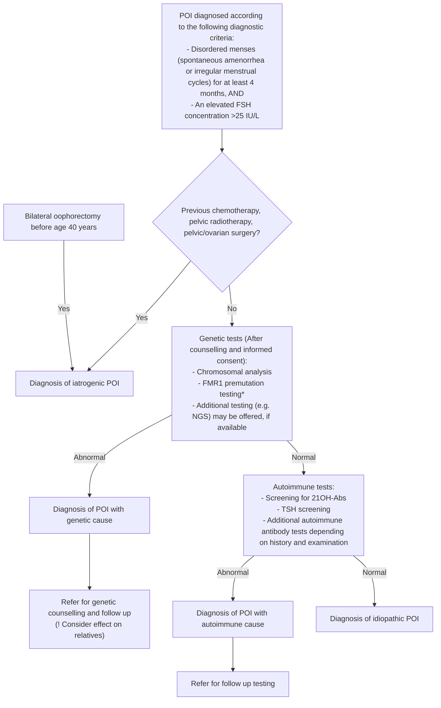
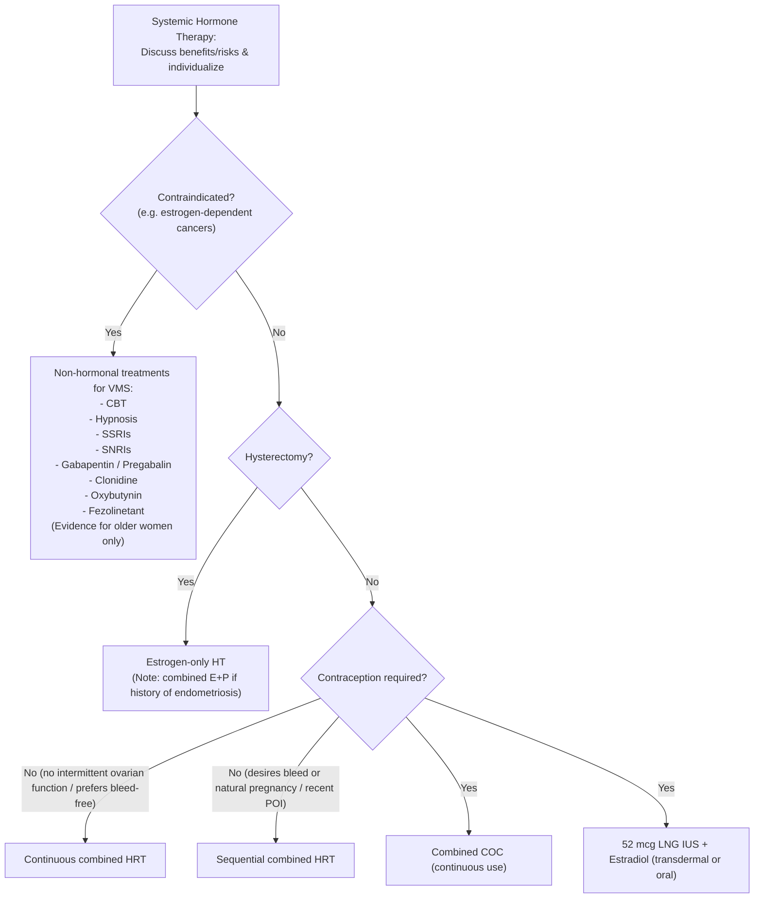

# ESHRE, ASRM, CREWHIRL and IMS Evidence-Based Guideline: Premature Ovarian Insufficiency

> **Layer 1 Source Reference:** [`1-s20-S0015028224023859 (1)_261026_194559.pdf`](../../sources/magid-course/1-s20-S0015028224023859%20%281%29_261026_194559.pdf)
> **Collection:** Magid Course — Clinical Guidelines & Literature | **Organization/Authors:** `ESHRE, ASRM, CREWHIRL and IMS Guideline Group on POI (Nick Panay, Amanda J. Vincent, et al.)` | **Date:** `Published online Dec 9, 2024; Fertil Steril Vol. 123, No. 2, Feb 2025`

> [!NOTE]
> **Citation & Co-Publication Note (`[Source: p. 1 (p. 221)]`):** Simultaneously co-published in *Fertility and Sterility* (2025;123(2):221–236; `https://doi.org/10.1016/j.fertnstert.2024.11.007`), *Climacteric*, and *Human Reproduction Open*. Approved by the Executive Committees/Boards of the American Society for Reproductive Medicine (ASRM), European Society of Human Reproduction and Embryology (ESHRE), Centre for Research Excellence in Women's Health in Reproductive Life (CRE-WHiRL), and International Menopause Society (IMS).
> **Authors:** Nick Panay, Richard A. Anderson, Amy Bennie, Marcelle Cedars, Melanie Davies, Carolyn Ee, Claus H. Gravholt, Sophia Kalantaridou, Amanda Kallen, Kimberly Q. Kim, Micheline Misrahi, Aya Mousa, Rossella E. Nappi, Walter A. Rocca, Xiangyan Ruan, Helena Teede, Nathalie Vermeulen, Elinor Vogt, and Amanda J. Vincent.

---

## Structured Abstract & Key Updates from 2015 Guideline

`[Source: pp. 1–2 (pp. 221–222)]`

- **Study Question:** How should premature/primary ovarian insufficiency (POI) be diagnosed and managed, based on the best available evidence from published literature?
- **Summary Answer:** The current guideline provides **145 recommendations** (92 evidence-based recommendations + 53 Good Practice Points/GDG statements) on symptoms, diagnosis, causation, sequelae and treatment of POI across **40 clinical questions**.
- **What Is Known Already:** Premature ovarian insufficiency (POI) presents a significant challenge to women's health, with far-reaching implications, both physically and emotionally. The potential implications include adverse effects on quality of life; fertility; and bone, cardiovascular and cognitive health. Although hormone therapy (HT) can mitigate some of these effects, many questions still remain regarding the optimal management of POI.
- **Study Design, Size, Duration:** Developed according to the structured ESHRE guideline methodology. Key questions were determined by experts and informed by a scoping survey of women and health care professionals (HCPs). Literature searches (PUBMED/MEDLINE) included English-language papers published up to **January 30th, 2024**. An integrity review (RIGID methodology) was conducted for 32 RCTs on POI.
- **Participants/Materials, Setting, Methods:** Recommendations were formulated by consensus within the guideline development group (GDG), including women with lived experience of POI, followed by public stakeholder review (17 April – 27 May 2024) and approval by ESHRE, ASRM, CRE-WHiRL, and IMS.
- **Main Results and Significant Updates Since 2015/2016:**
  - **Higher Prevalence:** New data indicate a higher prevalence of non-iatrogenic POI (**3.5%–3.7%**), up from ~1% in older studies (and 12.2% when combined with early menopause).
  - **Streamlined Diagnostic Criteria:** **Only one elevated FSH >25 IU/L** (with disordered menses ≥4 months) is now required for diagnosis of POI; repeat FSH after 4–6 weeks and/or AMH testing are reserved for cases of diagnostic uncertainty.
  - **New & Expanded Clinical Topics:** Role of anti-Müllerian hormone (AMH) in diagnosis/prediction, expanded genetic testing (next-generation sequencing where available), fertility preservation, muscle health/sarcopenia, specific considerations for HT in iatrogenic POI (gynaecological/breast cancers, RRSO, HSCT), updated estrogen doses/regimens (≥2 mg oral estradiol or ≥100 μg transdermal estradiol for bone optimisation), continuous/extended combined oral contraceptives (COCs), transdermal testosterone therapy for HSDD, puberty induction from age 11 with estradiol, non-hormonal and complementary treatments, and lifestyle management.
- **Limitations, Reasons for Caution:** Supporting evidence specific to POI remains limited for many management options, requiring extrapolation from usual-age menopause populations or clinical consensus.

---

## What Does This Mean for Patients?

`[Source: p. 3 (p. 223)]`

Informed by those with lived experience of premature ovarian insufficiency (often shortened to POI), in addition to current evidence, this guideline aims to facilitate prompt diagnosis of POI, conveyed in a sensitive manner, and shared decision making for personalised best practice management. This will assist in effectively addressing recognised patient dissatisfaction, care variation, non-adherence with therapy, and resultant poorer outcomes in women with POI.

---

## Introduction & Methodology

`[Source: pp. 3–4 (pp. 223–224)]`

POI is a clinical condition characterised by loss of ovarian function indicated by irregular menstrual cycles together with biochemical confirmation of ovarian insufficiency before the age of 40. POI is to be differentiated from the usual-age of menopause, as women with POI have unique needs and management options. They may not only suffer from symptoms associated with estrogen deficiency, but can also experience other issues, with a significant impact on their quality of life and later health outcomes. POI affects fertility, bone health, cardiovascular health, sexual function, psychological health, and neurological function, making it a challenge for patients and health care professionals (HCPs) (Webber et al., 2016).

This guideline is limited to POI and does not apply to women with low ovarian reserve. Reference to early menopause (age 40–44 years) is included where evidence is available but was not the focus of the key questions.

### Grading System & Recommendation Categories (Figure 1)

`[Source: pp. 3–4 (pp. 223–224)]`

Thefinal guideline was built from **40 key questions** (4 narrative reviews termed "Key Questions" and 36 systematic reviews framed as PICO questions; PUBMED/MEDLINE searched from inception to January 30, 2024; 32 POI RCTs screened using RIGID research integrity methodology).

**GRADE Evidence Quality Symbols:**
- `⊕⊕⊕⊕` — **High**
- `⊕⊕⊕◯` — **Moderate**
- `⊕⊕◯◯` — **Low**
- `⊕◯◯◯` — **Very low**

**Figure 1: Suggested Interpretation of Strong and Conditional Recommendations (`[Source: p. 4 (p. 224)]`):**

| Stakeholder / Category | **STRONG RECOMMENDATION** | **CONDITIONAL RECOMMENDATION** | **OTHER RECOMMENDATIONS** |
|---|---|---|---|
| **Patients** | Most people in your situation would want the recommended course of action and only a small proportion would not. | The majority of people in your situation would want the recommended course of action, but many would not. | **GOOD PRACTICE POINT (GPP):** Information of the advice of the guideline group regarding a certain recommendation (based on clinical expertise). |
| **Clinicians** | Most patients should receive the recommended course of action. | Different choices will be appropriate for different patients and clinicians must make greater effort in helping patients to arrive at a decision consistent with their values and preferences (shared decision-making). | **RESEARCH-ONLY RECOMMENDATION:** The test or intervention should only be considered within the setting of a research trial for which appropriate approvals and safety precautions have been established. |
| **Policy Makers** | The recommendation can be adopted as a policy in most situations. | Policy making will require substantial debate and involvement of many stakeholders. | **GDG STATEMENT:** Consensus factual/definitional statement by the Guideline Development Group. |

---

## Complete Guideline Recommendations (All 40 Questions & 145 Recommendations)

`[Source: pp. 4–12 (pp. 224–232)]`

> **Inclusive Language Note (`[Source: p. 4 (p. 224)]`):** The guideline group recognises that there are individuals living with POI who are transgender or who do not identify with the terms used in the literature. Throughout, the term "women with POI" is used, but this is not intended to isolate, exclude, or diminish any individual's experience nor to discriminate against any group.

---

### Section 1: Introduction to POI — Nomenclature, Definition, Prevalence & Risk Factors

`[Source: pp. 4–5 (pp. 224–225)]`

#### Key Question: What should this condition be called?
- **[Rec 1]** The guideline group recommends that the term "premature ovarian insufficiency" is used to describe this condition in research and clinical practice. — **`GPP`**

#### Key Question: How should POI be defined?
- **[Rec 2]** Premature ovarian insufficiency (POI) is a condition defined by loss of ovarian activity before the age of 40 years. POI is characterised by amenorrhea or irregular menstrual cycles with elevated gonadotropins and low estradiol. In this guideline, cessation of ovarian function in women aged from 40 and less than 45 (age 40–44 years) will be termed early menopause. Early menopause is outside the scope of the current guideline, but the evidence and recommendations may be relevant to women with early menopause. — **`GDG STATEMENT`**

#### Key Question: What is the prevalence of POI in the general population?
- **[Rec 3]** The reported prevalence of non-iatrogenic POI varies from approximately 1% in older studies to 3.5% in recent publications. Population characteristics such as ethnicity may affect the prevalence of non-iatrogenic POI. — **`GDG STATEMENT`**

#### PICO Question: What are the risk factors for POI?
- **[Rec 4]** The guideline group recommends that in view of the long-term health consequences of POI, efforts should be made to reduce the risk of POI. Modifiable factors may include:
  - gynaecological surgical practice
  - lifestyle factors such as smoking
  - treatment regimens for malignant and chronic diseases. — **`GPP`**
- **[Rec 5]** The guideline group recommends that women with risk factors for POI are identified and counselled regarding POI risk and fertility preservation. — **`GPP`**

---

### Section 2: Diagnosis of POI & Investigation of Etiology (Figure 2)

`[Source: pp. 5–7 (pp. 225–227)]`

#### Figure 2: Diagnostic and Etiologic Algorithm for Premature Ovarian Insufficiency

`[Source: p. 5 (p. 225)]`

> **Figure 2 Footnote (`[Source: p. 5 (p. 225)]`):** `*Fragile X premutation testing is indicated in all women diagnosed with POI. This needs to be performed as a specific test as multigene panels and NGS are not useful in detecting FMR1 premutation.` *Abbreviations:* 21OH-Abs, 21-hydroxylase autoantibodies; BSO, bilateral salpingo-oophorectomy; FSH, follicle stimulating hormone; NGS, next generation sequencing; TSH, thyroid stimulating hormone.

#### PICO Question: What are the symptoms of POI?
`[Source: p. 6 (p. 226)]`
- **[Rec 6]** The guideline group recommends that health care professionals (HCPs) enquire about symptoms of estrogen deficiency in women presenting with irregular menstrual cycles or amenorrhea. — **`GPP`**
- **[Rec 7]** The guideline group recommends HCPs consider and exclude the diagnosis of POI in women aged less than 40 years who have amenorrhea/irregular menstrual cycles or estrogen-deficiency symptoms. — **`GPP`**

#### PICO Question: What investigations should be performed for diagnosis of POI?
`[Source: p. 6 (p. 226)]`
- **[Rec 8]** HCPs should diagnose POI based on the presence of spontaneous amenorrhea or irregular menstrual cycles and biochemical confirmation. — **`STRONG | ⊕⊕◯◯ (Low)`**
- **[Rec 9]** The guideline group recommends the following diagnostic criteria: disordered menstrual cycles (spontaneous amenorrhea or irregular menstrual cycles) for at least 4 months, and an elevated follicle stimulating hormone (FSH) concentration >25 IU/L. FSH assessment should be repeated after 4–6 weeks if there is diagnostic uncertainty. FSH testing for the diagnosis of POI does not have to be timed to a specific day of the menstrual cycle. — **`GPP`**
- **[Rec 10]** The guideline group recommends that HCPs consider these points when diagnosing POI:
  - Pregnancy should be excluded in women presenting with amenorrhea.
  - Use of hormonal therapy (including oral, injectable, or long-acting contraceptives) may conceal or cause amenorrhoea or irregular menstrual cycles, and potentially lower FSH concentrations. Some hormonal therapy (e.g., combined oral contraceptive) may need to be ceased before a diagnosis of POI can be confirmed.
  - Women who had bilateral salpingo-oophorectomy (BSO) before age 40 have a diagnosis of POI and additional diagnostic testing is unnecessary. — **`GPP`**
- **[Rec 11]** The guideline group does not recommend diagnosing POI based on serum estradiol concentrations. However, a low estradiol concentration indicates hypoestrogenism, and in combination with an elevated FSH concentration, provides additional confirmation of the POI diagnosis. — **`GPP`**

#### PICO Question: What is the role of AMH to predict/diagnose POI?
`[Source: p. 6 (p. 226)]`
- **[Rec 12]** Anti-Müllerian hormone (AMH) should not be used as the primary diagnostic test for POI. — **`STRONG | ⊕◯◯◯ (Very low)`**
- **[Rec 13]** The guideline group recommends that AMH testing may be useful to confirm POI diagnosis where FSH results are inconclusive, but AMH results need to be interpreted within the clinical context. — **`GPP`**
- **[Rec 14]** The guideline group recommends that HCPs do not routinely perform AMH testing to predict POI due to insufficient evidence of accuracy. — **`GPP`**

#### PICO Question: What are the known causes of non-iatrogenic POI and how should they be investigated?
`[Source: p. 6 (p. 226)]`
- **[Rec 15]** The guideline group recommends that HCPs inform women with POI of the different causes of POI, the limitations of current knowledge and testing for causes of POI, and that an exact cause may not be identified. — **`GPP`**
- **[Rec 16]** The guideline group recommends that HCPs discuss the risk of POI as part of the consent process before a medical or surgical intervention that may cause POI. — **`GPP`**
- **[Rec 17]** The guideline group recommends that HCPs discuss the implications of genetic testing before the test is performed. Referral for comprehensive genetic counselling should be considered. — **`GPP`**
- **[Rec 18]** Chromosomal analysis testing is recommended for all women with non-iatrogenic POI. — **`STRONG | ⊕⊕◯◯ (Low)`**
- **[Rec 19]** *FMR1* premutation (Fragile X syndrome gene) testing is recommended for all women with non-iatrogenic POI. — **`STRONG | ⊕⊕◯◯ (Low)`**
- **[Rec 20]** Where available and after comprehensive genetic counselling, additional genetic testing (e.g., next generation sequencing) can be offered to all women with non-iatrogenic POI to identify other potential genes that may cause POI. — **`CONDITIONAL | ⊕⊕◯◯ (Low)`**
- **[Rec 21]** The guideline group recommends that the age of a woman with POI should not be used to restrict access to genetic testing. — **`GPP`**
- **[Rec 22]** Screening for 21-hydroxylase autoantibodies (21OH-Abs) should be performed in women with POI of unknown cause. — **`STRONG | ⊕⊕◯◯ (Low)`**
- **[Rec 23]** Screening for anti-ovarian autoantibodies should not be used to diagnose autoimmune POI. — **`STRONG | ⊕◯◯◯ (Very low)`**
- **[Rec 24]** Thyroid function should be assessed by measuring thyroid stimulating hormone (TSH) at POI diagnosis. TSH measurement should be repeated every 5 years or when symptoms arise. — **`STRONG | ⊕◯◯◯ (Very low)`**
- **[Rec 25]** The guideline group recommends that HCPs do not routinely perform thyroid peroxidase (TPO) antibody screening as part of testing for autoimmune causes of POI due to the high prevalence of positive TPO antibodies in the general community. — **`GPP`**

#### PICO Question: How often should tests for autoantibodies be repeated?
`[Source: p. 7 (p. 227)]`
- **[Rec 26]** Women with POI and positive 21OH-Abs should be referred to an endocrinologist for testing of adrenal function. — **`STRONG | ⊕◯◯◯ (Very low)`**
- **[Rec 27]** If 21OH-Abs are negative in women with POI, there is no indication for re-testing later in life, unless signs or symptoms of adrenal insufficiency develop. — **`STRONG | ⊕◯◯◯ (Very low)`**
- **[Rec 28]** Women with POI with abnormal TSH levels should be evaluated and treated for thyroid hormone disorders. — **`STRONG | ⊕◯◯◯ (Very low)`**

#### Care for Women with POI at Diagnosis & Implications for Relatives
`[Source: p. 7 (p. 227)]`
- **[Rec 29]** The guideline group recommends that HCPs convey the diagnosis of POI in a compassionate and sensitive manner, provide personalised evidence-based information about the condition, and ensure time for the women to ask questions. — **`GPP`**
- **[Rec 30]** The guideline group recommends shared decision making and support for continuity of care in managing POI. — **`GPP`**
- **[Rec 31]** The guideline group recommends referral of women with POI to appropriate support groups and mental health care. — **`GPP`**

#### Key Question: What are the possible implications for relatives of women with POI?
`[Source: p. 7 (p. 227)]`
- **[Rec 32]** The guideline group recommends that relatives of women with the *FMR1* premutation or other identified genetic causes of POI should be offered genetic counselling and testing. — **`GPP`**
- **[Rec 33]** Female relatives (such as sisters or daughters) of women with non-iatrogenic POI should be counselled that they are at increased risk of developing POI themselves. — **`STRONG | ⊕⊕◯◯ (Low)`**
- **[Rec 34]** The guideline group recommends that female relatives (such as sisters or daughters) of women with non-iatrogenic POI are offered support regarding their increased risk of POI, and ovarian reserve testing may be helpful. — **`GPP`**
- **[Rec 35]** The guideline group recommends that female relatives (such as sisters or daughters) of women with non-iatrogenic POI should be informed of the signs and symptoms of POI and should promptly seek medical advice if this occurs. — **`GPP`**
- **[Rec 36]** The guideline group recommends that female relatives (such as sisters or daughters) of women with non-iatrogenic POI should be informed that there are no established methods for predicting or preventing POI. Some relatives may wish to consider family planning and fertility preservation options. — **`GPP`**

---

### Section 3: Sequelae of POI — Life Expectancy, Fertility, Pregnancy, Bone, Muscle, Cardiovascular, Psychological, Sexual & Neurological Health

`[Source: pp. 7–10 (pp. 227–230)]`

#### PICO Question: What are the consequences of POI for life expectancy?
`[Source: p. 7 (p. 227)]`
- **[Rec 37]** Women with POI should be informed that POI without HT is associated with reduced life expectancy, largely due to cardiovascular disease. — **`STRONG | ⊕⊕◯◯ (Low)`**
- **[Rec 38]** HT is recommended for women with POI until the usual age of menopause for primary prevention to reduce the risk of morbidity and mortality, whether there are estrogen deficiency symptoms or not. — **`STRONG | ⊕◯◯◯ (Very low)`**
- **[Rec 39]** The guideline group recommends that women with POI should be encouraged to adopt a healthy lifestyle (including avoiding smoking, having a healthy diet and regular physical activity, and maintaining a healthy weight range) to reduce cardiovascular risk. — **`GPP`**

#### PICO Question: What are the consequences of POI for fertility?
`[Source: p. 7 (p. 227)]`
- **[Rec 40]** Women with POI should be informed that POI substantially reduces the chances of natural conception. — **`STRONG | ⊕◯◯◯ (Very low)`**
- **[Rec 41]** Women with non-surgical POI should be informed that ovarian activity may occur. This is associated with a chance of natural conception. — **`STRONG | ⊕◯◯◯ (Very low)`**
- **[Rec 42]** Women with non-surgical POI should be advised to use contraception if they wish to avoid pregnancy. — **`STRONG | ⊕◯◯◯ (Very low)`**

#### PICO Question: What fertility interventions are effective?
`[Source: p. 7 (p. 227)]`
- **[Rec 43]** Women with POI should be informed that there are no interventions that have been reliably shown to increase ovarian activity and natural conception rates. — **`STRONG | ⊕⊕⊕◯ (Moderate)`**
- **[Rec 44]** Women with POI should be informed that oocyte donation is an established option to achieve pregnancy after a diagnosis of POI. — **`STRONG | ⊕⊕◯◯ (Low)`**
- **[Rec 45]** Women with non-iatrogenic POI and considering assisted reproduction using oocytes donated by their sister should be informed that this includes shared genetic risk and carries a higher risk of ovarian stimulation cycle cancellation. — **`STRONG | ⊕⊕◯◯ (Low)`**

#### PICO Question: What therapies are effective for fertility preservation and/or prevention of POI?
`[Source: p. 7 (p. 227)]`
- **[Rec 46]** For iatrogenic causes of POI, fertility preservation can be considered prior to treatment. — **`CONDITIONAL | ⊕⊕◯◯ (Low)`**
- **[Rec 47]** The guideline group recommends that fertility preservation is discussed with women at risk of POI. In most women with POI, there is no opportunity for fertility preservation as the follicle pool is depleted. — **`GPP`**

#### PICO Question: What are the obstetric risks associated with POI?
`[Source: p. 8 (p. 228)]`
- **[Rec 48]** Women should be reassured that natural pregnancies after idiopathic POI or most forms of chemotherapy do not show any higher obstetric or neonatal risk than in the general population. — **`STRONG | ⊕⊕◯◯ (Low)`**
- **[Rec 49]** Oocyte donation pregnancies are high risk and should be managed in an appropriate obstetric unit. Women and their partners should be encouraged to disclose the origin of their pregnancy to their obstetric team. — **`STRONG | ⊕⊕◯◯ (Low)`**
- **[Rec 50]** Pregnancies occurring after radiation to the uterus are at high risk of obstetric complications and should be managed in an appropriate obstetric unit. — **`STRONG | ⊕⊕◯◯ (Low)`**
- **[Rec 51]** Pregnancies in women with Turner Syndrome are at high risk of obstetric and non-obstetric complications and should be managed in an appropriate obstetric unit with cardiologist involvement. — **`STRONG | ⊕⊕◯◯ (Low)`**

#### PICO Question: How should fitness for pregnancy be assessed in women with POI?
`[Source: p. 8 (p. 228)]`
- **[Rec 52]** Women presenting for oocyte donation who are suspected of having POI should be investigated for the aetiology of POI prior to oocyte donation. — **`STRONG | ⊕⊕◯◯ (Low)`**
- **[Rec 53]** A cardiologist should be involved in care of women considering pregnancy who have received anthracyclines and/or cardiac irradiation. — **`STRONG | ⊕◯◯◯ (Very low)`**
- **[Rec 54]** Comprehensive cardiac screening and appropriate counselling by both a maternal-fetal medicine specialist and cardiologist with expertise in managing women with Turner Syndrome is recommended prior to planning a pregnancy, especially if oocyte or embryo donation is considered. — **`STRONG | ⊕⊕◯◯ (Low)`**
- **[Rec 55]** In addition to usual antenatal screening, women with POI should have their cardiometabolic and thyroid function assessed prior to pregnancy. — **`STRONG | ⊕◯◯◯ (Very low)`**
- **[Rec 56]** Pregnancy in some women can be of such high risk that HCPs may consider oocyte donation pregnancy to be life threatening and therefore inappropriate. — **`STRONG | ⊕◯◯◯ (Very low)`**

#### PICO Question: What are the consequences of POI for skeletal health?
`[Source: p. 8 (p. 228)]`
- **[Rec 57]** Women with POI and HCPs should be aware that POI is associated with abnormal bone microarchitecture and reduced bone mineral density. — **`STRONG | ⊕⊕◯◯ (Low)`**
- **[Rec 58]** It is suggested that HCPs inform women that POI may be associated with an increased risk of osteoporosis and fracture later in life. — **`CONDITIONAL | ⊕◯◯◯ (Very low)`**

#### PICO Question: What are the treatment options for bone protection and improvement?
`[Source: p. 8 (p. 228)]`
- **[Rec 59]** Osteoporosis risk factors should be identified and addressed at POI diagnosis and during ongoing care. — **`STRONG | ⊕◯◯◯ (Very low)`**
- **[Rec 60]** The guideline group recommends that women with POI should be encouraged to adopt a healthy lifestyle (including weight-bearing exercise, healthy diet, avoiding smoking, and maintaining normal body weight) to optimise bone health. — **`GPP`**
- **[Rec 61]** Dietary supplementation of calcium and vitamin D may be required in women with inadequate vitamin D status and/or calcium intake and may be of benefit in women with low bone mineral density. — **`CONDITIONAL | ⊕⊕◯◯ (Low)`**
- **[Rec 62]** HT is recommended to maintain bone density and prevent osteoporosis. — **`STRONG | ⊕⊕◯◯ (Low)`**
- **[Rec 63]** A daily dose of hormone replacement therapy (HRT) containing no less than 2 mg oral estradiol or 100 μg transdermal estradiol, or equivalent, is suggested to optimise bone mineral density. — **`CONDITIONAL | ⊕◯◯◯ (Very low)`**
- **[Rec 64]** Delayed initiation and non-adherence of hormone therapy should be avoided. — **`STRONG | ⊕◯◯◯ (Very low)`**
- **[Rec 65]** If the combined oral contraceptive is used, then a continuous or extended regimen is recommended to provide continuous estrogen therapy and avoid bone loss. — **`STRONG | ⊕⊕◯◯ (Low)`**
- **[Rec 66]** Other pharmacological treatments, including bisphosphonates, should only be considered with advice from an osteoporosis specialist. Particular caution applies to women desiring pregnancy. — **`STRONG | ⊕⊕◯◯ (Low)`**

#### PICO Question: How should skeletal health be monitored in women with POI?
`[Source: p. 8 (p. 228)]`
- **[Rec 67]** Where available, measurement of bone mineral density using dual x-ray absorptiometry (DXA) at diagnosis of POI is recommended for all women. — **`STRONG | ⊕⊕◯◯ (Low)`**
- **[Rec 68]** If bone mineral density is normal and adequate systemic HT is commenced and adhered to, the value of a repeated DXA scan within 5 years is low. — **`STRONG | ⊕◯◯◯ (Very low)`**
- **[Rec 69]** Bone mineral density using DXA should be reassessed every one to three years, based on individual risk factors, in women with POI who have osteoporosis or low bone density. — **`STRONG | ⊕◯◯◯ (Very low)`**
- **[Rec 70]** The guideline group recommends that a decrease in bone mineral density should prompt review of HT and potential factors contributing to bone loss. Referral to a specialist may be required. — **`GPP`**

#### PICO Question: What are the consequences of POI for muscle health?
`[Source: p. 9 (p. 229)]`
- **[Rec 71]** It is suggested that HCPs inform women that POI may be associated with reduced muscle mass, strength and performance which may increase the risk of sarcopenia. — **`CONDITIONAL | ⊕⊕◯◯ (Low)`**

#### PICO Question: What are the treatment options for muscle protection and improvement?
`[Source: p. 9 (p. 229)]`
- **[Rec 72]** The guideline group recommends that women with POI should be encouraged to adopt a healthy lifestyle (including healthy diet, physical activity, avoiding smoking, and maintaining normal body weight) to aid muscle health. — **`GPP`**
- **[Rec 73]** HCPs may consider prescribing resistance exercise for women with POI and impaired muscle parameters as resistance exercise increases muscle mass, strength and performance in other populations, although specific evidence in women with POI is lacking. — **`CONDITIONAL | ⊕◯◯◯ (Very low)`**
- **[Rec 74]** It is suggested that HCPs inform women with POI that HRT prescribed for other indications may also benefit muscle health. — **`CONDITIONAL | ⊕◯◯◯ (Very low)`**
- **[Rec 75]** The effect of other interventions, including testosterone therapy, on muscle health in women with POI is uncertain and therefore they should not be offered. — **`STRONG | ⊕◯◯◯ (Very low)`**

#### PICO Question: How should muscle health be monitored in women with POI?
`[Source: p. 9 (p. 229)]`
- **[Rec 76]** The guideline group recommends that HCPs consider screening for sarcopenia at POI diagnosis. — **`GPP`**

#### PICO Question: What are the consequences of POI for the cardiovascular system?
`[Source: p. 9 (p. 229)]`
- **[Rec 77]** Women with POI should be advised that they are at increased risk of cardiovascular disease, including coronary artery disease, heart failure and stroke. — **`STRONG | ⊕⊕◯◯ (Low)`**
- **[Rec 78]** All women diagnosed with Turner Syndrome should be evaluated by a cardiologist with expertise in congenital heart disease, especially prior to and during pregnancy. — **`STRONG | ⊕⊕◯◯ (Low)`**

#### PICO Question: Is estrogen therapy cardio-protective?
`[Source: p. 9 (p. 229)]`
- **[Rec 79]** HCPs and women should be aware that estrogen therapy has beneficial cardiometabolic effects which can influence cardiovascular disease risk. Non-use of HT is associated with an increased risk of cardiovascular events and mortality and HT is therefore recommended until the usual age of menopause. — **`STRONG | ⊕⊕◯◯ (Low)`**

#### PICO Question: Should cardiovascular risk factors be monitored?
`[Source: p. 9 (p. 229)]`
- **[Rec 80]** The guideline group recommends that cardiovascular risk should be assessed in women diagnosed with POI. — **`GPP`**
- **[Rec 81]** The guideline group recommends that women with POI should be informed of cardiovascular risk factors that they can modify through lifestyle behavioural change (including avoiding smoking, heart healthy diet, regular physical activity, and maintenance of normal body weight). — **`GPP`**
- **[Rec 82]** The guideline group recommends that all women with POI should have (at least) annual monitoring of blood pressure, weight and smoking status. — **`GPP`**
- **[Rec 83]** The guideline group recommends that all women with POI should have a lipid profile and diabetes screening at diagnosis. Thereafter, frequency of measurement should be based on the presence of hyperlipidaemia, hyperglycaemia and additional risk factors or global cardiovascular risk. — **`GPP`**

#### PICO Question: What are the consequences of POI on psychological wellbeing and quality of life?
`[Source: p. 9 (p. 229)]`
- **[Rec 84]** HCPs should be aware that a diagnosis of POI can have a significant impact on psychological wellbeing and quality of life. — **`STRONG | ⊕◯◯◯ (Very low)`**
- **[Rec 85]** The guideline group recommends offering assessment of psychological health and quality of life to all women with POI. — **`GPP`**

#### PICO Question: What are the management options for reduced quality of life associated with POI?
`[Source: p. 9 (p. 229)]`
- **[Rec 86]** Personalised care, including psychological support, should be accessible to women with POI. — **`STRONG | ⊕◯◯◯ (Very low)`**

#### PICO Question: What are the consequences of POI for sexuality?
`[Source: p. 10 (p. 230)]`
- **[Rec 87]** HCPs should advise women that a diagnosis of POI can have a significant impact on sexual wellbeing and function. — **`STRONG | ⊕⊕◯◯ (Low)`**
- **[Rec 88]** The guideline group recommends that HCPs routinely and sensitively ask permission of women with POI to discuss sexual wellbeing and function. — **`GPP`**

#### PICO Question: What are the management options for the effects of POI on sexuality?
`[Source: p. 10 (p. 230)]`
- **[Rec 89]** The guideline group recommends personalised management using the biopsychosocial model for the impact of POI on sexuality. — **`GPP`**
- **[Rec 90]** Where available, transdermal testosterone therapy, in doses that approximate physiological premenopausal testosterone concentrations, can be considered, as it may improve hypoactive sexual desire disorder and sexual function. — **`CONDITIONAL | ⊕⊕◯◯ (Low)`**
- **[Rec 91]** HCPs should be aware that HT prescribed to women with POI for other indications may improve sexual function, although the effect is generally small. — **`STRONG | ⊕◯◯◯ (Very low)`**

#### PICO Question: What treatments are available for genitourinary symptoms in POI?
`[Source: p. 10 (p. 230)]`
- **[Rec 92]** HCPs should offer vaginal estrogen therapy to improve genitourinary and sexual symptoms. — **`STRONG | ⊕◯◯◯ (Very low)`**
- **[Rec 93]** Women with POI may be offered vaginal estrogen therapy if genitourinary symptoms are not fully relieved by using systemic HT. — **`CONDITIONAL | ⊕◯◯◯ (Very low)`**
- **[Rec 94]** Vaginal lubricants and moisturizers can be used for treatment of vaginal discomfort and dyspareunia in women with POI and can be combined with other treatments. — **`CONDITIONAL | ⊕◯◯◯ (Very low)`**
- **[Rec 95]** The guideline group currently does not recommend laser or thermal energy as standard care for genitourinary symptoms due to inconclusive evidence of benefit from RCTs. — **`GPP`**

#### PICO Question: What are the consequences of POI on cognition/neurological function?
`[Source: p. 10 (p. 230)]`
- **[Rec 96]** HCPs and women should be aware that POI is associated with an increased risk of cognitive impairment and dementia. — **`STRONG | ⊕◯◯◯ (Very low)`**
- **[Rec 97]** The possible detrimental effect on cognition and increased risk of dementia, parkinsonism, and other neurologic diseases should be discussed when planning bilateral oophorectomy under the age of 45 years, especially for women at an average risk of ovarian cancer. — **`STRONG | ⊕◯◯◯ (Very low)`**

#### PICO Question: What are the management options for the effect of POI on cognition/neurological function?
`[Source: p. 10 (p. 230)]`
- **[Rec 98]** HT is recommended in women with POI until the usual age of menopause to reduce the possible risk of cognitive impairment and dementia. — **`STRONG | ⊕⊕◯◯ (Low)`**
- **[Rec 99]** HT may be recommended in women with POI to protect neurological function even in the absence of menopausal symptoms. — **`CONDITIONAL | ⊕⊕◯◯ (Low)`**
- **[Rec 100]** The guideline group recommends that women with POI should be encouraged to adopt a healthy lifestyle (including physical activity, healthy diet, avoiding smoking, and maintaining normal body weight) to reduce the risk of cognitive impairment and dementia. — **`GPP`**

---

### Section 4: POI Treatment — Hormone Therapy (HT), Testosterone, Non-Hormonal, Complementary, Lifestyle & Puberty Induction (Figure 3)

`[Source: pp. 10–13 (pp. 230–233)]`

#### Hormone Therapy (HT) in POI: Principles and Indications
`[Source: p. 10 (p. 230)]`
- **[Rec 101 *(repeats Rec 38)*]** HT is recommended for women with POI until the usual age of menopause for primary prevention to reduce the risk of morbidity and mortality, whether there are estrogen deficiency symptoms or not. — **`STRONG | ⊕◯◯◯ (Very low)`**
- **[Rec 102]** Women with POI should be advised that HT is recommended for the treatment of symptoms due to low estrogen concentrations. — **`STRONG | ⊕⊕◯◯ (Low)`**
- **[Rec 103]** The guideline group recommends that when women with POI reach the age at which usual menopause occurs, HCPs consider the need for continued HT based on a personalised risk-benefit assessment and current evidence. — **`GPP`**
- **[Rec 104]** The guideline group recommends that HCPs advise women with POI that hormone replacement therapy (HRT) does not provide contraception, in order to assist them with their family planning. — **`GPP`**
- **[Rec 105]** In women with POI with evidence of intermittent ovarian function and desiring natural pregnancy, recommendations for HRT remain unchanged, and do not impact chances of natural conception. A sequential HRT regimen is recommended. — **`GPP`**

#### PICO Question: What are the risks of HT?
`[Source: pp. 10–11 (pp. 230–231)]`
- **[Rec 106]** Women with POI can be informed that there is no evidence that HT use increases their risk of breast cancer compared to women of the same age without POI. — **`CONDITIONAL | ⊕◯◯◯ (Very low)`**
- **[Rec 107]** HT is generally not recommended in women with a history of breast cancer. — **`STRONG | ⊕⊕⊕◯ (Moderate)`**
- **[Rec 108]** Women with *BRCA1/2* mutations without a personal history of breast cancer should be advised that HT is an option after risk-reducing bilateral salpingo-oophorectomy. — **`STRONG | ⊕⊕◯◯ (Low)`**
- **[Rec 109]** A progestogen should be given in combination with estrogen therapy to all women with an intact uterus to prevent endometrial hyperplasia/cancer. — **`STRONG | ⊕⊕◯◯ (Low)`**
- **[Rec 110]** The guideline group recommends that the dose of progestogen is increased when higher doses of estrogen therapy are used. — **`GPP`**
- **[Rec 111]** The guideline group recommends that in women with POI, as with any women using HT, unscheduled bleeding requires assessment. — **`GPP`**
- **[Rec 112]** The guideline group recommends that women with POI and a history of endometriosis should be treated with combined estrogen-progestogen HT, even after hysterectomy, to avoid recurrence of endometriosis or malignant transformation. — **`GPP`**
- **[Rec 113]** Migraine should not be considered a contraindication to HRT use by women with POI. — **`STRONG | ⊕⊕◯◯ (Low)`**
- **[Rec 114]** HCPs should consider changing dose, route of administration, or regimen if migraine worsens during HRT. — **`STRONG | ⊕⊕◯◯ (Low)`**
- **[Rec 115]** Women with POI and migraine with aura should be advised to use transdermal estrogen as this may be the lowest-risk route of administration. — **`STRONG | ⊕◯◯◯ (Very low)`**

#### PICO Question: What are the options for HT?
`[Source: p. 11 (p. 231)]`
- **[Rec 116]** The guideline group recommends shared decision making when prescribing each component of HT with consideration of patient preference, contraceptive needs, and presence of co-morbidities. — **`GPP`**
- **[Rec 117]** Different estrogens/progestogens have variable metabolic and other effects which should be taken into consideration when personalising care in POI. — **`STRONG | ⊕⊕◯◯ (Low)`**
- **[Rec 118]** The guideline group recommends that HCPs and women should be aware that compounded "bio-identical" preparations of estrogen and progesterone are not recommended due to lack of data regarding efficacy and safety. — **`GPP`**
- **[Rec 119]** Women with POI should be advised that adherence to HT is important to minimise long term health risks and therefore long term follow up is needed. — **`STRONG | ⊕⊕◯◯ (Low)`**

#### Monitoring HT
`[Source: p. 11 (p. 231)]`
- **[Rec 120]** The guideline group recommends that women with POI should have a regular clinical review, addressing individualised risk factors and adherence to therapy. — **`GPP`**

#### PICO Question: What is the role of testosterone therapy in POI?
`[Source: p. 11 (p. 231)]`
- **[Rec 121]** Testosterone treatment should be considered in women with iatrogenic POI to manage hypoactive sexual desire disorder when other biopsychosocial aetiologies are excluded. — **`STRONG | ⊕⊕◯◯ (Low)`**
- **[Rec 122]** Testosterone treatment could be considered in women with non-iatrogenic POI to manage hypoactive sexual desire disorder when other biopsychosocial aetiologies are excluded. — **`CONDITIONAL | ⊕⊕◯◯ (Low)`**
- **[Rec 123]** HCPs should be aware that although short term treatment with transdermal testosterone at doses approximating physiological premenopausal levels is safe, longer term safety data are lacking. — **`STRONG | ⊕⊕◯◯ (Low)`**
- **[Rec 124]** The guideline group recommends that women with POI are informed that there are limited data for androgen treatment for indications other than hypoactive sexual desire disorder, and that long-term health effects are unknown. — **`GPP`**

#### PICO Question: What are the specific considerations for HT in iatrogenic POI?
`[Source: pp. 11–12 (pp. 231–232)]`
- **[Rec 125]** The guideline group recommends a personalised approach to risks and benefits of HT in women with iatrogenic POI after gynaecological/breast cancer. — **`GPP`**
- **[Rec 126]** HT does not increase the risk of recurrence of squamous cell carcinoma of the cervix and is recommended for women with iatrogenic POI due to treatment of squamous cell carcinoma. — **`STRONG | ⊕⊕⊕◯ (Moderate)`**
- **[Rec 127]** HT may be associated with a slightly increased risk of recurrence of cervical adenocarcinoma and a personalised approach considering individualised HT risk and benefits is recommended. — **`STRONG | ⊕⊕◯◯ (Low)`**
- **[Rec 128]** HCPs could consider HT in women with iatrogenic POI due to early-stage low-risk endometrial adenocarcinoma, as there is no evidence that it increases the risk of cancer recurrence. — **`CONDITIONAL | ⊕⊕◯◯ (Low)`**
- **[Rec 129]** HCPs could consider HT in women with iatrogenic POI due to epithelial ovarian cancer. — **`CONDITIONAL | ⊕⊕⊕◯ (Moderate)`**
- **[Rec 130]** The effect of HT on the risk of recurrence of non-epithelial ovarian cancer is uncertain and it is suggested that HCPs use a personalised approach to prescribing HT including consideration of tumour hormone receptor status. — **`CONDITIONAL | ⊕◯◯◯ (Very low)`**
- **[Rec 131]** HT should be avoided in women with hormone dependent ovarian or uterine tumours including uterine sarcoma, endometrioid carcinoma, ovarian clear cell carcinoma, ovarian granulosa cell tumour or sex cord-stromal tumours. — **`STRONG | ⊕⊕⊕◯ (Moderate)`**
- **[Rec 132]** Women should be informed of the risks of iatrogenic POI and risks and benefits of HT before bilateral salpingo-oophorectomy to reduce cancer risk (RRSO). — **`STRONG | ⊕◯◯◯ (Very low)`**
- **[Rec 133]** It is recommended that personalised HT or pubertal induction be commenced in girls/women with POI following hematopoietic stem cell transplantation or other gonadotoxic therapies. — **`STRONG | ⊕⊕◯◯ (Low)`**

#### PICO Question: What non-hormonal therapies are available for POI?
`[Source: p. 12 (p. 232)]`
- **[Rec 134]** HCPs could consider non-hormonal pharmacologic and non-pharmacologic therapies for women with POI that are effective in peri-/postmenopausal women, although evidence specific to POI is lacking. — **`CONDITIONAL | ⊕◯◯◯ (Very low)`**

#### PICO Question: What complementary treatments are effective for managing the sequelae of POI?
`[Source: p. 12 (p. 232)]`
- **[Rec 135]** The guideline group recommends that HCPs should enquire about use of complementary therapies and incorporate individual patient values and preferences into shared decision making about their use. — **`GPP`**
- **[Rec 136]** Complementary therapies should not be used to replace HT as there is insufficient evidence on their effectiveness for prevention of long-term sequalae of POI. — **`STRONG | ⊕◯◯◯ (Very low)`**
- **[Rec 137]** Women who are considering the use of Chinese herbal medicine for the management of menopausal symptoms and metabolic risk should be informed that the evidence for benefit is limited but the intervention does not appear to cause significant harm in the short term. — **`STRONG | ⊕◯◯◯ (Very low)`**
- **[Rec 138]** Women should be informed that there is limited evidence on the effectiveness of acupuncture for menopausal symptoms in POI and the evidence does not suggest a benefit from adding acupuncture to HT. — **`STRONG | ⊕◯◯◯ (Very low)`**
- **[Rec 139]** Women who are considering using other nutrient supplements and herbal medicines should be informed that there is insufficient evidence to support their use. — **`STRONG | ⊕◯◯◯ (Very low)`**

#### PICO Question: What are the lifestyle management options for POI?
`[Source: p. 12 (p. 232)]`
- **[Rec 140]** Women should be aware that a healthy lifestyle, including physical activity, has metabolic and heart benefits in the general population including postmenopausal women, although specific evidence on lifestyle interventions in POI is limited. — **`STRONG | ⊕⊕◯◯ (Low)`**
- **[Rec 141]** The guideline group recommends women with POI should be encouraged to adopt a healthy lifestyle to improve their overall well-being and mitigate the risk of potential complications. — **`GPP`**

#### PICO Question: How should puberty be induced?
`[Source: p. 12 (p. 232)]`
- **[Rec 142]** Puberty should be induced or progressed with estradiol, starting with low dose at the age of 11 years with a gradual increase over 2–3 years. — **`STRONG | ⊕⊕◯◯ (Low)`**
- **[Rec 143]** In cases of late diagnosis and for those girls in whom growth is not a concern, HCPs can consider a modified regimen of estradiol therapy. — **`CONDITIONAL | ⊕◯◯◯ (Very low)`**
- **[Rec 144]** Evidence for the optimum mode of administration (oral or transdermal) is inconclusive. HCPs may prefer transdermal estradiol as it results in more physiological estrogen concentrations. — **`CONDITIONAL | ⊕◯◯◯ (Very low)`**
- **[Rec 145]** A combined oral contraceptive should not be used for puberty induction. — **`STRONG | ⊕◯◯◯ (Very low)`**
- **[Rec 146]** The guideline group recommends starting cyclical progestogens after about 2 years of estrogen therapy or when breakthrough bleeding occurs. — **`GPP`**

---

### Figure 3: Management Algorithm for Premature Ovarian Insufficiency (POI)

`[Source: p. 13 (p. 233)]`

#### Step 1: Evaluation for Treatment and Complication Screening at Diagnosis
- **History and Examination Checklist:**
  - Cause of POI
  - Symptoms
  - Sexual function
  - Osteoporosis risk factors
  - CVD risk factors
  - Psychological risk factors
  - Fertility
  - Pre-existing medical condition (`*` In women with pre-existing medical conditions, some HT options may be contraindicated or not recommended; see recommendations linked to pre-existing medical conditions/cancer)
  - BP / weight / height
- **Investigations Checklist:**
  - **General:** Renal function, Liver function
  - **Bone:** Bone Density (DXA), Vitamin D
  - **CVD:** Fasting Lipid profile, Fasting plasma glucose or HbA1c

#### Step 2: Seven Core Management Domains
1. **Lifestyle Management:** Cease smoking, Regular exercise, Maintain healthy weight, Healthy diet, Adequate Calcium intake, Adequate Vitamin D, Reduce alcohol intake. *(Note: Insufficient evidence to recommend herbal therapies or complementary medicine.)*
2. **Psychological Health:** Counselling, Refer to psychologist/psychiatrist, Refer to support groups.
3. **Fertility:** Refer to specialist.
4. **Systemic Hormone Therapy:** Discuss benefits/risks; Individualize according to patient preferences and comorbidities (decision pathway below).
5. **Bone / Heart / Brain Health:** Manage risk factors → Promote adherence to HT → Refer to specialist if bone loss/fracture or CVD.
6. **Sexual Function:** Biopsychosocial approach, Treat GSM, Counselling, Consider transdermal testosterone if HSDD.
7. **Genitourinary Symptoms:** Vaginal estrogen, Non-hormonal lubricants/moisturizers, Physical therapies.

#### Step 3: Systemic Hormone Therapy Decision Pathway

#### Step 4: Ongoing Monitoring Checklist
- Continue HT until the usual age of menopause (unless contraindicated)
- Support adherence to HT
- Annual clinical review to assess HT, CVD and bone health
- Support psychological health
- Mammogram / CST (cervical screening test) as per national recommendations
- Bone density (DXA) every 1–5 years depending on risk (every 1–3 years if osteoporosis/low BMD; repeat within 5 years has low value if baseline BMD normal and adherent to adequate HT)
- Lipids, diabetes screen, TSH as indicated by risk (TSH every 5 years or when symptoms arise)
- No specific recommendation regarding repeating antibody testing if initially negative (unless signs/symptoms of adrenal insufficiency develop)

---

## Discussion

`[Source: pp. 12–14 (pp. 232–234)]`

This paper provides an overview of recommendations for the management of POI, from prevalence, symptoms, diagnosis and causation, to sequelae, monitoring and treatment. Overall, **145 recommendations** have been formulated, **92 supported by research data** and **53 good practice points (or statements)** based primarily on clinical expertise. The guidelines are based on the best available evidence or, where data of sufficient quality were absent, on recommendations by the guideline group (good practice points).

The current guideline and recommendations are an update of the ESHRE guideline: Management of women with POI, published in 2015/2016 (Webber et al., 2016). The key questions and topics covered in the guideline of 2015/2016 were updated based on the results of a scoping survey, and the evidence supporting the recommendations was updated based on data published between 2015 and 2024, where available.

Of importance are new data indicating a higher prevalence of POI, **3.5–3.7%**, than was previously thought (Golezar et al., 2019, Li et al., 2023). This key finding emphasises that POI is not a rare disease, and quite common when the prevalence data for both POI and early menopause (**12.2%**) are combined, with significant individual and public health implications.

Whilst most of the more recent studies confirm or clarify previous recommendations, almost all guideline questions contain recommendations in which significant changes in clinical practice are to be expected:
- **Streamlined Diagnosis:** Where the 2015/2016 guidance recommended FSH assessments on two occasions to diagnose POI, a **single FSH assessment (>25 IU/L)** in combination with the characteristic clinical picture (disordered menses ≥4 months) is now considered sufficient for POI diagnosis, and a second FSH assessment (after 4–6 weeks) is only required in case of diagnostic uncertainty. This change should facilitate rapid and efficient diagnosis and prompt commencement of treatment.
- **Role of AMH:** While AMH should not be used as a primary diagnostic test, it may be of value in confirmation of the diagnosis where there is uncertainty, though clinicians should be mindful that it is still not universally available, particularly in primary care.
- **Genetic Testing Advances:** Includes a conditional recommendation regarding next-generation sequencing (NGS) where available after comprehensive genetic counselling, helping personalise individual and familial risks (fertility and malignancy).
- **Compassionate Care at Diagnosis:** Emphasises psychological impact, sensitively conveying the diagnosis, and shared decision making.
- **Muscle Health:** Added due to emerging data indicating changes in muscle parameters associated with POI, with urgent need for further research.
- **DXA Monitoring Frequency:** Clarifies baseline DXA at diagnosis, reassessment every 1–3 years in women with osteoporosis or low BMD based on individual risk factors, and low value of repeating DXA within 5 years in women with normal BMD who adhere to adequate systemic HT.
- **HT Regimens & Contraception:** Extends 2015/2016 guidance by specifying estrogen doses to optimise BMD (no less than 2 mg oral estradiol or 100 μg transdermal estradiol, or equivalent) and continuous/extended use of the combined oral contraceptive when COC is chosen.
- **Testosterone Therapy:** Updated reflecting new evidence and the Global Consensus Position Statement (Davis et al., 2019) for HSDD, while noting that POI-specific long-term safety data are still needed.
- **Non-Hormonal, Lifestyle & Complementary Therapies:** Extrapolated primarily from usual-age menopause populations; healthy lifestyle behaviours underpin all interventions, while complementary therapies must not replace HT for preventing long-term sequelae.
- **Puberty Induction:** Recommended from **age 11 years** with emphasis on **estradiol** (rather than conjugated equine estrogens or ethinylestradiol) to optimise metabolic benefits, uterine and breast development.

Of the evidence-based recommendations, almost 76% were formulated as strong recommendations (i.e. appropriate for most women with POI), even if the evidence base was limited to observational data (level very low or low), supporting a call for ongoing and future research (30 research recommendations provided in Supplementary File S1 at `www.eshre.eu/guidelines`).

---

## Appendix & References

`[Source: pp. 14–16 (pp. 234–236)]`

### Data Availability & Collaborators
- **Full Guideline & Evidence Tables:** `https://www.eshre.eu/guidelines`
- **Core Group Co-Chairs:** Nick Panay and Amanda J. Vincent; **Methodological Support:** Nathalie Vermeulen; **Research Integrity Review Lead:** Aya Mousa.
- **Collaborators:** Ladan Yeganeh (Monash University), Rinky Giri (Monash Health / Hudson Institute of Medical Research), Madeline Flanagan (Monash University).

### References Cited in Summary Guideline Paper
1. Davis SR, Baber R, Panay N, Bitzer J, Perez SC, Islam RM, Kaunitz AM, Kingsberg SA, Lambrinoudaki I, Liu J, et al. Global Consensus Position Statement on the Use of Testosterone Therapy for Women. *J Clin Endocrinol Metab* 2019;104:4660–6.
2. Golezar S, Ramezani Tehrani F, Khazaei S, Ebadi A, Keshavarz Z. The global prevalence of primary ovarian insufficiency and early menopause: a meta-analysis. *Climacteric* 2019;22:403–11.
3. Li M, Zhu Y, Wei J, Chen L, Chen S, Lai D. The global prevalence of premature ovarian insufficiency: a systematic review and meta-analysis. *Climacteric* 2023;26:95–102.
4. Mousa A, Flanagan M, Tay CT, Norman RJ, Costello M, Li W, Wang R, Teede H, Mol BW. Research Integrity in Guidelines and evIDence synthesis (RIGID): a framework for assessing research integrity in guideline development and evidence synthesis. *eClinicalMedicine* 2024;74.
5. Vermeulen N, Le Clef N, Mcheik S, D'Angelo A, Tilleman K, Veleva Z, Nelen W. *Manual for ESHRE Guideline Development*. 2020. Available at: `https://www.eshre.eu/Guidelinesand-Legal/Guidelines`. Accessed November 22, 2024.
6. Webber L, Davies M, Anderson R, Bartlett J, Braat D, Cartwright B, Cifkova R, de Muinck Keizer-Schrama S, Hogervorst E, Janse F, et al. ESHRE Guideline: management of women with premature ovarian insufficiency. *Hum Reprod* 2016;31:926–37.
