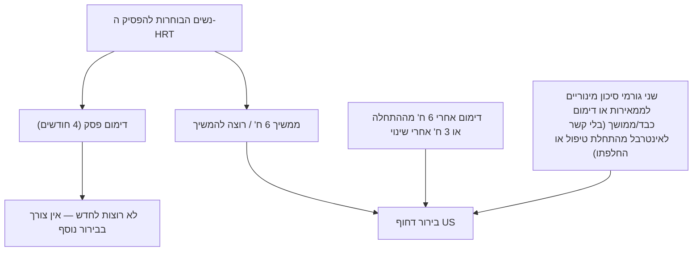

# תופעות לוואי תחת MHT — "דימומים וצרות אחרות"

> **Layer 1 Source Reference:** [`דימומים תחת MHT - דר מרב פרייברג.pptx`](../../sources/magid-course/%D7%93%D7%99%D7%9E%D7%95%D7%9E%D7%99%D7%9D%20%D7%AA%D7%97%D7%AA%20MHT%20-%20%D7%93%D7%A8%20%D7%9E%D7%A8%D7%91%20%D7%A4%D7%A8%D7%99%D7%99%D7%91%D7%A8%D7%92.pptx)
> **Collection:** Magid Institute Practical Menopause Course | **Lecturer/Source:** `Dr. Merav Freiberg (ד"ר מרב פרייברג)` | **Original Format:** `PPTX`

> **הערת מקור:** מצגת זו כוללת 28 שקופיות תוכן קליניות (שקופיות 1–28), המבוססות בין היתר על הנחיות האגודה הבריטית למנופאוזה (**BMS Joint Guideline: Management of unscheduled bleeding on HRT**), בצירוף הערות פרקטיות של המרצה (`מ.פ.`). שקופיות 29–32 בקובץ המקור הן שקופיות תבנית גנריות של PowerPoint שנותרו בסוף הקובץ ואינן קליניות.

---

## Slide 1: Title Slide — שער המצגת

- **כותרת:** תופעות לוואי תחת MHT — "דימומים וצרות אחרות"
- **מרצה:** ד"ר מרב פרייברג, מומחית ברפואת נשים ומיילדות, יועצת לבריאות האישה בגיל המעבר

---

## Slide 2: Introduction to MHT Side Effects — הקדמה

- לכל טיפול תרופתי יכולות להיות תופעות לוואי
- כך גם ב-MHT - אך בד"כ הן קלות אם בכלל
- **רוב תופעות הלוואי חולפות עם הזמן לכן כדאי לחכות לפחות 3 חודשים**
- לעיתים בכלל מדובר בתסמיני המנופאוזה עצמן...
- גם אסטרוגן וגם פרוגסטרון שונים בהרכבים ובמינונים - ולכן החשיבות בהתאמה האישית

---

## Slide 3: Trial and Error in Initial Regimen Selection — לא תמיד הבחירה הראשונה היא הנכונה

- **כותרת:** לא תמיד הבחירה הראשונה היא הנכונה
- **איור בשקופית:** *"אן דן דינו"* — המחשה לכך שהתאמת התכשיר הראשוני דורשת לעיתים ניסוי, מעקב והתאמה חוזרת למטופלת.

---

## Slide 4: Estrogen / General HRT Side Effects — תופעות לוואי אסטרוגן

**אינפוגרפיקה מוטמעת בשקופית — `Side Effects of Hormone Replacement Therapy (HRT)`:**

1. **Breast tenderness/fullness** (רגישות / מלאות בשדיים)
2. **Bloating/water retention** (נפיחות בטנית / צבירת נוזלים)
3. **Mild nausea/headache** (בחילה קלה / כאב ראש)
4. **Light irregular bleeding/spotting** (דימום קל לא סדיר / הכתמות)
5. **Mood or sleep changes** (שינויים במצב הרוח או בשינה)

---

## Slide 5: Progesterone Side Effects — תופעות לוואי פרוגסטרון

**אינפוגרפיקה מוטמעת בשקופית — `Common Side Effects of Progesterone`:**

1. **Breast tenderness or pain** (רגישות או כאב בשדיים)
2. **Nausea** (בחילה)
3. **Drowsiness** (ישנוניות / נמנום)
4. **Bloating** (נפיחות בטנית)
5. **Mood swings** (תנודות במצב הרוח)
6. **Increased vaginal discharge** (הפרשה נרתיקית מוגברת)
7. **Headache** (כאב ראש)
8. **Spotting or irregular menstrual cycle** (הכתמות או מחזור לא סדיר)

---

## Slide 6: Combined MHT Side Effects — תופעות לוואי טיפול משולב

- צריך להבדיל בין השפעת אסטרוגן לפרוגסטרון
- לפעמים חופף ודומה
- תופעות לוואי טיפול מחזורי
- תופעות לוואי טיפול משולב
  - לא כך באסטרוגן בלבד או פרוגסטרון בלבד
- **איור בשקופית:** שני חלקי פאזל שלובים — `ESTROGEN` ו-`PROGESTERONE`.

---

## Slide 7: Side Effects vs. Adverse Effects — משך וחומרת תופעות הלוואי

- **רוב תופעות הלוואי חולפות תוך ימים עד מספר שבועות**
- כרוכות באי נוחות
- לא אמורות להיות מגבילות
- **תשומת לב לאלרגיה**
- **`P > E`** *(פרוגסטרון אחראי ליותר תופעות לוואי מאשר אסטרוגן)*

**אינפוגרפיקה מוטמעת בשקופית — `SIDE EFFECTS vs ADVERSE EFFECTS — KNOW THE DIFFERENCE`:**

| `SIDE EFFECTS` | `ADVERSE EFFECTS` |
| :--- | :--- |
| Can be mild, sometimes even therapeutic. | Harmful, undesirable & sometimes life-threatening. |

> *Both are drug reactions, but impact is different.*

---

## Slide 8: Overcoming the Initial Adaptation Hurdle — צליחת משוכת ההסתגלות

- *(שקופית ויזואלית: איור אישה מדלגת מעל משוכה — סמל לצליחת תקופת ההסתגלות הראשונית של הטיפול ההורמונלי).*

---

## Slide 9: BMS Joint Guideline on Unscheduled Bleeding — ניהול דימומים תחת טיפול הורמונלי מנופאוזלי

- **כותרת:** ניהול דימומים תחת טיפול הורמונלי מנופאוזלי (ספטמבר 2026)
- **צילומי מסך מוטמעים בשקופית:**
  - **BMS Guideline:** *Management of unscheduled bleeding on hormone replacement therapy (HRT)*
  - *This joint guideline has been prepared on behalf of the British Menopause Society (BMS), in partnership with the British Society of Gynaecological Endoscopy (BSGE), British Gynaecological Cancer Society (BGCS), College of Sexual & Reproductive Healthcare (CoSRH), Getting It Right First Time (GIRFT), Royal College of General Practitioners (RCGP) and the Royal College of Obstetricians & Gynaecologists (RCOG).*

---

## Slide 10: Initial Assessment of Unscheduled Bleeding — הערכת אישה המגיעה עם דימום לא צפוי תחת טיפול

- **בירור דגם הדימום** – האם טיפול רציף / משולב / פרימנופאוזה / מנופאוזה
- **גורמי סיכון לממאירות רחם / צוואר הרחם**
- **בדיקת אגן**
- **סקר צוואר** (PAP / HPV)
- **משטחים (STD)**
- **BMI**
- **תרופות / ניתוחים / שינויים משמעותיים** - *הערה שלי מ.פ*

---

## Slide 11: Endometrial Hyperplasia & Cancer Risk Factors — גורמי סיכון להיפרפלזיה וסרטן רחם בנוטלות HRT

יש לזהות ולהעריך גורמי סיכון לממאירות רחם עצמאיים מ-HRT:

| קטגוריית סיכון | גורמי סיכון לממאירות רירית הרחם |
| :--- | :--- |
| **גורמי סיכון עיקריים (Major Risk Factors)** | • **`BMI > 40`** *(מופיע במקור כ-`<BMI40` עקב היפוך כיווניות RTL)* • **תורשה** – `LYNCH` או `COWDEN SYND` |
| **גורמי סיכון מינוריים (Minor Risk Factors)** | • **`BMI` בין `30–39`** • **סכרת** • **`PCOS`** *(מופיע במקור עם תקלדה `PMOS`)* |

- יש גורמים הניתנים לשינוי - יורידו הדימומים והסיכון לממאירות.
- **המלצות ליבה מתוך ה-BMS Guideline המופיעות בשקופית:**
  - *A monthly progestogen dose, in proportion to the estrogen dose, is recommended in women with a uterus.*
  - *In women using sequential HRT (sHRT), offer a minimum of 10 days norethisterone (NET) or medroxyprogesterone acetate (MPA), or 12 days of micronised progesterone, per month.*
  - *Women taking a sequential preparation (sHRT) over the age of 45 should be offered, after five years of use or by age 54 (whichever comes first), a change to continuous combined (ccHRT).*

---

## Slide 12: Minimum Monthly Progestogen Days & Switch to ccHRT — הקפדה על מינון פרוגסטרון חודשי

- הקפדה על מינון פרוגסטרון חודשי מותאם לגיל ושלב בחיים בנשים עם רחם
- נשים על טיפול מחזורי צריכות לקבל מינון נכון מכל סוג של פרוגסטרון:
  - **10 ימי `NETA` או `MPA`**
  - **או 12 ימי פרוגסטרון מיקרונייזד** בכל חודש
- *Women taking a sequential preparation (sHRT) over the age of 45 should be offered, after five years of use or by age 54 (whichever comes first), a change to continuous combined (ccHRT)*

---

## Slide 13: Synthetic Progestin vs. Natural Progesterone & Long-Term Regimen Choice — סוג הפרוגסטוגן ומעבר לתכשיר ממושך

- **הערה:** תשומת לב לכמות וסוג ה-P — `NETA` מול טבעי וכו' – *הערה שלי מ.פ*
- **בנשים על טיפול מחזורי:**
  - מעל גיל 45 אחרי **5 שנות שימוש** בתכשיר מחזורי, **או**
  - **מעל גיל 54**
  - $\rightarrow$ **יש להציע לעבור לתכשיר ממושך (רציף)**
- **הערה קלינית (`מ.פ.`):** **לא כל P מתאים לממושך לאורך זמן למשל `NETA` ....מ.פ.**

### טבלה מוטמעת בשקופית — `PROGESTIN AND PROGESTERONE ARE NOT THE SAME`

| תחום השפעה | `SYNTHETIC PROGESTIN` | `NATURAL PROGESTERONE` |
| :--- | :--- | :--- |
| **כאבי ראש / מיגרנה** | Causes headaches/migraines | Reduces headaches/migraines |
| **רירית הרחם** | Thins uterine lining | Prepares lining for potential pregnancy |
| **דפוס דימומים** | May cause irregular menstrual bleeding | Reduces spotting and supports luteal phase length |
| **מצב רוח ומוח** | Increases mood issues / depression / anxiety | Supports brain function and has a calming effect |
| **שד** | Causes breast tenderness | Supports breast health |
| **חשק מיני (Libido)** | Decreased sex drive | Decreased sex drive (luteal phase) |
| **פרופיל אנדרוגני** | Chemically similar to androgens (e.g. levonorgestrel) | Anti-androgenic |

---

## Slide 14: Grace Period for Regimen Adjustment in Low-Risk Women — מתי לבצע בירור (התאמת טיפול בסיכון נמוך)

- **באין גורמי סיכון ל-CA** – שינוי ה-P או כל התכשיר ל-**6 חודשים לפחות** אם:
  1. הדימום הלא סדיר קורה **תוך 6 חודשים מתחילת הטיפול**, **או**
  2. נמשך מעל *(לפי BMS ושקופיות 16–17: תוך 3 חודשים משינוי מינון/תכשיר ניתן להתאים; אם מופיע או נמשך מעל 3 חודשים אחרי שינוי מינון או תכשיר — נדרש US דחוף)* **3 חודשים אחרי שינוי מינון או תכשיר**

---

## Slide 15: Persistent Bleeding After 6 Months of Adjustments — המשך דימום מעל 6 חודשי התאמות

- אם הדימום הלא סדיר ממשיך באישה בסיכון נמוך **מעל 6 חודשים של התאמות**:
  - **יש לבצע סונר דחוף תוך 6 שבועות** (`discuss the options of an urgent ultrasound (within six weeks)`)
  - לשקול הפסקת הטיפול או מעבר לטיפול לא הורמונלי כדי להימנע מהתערבויות

---

## Slide 16: Investigation Triage Rules & Stopping HRT — תרשים זרימה לבירור

- **נשים הבוחרות להפסיק HRT:**
  - אם הדימום פסק אחרי 4 חודשים *(בהנחיית BMS המקורית: 4 שבועות; בשקופית נכתב 4 חודשים)* ומתאים להן לא לחדש $\rightarrow$ **אין צורך בבירור נוסף**
  - אם רוצה לחדש והדימום ממשיך 6 חודשים $\rightarrow$ **US דחוף**
- **אם הדימום מתחיל רק אחרי 6 חודשי טיפול או 3 חודשים אחרי שינוי התכשיר** $\rightarrow$ **יש להציע US דחוף**
- **אם יש שני גורמי סיכון מינוריים לממאירות או הדימום כבד/ממושך** $\rightarrow$ **יש להציע US דחוף (תוך 6 שבועות) בלי קשר לאינטרבל מהתחלת או שינוי הטיפול**

---

## Slide 17: Visual Flowchart — נשים הבוחרות להפסיק ה-HRT והתוויות ל-US דחוף

**תיבות הטקסט בתרשים בשקופית:**
- **דימום פסק** $\rightarrow$ **4 חודשים** $\rightarrow$ **לא רוצות לחדש — אין צורך בבירור נוסף**
- **ממשיך 6 ח' / רוצה להמשיך** $\rightarrow$ **בירור דחוף US**
- **דימום אחרי 6 ח' מההתחלה או 3 ח' אחרי שינוי** $\rightarrow$ **US דחוף**
- **אם יש שני גורמי סיכון מינוריים לממאירות או הדימום כבד/ממושך** $\rightarrow$ **יש להציע אולטראסאונד דחוף בלי קשר לאינטרבל מהתחלת טיפול או החלפתו**

---

## Slide 18: Immediate Cancer Pathway Red Flags — הפניה מיידית לשלילת סרטן

> **[!WARNING] תמרור "זהירות! סכנה" בשקופית:**
> - **אם לאישה גורם סיכון עיקרי אחד (`1 Major`) או 3 מינוריים (`3 Minor`) לממאירות רחם, בלי קשר לדגם הדימום או מרחקו מהתחלה, או שינוי טיפול — יש להפנות לבירור מיידי לשלילת סרטן.**
> - בזמן ההמתנה ניתן לבצע שינויים בפרוגסטרונים או הפסקת הטיפול.

---

## Slide 19: Endometrial Thickness Cutoffs (Reassuring Ultrasound) — איך מבצעים הבירור: רירית תקינה בסונר

- **באישה עם דימום לא סדיר:**
  - תחת **טיפול ממושך (רציף)** בנוכחות רירית סדירה הנראית במלואה **`≤ 4 מ"מ`**, **או**
  - ב**טיפול מחזורי** עם רירית **`≤ 7 מ"מ`**
  - $\rightarrow$ **הסיכוי לממאירות נמוך מאוד**
- **אישה עם טיפול מחזורי ורירית `≤ 7 מ"מ`:**
  - ניתן להציע **שינוי טיפול ל-6 חודשים**
  - אך **אם הדימום ממשיך או גובר** $\rightarrow$ **יש לשלוח להערכת הרירית**

---

## Slide 20: Endometrial Thickness Cutoffs for Urgent Biopsy / Hysteroscopy — רירית מעובה: ביופסיה והיסטרוסקופיה דחופה

| סוג משטר ה-HRT | סף עובי רירית תקין | סף רירית מעובה להפניה דחופה | פעולה נדרשת |
| :--- | :---: | :---: | :--- |
| **טיפול ממושך / רציף (ccHRT)** | `≤ 4 מ"מ` | **`> 4 מ"מ`** | **להפנות במסלול דחוף בחשד לממאירות לביופסיה ו/או היסטרוסקופיה** |
| **טיפול מחזורי (sHRT)** | `≤ 7 מ"מ` | **`> 7 מ"מ`** | **להפנות במסלול דחוף בחשד לממאירות לביופסיה ו/או היסטרוסקופיה** |

---

## Slide 21: Follow-Up After Benign Endometrial Workup — מעקב והתאמה לאחר בירור תקין/שפיר

- **באם פתולוגיה שפירה:**
  - יש לנסות להתאים ה-**P** - שהוא בד"כ הבעיה
  - ולחזור להערכה אחרי **3 ח'**
- **אם גם היסטרוסקופיה תקינה** – ניתן לחכות **חצי שנה**
- **כל עוד הבירור תקין** - מאוד חשוב לעודד ולתמוך בסבלנות – **זה לא QUICK FIX**

---

## Slide 22: Optimizing Regimen & Role of Mirena — התאמת הטיפול להפחתת דימום לא צפוי

- **קודם כל וידוא אופן נטילה והדבקות בה...** מינון, משך, מסלול נטילה
- האם עדיפות לתכשיר **"מובנה"** או **"תפור"** בו אנו שולטים בהרכב, אופן מתן, מינון
- **"להציע לכל אישה מירנה – תכשיר המוריד דימום לא צפוי בהשוואה לכל תכשיר אחר"**

---

## Slide 23: Oral vs. Transdermal Bleeding Control & GSM Atrophy — תכשירים פומיים ואטרופיה נרתיקית

- **אם אין סיכון לקרישיות יתר או הוריית נגד לטיפול פומי:**
  - **תכשירים פומיים משיגים רמות גבוהות יותר של אמנוריאה לעומת TD** וניתן להציען לנשים המדממות על TD
- כמובן יכולים להיות קו טיפול ראשון:
  - **מחזורי בפרי!!! ממושך במנופאוזה מבוססת (`מ.פ.`)**
- **לא לשכוח טיפול מקומי לאלמנט האטרופי ב-GSM** *(אטרופיה נרתיקית/אורוגניטלית כסיבה לדימום)*

---

## Slide 24: Summary of Unscheduled Bleeding Management — לסיכום דימומים

- **שכיחים ב-6 חודשים ראשונים**
- **שינוי והתאמת טיפול**, אופן, מינון, דבקות
- **בירור גורמי סיכון לממאירות** רחם, צוואר, נרתיק
- **בירור אטרופיה ב-DD**
- **מקומה של המירנה בטיפול**
- **תשומת לב לשלב התחלת הטיפול:**
  - **פרימנופאוזה = מחזורי** *(מינימום ימי P ב"מורכב" — 12 עד 14 יום לפי סוג P)*
  - **מנופאוזה = ממושך**
- **אנחנו ממש לא ONE SIZE ואף חצאי מידות**

---

## Slide 25: Managing Breast Tenderness / Mastalgia — גודש/ כאב שדיים

אסטרטגיות לניהול גודש וכאב שדיים תחת MHT:
- **החלפת E** (או הפחתת מינון E)
- **החלפת P**
- **זמן נטילה**
- **דרך נטילה**
- **התייחסות לדימות** (מעקב הדמיית שד)
- **מחזורי ארוך כשאפשר**
- **תזונה**

---

## Slide 26: Managing Sleep Side Effects — שינה

אסטרטגיות לניהול הפרעות שינה או ישנוניות תחת MHT:
- **התאמת P** *(למשל ניצול האפקט המרדים של פרוגסטרון מיקרונייזד בלילה, או החלפת פרוגסטין שמפריע לשינה/גורם לעייפות יומית)*
- **זמן נטילה** (ערב מול בוקר)
- **תוספים**
- **DD** (אבחנה מבדלת להפרעות שינה אחרות)

---

## Slide 27: Clinical Fine-Tuning — פטנטים ותפירת טיפול

- **כותרת:** פטנטים ותפירת טיפול *(איור כפתור כוונון `TUNING` — התאמה מדויקת ופרטנית של מינון, תכשיר ומסלול מתן לכל מטופלת).*

---

## Slide 28: Closing Slide — תודה על ההקשבה

- **תודה על ההקשבה** — ד"ר מרב פרייברג, רופאת נשים.

---

## Slides 29–32: Presentation Template Boilerplate — שקופיות תבנית גנריות (ללא תוכן קליני)

*(שקופיות 29–32 בקובץ ה-PPTX הן שקופיות דוגמה שיווקיות מתבנית המצגת הכללית — "היתרונות שלנו", "יתרונות מרכזיים של המוצר או השירות", "השלבים הבאים", "מידע התקשרות" — שנותרו בסוף המצגת ואינן קשורות לתוכן ההרצאה).*
