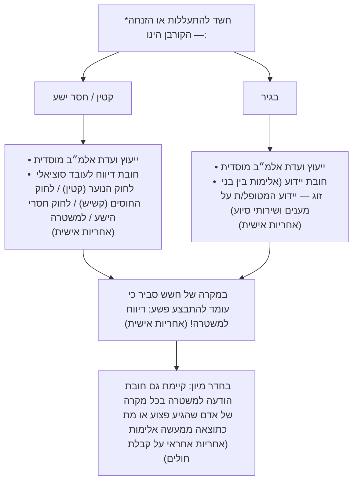

# המלצות כוח המשימה הישראלי בנושא: קידום בריאות ורפואה מונעת

> **Layer 1 Source Reference:** [`clinical_118_HealthPromotionPreventiveMedicine.pdf`](../../sources/magid-course/clinical_118_HealthPromotionPreventiveMedicine.pdf)
> **Collection:** Magid Course — Clinical Guidelines & Literature | **Organization/Authors:** `איגוד רופאי המשפחה בישראל — ההסתדרות הרפואית בישראל (המכון לאיכות ברפואה)` | **Date:** `אוקטובר 2022`

> **הערת מבנה לשכבה 2 (Layer 2 Extraction Scope):** חוברת זו בת 284 עמודים היא מדריך הרפואה המונעת הלאומי של איגוד רופאי המשפחה בישראל וההסתדרות הרפואית בישראל (מהדורת אוקטובר 2022), המקיף את כלל מעגל החיים מלידה ועד זקנה. מסמך זה כולל: **(א)** תוכן עניינים ראשי ומפורט של כל 284 עמודי החוברת ואינדקס מלא של כלל הטבלאות והאיורים; **(ב)** טבלאות הרפואה המונעת המלאות לנשים ולמבוגרים לפי גיל (`טבלה ו: 20–39`, `טבלה ז: 40–64`, `טבלה ח: 65+`); ו-**(ג)** חילוץ מלא ומדויק של הטקסט המקורי בעברית (לרבות כל הטבלאות, השאלונים והערות השוליים, עם ציוני עמודים מדויקים `[עמ' X]` וכותרות דו-לשוניות לקישור `#anchor` נקי) של כלל הפרקים הרלוונטיים לבריאות נשים באמצע החיים וגיל המעבר.

---

## Editorial & Guideline Provenance — פרטי המסמך, עורכים ואיגודים תומכים

[עמ' 1–3]

- **כותרת מלאה:** המלצות כוח המשימה הישראלי בנושא: קידום בריאות ורפואה מונעת (`Clinical Guidelines — הנחיות קליניות`)
- **הוכן על-ידי (עורכים ראשיים, מהדורת אוקטובר 2022):** פרופ' אמנון להד, פרופ' חוה טבנקין, ד"ר תם אקסלרוד
- **עורכי משנה (2022):** ד"ר אלי רוזנברג, ד"ר ענבל קדמן | **יו"ר איגוד רופאי המשפחה בישראל:** ד"ר מיכל שני
- **מוציאים לאור:** איגוד רופאי המשפחה בישראל; ההסתדרות הרפואית בישראל — המכון לאיכות ברפואה (אוקטובר 2022)
- **איגודים תומכים:** החברה לחקר, מניעה וטיפול בטרשת העורקים; האיגוד הישראלי לנפרולוגיה ויתר לחץ דם; האיגוד לגסטרואנטרולוגיה ותזונה בילדים; האיגוד הישראלי לרפואת ריאות; החברה לרפואת הנקה בישראל; האיגוד הישראלי לרפואת ילדים
- **הצהרת אחריות קלינית:** הנחיות קליניות מתפרסמות ככלי עזר לרופא/ה ואינן באות במקום שיקול דעתו/ה בכל מצב נתון.
- **משתתפים בעדכון ועריכת מהדורת 2022 (לפי סדר א'-ב', [עמ' 3]):** ד"ר אקסלרוד תם (עורך ראשי), ד"ר אלבז-בראון עמית, פרופ' אנדוולט רונית, ד"ר אפק שני, ד"ר ארד אור, ד"ר בר זאב יעל, ד"ר בראון יהונתן, ד"ר גבאי אביעזר, גב' גולן אסתי, ד"ר גופן רותי, ד"ר גינסבורג אבידור, פרופ' דגן ירון, פרופ' דובנוב-רז גל, ד"ר דסקל-ויכהנדלר חגית, ד"ר וגנר-קולסקו גל, ד"ר זעיתר אמאני, ד"ר זעיתר מוחמד, ד"ר חזן ביביאנה, פרופ' טבנקין חוה (עורכת ראשית), ד"ר טוביאס גיא, ד"ר לבני אלון, פרופ' להד אמנון (עורך ראשי), פרופ' לוי-להד אפרת, גב' לוי שרון, ד"ר ליברמן שרי, ד"ר מייקלסון-כהן רחל, ד"ר מיסקין יאן, ד"ר נבות-מינצר דליה, ד"ר נדיר אייל, מר נייס שחר, ד"ר ספרא כרמית, ד"ר צימרמן דינה, ד"ר קדמן ענבל (עורכת משנה), פרופ' קונסטנטיני נעמה, פרופ' קיטאי אליעזר, ד"ר רוזנברג אלי (עורך משנה), ד"ר רוזנברג רנה, פרופ' רנרט גד, ד"ר רסולי איריס.

---

## Master Table of Contents — תוכן עניינים מלא (עמודים 1–284)

[עמ' 4–5]

| חלק / פרק | נושא הפרק / תת-הפרקים העיקריים | עמודים במקור (PDF) | סטטוס במסמך שכבה 2 זה |
| --- | --- | --- | --- |
| **שער וצוות העורכים** | שער, איגודים תומכים, רשימת עורכי מהדורות 2008, 2013 ו-2022 | 1–3 | מתועד לעיל |
| **תוכן עניינים** | תוכן עניינים ראשי | 4–5 | משוחזר במלואו בטבלה זו |
| **פתח דבר** | ד"ר מיכל שני, יו"ר איגוד רופאי המשפחה בישראל | 6 | **טקסט מלא** |
| **מבוא** | רמות מניעה (ראשונית, שניונית, שלישונית), תבחיני וילסון לבדיקות סקר, `טבלה א`, דירוג USPSTF ו-ACC/AHA | 7–9 | **טקסט מלא + טבלה א** |
| **חלק ראשון** | **ריכוז המלצות לפי גיל** | **10–49** | — |
| טבלאות לפי גיל (ילדות ונוער) | `טבלה ב` (לידה–שנתיים, עמ' 10); `טבלה ג` (2–6 שנים, עמ' 11); `טבלה ד` (7–12 שנים, עמ' 12); `טבלה ה` (13–19 שנים, עמ' 13) | 10–13 | במקור (Layer 1) |
| **טבלאות לפי גיל (בגרות וזקנה)** | **`טבלה ו`: גיל 20–39 (עמ' 14); `טבלה ז`: גיל 40–64 (עמ' 15–16); `טבלה ח`: מגיל 65+ (עמ' 17)** | **14–17** | **טבלאות מלאות + הערות שוליים** |
| רפואה מונעת בילדות ובנעורים | לידה עד שנתיים (עמ' 18–21); גיל 2–6 שנים (עמ' 22–23); גיל 7–12 שנים (עמ' 24–25); גיל 13–19 שנים (עמ' 26–27) | 18–27 | במקור (Layer 1) |
| **רפואה מונעת בגיל 20–39 וגיל 40–64 שנים** | הקדמה לגיל העמידה, משקל והשמנה, שינה, עישון, אלכוהול (`SASQ`/`AUDIT-C`), היריון וזוגיות, דיכאון (`PHQ-2`) ואלימות במשפחה, מניעת תחלואה לבבית/יל"ד/סוכרת/שומנים, סרטן השד/העור/צוואר הרחם/המעי הגס/הריאות, דלדול עצמות מעל גיל 40, חיסונים ו-HIV/STIs | **28–40** | **טקסט מלא** |
| **רפואה מונעת מגיל 65 שנים ומעלה** | פעילות גופנית, תזונה (חלבון, B12, ויטמין D, סידן), משקל, עישון, אלכוהול, שמש, חיסונים, איתור מוקדם (לב וכלי דם, סרטן, אוסטיאופורוזיס `DXA`, נפילות `TUG`, דיכאון `PHQ-2`/`GDS`, ריבוי תרופות `Beers`/`STOPP-START`, דמנציה, אי-נקיטת שתן בנשים, שינה) והתערבויות שאינן מומלצות | **41–49** | **טקסט מלא + טבלת PHQ-2** |
| **חלק שני** | **פרקים לפי נושאים עיקריים** | **50–215** | — |
| **פרק מס' 1** | **הצעות ליישום ההמלצות לקידום בריאות ורפואה מונעת במרפאה הראשונית** (`טבלה 1`, מודל `GRACE`, ריאיון הנעתי, `5A's`, טיפול תרופתי בהשמנה `Orlistat`/`Liraglutide`) | **50–56** | **טקסט מלא + טבלה 1** |
| פרק מס' 2 | הערכת התפתחות בילדות (`טבלה 2`: מדרגות התפתחות) | 57–58 | במקור (Layer 1) |
| פרק מס' 3 | בריאות הפה והשיניים (עששת, פלואוריד, מחלות חניכיים, נגעים בחלל הפה) | 59–62 | במקור (Layer 1) |
| פרק מס' 4 | בטיחות ילדים — הנחיות להורים (לידה עד גיל 18) | 63–67 | במקור (Layer 1) |
| **פרק מס' 5** | **חיסונים** (מבוא עמ' 68; חיסוני ילדות `טבלה 3` עמ' 69; **לוח חיסוני מבוגרים `טבלה 4` עמ' 70**; פירוט חיסוני מבוגרים ונשים: `HBV`, פוליו, `Td`/`Tdap`, `Hib`, פנוימוקוק `PCV13`/`PPSV23`, `MMR`, אבעבועות רוח, `HAV`, `HPV`, **שפעת**, **שלבקת חוגרת `Zostavax`/`Shingrix`**, מנינגוקוק, חיסונים לפני היריון ובמהלכו, עמ' 71–83) | **68–83** | **טקסט מלא למבוגרים + טבלה 4** *(למעט טבלה 3 ורוטה של ינקות)* |
| **פרק מס' 6** | **תזונה נבונה למניעת מחלות** (התזונה הים-תיכונית, קשת המזון של משרד הבריאות, המלצות מעשיות, נתרן, סוכר, שומנים וסידן) | **84–89** | **טקסט מלא** |
| **פרק מס' 7** | **פעילות גופנית** (מניעת תחלואה ותמותה, `טבלה 5`, התאמה למחלת לב כלילית, סוכרת, עודף משקל והשמנה, יל"ד וממאירויות, בדיקות טרום-פעילות, סולם בורג `טבלה 6`, המלצות לפי גיל `טבלה 7`) | **90–99** | **טקסט מלא + טבלאות 5–7** |
| **פרק מס' 8** | **גורמי סיכון למחלות לב וכלי דם** (הערכת סיכון `SCORE` — `טבלה 8`; **יתר לחץ דם** — `טבלאות 9–10`; **דיסליפידמיה** ו-`Lp(a)`; **סוכרת**; **השמנה ותסמונת מטבולית**; **סיבוכי היריון כגורמי סיכון קרדיווסקולריים באישה**) | **100–110** | **טקסט מלא + טבלאות 8–10** |
| פרק מס' 9 | מעקב טרום-לידתי באישה בלא גורמי סיכון (בדיקות שגרה בהיריון, סקר גנטי, סקר טריזומיה 21, מי שפיר/סיסי שליה, `NIPS`) | 111–119 | במקור (Layer 1) |
| **פרק מס' 10** | **נזקי העישון והדרכים למניעה ולגמילה** (תחלואה לבבית, סרטן, **בריאות האישה והקדמת גיל המעבר/אוסטיאופורוזיס**, עישון קל, נרגילה, סיגריות אלקטרוניות, טבק בחימום, מודל `5A's`, תרופות לגמילה `טבלאות 11–12`, עלייה במשקל ודיכאון, שאלון פגרסטרום) | **120–134** | **טקסט מלא + טבלאות 11–12** |
| **פרק מס' 11** | **מניעה ואיתור מוקדם של מחלות ממאירות** (`טבלה 13` היארעות בישראל; מניעה ראשונית וגורמי סיכון לסרטן השד כולל MHT; **סרטן השד** — ממוגרפיה, שד סמיך, DBT, MRI; **סרטן המעי הגס**; **מלנומה של העור**; סרטן הערמונית; **סרטן השחלה**; **סרטן צוואר הרחם — Pap ו-hrHPV**; **סרטן הריאה — LDCT**; **בדיקה נרתיקית שגרתית וסרטן רירית הרחם**; **ייעוץ גנטי, סקר אוכלוסייה ל-`BRCA1/2` באשכנזיות, ניהול נשאיות, פאנל גנים `טבלה 14` ותסמונת לינץ'**) | **135–156** | **טקסט מלא + טבלאות 13–14** |
| פרק מס' 12 | אורתופדיה מניעתית (מניעת כאבי גב תחתון ומניעת אוסטיאוארתריטיס של הברכיים והירכיים) | 157–158 | במקור (Layer 1) |
| פרק מס' 13 | רפואת מטיילים ומניעת תחלואה בטיסה (חיסוני מטיילים, יעפת/מלטונין, קרישיות ורידית בטיסה, כשירות רפואית לטיסה) | 159–170 | במקור (Layer 1) |
| **פרק מס' 14** | **רפואה מונעת בקהילת הלהט"ב** (כללי, **נשים המקיימות יחסי מין עם נשים `WSW`** עמ' 171–173; גברים המקיימים יחסי מין עם גברים `MSM` עמ' 173–174; **הקהילה הטרנסג'נדרית** עמ' 175) | **171–175** | **טקסט מלא לכלל הלהט"ב, WSW וטרנסג'נדרים** |
| פרק מס' 15 | מניעה של מחלות כבד (`טבלה 15`, חיסוני הפטיטיס A ו-B, סקירת הפטיטיס C בקבוצות סיכון) | 176–179 | במקור (Layer 1) |
| **פרק מס' 16** | **מניעה באמצעות תכשירים תרופתיים (`Chemoprevention`)**: אספירין למניעה ראשונית של מחלות לב וסרטן המעי (עמ' 180–182); **טמוקסיפן, רלוקסיפן ומעכבי ארומטאז למניעה ראשונית של סרטן השד** (עמ' 183–184); **ויטמינים, סידן וויטמין D** (עמ' 185–186); **טיפול הורמונלי (`HT`/`MHT`) לאחר הפסקת הווסת כטיפול מונע ראשוני** (עמ' 186–188) | **180–188** | **טקסט מלא** |
| **פרק מס' 17** | **אוסטיאופורוזיס: מניעה, איתור מוקדם וטיפול** (אפידמיולוגיה, הגדרות WHO, מודל `FRAX`, קריטריוני אבחנה, סקר `DXA` והתוויות סל הבריאות, ויטמין D וסידן, ביספוספונטים, דנוסומאב, רלוקסיפן, קלציטונין, **טיפול הורמונלי בגיל המעבר**, טריפראטייד ומשך הטיפול) | **189–196** | **טקסט מלא** |
| **פרק מס' 18** | **הערכת הרגלי שינה והפרעות שינה במרפאה הראשונית** (נדודי שינה, דום נשימה בשינה, היגיינת שינה, שאלון `Epworth`, שאלון `STOP-BANG`) | **197–200** | **טקסט מלא + שאלונים** |
| **פרק מס' 19** | **אלימות במשפחה ופגיעה מינית** (שכיחות, נורות אדומות, סקירה מול תשאול ממוקד `טבלה 16`, מודל `LIVES`, בדיקה ותיעוד, חובות דיווח ויידוע `תרשים 1`, תקשורת ומענה ראשוני `טבלה 17`, מענים ומוקדי סיוע `טבלה 18`) | **201–212** | **טקסט מלא + תרשים 1 + טבלאות 16–18** |
| **פרק מס' 20** | **נושאים שנויים במחלוקת** (עקמת, בדיקות דם ושתן שגרתיות, הומוציסטאין, **בדיקה גינקולוגית שגרתית לנשים בריאות**, בדיקת עור לנבוסים, `ECG` במנוחה ומבחן מאמץ, **בדיקות לתפקוד בלוטת המגן `TSH` וסרטן התריס**, פרפור פרוזדורים/חדרים, היצרות עורקי התרדמה, וסקירה למחלת כליות כרונית `CKD`) | **213–215** | **טקסט מלא** |
| **נספחים** | `נספח מס' 1`: הערכת תפקוד יומי (`ADL`, עמ' 216); `נספח מס' 2`: מבחן קצר לאבחון מנטלי (`MMSE`, עמ' 217) | 216–217 | מתועד בפרק גיל 65+ / במקור |
| **מקורות** | רשימת מקורות ביבליוגרפיים ממוספרת (פריטים `1–1261`) | 218–284 | במקור (Layer 1) |

### Complete Index of Tables & Figures — אינדקס מלא של כל הטבלאות והאיורים בחוברת

| סימון | כותרת הטבלה / האיור | עמוד במקור |
| --- | --- | --- |
| **טבלה א** | יתרונות וחסרונות של בדיקות סקר | 8 |
| **טבלה ב** | רפואה מונעת בגיל לידה עד שנתיים | 10 |
| **טבלה ג** | רפואה מונעת בגיל 6–2 שנים | 11 |
| **טבלה ד** | רפואה מונעת בגיל 12–7 שנים | 12 |
| **טבלה ה** | רפואה מונעת בגיל 19–13 שנים | 13 |
| **טבלה ו** | רפואה מונעת בגיל 39–20 שנים | 14 |
| **טבלה ז** | רפואה מונעת בגיל 64–40 שנים | 15–16 |
| **טבלה ח** | רפואה מונעת מגיל 65 שנים | 17 |
| **טבלה 1** | גורמים המעכבים יישום פעולות מניעה | 50 |
| **טבלה 2** | מדרגות התפתחות | 57–58 |
| **טבלה 3** | לוח חיסוני השגרה בגיל הילדות (יולי 2018) | 69 |
| **טבלה 4** | לוח החיסונים המומלצים למבוגרים (ינואר 2014) | 70 |
| **איור 1** | קשת המזון החדשה של משרד הבריאות | 84 |
| **איור 2** | פירמידת הפעילות הגופנית והאימון | 92 |
| **טבלה 5** | פעילות גופנית מומלצת לאוכלוסייה הבוגרת | 93 |
| **טבלה 6** | סולם בורג — תחושה סובייקטיבית של עצימות המאמץ הגופני | 97 |
| **טבלה 7** | הפעילות הגופנית המומלצת לפי קבוצות גיל (0–2, 2–6, 7–12, 13–19, 20–64, 65+) | 98–99 |
| **טבלה 8** | הערכת סיכון ל-Fatal CVD בתוך 10 שנים עבור ארצות בסיכון נמוך לפי SCORE (תואמת את הנתונים מישראל) | 101 |
| **טבלה 9** | סיווג של לחץ הדם במרפאה והגדרות לחומרת יל"ד במרפאה | 104 |
| **טבלה 10** | ערכים מקבילים בטכניקות מדידות שונות של לחץ דם (ערכים בממ"כ) | 104 |
| **טבלה 11** | סיכום תוצאות טיפולים תרופתיים שונים לגמילה מעישון | 131 |
| **טבלה 12** | תופעות לוואי ודגשים לשימוש בתכשירים לגמילה מעישון | 133 |
| **טבלה 13** | שיעור היארעות סרטן מתוקנן ל-100,000 לפי מין וקבוצות אתניות (נתוני הרישום הלאומי לסרטן 2015) | 135 |
| **טבלה 14** | פירוט הערכות סיכון והמלצות למעקב לנשאיות של מוטציות בגנים העיקריים בפאנל לסרטן שד תורשתי (`ATM`, `BRIP1`, `CHEK2`, `PALB2`) על פי NCCN | 153 |
| **טבלה 15** | המלצות בנושא מניעה ראשונית ומשנית של מחלות כבד | 176 |
| **טבלה 16** | סיכום המלצות בנושא סקירה לאלימות במשפחה (`WHO`, `NICE`, `USPSTF`, `Cochrane`, משרד הבריאות) | 204 |
| **תרשים 1** | אלגוריתם חוקים — חובת דיווח וחובת יידוע בחשד להתעללות, הזנחה או אלימות בין בני זוג | 209 |
| **טבלה 17** | אלימות בין בני זוג: תקשורת ומענה ראשוני | 210 |
| **טבלה 18** | דף מידע: שירותים למצבי אלימות במשפחה או פגיעה מינית | 211 |

---

## Foreword & Principles of Preventive Screening — פתח דבר ומבוא

[עמ' 6]

**פתח דבר**

הרפואה המודרנית מצאה פתרונות לבעיות רפואיות רבות, אך לא מצאה ריפוי למרבית המצבים הכרוניים, ולכן
קידום בריאות ורפואה מונעת היו לאבני דרך חשובות ברפואה במאה ה-21. מצאנו לנכון לרכז את כל המידע הקיים
ולהשתמש בו כחומר לימוד בבתי ספר לרפואה, בהתמחויות שונות, בקרב צוותי רפואה בקהילה ובבתי החולים ובקרב
כלל העוסקים ברפואה מונעת ורפואה המכוונת לקידום בריאות בכל קבוצות הגיל באוכלוסייה.
ההמלצות בחוברת זו מבוססות על מהדורת 2013 וכן על עדכונים של המלצות כוחות המשימה האמריקאיים
והאירופיים, המועצות הלאומיות של משרד הבריאות והמלצות משרד הבריאות, בתוך התחשבות בנתונים
אפידמיולוגיים מישראל ובמבנה הייחודי של מערכת הבריאות בה. מרבית ההמלצות עונות על אמות המידה להמלצות
מסוג A ו-B של כוח המשימה האמריקאי (USPSTF). כמה המלצות נכללו אף שהן נשענות על חוות דעת מומחים
בלבד, ואין להן בשלב זה ראיות מחקריות עוצמתיות יותר.
אנו סבורים כי קידום בריאות, פעולות למניעה ראשונית ופעולות לאיתור מוקדם הם גם באחריות הציבור עצמו - עליו
להיות פעיל בשמירה על בריאותו. כל הכתוב הוא בגדר המלצה בלבד, ולא הנחיה לחובת ביצוע המוטלת על הרופאים.
בכל מקרה יש להפעיל שיקול דעת רפואי.
חלק הראשון מחולק לפי קבוצות גיל. בנוגע לכל קבוצת גיל מופיע תיאור מפורט של הפעולות שיש לנקוט, וכן טבלה
תמציתית שנועדה להקל על הקוראים. בחוברת תמצאו פרקים המפרטים את מהות הפעולות בתחומים העיקריים, כגון
עדכון תוכנית החיסונים בילדים ובמבוגרים והמלצות לאורח חיים בריא בתחום מניעת עישון, פעילות גופנית, תזונה
נכונה ועוד. הפרק האחרון הוא אולי המעניין ביותר, ובו “נושאים במחלוקת”. לנוחיותכם, לחוברת מתלווה רשימת
מקורות מפורטת ומעודכנת, ובה מאות מובאות, זאת כדי לתת תוקף מדעי ועדכני לכתוב. בנוגע לכל קבוצת גיל או
נספח רשומים מספרי המקורות הרלוונטיים ביותר.
את העדכון והכתיבה הובילו פרופ’ אמנון להד, פרופ’ חוה טבנקין וד”ר ת ֺם אקסלרוד, בעזרת ד”ר אלי רוזנברג וד”ר ענבל
קדמן, ואיתם עוד רבים וטובים שהיו חברים בוועדות השונות או שהשתתפו כעורכים, מעירים או סוקרים, מומחים
בתחומים רפואת המשפחה, רפואה מונעת ובריאות הציבור, גריאטריה, מחלות זיהומיות ורפואת ילדים.
ד"ר יצחק ברלוביץ' יזם פיתוח אתר אינטרנט "שווה בדיקה" דרכו יכול הציבור לקבל פירוט המלצות אישיות לפי הכתוב
בחוברת זו, ובימים אלה אנו עובדים על גרסה מתקדמת ומעודכנת לאתר.
החומר הועבר לעיון מומחים מתחומים נוספים ולהערותיהם.
החוברת עודכנה בשנת 2022, ולכן עם חלוף הזמן יש להיעזר בספרות עדכנית.
ברכות לכל העוסקים במלאכה.

**ד”ר מיכל שני**

**יו”ר איגוד רופאי המשפחה בישראל**

[עמ' 7]

**מבוא**

קידום בריאות ורפואה מונעת הם שניים מהיעדים החשובים ביותר של שירותי הבריאות כיוון שהם מאפשרים להאריך
את תוחלת חיים, לשפר את איכות החיים ולהאריך את השנים הפנויות ממחלות וממוגבלויות (״שנים בריאות״). לפיכך,
ארגון הבריאות העולמי כלל נושאים אלה ביעדי ״בריאות לכל בשנת האלפיים״, ובפרסומיו ניתן דגש מיוחד לחשיבות
הרפואה המונעת. גם משרד הבריאות וקופות החולים שמים היום דגש מוגבר על תחומים אלה במסגרת מדדי הבריאות
ויוזמת ״לעתיד בריא 2020״, אך בינתיים לא הוקצה זמן רב יותר כדי לאפשר יישום שלהם.
פעולות אלו עשויות להתבצע במסגרות שונות: במסגרת הפרט, המשפחה והקהילה, ובשלוש רמות מניעה:
מניעה ראשונית (Primary Prevention) - מטרתה הפחתת החשיפה לגורמי סיכון או יצירת חסינות כלפיהם כדי מנוע
הופעה של מחלה או נזק. המניעה הראשונית כוללת, מלבד שינוי באורח החיים, חיסונים וטיפול תרופתי מונע, כולל
מתן תוספי מזון וויטמינים, וכן שינויים בהרגלים ובאורחות חיים של האוכלוסייה, למשל הימנעות מעישון ומחשיפה
יתרה לשמש, תזונה נכונה, נהיגה נכונה, וביצוע פעילות גופנית סדירה. באמצעות מניעה ראשונית אפשר להפחית את
שיעורי התמותה עד 50 אחוזים.
מניעה שניונית (Secondary Prevention) - מטרתה גילוי מוקדם של המחלה או גורם הסיכון וטיפול בהם בשלב
מוקדם ככל האפשר כדי לשנות את מהלך המחלה. רמה זו מתבצעת באמצעות זימון יזום של האוכלוסייה למגוון בדיקות
(בדיקות דם, לח״ד, הדמיה וכו’), (Opportunistic screening( Case Finding ובדיקות סקר כלליות (Systematic
Screening). לרמה זו משקל פחות מאשר למניעה ראשונית.
מניעה שלישונית (Tertiary Prevention) - מטרתה הפחתת הסיבוכים וצמצום השלכותיה של מחלה מפושטת
לאחר שכבר הופיעו המחלה או הנזק. היא מתבצעת באמצעות התערבות.
בעולם הרפואה, התבחינים לבדיקות סקר מבוססים על העקרונות של וילסון (1), ומובאים בבחירתם שלושה מרכיבים:

א. מרכיב המחלה

1. שיעורי היארעות והימצאות משמעותיים;

2. חומרת המחלה;

3. קיום אמצעים לשינוי מהלך המחלה;

4. מציאות תרופה אסימפטומטית משמעותית, כזאת המאפשרת התערבות;

5. יחס סיכון/תועלת נמוך בנוגע לטיפול המקובל.

ב. מרכיב האמצעים לגילוי/הכלי האבחנתי/הבדיקה

6. קיום אמצעים מתאימים (זולים, פשוטים, בטוחים) לגילוי המחלה בתקופה האסימפטומטית, כאלה
המתאימים לבדיקה המונית של אוכלוסייה בריאה;

7. רמות רגישות וסגוליות גבוהות יחסית של בדיקת הסינון;

8. שיעור סיבוכים נמוך לביצוע הבדיקה;

9. יחס סיכון/תועלת נמוך;

10. עלות סבירה: יחס עלות/תועלת נמוך.

[עמ' 8]

ג. מרכיב האוכלוסייה והמערכת הרפואית

11. ערך מנבא (Predictive Value) גבוה לבדיקה בקרב האוכלוסייה;

12. קדימות גבוהה בקרב מקבלי ההחלטות;

13. מודעות של האוכלוסייה ונכונות שלה לשתף פעולה (בדיקה שהאוכלוסייה מחשיבה קבילה);

14. הימצאות תשתית טיפולית מתאימה ונאותה או אפשרות להקים תשתית כזאת.
המדד האמין ביותר להערכת תוכנית סקירה הוא ירידה בשיעור תמותה. להלן יתרונות וחסרונות של בדיקות סקר:

**טבלה א: יתרונות וחסרונות של בדיקות סקר** `[עמ' 8]`

| יתרונות | חסרונות |
| --- | --- |
| הפחתת תחלואה ותמותה אמיתיים. | תוצאה שלילית כוזבת (`False negative`) היא אישור מטעה לבריאות, והיא מעכבת אבחנה וטיפול. |
| שיפור פרוגנוזה לחולים שאותרו בסקירה. | תוצאה חיובית כוזבת (`False positive`), כלומר תוצאה חיובית לאדם ללא מחלה, גורמת מצוקה נפשית ועלולה להוביל לבדיקות נוספות ולטיפולים מיותרים (עד שמתבררת הטעות). |
| טיפול פחות רדיקלי לריפוי חולים המאובחנים מוקדם. | תוצאת בדיקה תקינה עלולה לעורר תחושת ביטחון מדומה ולדחות את האבחנה ("נבדקתי והכול בסדר"). |
| מעניק חיזוק שהאדם בריא (`reassurance`). | אבחון-יתר וטיפול-יתר לחולים גבוליים שבלא איתור מוקדם כלל לא היו מטופלים והמחלה מעולם לא היתה מתבטאת אצלם (או להפך — מחלה עמידה שבדיעבד מתברר שאינה מגיבה לטיפולים). |
| חיסכון במשאבים לטיפול. | הבדיקות עצמן עלולות לגרום נזק; בזבוז משאבים בבדיקת אנשים בריאים. |

ההמלצות בחוברת זו מבוססות על המלצות ברמת A ו- B של כוחות המשימה לרפואה מונעת של ארצות הברית
וקנדה, המלצות ברמה 1 ו-2 של ICSI, מחקרים מבוקרים, מטה-אנליזות, סקירות ספרות נבחרות ודעת מומחים,
הנחיות מוכרות של משרד הבריאות, המלצות המועצות הלאומיות לפדיאטריה, לאונקולוגיה ולקרדיולוגיה בהתאמה
לאפידמיולוגיה האופיינית למדינת ישראל וחוות דעת מומחים בישראל. בכמה מפרקי החוברת נעשה מאמץ לאפיין
את ההמלצות השונות בדירוג חוזק ההמלצה ועוצמת הראיות בהתאם לשיטת הדירוג של USPSTF (2) (למעט
בהמלצות הקרדיולוגיות בהן נעשה שימוש בשיטה המקבילה של ה-ACC/AHA)י(3).
הוועדה גיבשה הנחיות בשלושה תחומים ברפואה מונעת:

א. פעולות ייעוץ וקידום בריאות למניעת מחלות ותאונות;

ב. חיסונים בכל הגילים ותרופות או תכשירים אחרים למניעת מחלות (Chemoprevention);

ג. איתור מוקדם של מחלות.

[עמ' 9]

המלצותינו מתייחסות לפעולות העיקריות המומלצות לכל קבוצת גיל, ואינן כוללות תיעדוף על פי עומס תחלואה
או עלות-תועלת ומועילות ההתערבות. אף על פי כן, אנו מדגישים כי עמידה בתוכנית החיסונים, הימנעות מעישון,
פעילות גופנית סדירה, מניעת השמנה, תזונה נכונה, הימנעות מחשיפה יתרה לשמש ונהיגה זהירה הן הפעולות
החשובות ביותר למניעת מחלות ולקידום בריאות. בפרט, הפסקת עישון, פעילות גופנית ותזונה נכונה הן הפעולות
החשובות ביותר לשמירת בריאות ולמניעת מחלות לב וסרטן.
ההמלצות מיועדות למגוון אוכלוסיות מקצועיות בתחום הבריאות: לכל ציבור הרופאות והרופאים, לצוות הסיעודי,
לצוותי בריאות בקהילה, לסטודנטים ולסטודנטיות לרפואה ולסיעוד ולקובעי מדיניות, כגון משרד הבריאות וקופות
החולים. גם הקהל הרחב יוכל להיעזר בהמלצות אלה.
אנו סבורים כי קידום בריאות, פעולות מניעה ראשוניות ופעולות איתור מוקדם הן באחריות הציבור עצמו וכי עליו
להיות פעיל בשמירת בריאותו ולהקפיד לבצע את פעולות אלה עבור עצמו. לצד זה, אנו מברכים על כך שהצוותים
הרפואיים עוסקים היום בפעולות רפואה מונעת וקידום בריאות על אף הקשיים ליישום רפואה כזאת במסגרת
הרפואה הראשונית: יש סתירות בין ההמלצות שמפרסמים גופים מקצועיים שונים, קשה לשכנע את המטופל ואת
המטפל בנחיצות הבדיקות, יש פערי ידע והמשאבים מוגבלים (בעיקר מרפאות עמוסות, חוסר זמן וכוח אדם). כל אלו
משפיעים על הרפואה הראשונית לתעדף את העיסוק במחלות החריפות על פני רפואה מונעת.
כדי לסייע להתגבר על כמה מהגורמים המעכבים צורפו המלצות ליישום ההמלצות. 1 נוסף על כך, כמה מפעולות
המניעה והאיתור המוקדם הוכנסו למדדי האיכות של הקופות. כדי שפעולות אלה יתבצעו בעקביות וכחלק מפעילות
סדירה, יש להקצות לכך זמן ולחלק את הפעילויות בין הצוות הרפואי בקהילה (רופאות ורופאים, אחיות ואחים,
מזכירות רפואית, מקדמי בריאות וכו’).
1 ר’ פרק מס’ 1

---

## Adult Lifecycle Preventive Care Tables — טבלאות רפואה מונעת לפי גיל בנשים ובמבוגרים

### Table Vav (Ages 20–39) — טבלה ו: רפואה מונעת בגיל 39-20 שנים

[עמ' 14]

| ייעוץ ומניעה ראשונית | סקירה ואיתור מוקדם | חיסונים ותרופות למניעה |
| --- | --- | --- |
| **הרגלי אכילה ותזונה נכונה;** **מעקב טרום לידתי;** **אמצעי מניעה ותכנון המשפחה.** **שינה:** הרגלי שינה נכונים (6–8 שעות ביממה). **נהיגה זהירה**, מניעת תאונות דרכים וחגירת חגורות בטיחות; **עישון:** תשאול בנוגע להרגלים וייעוץ לגמילה מעישון ומסמים; **אלכוהול:** תשאול וייעוץ בנשים הרות או המתכננות היריון (למי שעוסק במעקב טרום הריוני). | **BMI:** משקל וגובה — לפי שיקול דעת רפואי; **סוכרת:** מגיל 35 בדיקת רמת הסוכר בדם (סוכר בצום, המוגלובין A1c או העמסת סוכר) במטופלים הסובלים מעודף משקל או מהשמנה או באלו עם גורמי סיכון מוגדרים. בנשים הרות העמסת סוכר בשבועות 24–28. **לחץ דם:** בדיקת לחץ דם — א. לכלל האוכלוסייה בגילים 20–29 מדי 5 שנים, ובגילים 30–39 מדי 3–5 שנים. ב. אלה עם גורמי סיכון למחלת לב: מדי שנה. **שומני דם:** סך כולסטרול, HDL, LDL, וטריגליצרידים בגברים ובנשים מגיל 35 מידי 5 שנים (או מגיל 20 כשקיים סיכון גבוה למחלת כלי דם טרשתית ובהיפרכולסטרולמיה משפחתית). **Lipoprotein (a):** מומלץ לבדוק פעם אחת בחיים החל מגיל 35. | **קרמת-צפדת (דיפתריה-טטנוס):** מדי 10 שנים, הראשונה מהן יחד עם חיסון לשעלת (`Tdap`). **שפעת:** מדי שנה; **אדמת:** השלמת חיסון נגד אדמת באמצעות חיסון `MMR` לנשים בגילים 18–45 שאינן מחוסנות לפני כניסה להיריון; **שעלת:** בכל היריון, רצוי בשבועות 27–36. **אבעבועות רוח:** לנשים שאינן בהיריון ולבני בית של מדוכאי חיסון (אם טרם חלו במחלה). |
| *(המשך)* | *(המשך סקירה לעיל)* | **חיסון כנגד מנינגוקוקים, פנאומוקוקים והמופילוס אינפלואנזה B:** לקבוצות הסיכון. **Hepatitis B:** לקבוצות סיכון; **Hepatitis A:** לנוסעים ומטיילים באזורים אנדמיים להפטיטיס A, למזריקי סמים ולגברים המקיימים יחסי מין עם גברים ולכל מי שמעוניין. **HIV:** `PrEP` לבן/בת זוג לנשא HIV או ל-MSM, בהתאם להנחיות. |
| **פעילות גופנית אירובית** של לפחות 30 דקות במרבית ימות השבוע, לצבירה של לפחות 150 דקות שבועיות בעצימות בינונית או 75 דקות בעצימות גבוהה. **אימוני כוח** 2–3 פעמים בשבוע ואימוני גמישות. | **אנמיה:** בדיקת המוגלובין במהלך ההיריון ולאחר כל היריון; **Hepatitis C:** בדיקת דם לקבוצות סיכון. **בדיקת אנטיגן להפטיטיס B** לנשים בהיריון. | **מומי התעלה העצבית (חומצה פולית):** המלצה כללית לנטילת חומצה פולית `0.4 מ"ג` ליום (ההמלצה לכך צריכה להיות תואמת תרבות). המלצה מפורשת לנטילת חומצה פולית `0.4 מ"ג` ליום לפחות חודש לפני הכניסה להיריון ובמשך 3 חודשי ההיריון הראשונים. לנשים בקבוצת סיכון: נטילת חומצה פולית `5 מ"ג` ליום לפחות חודש לפני הכניסה להיריון ובמשך 3 חודשי ההיריון הראשונים. באחריות משרד הבריאות ליידע את כל הנשים בגיל הפוריות על חשיבות נטילת חומצה פולית. |
| **בריאות העור:** הימנעות מחשיפה לקרינה על-סגולה (UV) כדי למזער נזקים וסרטן לעור. בדיקת עור — על פי שיקול דעת רפואי. | **סרטן צוואר הרחם:** משטח צוואר הרחם (`Pap Smear`) או `hrHPV` מגיל 25: מדי 3 שנים. **איתור דיכאון ואלימות במשפחה:** תשאול לפי שיקול דעת קליני. | *(ראו לעיל)* |

### Table Zayin (Ages 40–64) — טבלה ז: רפואה מונעת בגיל 64-40 שנים

[עמ' 15–16]

| ייעוץ ומניעה ראשונית | סקירה ואיתור מוקדם | חיסונים ותרופות למניעה |
| --- | --- | --- |
| **תזונה:** הרגלי אכילה ותזונה נכונה והמלצה להישקל בבית מדי שבוע ביום קבוע. **שינה:** הרגלי שינה נכונים (6–8 שעות ביממה). **פעילות גופנית:** פעילות גופנית אירובית של לפחות 30 דקות במרבית ימות השבוע, לצבירה של לפחות 150 דקות שבועיות בעצימות בינונית או 75 דקות בעצימות גבוהה, אימוני כוח 2–3 פעמים מדי שבוע ואימוני גמישות. **עישון:** תשאול בנוגע להרגלים וייעוץ לגמילה; **אלכוהול:** נזקי אלכוהול בנשים הרות או המתכננות היריון. | **BMI:** משקל וגובה — לפי שיקול דעת הרופא, כולל לקראת ביקור מניעתי או לקראת קביעת מינון טיפול תרופתי רלוונטי. **לחץ דם:** מדי שנה. **סוכרת:** בגילים 35–70 בדיקת רמת הסוכר בדם (סוכר בצום, המוגלובין A1c או העמסת סוכר) במטופלים הסובלים מעודף משקל או מהשמנה או באלו עם גורמי סיכון מוגדרים. לחזור מדי שלוש שנים; נשים הרות: העמסת סוכר בשבועות 24–28; **אנמיה:** בדיקת המוגלובין — במשך ההיריון ומיד לאחריו. **Hepatitis C:** בדיקת דם לקבוצות סיכון. | **קרמת-צפדת (דיפתריה-טטנוס):** מדי 10 שנים, הראשונה שבהן עם חיסון לשעלת (`Tdap`); **שפעת:** מדי שנה; **אדמת:** השלמת חיסון נגד אדמת באמצעות חיסון `MMR` לנשים בגילים 40–45 שאינן מחוסנות לפני הכניסה להיריון; **שעלת:** בכל היריון, רצוי בשבועות 27–36. **אבעבועות רוח:** לנשים שאינן בהיריון ולבני בית של מדוכאי חיסון (אם טרם חלו במחלה). |
| **בריאות העור:** הימנעות מחשיפה לקרינה על-סגולה (UV) כדי למזער נזקים וסרטן לעור. בדיקת עור — על פי שיקול דעת רפואי. **נהיגה זהירה**, חגירת חגורות בטיחות ומניעת תאונות. | **שומני דם:** סך כולסטרול, HDL, LDL, וטריגליצרידים בגברים ובנשים מגיל 35 מידי 5 שנים (או מגיל 20 כשקיים סיכון גבוה למחלת כלי דם טרשתית ובהיפרכולסטרולמיה משפחתית). **Lipoprotein (a):** מומלץ לבדוק פעם אחת בחיים החל מגיל 35. **אק"ג פעם אחת** (אם טרם נעשה, כבסיס להשוואה). | **חיסון כנגד מנינגוקוקים, פנאומוקוקים והמופילוס אינפלואנזה B:** לקבוצות הסיכון. **שלבקת חוגרת:** חיסון נגד הרפס זוסטר לבני 60 שנה ומעלה. **Hepatitis B:** לקבוצות סיכון; **Hepatitis A:** לנוסעים ומטיילים באזורים אנדמיים להפטיטיס A, למזריקי סמים ולגברים המקיימים יחסי מין עם גברים ולכל מי שמעוניין. **HIV:** `PrEP` לבן/בת זוג לנשא HIV או ל-MSM, בהתאם להנחיות. |
| *(ראו לעיל)* | **דלדול עצמות:** הערכה בעזרת שאלון כגון `FRAX` לנשים לאחר גיל הפסקת הווסת. בהתאם לתוצאות, יש לשקול לבצע `DEXA`; לכל הנשים מגיל 65 מומלץ לבצע בדיקת צפיפות עצם `DEXA` (סל הבריאות כולל את הבדיקה מגיל 60). **איתור דיכאון ואלימות במשפחה:** תשאול לפי שיקול דעת קליני. | *(ראו המשך בעמ' 16)* |
| *(עמ' 16)* | **סרטן השד:** ממוגרפיה מדי שנתיים בגילים 50–74 (מגיל 40 לנשים בסיכון גבוה) **[א]**. **סרטן המעי הגס:** דם סמוי בצואה אחת לשנה בגילים 50–74, וקולונוסקופיה למי שנמצא חיובי **[ב]**. קולונוסקופיה אחת ל-5 שנים בקבוצות סיכון **[ג]**. **סרטן צוואר הרחם:** משטח צוואר הרחם (`Pap Smear`) או `hrHPV` מדי 3 שנים עד גיל 65. **סרטן הריאות:** `LDCT` לאיתור סרטן ריאה למעשנים כבדים (לא בסל) **[ד]**. | **מומי התעלה העצבית (לנשים בגיל הפוריות):** המלצה כללית לנטילת חומצה פולית `0.4 מ"ג` ליום (ההמלצה לכך במרפאה צריכה להיות תואמת תרבות). המלצה מפורשת לנטילת חומצה פולית `0.4 מ"ג` ליום לפחות חודש לפני הכניסה להיריון ובמשך 3 חודשי ההיריון הראשונים. לנשים בקבוצת סיכון: נטילת חומצה פולית `5 מ"ג` ליום לפחות חודש לפני הכניסה להיריון ובמשך 3 חודשי ההיריון הראשונים. באחריות משרד הבריאות ליידע את כל הנשים בגיל הפוריות על חשיבות נטילת חומצה פולית. |

**הערות שוליים לטבלה ז `[עמ' 16]`:**
- **[א]** סיכון גבוה לסרטן השד: סיפור משפחתי (קרבה ראשונה), מחלת שד עם אטיפיה בביופסיה או סרטן שד בעבר, נטילה ממושכת של טיפול הורמונלי (`HT`).
- **[ב]** למי שאינו מבצע בדיקות דם סמוי בצואה אפשר להמליץ לבצע קולונוסקופיה מדי 10 שנים מגיל 50 או לפחות פעם אחת בערך בגיל 55–65. הבדיקה אינה כלולה בסל הבריאות כבדיקת סריקה לאיתור מוקדם לאנשים בסיכון נמוך (בהיעדר מחקר קליני מבוקר, ההמלצה מבוססת על דעת מומחים בעולם).
- **[ג]** קבוצות סיכון לסרטן המעי: מחלת מעי דלקתית, סיפור משפחתי של סרטן מעי (קרבה ראשונה — הורה, אח או אחות) צריכים לבצע קולונוסקופיה מגיל 40 או מגיל צעיר ב-10 שנים מהגיל שקרוב המשפחה לקה בו בסרטן. אם יש תסמונות מורשות לא פוליפוזיות יש לבצע קולונוסקופיה מגיל 25. אם יש פוליפוזיס מורשת, יש לבצע מגיל 15 (בהיעדר מחקר קליני מבוקר, ההמלצה מבוססת על דעת מומחים).
- **[ד]** למעשנים בני 50–80 עם היסטוריה של 20 שנות קופסה, אשר מעשנים עתה או הפסיקו לעשן ב-15 השנים האחרונות, מומלץ לפנות מדי שנה למכונים פרטיים ולבצע CT חזה עם קרינה נמוכה — `LDCT` (הבדיקה אינה כלולה בסל הבריאות). היום בישראל נערך פיילוט לשימוש בבדיקה זו כבדיקת סקר, ובעתיד יתכן שאוכלוסיית הסקירה תשתנה בעקבות המלצות הפיילוט.

### Table Chet (Age 65+) — טבלה ח: רפואה מונעת מגיל 65 שנים

[עמ' 17]

| ייעוץ ומניעה ראשונית | סקירה ואיתור מוקדם | חיסונים ותרופות למניעה |
| --- | --- | --- |
| **150 דקות פעילות אירובית בשבוע** (ברוב ימות השבוע), משולבת בפעילות בונה כוח, אימון יציבות ואימון גמישות. דרגת המאמץ תותאם למצב הבריאות. **הימנעות / גמילה מעישון.** **חשיפה מדודה לשמש** בשעות הבוקר (במשך כרבע שעה אחרי השעה 10:00). **שינה:** מומלץ 6–8 שעות שינה. תשאול וייעוץ בנוגע להרגלי שינה. | **מדידת לחץ דם** מדי שנה (בהיעדר יתר-לחץ דם ידוע); **מדידת BMI.** **שומני דם:** למי שלא אובחנו עד גיל 65 עם דיסליפידמיה מומלץ להמשיך לבדוק פרופיל שומנים מדי 5 שנים לפחות עד גיל 75. **סקירה לסוכרת** (בהיעדר סוכרת ידועה) מדי 3 שנים באנשים עם עודף משקל. **סרטן השד:** ממוגרפיה מדי שנתיים בגילים 50–74 (מגיל 40 לנשים בסיכון גבוה). **סרטן המעי הגס:** דם סמוי בצואה אחת לשנה בגילים 50–74, וקולונוסקופיה למי שנמצא חיובי. קולונוסקופיה אחת ל-5 שנים בקבוצות סיכון. **סרטן הריאות:** `LDCT` לאיתור סרטן ריאה למעשנים כבדים (לא בסל). | **קרמת-צפדת (דיפתריה-טטנוס, `Td`):** מדי 10 שנים. **שפעת:** מדי שנה. **פנוימוקוקים:** חיסון פוליסכרידי נגד זיהומים פנוימוקוקליים (פנוימווקס `PPSV23`) מגיל 65; אפשר לשקול תוספת חיסון מצומד נגד זיהומים פנוימוקוקליים (פרבנר `PCV13`) לאוכלוסייה בסיכון. **שלבקת חוגרת:** חיסון נגד הרפס זוסטר לבני 60 שנה ומעלה. |
| **תזונה בהתאם ל"קשת המזון"**, לפי הנחיות משרד הבריאות, לרבות סיבים תזונתיים, ובפרט: - תזונה דלת-שומן רווי ושומן טרנס; - תזונה המכילה לא יותר מ-`1,500–2,300 מ"ג` נתרן ביום, ירקות וסיבים תזונתיים, דגנים מלאים ומוצרי חלב דלי-שומן. **ערנות לגבי צריכת-יתר של משקאות אלכוהוליים.** | **AAA:** סקירה על-קולית (US) חד-פעמית של הוותין הבטני לגברים בני 65–74 המעשנים או שעישנו בעבר. **דלדול עצמות:** לכל הנשים מגיל 65 מומלץ לבצע צפיפות עצם `DEXA` (כלול בסל מגיל 60). **סקר לנפילות:** תשאול בנוגע לאירועי נפילות. התרשמות משיווי המשקל ומטיב ההליכה. באלה שאותרו בסיכון לנפילות: הערכה רב-גורמית של הסיבות לנפילות והתערבות בגורמים שאותרו. **ניהול הטיפול התרופתי:** בדיקה תקופתית של מכלול התרופות. **איתור דיכאון ואלימות במשפחה:** תשאול לפי שיקול דעת קליני. **אבחון דמנציה:** במטופלים עם חשד קליני. **איתור נקיטת שתן:** במסגרת אנמנזה. | **ויטמין D3:** `800–1,000 יחידות בינ"ל/יום` בהתאם לתזונה ולמידת החשיפה לשמש. **סידן:** `1,200 מ"ג/יום`, בהתאם לתזונה. |

---

## Preventive Care at Ages 20–39 and 40–64 — רפואה מונעת בגיל 39-20 וגיל 64-40 שנים

[עמ' 28]

**גיל 39-20 וגיל 64-40 שנים**

**ד”ר אלי רוזנברג**

ככלל, למעט כאשר מצוין מפורשות אחרת, ההמלצות בנוגע לקבוצת הגיל 39-20 מבוססות על המקורות
(5,6,23,24,52,53,57–65,84,104–267), וההמלצות בנוגע לקבוצת הגיל 64-40 מבוססות על המקורות
(5,6,23,24,46,52,53,57–65,68,69,71–74,76–81,83–89,91,92,94–99,101,104,105,107,108,113–
126,134,161–188,223–241,243–255,257–266,268–511).
אומנם קבוצות הגיל 39-20 ו-64-40 שונות זו מזו ברבים ממאפייניהן, אך בדרך כלל הן חופפות בהמלצות הרלוונטיות
לקידום בריאות ולרפואה מונעת. ההמלצות המאוחדות שלהלן מתייחסות אפוא לגילים 20 עד 64, למעט במקומות
שמצוין בהם אחרת. ככלל, כדי למנוע מחלות ולאתר אותן מוקדם, חשוב ביותר כי המטופלים והמטופלות ידווחו לצוות
המטפל על מחלות בעברם ועל התנהגות הבריאות שלהם, כולל עישון ופעילות גופנית, ועל מחלות במשפחה, ובעיקר
מחלות לב וכלי דם, סוכרת וכל סוגי מחלות הסרטן.

**הקדמה לגיל 39-20 שנים**

קבוצת גיל זו מתאפיינת בישראל במעבר ממסגרות מחייבות כגון השירות הצבאי למסגרות אחרות המעצבות את
המשך החיים, כולל נישואין, לימודים ועבודה. נדיר יחסית בפרק זה בחיים לחלות במחלות כרוניות כמו יתר-לחץ דם
(יל”ד), סוכרת, מחלות לב ומרבית סוגי הסרטן (פרט למלנומה ולויקמיות). להבדיל, תאונות דרכים, דיכאון והתאבדויות,
אלימות בין בני הזוג, נדודי שינה ומתח ושחיקה בעבודה שכיחים יחסית.
זה הגיל לסגל אורחות חיים בריאים, כמו תזונה מאוזנת ופעילות גופנית תדירה. יחד הם יסייעו למנוע השמנה ופגיעה
במערכות גוף חיוניות רבות. קביעה זו נכונה במיוחד לאלו העוברים שינויי חיים, כגון נישואין והיריון, הטומנים בחובם
סכנה להשמנה וליושבנות. רצוי להפסיק הרגלים מזיקים כמו עישון ושתייה מופרזת של משקאות אלכוהוליים,
השכיחים יחסית בתקופה זו. כמו כן, חשוב להגן על העור מפני חשיפה ממושכת לקרני השמש כדי למנוע סרטן ונגעי
עור אחרים בעתיד. כדי למנוע תאונת דרכים, נדרשות משנה זהירות וחדות חושים בנהיגה. המחויבויות בבית ובעבודה
עלולות לקפח שעות שינה ולפגוע בערנות הנדרשת, אך חשוב להקפיד על שנת לילה טובה, המיטיבה עם הבריאות,
הבטיחות והתפקוד בעבודה והחיונית ליחסים בין-אישיים תקינים.

**הקדמה לגיל 64-40 שנים**

קבוצת גיל זו מתאפיינת בישראל כגשר 18 בין תקופת הבריאות הטובה של גיל הבגרות הצעירה ובין התקופה שאדם
יוצא לגמלאות, על אתגריה הבריאותיים של תקופה זו. בגיל זה עולה השכיחות של מחלות כרוניות, כמו יל”ד וסוכרת,
מחלות ממאירות ובעיות שריר ושלד. עלייה זו נגרמת, בין השאר, מגידול רקמת שומן ועלייה במשקל הנובעים מהאטת
קצב חילוף החומרים וירידה במסת השריר של הגוף יחסית לגיל הצעיר. לכן מומלצים הרגלי אכילה בריאים וצריכה
של כמות קלוריות המשמרת את משקל הגוף התקין בלבד, זאת בתוך הקפדה על אכילת מזון איכותי. לצד זה, ביצוע
תדיר של פעילות גופנית, הן פעילות אירובית והן פעילות הבונה את כוח השרירים, וכן פעילות השומרת על הגמישות
ועל שיווי המשקל. פעילות כזאת, ובעיקר פעילות נושאת משקל, חיונית כדי לשמר את רקמת העצם המידלדלת עם
השנים, בעיקר עקב הפסקת הווסת. חשוב לבצע בדיקות סקר לאיתור מוקדם של מחלות בגיל ובתדירות המפורטים
בפרק זה (כגון יתר שומני הדם, סוכרת, יתר לחץ דם, סרטן השד וסרטן המעי). למטופלים המאמצים אורחות חיים
מזיקים, כמו עישון או שתייה מופרזת של אלכוהול, יש להמליץ על גמילה.
עם העלייה בגיל, מגוון תפקודים ויכולות גופניים פוחתים, בהם מהירות ודיוק התגובה, גמישות הרקמות וכן עומק
18 התקופה ידועה בשם “גיל העמידה”, על שם היותה בין הגיל הצעיר, המאופיין בעליית היכולות ובהשלמת תקופת הצמיחה,
ובין הגיל המבוגר יותר, המאופיין בירידה הדרגתית של עתודות ושל יכולות הגוף.

[עמ' 29]

השינה ואיכותה. ירידה בכל אחד מהם, ובוודאי ירידה בכמה מהם, מגבירה את הסכנה לפגיעה ולתאונות לפרט ולזולת.
כדי למנוע זאת חשוב לשמור על כושר גופני תקין, על כל היבטיו, ועל שאר המרכיבים של אורח חיים בריא, ולאמץ
גישה זהירה, הדרגתית ומודעת יותר בעת ביצוע פעולות מאומצות.

**הנחיות לשתי קבוצות הגיל, 39-20 ו-64-40 שנים**

**שמירה על משקל גוף תקין**

רקע: חשוב לנקוט גישה רב-גורמית (multi-factorial) לשימור משקל הגוף.

א. אכילה בריאה

1. ידיעת הרכב המזון: כדי להתאים את צריכת המזון להוצאה האנרגטית, חשוב לקרוא את התוויות שעל אריזות
המזון ולבחור את המזון שמספר הקלוריות בו למנה מתאים לצורכי האדם;

2. בחירת סוג המזון: כדי למנוע עלייה במשקל, חשוב לווסת את קצב שחרור הסוכר מהמזון וכן לאכול מזון
המעורר תחושת שובע בלא לצרוך כמות רבה של קלוריות. לשם כך התפתחו כמה משטרי אכילה, שלכל אחד
מהם חוזקה אחרת: אכילת פחמימות מורכבות (כגון פסטה או לחם מקמח מלא), אכילת מזון בעל מדד גליקמי
נמוך (כגון מרבית הירקות ואגוזים). שני אלו הם פתרונות טובים (427), אך יש אנשים שמשקל גופם נוטה
לעלות כששיעור ניכר מהתזונה שלהם מורכב מפחמימות, ולפיכך יש המעדיפים משטר עתיר חלבון או שומן

**(כמו דיאטת Atkins (428)). 19**

2.1. בחירת שתייה דלת-קלוריות: רצוי לשתות מים או סודה;

2.2. אכילה בקצב נינוח: תחושת שובע אינה מגיעה מיד עם האכילה. לכן, חשוב להאט את קצב האכילה
(429);

2.3. אכילה קשובה: אכילה המלווה פעולה אחרת (למשל צפייה בטלוויזיה או במשחק ספורט) או אכילה
שאינה מיועדת להשביע תחושת רעב (למשל כדי להתעודד) היא מתכון לצריכת קלוריות רבות מהרצוי.
חשוב להיות מודע וקשוב לפעולת האכילה;

2.4. אכילת מנות בגודל סביר: בעשורים האחרונים גדל גודל מנות המזון הנמכרות. בני אדם נוטים לשאוף
לרוקן את הצלחת, ולכן רצוי לבחור מנות בגודל סביר ולהצטייד בכלים שנפחם או שטחם מצומצם
יחסית. להלן דוגמאות לגודל מנה סביר: דגני בוקר - כאגרוף; פסטה או אורז - כחצי כדור טניס; מנת
בשר בקר או עוף - בגודל חפיסת קלפים;

ב. צמצום התיאבון: כדי למנוע אכילת אוכל לא מזין (כגון מזון אולטרה-מעובד) או כמות קלוריות גבוהה מהרצוי, כדאי
לאמץ את הכללים האלה: לפתוח את הארוחה בשתייה לא ממותקת, מרק צח וסלטי ירקות טריים כדי לעורר תחושת
שובע עוד לפני הארוחה; לצמצם את הגירוי לאכול על ידי הרחקת מאכלים עתירי קלוריות מן העין (למשל, עוגה
במקרר ולא על השולחן או הימנעות מלהכניס הביתה ממתקים וחטיפים). גם כשיוצאים לאכול במסעדה מומלץ
להקפיד על אכילה נכונה ולהעדיף מנה אחרונה המבוססת על פירות וירקות או לחלוק עם אחרים. ביצוע פעילות
גופנית: אין די בשמירה על הרגלי אכילה נכונים כדי לשמור על משקל גוף תקין. לשם כך יש לבצע פעילות גופנית
אירובית ופעילות בונה כוח באופן תדיר. פעילות בונה כוח מסייעת לבנות את מסת השריר הנדרשת כדי לשרוף די
קלוריות גם כשהגוף אינו פעיל (למשל, בשינה או במנוחה) או בעת פעילות קלה בלבד (למשל, בעת עבודה משרדית).

1. שינה מספקת: כשאיננו ישנים די שעות מתערערים כמה מנגנונים החשובים לשמירה על משקל הגוף: הורמון
התיאבון (Ghrelin) גובר על הורמון השובע (Leptin); כוח הרצון פוחת, ואנו נוטים לאכול מזון “מפתה”/פחות;
קשה לגבור על ה”תנע” (Inertia) וליזום פעילות גופנית;
19 ר’ פירוט בפרק 7: “תזונה נבונה למניעת מחלות”.

[עמ' 30]

2. מודעות למשקל הגוף האמיתי: ככלל, הגוף ניחן ביכולת לשמור על משקל קבוע כל עוד איננו משנים את
התנהגותנו בצורה ניכרת, למשל בצריכה של כמות ניכרת של קלוריות בלא להוציא כמות דומה של קלוריות
בפעילות. מומלץ לנטר את משקל הגוף בקביעות (להישקל מדי שבוע ביום קבוע, באמצע השבוע, ובשעה
קבועה) ולחשב אינדקס משקל-גובה (BMI), שהוא גובה בריבוע (במטרים) חלקי המשקל (בק”ג). הנורמה היא
24.9-18.5. כדי למנוע התפתחות של השמנה מרכזית ובעקבות זאת התפתחות של התסמונת המטבולית,
רצוי למדוד את היקף הבטן במטופלים בעלי עודף משקל (29.9-25 = BMI). היקף בטן של 94 ס”מ או יותר

**בגברים והיקף בטן של 80 ס”מ או יותר בנשים נחשב היקף מוגבר (430). 20**

ג. התמודדות עם היקף בטן מוגבר, עודף משקל או השמנה: כל ההמלצות שצוינו בסעיף הקודם כמועילות לשימור
של משקל גוף תקין בוודאי תקפות גם לצורך ירידה במשקל, ואפשר לסייע למטופלים הסובלים מעודף משקל
והשמנה המעוניינים לרדת במשקל ולשמור על ההישגים:

1. גישה: בחינת מידת המוכנות של המטופל.ת לרדת במשקל. אפשר להיעזר בשיטת הריאיון ההניעתי
(Motivational interviewing) ולגבש עם המטופל.ת את ההחלטה לשנות את אורח החיים. בהתאם לכמות
הזמן הפנוי לשיחה, אפשר להסתפק בייעוץ קצר ולהפנות את המטופל להמשך ייעוץ ממושך (כמתואר להלן
בסעיף ג), להדרכה פרטנית או בקבוצות, בשילוב בין שתי הגישות וכן באמצעים טכנולוגיים, כמו טלפון חכם
או אתר מרשתת ייעודי;

2. יעד: בשלב ראשון רצוי לכוון ליעד צנוע, בר-השגה וחשוב מבחינה בריאותית: הפחתת משקל בהיקף של 10-5
אחוזים ממשקל הגוף. אם למטופל משקל עודף ניכר או אם השמנת-היתר מלווה במחלות כרוניות, כמו סוכרת
או יתר-לחץ דם, רצוי לשאוף לירידה גדולה יותר במשקל הגוף בהמשך התהליך;

3. עצימות הייעוץ: התערבויות נוטות להצליח כשהן מתאפיינות בייעוץ נמרץ (intensive counseling) (431)
- 12 פגשי ייעוץ אישיים או יותר עם גורם מקצועי, כמו תזונאי, במשך שנה, ניטור אישי של משקל הגוף ומתן
כלים לעידוד ירידה או במשקל הגוף או שמירה עליו. ייעוץ קבוצתי או אישי-קבוצתי בדרך כלל כרוך במספר
גדול יותר של מפגשים ובמשך ממושך - שנה. ככלל, כדי להצליח, הרופא המטפל הראשוני יכול להעביר ייעוץ
התנהגותי קצר, ולאחר מכן הוא בעיקר נעזר באנשי מקצוע אחרים (432).

ד. שיטות לירידה במשקל

1. תפריטי תזונה (דיאטות):

1.1. אספקת תחליפי ארוחות בליווי תמיכה מקצועית (meal replacement with support) (433);

1.2. שילוב בין קביעת יעד קלורי או צמצום קלוריות מוגדר להתערבות קבוצתית או תמיכה התנהגותית
המלווה בתוכנית של פעילות גופנית (434). מלבד הפעילות הגופנית, מרכיבים אלו מאפיינים תוכניות
כמו “שומרי משקל” (Weight Watchers) (435);

1.3. טיפול תרופתי: בישראל רשומות 3 תרופות הרזייה: שתיים לנטילה בפה (Orlistat [קסניקל]
ו-Phentermine [רזין]) ואחת הניתנת בהזרקה (Liraglutide [סאקסנדה]). בשנת 2020 הופסק שיווק
התרופה Lorcaserin (בלביק) לאחר שה-FDA הודיע שבניסוי קליני נמצא כי מי שנטלו אותה התאפיינו
בעלייה קלה בשיעור הסרטן (436). ב-2021 אישר ה-FDA תרופה נוספת (לראשונה מ-2014) - זריקה
שבועית של Semeglutide 2.4 mg )Wegovy(, אך היא טרם הגיעה לארץ. נכון לכתיבת שורות אלה,
בישראל רשומה התרופה Semeglutide במינון נמוך של 0.25 - 1 מ״ג (Ozempic) לטיפול בסוכרת.
אומנם השילוב בין תרופות להרזיה ובין התערבויות התנהגותיות תרם לירידה במשקל המטופלים
במשך 18-12 חודשים, אך פערים בבסיס הראיות של ההתערבות התרופתית מקשים להמליץ
להשתמש בו (437);
20 הנחיות למדידת היקף הבטן ר’ https://www.cdc.gov/healthyweight/assessing/index.html

[עמ' 31]

1.4. קשר פנים אל פנים עם גורם מקצועי לפחות מדי חודש (438);

1.5. שמירה על ההישגים: קשה למנוע עלייה מחדש במשקל באמצעות אמצעים אלו. ככלל, כ-20 אחוזים
מהיורדים במשקל מצליחים לשמר את ההישג. העצות הבאות אפיינו את אלו שהצליחו בכך: צריכה
של תזונה דלת-קלוריות: ניטור קבוע של המשקל, ביצוע פעילות גופנית במשך 60 דקות לפחות
ביממה, שמירה על דפוס אכילה קבוע במשך כל השבוע (439).

2. הרכב התזונה

2.1. סוג חלבון: יש להעדיף חלבון בהתאם לעקרונות התזונה הים-תיכונית. יש להתבסס על צריכה יומית
של חלבון מהצומח, כגון שילוב בין קטניות לדגנים מלאים, ולצרוך דגים פעמיים בשבוע לפחות (בעיקר
דגי ים שמנים, כגון טונה, אילתית [סלמון], הרינג וכד’). כן יש לצרוך מדי שבוע כשתי מנות של בשר
עוף או הודו, ביצים או מוצרי חלב דל-שומן. רצוי להוסיף כמות מוגבלת של אגוזים. רצוי להמעיט
בצריכת בשר אדום (כגון בשר בקר או כבש). בעיקר יש להמעיט בבשר מעובד, כגון נקניק, נקניקיות
ושניצלונים מעובדים;

2.2. פירות וירקות: הכמות היומית המומלצת של ירקות ופירות היא לפחות שלוש מנות ירק ושתי מנות
פירות מדי יום;

2.3. סיבים תזונתיים: אלו מצויים בעיקר בירקות, בקטניות ובדגנים מלאים. הצריכה היומית המומלצת
לגברים היא 38 גרם, ולנשים - 25 גרם;

2.4. ויטמינים ומינרלים: אין המלצה לצרוך ויטמינים כתוסף מזון (פרט לנשים בהיריון, כפי שיפורט
בהמשך), אלא לאכול תפריט מגוון, העשיר בחומרים הללו;

2.5. הכנת מזון: יש להעדיף הכנת מזון בשיטות אידוי, אפייה ובישול (ולא טיגון וצלייה);

2.6. סוכר: רצוי להמעיט בשתיית משקאות ובאכילת מזונות ממותקים;

2.7. קפאין: יש יתרונות בריאותיים מסוימים לצריכה מתונה של קפה. אין לצרוך יותר מ-400 מ”ג קפאין
מדי יום (בכוס קפה נמס יש בערך 70 מ”ג ובאספרסו כ-100 מ”ג). לנשים הרות מומלץ לצרוך עד 200
מ”ג קפאין מדי יום (440).

**פעילות גופנית**

א. פעילות אירובית: יש לשאוף לבצע מדי שבוע 150 דקות של פעילות גופנית בעצימות בינונית (כזו המעלה את
הדופק וגורמת הזעה, כגון הליכה מהירה, עבודת גינון או ריקוד), 75 דקות של פעילות בעצימות גבוהה (כזו המעלה
את הדופק ואת קצב הנשימה באופן בולט, כגון ריצה, שחייה מהירה או התעמלות אירובית) או שילוב ביניהן.
אפשר להגיע למשך המומלץ בצירוף של כמה אימונים במשך השבוע. אם הפעילות נועדה להביא להפחתה
במשקל, מומלץ להיות פעילים במשך כ-300 דקות לפחות מדי שבוע (441);

ב. פעילות בונה כוח: יש לשאוף לבצע לפחות שני אימונים של פעילות מדי שבוע. בכל אחד מהם מומלץ לבצע
לפחות מערכה (set) אחת (ואם אפשר, 3-2 מערכות) להפעלת קבוצות השרירים המרכזיות בגוף. רצוי לחזור
12-8 פעמים על כל תרגיל בכל מערכה;

ג. עידוד לביצוע פעילות גופנית: לפי שיקול דעת רפואי, בדגש על אנשים המאופיינים בלפחות אחד מגורמי הסיכון
האלה: 25 BMI או יותר, יתר לחץ דם, רמת מוגברת של סוכר בצום או תסמונת מטבולית (442,443).

[עמ' 32]

**שינה**

א. התנהגות מומלצת: רצוי לישון 8-7 שעות בכל לילה, ובכל מקרה לא פחות מ-6 שעות. אם המטופל ישנוני, רצוי
שיתרענן בעזרת תנומה של עד 20 דקות במשך היום (אך לא בשעות הקרובות לשעת השינה, כדי שלא לקפח את
שנת הלילה). אם אין הוא מצליח להירדם בתוך כ-15 דקות, רצוי לקום מהמיטה ולעסוק בפעילות המרגיעה אותו

**או מביאה אותו לכדי ישנוניות לפני שהוא חוזר למיטה; 21**

ב. בדיקות סקר וייעוץ: אין המלצה לתשאל כל מטופל כבדיקת סקר בנוגע למספר שעות השינה שלו ולאיכותן,
לישנוניות ולפגיעה בתפקוד, אך חשוב לגלות חשד קליני כלפי מטופלים העובדים בתחומים שבעיות אלה עלולות
לגרום סיכון בטיחותי, כמו נהגים בתחבורה הציבורית, מובילי חומרים מסוכנים או עובדי משמרות. כיוון שדום
נשימה בשינה עלול לגרום חוסר בשינה ובשל ההשלכות על הבריאות והאפשרות למנוע אותן או לפחות למזערן,
ראוי לתשאל בנושא תסמונת זו בשינה מטופלים הסובלים מעודף משקל או שהיקף צווארם 43 ס”מ או יותר
בגברים או 40 ס”מ או יותר בנשים.

**עישון**

א. רקע: כ-30 אחוזים מהמעשנים בישראל החלו לעשן בגיל 20 או לאחר מכן (444). העישון נפוץ מאוד בקרב גברים
ערבים: שיעור המעשנים בקרבם גבוה בכ-50 אחוזים מאשר בקרב גברים יהודים. בקרב הנשים המצב הפוך:
שיעור המעשנות בקרב נשים יהודיות גבוה בכ-50 אחוזים מאשר בקרב נשים ערביות (אך שיעורן נמוך מאשר
שיעור הגברים);

ב. בדיקות סקר וייעוץ: נערכות במסגרת מדדי האיכות בקהילה וכוללות תשאול המטופל בנוגע לרצון להיגמל מעישון
והצעה למעשן סיוע בגמילה וכן כיצד להימנע מעישון כפוי. למעשנים מומלץ להעביר אפילו ייעוץ קצר (פחות מ-3
דקות) בתוך שימוש בשיטת חמשת ה- s’A או ה-ה”ים. 22 אפשר להציע למטופל טיפול תרופתי - יש מגוון תרופות
לגמילה (Buproprion ,)NRT( Nicotine Replacement Therapy ,Varenicline) וכן להזמינו להשתתף בסדנאות
ייעוץ התנהגותי הממומנות בסל התרופות. מומלץ לשלב בין שני ערוצי הטיפול, אך אין זה הכרחי. 23 כמה מקופות
החולים מפעילות קו לייעוץ טלפוני, ומשרד הבריאות צפוי לפתוח קו ייעוץ משלו. כמו כן, מומלץ לתת מידע כתוב
או מקוון המותאם לצורכי המטופל.
כמו כן מומלץ לשאול על תסמינים נשימתיים כמו שיעול, פליטת ליחה, קוצר נשימה, ולבדוק האם היו זיהומים בדרכי
נשימה בשנה החולפת. במקרים תסמיניים באופן כרוני או התקפי, מומלץ להפנות לבדיקת ספירומטריה כדי לחפש
מחלת ריאות חסימתית כרונית (COPD). כדאי לזכור כי אצל מעשנים קיימת נטייה להמעיט בחשיבות תסמינים או
לייחסם לגורמים אחרים (כושר גופני לקוי, העישון עצמו כגורם לשיעול) (529).

**אלכוהול**

א. התנהגות מומלצת: שתייה של יותר ממשקה אחד ביום בנשים או שני משקאות ביום בגברים מוגדר שתייה מרובה.
שתייה של 4 משקאות או יותר באירוע אחד בקרב נשים או 5 משקאות או יותר בקרב גברים מוגדרת “שתיית
בולמוס”;

ב. בדיקות סקר וייעוץ: כיוון שבישראל שתייה מסוכנת אינה נפוצה ביותר, אין צורך לתשאל את כלל המטופלים בנושא.
אף על פי כן, כיוון שחשוב למנוע הפרעות על קשת תסמונת האלכוהול העוברית (Fetal Alcohol Spectrum
Disorder), חשוב לתשאל נשים המתכננות היריון ונשים הרות בנוגע להרגליהן בנושא שתיית אלכוהול. מוצע
להיעזר באחד משני השאלונים האלה:
21 ר’ פרטים נוספים בפרק 19: “הערכת הרגלי שינה והפרעות שינה במרפאה הראשונית”.
22 ר’ פרטים בפרק מס’ 1: הצעות ליישום ההמלצות לקידום בריאות ורפואה מונעת במרפאה הראשונית.
23 ר’ פרטים נוספים בפרק מס’ 10: נזקי העישון והדרכים למניעה ולגמילה.

[עמ' 33]

1. )SASQ( Single Alcohol Screening Question: שאלון שבו שאלה אחת על שתיית בולמוס: כמה פעמים
בשנה החולפת שתית באותו יום 5 משקאות (גברים) או 4 משקאות (נשים)?

2. השאלון AUDIT-C: שאלון שבו השאלה שצוינה בסעיף 1 וכן שתי שאלות שעניינן תדירות השתייה וכמות
השתייה. מילוי השאלון אורך 2-1 דקות (ר’ שאלות 3-1 בשאלון באותו קישור). אם עולה חשד לשימוש מופרז
באלכוהול, מומלץ להעביר לנשאלים את שאלון AUDIT המלא, שבו 10 שאלות, כדי לאפיין טוב יותר את הרגלי
השתייה. באמצעותו אפשר לברר גם אם יש התמכרות ופגיעה תפקודית הנובעות משימוש מופרז באלכוהול
(ר’ תרגום השאלון לעברית בקישור https://auditscreen.org/cmsb/uploads/audit-hebrew.pdf)

3. אפשר לייעץ קצרות לבצע שינוי התנהגותי (Short Behavioral Intervention), ואם מטופלים פונים בנושא
גמילה אפשר להפנות אותם לטיפול גמילה;

4. בין השיטות המומלצות בספרות מוזכר שיקוף למטופל שהתנהגותו חורגת מהנורמה (personalized
normative feedback). תוכנית ASSIST של ארגון הבריאות העולמי, תוכנית המבוססת על עקרונות הריאיון
ההנעתי (Motivational Interviewing) ושפותחה עבור רופאים ראשוניים, גם כן עשויה לתת כלים לאבחון

**שתייה מרובה, שימוש לרעה באלכוהול והתמכרות אליו, ולייעוץ בנושא**

(ר’https://www.who.int/publications/i/item/the-assist-linked-brief-intervention-for-hazardous-and-harmful-substance-use).
אפשר גם לכוון את המטופל בעזרת מידע או ייעוץ מקוון, ככל שחומרים כאלה מצויים בארגונכם. אם
מהשאלונים הללו עולה חשש לתלות באלכוהול, יש להפנות את המטופל לטיפול גמילה (445).

**היריון וזוגיות**

א. מניעת מומים מולדים והדבקת יילודים

1. התנהגות מומלצת: הימנעות משתיית משקאות אלכוהוליים ומנטילת תרופות שאינן מותרות בהיריון;

2. בדיקות סקר וייעוץ: ביצוע בדיקות גנטיות למחלות שכיחות וחמורות, כפי שמפורסם באתר המחלקה לגנטיקה
קהילתית במשרד הבריאות. מומלץ לבצע את הבדיקות עוד בעת תכנון ההיריון. 24

ב. חיסונים ותרופות מניעתיות

1. חיסונים: יש לברר אם האישה מחוסנת מפני חצבת-חזרת-אדמת ואבעבועות רוח עוד לפני הכניסה להיריון.
אם אין תיעוד שהיא חוסנה בשתי מנות חיסון כנגד מחלות אלו, מומלץ לחסנה לפני הכניסה להיריון. כן יש
להתחסן כנגד צפדת-קרמת-שעלת (Tdap) בשבועות 36-27 להיריון. אפשר לחסנה גם לאחר השבוע ה-36,

**ובמקרים מיוחדים גם לפני השבוע ה-27. 25**

2. תרופות

2.1. נשים בסיכון רגיל: יש ליטול 0.4 מ”ג/יום חומצה פולית בגיל הפוריות לאלו המעוניינות להרות או
המקיימות יחסי מין ואינן משתמשות באופן קבוע באמצעי מניעה יעילים. חשוב להדגיש שחשוב
להתחיל ליטול את הוויטמין לפחות חודש אחד לפני תחילת הניסיון להרות ובמשך 3 החודשים
הראשונים להיריון;

2.2. נשים בסיכון גבוה: 26 יש ליטול 0.4 מ”ג/יום חומצה פולית מדי יום בגיל הפוריות, אך יש להעלות
את המינון ל-5 מ”ג/יום החל מחודש אחד לפחות לפני תחילת הניסיון להרות ובמשך 3 החודשים
24 ר’ פרק... בדיקות סקר גנטיות בהיריון.
25 ר’ פרק... מעקב טרום לידתי באישה ללא גורמי סיכון.
26 נשים בסיכון גבוה: נשים שילדו או הרו תינוק עם מום פתוח בתעלה העצבית או שאירע כך לבני זוגן. גורמי סיכון אחרים הם
השמנה, סוכרת (כולל טרום הריונית), מחלות דלקתיות במעיים (כאלה הפוגעות בספיגה של חומצה פולית מהמעיים), שימוש
מזיק באלכוהול או קבלת טיפול תרופתי נגד פרכוסים, בליתיום או Methotrexate.

[עמ' 34]

הראשונים להיריון. כן יש ליטול 2 מק”ג/יום ויטמין B12 או לבדוק את רמת הוויטמין בדם.
באחריות משרד הבריאות ליידע את הנשים בגיל הפוריות בנוגע לנטילת חומצה פולית.

3. מניעת אנמיה

3.1. התנהגות מומלצת: צריכת מזון עשיר בברזל מהחי ומהצומח ומזון עשיר בוויטמין C, כמו פרי הדר,
קיווי, עגבנייה, פלפל, מלון וכרוב, זאת כדי לסייע בספיגת הברזל;

3.2. בדיקות סקר וייעוץ: בדיקת רמת ההמוגלובין בדם במשך ההיריון (446) ומיד לאחריו;

3.3. חיסונים ותרופות מניעתיות: נטילת תוסף ברזל - 30 מ”ג/יום, מהחודש הרביעי להיריון עד סוף השבוע

**השישי שלאחר הלידה (447). 27**

4. מניעת סוכרת

4.1. התנהגות מומלצת: שמירה על עלייה מתונה במשקל הגוף במשך ההיריון (תלוי במשקל לפני ההיריון):
BMI נמוך (≤ 18.4): רצוי לעלות 18-12.5 ק”ג, BMI תקין (24.9-18.5): 16-11.5 ק”ג, עודף משקל
(29.9-25): 11.5-7 ק”ג, השמנה (BMI 30 או יותר): 9-5 ק”ג (448);

4.2. בדיקות סקר וייעוץ: יש לבצע בדיקת העמסת סוכר בשבועות 28-24.

5. מניעת דיכאון בהיריון ובתקופה הבתר-הריונית

5.1. התנהגות מומלצת: פעילות גופנית בעצימות בינונית לפחות במשך 150 דקות בשבוע מצמצמת את
הסיכון לפתח דיכאון בהיריון (אך טרם הוכחה יעילותו בתקופה הבתר-הריונית) (449);

5.2. בדיקות סקר וייעוץ: לנשים בהיריון או בתקופה הבתר-הריונית מומלץ להעניק ייעוץ מתחום התרפיה
קוגניטיבית-התנהגותית (CBT) או ייעוץ בין-אישי (IPT) אם הן מתאפיינות באחד או יותר מגורמי
הסיכון האלה: עבר של דיכאון, תסמיני דיכאון שאינם מספיקים לקבוע אבחנה של דיכאון, גורמי סיכון
כלכליים-חברתיים, כמו הכנסה נמוכה או חד-הוריות, אלימות לאחרונה מבן הזוג או תסמיני חרדה או
עבר של אירועי חיים קשים. ייעוץ מועיל כולל 8 מפגשים במשך 4 שבועות לפחות. צוות הייעוץ עשוי
לכלול פסיכולוגים, אחיות, מיילדות או אנשי מקצוע אחרים מתחום בריאות הנפש (450).

**מניעת אלימות מצד בן הזוג**

על פי שיקול דעת רפואי ובמקרה של חשד לאלימות, אפשר לברר בקרב נשים החיות עם בני זוג אם הן נחשפות

**לאלימות מצדם (244). 28**

**גילוי מוקדם של דיכאון**

תשובה חיובית לאחת משתי השאלות האלה מהשאלון 2 -PHQ (Public Health Questionnair) היא עילה להמשך
בירור וטיפול: (1) האם במהלך החודש האחרון הרגשת לעתים קרובות דיכאון, ייאוש או חוסר תקווה? (2) האם במהלך
החודש האחרון הרגשת לעיתים קרובות חוסר עניין או חוסר הנאה או חוסר רצון לעשות דברים? (451)
27 הערה: בניגוד להמלצת כוח המשימה האמריקאי למניעה קלינית, שהעניק רק ציון “I” (ראיות בלתי מספיקות כדי להכריע)
בנוגע לבדיקת רמת ההמוגלובין ולמתן תוסף ברזל, הוחלט להמליץ בישראל לעשות כן, זאת בשל כמה הבדלים בין נשים בגיל
הפוריות בישראל לעמיתותיהן במדינות מערביות אחרות: שיעור פריון גבוה, מרווח קצר יותר בין הריונות, היעדר העשרה של
דגנים בברזל, בשר כשר עני בברזל מבשר אחר, שיעור האנמיה מחוסר ברזל גבוה יותר בנשים צעירות בישראל מאשר בנשים
במדינות אחרות.
28 ר’ פרק 19, “אלימות במשפחה”.

[עמ' 35]

* הערות: שאלונים מתוקפים אחרים, למשל EPDS (Edinburgh Postnatal Depression Scale) לנשים לאחר לידה
או HADS (Hospital Anxiety and Depression Scale), קבילים גם כן, אלא שהם ארוכים יותר; ההמלצה תקפה הן
לנשים בהיריון הן לנשים בתקופה הבתר-הריונית (452).

**מניעת תחלואה לבבית**

א. מניעת יתר-לחץ דם

1. התנהגות מומלצת: תזונה דלת-מלח: אין לצרוך יותר מ-2,300 מ”ג נתרן/יום - ככפית מלאה של מלח (בערך 6
גרם) מדי יום, ובאופן אידאלי אף לא יותר מ-1,500 מ”ג נתרן/ליום (כשני שליש כפית מלח) (538,539). יש
לעיין בתווית המזון כדי להגביל את צריכת המלח, ולפי הצורך, להתייעץ בתזונאית כדי לבנות תפריט מתאים;

2. בדיקות סקר וייעוץ: בגילים 29-20 בלא גורמי סיכון - מדידת לחץ דם מדי 5 שנים, ובגילים 39-30 מדי 5-3
שנים. בגילים 39-20 עם גורמי סיכון או מעל גיל 40 - מדידת לחץ דם מדי שנה (453).

ב. מניעת סוכרת

1. התנהגות מומלצת: תזונה מאוזנת כדי למנוע עלייה במשקל הגוף וביצוע פעילות גופנית אירובית ופעילות בונה

**כוח מונעים סוכרת במטופלים בסיכון גבוה (עם קדם סוכרת) (454); 29**

2. בדיקות סקר וייעוץ: עד שנת 2021 לא הייתה המלצה לבדוק סוכר בצום (ומקביליו) בקבוצת הגיל 39-20.
בצל עלייה בשכיחות הסוכרת בגילים צעירים והתועלת שבטיפול מוקדם, הוריד ה-USPSTF לגיל 35 את גיל
ההמלצה לבדוק את רמת הסוכר בדם (סוכר בצום, המוגלובין A1c או העמסת סוכר OGTT) באנשים הסובלים
מעודף משקל או מהשמנה. יש לשקול את האפשרות לבדוק את רמת הסוכר בדם אף אם אין עודף משקל
בקרב אנשים שיש להם רקע משפחתי של סוכרת, רקע אתני של מועדות לסוכרת, אבחנה של סוכרת בהיריון
או תסמונת Polycystic ovaries. מומלץ לחזור על הבדיקה מדי 3 שנים. אם מתגלה רמת סוכר גבוהה, יש
להציע רצף מפגשי ייעוץ (“ייעוץ נמרץ”/Intensive counseling) עם רופא או תזונאי כדי לעודד תזונה בריאה
ופעילות גופנית (542).

ג. מניעת יתר-שומנים בדם

1. התנהגות מומלצת: הקפדה על תזונה דלה בשומן רווי ובשומן טרנס. הקפדה על כללי התזונה הבריאה שפורטו
לעיל;
2 . בדיקות סקר וייעוץ: בדיקת שומני הדם מגיל 35 מדי 5 שנים (או מגיל 20 אם יש סיכון גבוה למחלת כלי דם
טרשתית ובהיפרכולסטרולמיה משפחתית) (455). מומלץ לבצע בדיקת (a( Lipoprotein פעם אחת בחיים,
לאחר גיל 35 (544).

**מניעת סרטן**

א. סרטן המעי הגס והחלחולת

1. התנהגות מומלצת: מומלץ לבצע פעילות גופנית (456), לשמור על BMI תקין, להימנע משתייה מופרזת של
משקאות אלכוהוליים (457) ולדבוק בתפריט ים תיכוני (458);

2. בדיקות סקר וייעוץ: בגילים 74-50 מומלץ לבצע מדי שנה בדיקת דם סמוי בצואה באמצעות ערכת בדיקה
שרגישותה גבוהה. מומלץ שבעלי סיכון מוגבר (כגון מי שיש להם קרוב משפחה מדרגה ראשונה שחלה
בסרטן המעי הגס והחלחולת בגיל צעיר או כמה קרובי משפחה שחלו במחלה) ייבדקו מגיל צעיר יותר ובעזרת
קולונוסקופיה (459).
29 לפרטים ר’ את ההמלצות בפרקים על תזונה בריאה ופעילות גופנית בחוברת זו.

[עמ' 36]

ב. סרטן השד
ההתנהגויות האלה עשויות לסייע למנוע התפתחות של סרטן השד:

1. ביצוע פעילות גופנית על פי ההמלצות (460); 30

2. לנשים לפני גיל הפסקת הווסת: צריכת תזונה (דיאטה) בריאה (העשיר בפירות, ירקות, דגים, דגנים מלאים
ומוצרי חלב דלי-שומן) (461);

3. הימנעות משתייה מופרזת של אלכוהול (462);

4. שמירה על משקל גוף תקין (463);

5. הימנעות מחשיפה לקרינה מייננת: חשיפת מבוגרים צעירים (מתחת לגיל 23) לשתי הדמיות CT לחזה או ללב
הכפילה את הסיכון לפתח סרטן השד כעבור 10 שנים (464).

6. בדיקות סקר וייעוץ

6.1. מומלץ שנשים יעברו בדיקת ממוגרפיה מדי שנתיים בגילים 74-50;

6.2. על נשים הנמצאות בסיכון מוגבר לפתח סרטן השד (למשל, מי שקרובת משפחה מדרגה ראשונה
חלתה בסרטן) להיבדק כבר מגיל 40;

6.3. במסגרת תשאול המטופלת בנוגע לבריאות בני משפחתה (עד רמה של בני דודים וסבים וסבתות),
נכון להשיג מידע על תחלואה בסרטן, כולל סוג הסרטן, חולי בכמה סוגי סרטן והגיל בעת האבחנה
ובעת הפטירה. בקרב נשים שיש להן עבר אישי או משפחתי של סרטן השד, השחלות, החצוצרות או
החלל הצפקי ובקרב נשים שיש להן גורמי סיכון אתניים לתשניות (מוטציות), כגון BRCA1/2, אפשר
להיעזר בשאלון לאומדן סיכון, כגון Ontario Family History Assessment Tool או דומיו, המצויים
בסוף המסמך שבקישור הבא:
https://www.uspreventiveservicestaskforce.org/uspstf/recommendation/brca-related-

**cancer-risk-assessment-genetic-counseling-and-genetic-testin**

אם מתברר שהחולה בסיכון מוגבר, יש להציע לה להגיע לייעוץ גנטי;

6.4. לנשים בסיכון רגיל ממוצא אשכנזי (אפילו חלקי) מומלץ לבצע פעם אחת בחיים מגיל 25 בדיקת סקר
ל-3 המוטציות השכיחות ב-BRCA1/2 (הבדיקה הוכנסה לסל הבריאות בשנת 2020);

6.5. בקרב נשים הנמצאות בסיכון גבוה מאוד לחלות בסרטן השד (למשל בעלות תשניות [מוטציות]
ידועות), מומלץ לבצע בדיקת MRI מדי שנתיים נוסף על ממוגרפיה;

6.6. חיסונים ותרופות מניעתיות: בקרב נשים המתגלות כנמצאות בסיכון מוגבר לפתח סרטן השד, כוח
המשימה האמריקאי למניעה קלינית ממליץ לשקול טיפול בתרופות כגון Raloxifene ,Tamoxifen
או מעכבי Aromatase כדי לצמצם את הסיכון להתפתחות סרטן השד (459). התרופות הללו עדיין
אינן רשומות להתוויות הללו בישראל.

ג. סרטן העור

1. התנהגות מומלצת: הפחתת השהייה בשמש בשעות אמצע היום, חבישת כובע רחב שוליים, לבישת ביגוד עם
שרוולים ארוכים וכיסוי לרגליים ומריחה של משחה בעלת מקדם הגנה (SPF) 30 לפחות על העור החשוף.
חזרה על המריחה בהתאם למידת ההזעה והחשיפה למים.
30 ר’ פרק 19, “אלימות במשפחה”.

[עמ' 37]

2. בדיקות סקר וייעוץ

2.1. סיקור: אין ראיות התומכות בסקירה עצמאית של העור על ידי המטופל, בסקירת רופא של העור של
כלל האוכלוסייה או בסקירת רופא בקרב בעלי סיכון מוגבר לפתח נגעי מלנומה (בהירי עור, בהירי
שיער ועיניים, מנומשים, בעלי עור שנצרב בקלות בשמש, בעלי שומות יוצאות דופן (atypical moles),
מרובי שומות (100>) או סיפור משפחתי של סרטן עור מלנוטי (465). אף על פי כן, רצוי לעודד את מי
שנמצאים בסיכון מוגבר להגביר את ערנותם להתפתחות של נגעים בעורם, ובעיקר נגעים המתאימים
לראשי התיבות ABCDE: אסימטריה (Asymmetry), גבול לא סדיר (Border irregularity), צבע לא
אחיד (Color that is not uniform), קוטר מעל 6 מ”מ (6 mm > Diameter), דינמיות בצבע, בצורה
או בגודל (or color ,shape ,Evolving size) (555);

2.2. ייעוץ: מומלץ לייעץ לצעירים הנמצאים בסיכון מוגבר לפתח מלנומה וגילם 24 או פחות כיצד למזער
חשיפה לקרינה על-סגולה ונזקים ממנה, כמתואר לעיל בסעיף “התנהגות מומלצת”. בנוגע לבני 25
ומעלה, הדעות חלוקות עד כמה מועיל הייעוץ, ולכן יש להפעיל שיקול דעת ולהתאים את הייעוץ
למטופל.

ד. סרטן צוואר הרחם

1. התנהגות מומלצת: הימנעות מעישון, קיום יחסי מין מוגנים בלבד והגבלת מספר השותפים ליחסי מין (466);

2. בדיקות סקר וייעוץ: מומלץ לבצע ציטולוגיה (תבחין Pap) או hrHPV מגיל 25 וכן מדי 3 שנים עד גיל 65. יש
לציין שהבדיקה מכוסה בסל התרופות לבנות הגילים 54-30 בלבד.
הערה: כוח המשימה האמריקאי למניעה קלינית ממליץ לבצע בדיקות סינון ציטולוגיות מדי 3 שנים בגילים
29-21. מגיל 35-30 הוא מאפשר להמשיך בבדיקה הציטולוגית בתדירות זו, לעבור ל-hrHPV או לשלב בין
hrHPV לציטולוגיה מדי 5 שנים. האיגוד הישראלי לגניקולוגיה ומיילדות ממליץ לבצע רק hrHPV מגיל 25,
מדי 5-3 שנים;

3. חיסונים ותרופות מניעתיות: מומלץ לחסן כל אישה עד גיל 26 שטרם התחסנה ב-3 חיסוני HPV, וכן גברים
בקבוצות סיכון עד גיל זה.

ה. סרטן הערמונית

1. התנהגות מומלצת: מחקרים אפידמיולוגיים קושרים בין התפתחות סרטן הערמונית לגורמי סיכון התנהגותיים
כגון שתייה מופרזת של אלכוהול (467) וייתכן שגם תזונה מערבית (468). ייתכן שצריכה כוללת של מוצרי
סויה מגנה מסרטן זה כיוון שבמוצרים אלו יש Isoflavones )Daidzein Genistein) (469). עוד ייתכן
שפעילות גופנית מגנה ממנו (470).

2. בדיקות סקר וייעוץ: כדי להחליט אם לבצע בדיקת סקר באמצעות בדיקת דם ל-PSA, מומלץ לדון עם גברים
בגילים 69-55 בנוגע לעלות-תועלת שבביצוע בדיקת הדם (471). התועלת מתבטאת ביכולת התבחין לגלות
את הגידול מבעוד מועד בכמה מהמטופלים ולהסירו, וכך להפחית תמותה בקרבם. העלות מתבטאת באבחון-
יתר של מטופלים (ובעקבות זאת, ביצוע בדיקות אבחון פולשניות ואף טיפול בגידולים שלא היו מתפתחים
לסרטן גרורתי מסכן חיים), וכן בתופעות לוואי שכיחות של הניתוחים להסרת בלוטת הערמונית: אין-אונות
ואי-נקיטת שתן. מומלץ לדון עם המטופל בנוגע לסיכון שלו עצמו - היסטוריה משפחתית ואתנית, קיום מחלות
נלוות המשפיעות על תוחלת החיים שלו ועל הסיכויים להצלחת הטיפול. ככלל, רצוי לבחון איתו כיצד הוא
מעריך את הסיכויים הגלומים בביצוע הבדיקה ואת הסיכונים הברורים שבביצועה. המלצה זו של כוח המשימה
האמריקאי משנת 2018 היא בדרגה (Level( C , זאת בעוד שתוכניות התערבות מאורגנות מתרכזות על פי רוב
בהמלצות מדרגות A ו-B. להלן סרטון קצר שהציג רופא משפחה מכוח המשימה האמריקאי למניעה קלינית.
הסרטון מתאר את הדילמות העולות בתקשורת עם המטופלים הללו: https://youtu.be/YqticruOZ7U. 31
31 ר’ פרטים נוספים בפרק מס’ 10: נזקי העישון והדרכים למניעה ולגמילה”.

[עמ' 38]

ו. סרטן ריאות בקרב מעשנים

1. התנהגות מומלצת: הפסקת עישון מוחלטת;

2. בדיקות סקר וייעוץ: למעשנים בני 80-50 עם היסטוריית עישון של 20 שנות קופסה, אשר מעשנים עתה או
הפסיקו לעשן ב-15 השנים האחרונות, מומלץ לפנות מדי שנה למכונים פרטיים ולבצע CT חזה עם קרינה

**נמוכה (LDCT). 32**

**מניעה וגילוי מוקדם של דלדול עצמות מעל גיל 40**

א. התנהגות מומלצת: מומלץ לבצע 300-120 דקות פעילות גופנית אירובית בעצימות בינונית מדי שבוע וכן פעילות
לבניית כוח השריר ולשיפור שיווי המשקל. נוסף על כך, רצוי לוודא שהתזונה (דיאטה) עשירה בסידן ושסופגים די
ויטמין D דרך מערכת העיכול והעור (בתוך שמירה על הכללים להגן על העור מפני קרינה על-סגולה). יש להימנע

**מעישון ומשתייה מופרזת של אלכוהול; 33**

ב. בדיקות סקר וייעוץ: נשים הנמצאות בסיכון מוגבר לאבד סידן ולפתח דלדול עצמות (נשים מעשנות, אלו השותות
משקאות אלכוהוליים בכמות מופרזת או בעלות 18.4 ≥ BMI) מומלץ למלא שאלון אומדן הסיכון לשברים על
רקע דלדול עצמות - FRAX. אם נמצא שהן אכן בסיכון ברור לשבר בעשור הקרוב, יש להפנותן לבדיקת DEXA
להערכת צפיפות העצמות (472). מגיל 65 מומלץ לכל הנשים לבצע בדיקת צפיפות עצם אחת ולהחליט על
תדירות הבדיקות הבאות עם הרופא.ה המטפל.ת, לפי שיקול דעת רפואי.

**מתן חיסונים**

א. לכלל האוכלוסייה

1. שפעת: יש להתחסן מדי שנה בסתיו;

2. צפדת-קרמת-שעלת (Tdap/Td): יש להתחסן מדי 10 שנים. על החיסון הראשון לכלול את 3 החיסונים
(צפדת, קרמת ושעלת). מחיסון הדחף השני, הניתן כעבור 10 שנים, מחסנים רק בזוג החיסונים צפדת וקרמת
(Td);

3. נגיף פפילומה אנושי (HPV): מומלץ לנשים שטרם חוסנו (ולגברים בסיכון גבוה) לקבל סדרה של 3 חיסונים
עד גיל 26;

4. שלבקת חוגרת (Herpes Zoster): משרד הבריאות ממליץ להתחסן מגיל 60 במנה אחת של החיסון החי-
מוחלש Zostavax. החיסון אינו כלול בסל הבריאות וקבלתו מותנית בהשתתפות עצמית. בשנים האחרונות
פותח חיסון נוסף בשם Shingrix, הניתן בשתי מנות במרווח של 6-2 חודשים, והוא עדיף על פני זה הניתן היום
בישראל כיוון שהוא רקומביננטי, יעיל יותר ומגן זמן ממושך יותר מקודמו, אך הוא טרם נרשם בישראל. כאשר
Shingrix יירשם בישראל, יהיה מומלץ ליטול חיסון זה גם לאלה שחוסנו ב-Zostavax.

ב. לקבוצות סיכון 34

1. חצבת-חזרת-אדמת: על כל עובד בריאות, אף בתפקיד מנהלתי, להתחסן בשני חיסונים שביניהם לפחות 4
שבועות, אלא אם מתקיים אחד התנאים האלה: יש תיעוד שחוסן בשתי מנות, יש עדות מעבדה לכך שהוא
מחוסן או שיש תיעוד רפואי ומעבדתי לכך שחלה בשלוש המחלות;

2. דלקת כבד נגיפית (HCV ,HBV ,HAV): לאנשים בקבוצות הסיכון השונות לדלקת HAV או HBV מומלץ
להתחסן כנגדן ב-2 או 3 חיסונים, בהתאם לסוג החיסון. אם מדובר בשני חיסונים, יש להמתין לפחות 4
32 ר’ פרטים נוספים בפרק מס’ 11: מניעה ואיתור מוקדם של מחלות ממאירות.
33 ר’ פירוט בסעיפים הרלוונטיים בפרק זה, אלו המדברים על איתור ומניעת שתייה מופרזת של אלכוהול.
34 לפירוט קבוצות הסיכון ר’ פרקים מס’ 5: חיסונים; מס’ 15: מניעה של מחלות כבד; ותדריך החיסונים של משרד הבריאות.

[עמ' 39]

שבועות ביניהם. אם מדובר ב-3 חיסונים, יש להמתין חודש בין מנת החיסון הראשונה לשנייה ו-5 חודשים בין
המנה השנייה לשלישית. מומלץ שאנשים בקבוצת סיכון ל-HCV ייבדקו;

3. פנוימוקוקוס: לבעלי סיכון גבוה במיוחד שלא חוסנו כנגד החיידק בעבר מומלץ להתחסן במנת חיסון PCV13,
כעבור 8 שבועות להתחסן במנת חיסון PPV23, וכעבור 5 שנים להתחסן שוב במנת חיסון PPV-23 (הערה:
אם חוסנו בעבר, יש לעיין בטבלת החיסונים מטעם האגף לאפידמיולוגיה של משרד הבריאות כדי לדעת כיצד
לפעול). לבעלי סיכון גבוה מומלץ להתחסן במנת חיסון אחת בלבד של תרכיב PPV23;

4. מנינגוקוקוס: לאנשים בקבוצות הסיכון המוגבר מומלץ להתחסן בשני חיסונים:

4.1. חיסון נגד הזנים ACWY. חיסון זה ניתן בשתי מנות שביניהן 12-8 שבועות. כל עוד הסיכון נמשך, יש
לקבל חיסון דחף מדי 5 שנים. בחיסון זה יכולים להסתפק הנוסעים לארצות אנדמיות או אפידמיות;

4.2. חיסון כנגד זן B, הניתן בשתי מנות, שביניהן חודש. אין צורך בחיסון דחף לזן זה.

5. הימופולוס אינפלואנזה B (HiB): לאנשים בקבוצות סיכון מומלץ להתחסן במנת חיסון אחת (פרט למושתלי
מח עצם, שאותם מומלץ לחסן ב-3 מנות חיסון);

6. שיתוק ילדים (פוליו): על הנוסעים לארצות שיש בהן סיכון להעברת המחלה, עובדי מעבדה העוסקים ישירות
בדגימות ביולוגיות העלולות להכיל נגיפי פוליו, עובדי בריאות ועובדי ביוב להתחסן ב-3 מנות חיסון. יש להמתין
חודש לפחות בין המנה הראשונה לשנייה ו-5 חודשים לפחות בין המנה השנייה לשלישית. אין צורך בחיסון
אם יש בידם תיעוד שחוסנו או אם הם מצהירים שחוסנו כיאות וגם קיבלו חיסון דחף לאחר גיל 18;

7. אבעבועות רוח: על נשים בגיל הפוריות שאינן בהיריון, בני בית של חולים הסובלים מליקוי במערכת החיסון,
עובדי בריאות ותלמידי מקצועות הבריאות להתחסן בשתי מנות חיסון, במרווח של 4 שבועות לפחות ביניהן,
אם לא חלו בעבר באבעבועות או בשלבקת חוגרת ולא חוסנו כנגדה בעבר.

**HIV**

א. בדיקות סקירה וייעוץ

1. נשים בהיריון: על נשים להיבדק מוקדם ככל האפשר בהריונן אם הן משתייכות לאחת מ-5 קבוצות הסיכון
האלה: הן מקיימות יחסי מין מזדמנים בלא הגנה; משתמשות בסמים בהזרקה; מקיימות יחסי מין שאינם
מוגנים עם מי שמוגדר בסיכון גבוה להידבק בנגיף ה-HIV; היגרו מארצות אנדמיות ל-AIDS/HIV (מארצות
ששיעור הנשאים בהן גבוה מ-1 אחוז); משתמשות במין למטרות רווח;

2. בעלי סיכון מובהק: יש לבצע בדיקת סקר שנתית ל-HIV בקרב המשתייכים לקבוצות האלה: גברים המקיימים
יחסי מין עם גברים (MSM); מזריקים סמים לווריד; מקיימים יחסי מין למטרות רווח (473);

3. הנמצאים בסיכון מוגבר: יש לנצל הזדמנויות מניעתיות (case-finding) בקרב מטופלים המשתייכים לקבוצות
האלה: אנשים (שאינם נשים בהיריון) שהגיעו ממדינות אנדמיות ל-AIDS/HIV; בני זוג של אנשים שנדבקו
בנגיף ה-HIV והעומס הנגיפי של בן זוגם גבוה לסף הגילוי של הנגיף. יש להציע לזוג לקבל ייעוץ ממומחה
במרפאת איידס; המקיימים יחסי מין שאינם מוגנים עם אחרים המוגדרים בסיכון גבוה להידבק בנגיף ה-HIV.

ב. תרופות מניעתיות (PrEP - Preexposure prophylaxis): מדובר בטיפול מתמשך ב-Tenofovir/Disoproxil
fumarate בשילוב עם Emtricitabine (אמטריביר). מומלץ לאנשים העונים על התנאים המנויים בשני הסעיפים
הבאים (1 ו-2) יחד:

1. בן/בת זוג לנשא HIV שאינו נוטל טיפול נוגד נגיפי-רטרו (ART) בהתאם להנחיות או גבר המקיים יחסי מין עם
גברים (MSM) יחד עם אחד (או יותר) מהתנאים האלה:

1.1. שימוש לא עקבי בכובעון (קונדום) בעת קיום יחסי מין מזדמנים לאחרונה;

[עמ' 40]

1.2. אבחנה מתועדת של מחלת מין אחת או יותר לאחרונה;

1.3. שימוש במין למטרות רווח;

1.4. שימוש בסמים או באלכוהול לפני או במהלך קיום יחסי מין ללא כובעון לאחרונה (Chemsex);

1.5. קיום יחסי מין עם בן/בת זוג שסטטוס הנשאות שלו.ה אינו ידוע ועונה על אחד התנאים הנ”ל.

2. לפני תחילת טיפול מונע ב-PrEP, יש לבצע את הבדיקות האלה: שלילת זיהום בנגיף ה-HIV; שלילת זיהום
במחלת מין אחרת; בדיקת תפקוד הכליות; שלילת זיהום בנגיפי HBV ו-HCV; בדיקת היריון (בהתאם לנסיבות).
רמות מגנות בכל האיברים המיניים ובדם מושגות לאחר טיפול במשך 20 ימים רצופים לפחות (474).

---

## Preventive Care at Age 65 and Older — רפואה מונעת מגיל 65 שנים ומעלה

[עמ' 41]

**גיל 65 שנים ומעלה**

**ד”ר איריס רסולי**

ככלל, למעט כאשר מצוין מפורשות אחרת, ההמלצות בנוגע לקבוצת הגיל 39-20 מבוססות על המקורות
(5–8,46,52,53,59–65,80,100,104,105,107,108,119,120,159–162,183,187,223–233,292–296,301–306
,308–314,316–319,321–323,325–328,330–341,431,445,458,461,505,565–628).

**הקדמה**

בגיל זה גוברת השכיחות של מחלות כרוניות ועולה הסיכון לתחלואה חריפה. בהתאם, עולים השימוש בתרופות
ובשירותי בריאות. תחלואה עלולה להוביל למגבלה תפקודית, זמנית או קבועה, בעיקר בקרב המבוגרים יותר. טיפול
בבן זוג חולה, התאלמנות, פרישה ממעגל התעסוקה, בידוד חברתי, מצוקה כלכלית וכדומה עלולים לגרום מגוון קשיים
אישיים, חברתיים וכלכליים, וגם לקשיים אלו עלולה להיות השלכה על הבריאות. קשיים העולים מאלמנות וממגורים
לבד בולטים ביתר שאת בקרב נשים בנות 75 או יותר, זאת מפני שתוחלת החיים של נשים גבוהה יותר (בשנת 2019
תוחלת החיים הממוצעת בלידה של גברים בישראל הייתה 81.0 שנים ושל נשים 84.7 שנים) (543). אף על פי
כן, ככלל, לא ראינו לנכון להפריד בהמלצות בין בני 74-65 לבני 75 ויותר אלא במקרים שהמלצות נתמכות-ראיות
מבדילות בין שתי קבוצות הגיל (למשל בנוגע לבדיקות סינון לסרטן השד ולמעי הגס).
כבכל קבוצות הגיל, גם בגיל 65 ויותר, האמצעים החשובים ביותר למניעת תחלואה, תמותה ופגיעה בתפקוד היומיומי
ולהפחתתן הם אימוץ אורח חיים בריא, ובעיקר ביצוע פעילות גופנית, תזונה נכונה, הימנעות מהשמנה ומהשמנת-יתר
והימנעות מעישון.
כמו בפרקים הקודמים, גם כאן מובאות המלצות מרפואה מבוססת ראיות (EBM) אלא אם צוין שהתקבלו על פי חוות
דעת מומחים.

**קידום בריאות ומניעה ראשונית**

**פעילות גופנית**

התועלת של פעילות גופנית לבריאות בגיל המבוגר: פעילות גופנית סדירה חשובה מאוד

א. לבריאותם של בני הגיל המבוגר, לתפקודם היומיומי ולעצמאותם. חסר בפעילות גופנית מזיק בכל מצב בריאות,
ובעיקר בגיל הזקנה (544):

1. פעילות גופנית סדירה בגיל 65 ומעלה נמצאה יעילה במניעה ובאיזון תחלואה כרונית במגוון רב של מצבים,
לרבות באנשים עם גורמי סיכון קרדיו-וסקולריים (631) ובמגוון מצבי תחלואה אחרים, לרבות מחלות לב,
סוכרת, בעיות במערכת הנשימה, מחלת פרקינסון, בעיות מפרקים ומניעת נפילות ושברים (632);

2. פעילות גופנית מותאמת ספציפית תורמת לשיפור התפקוד במצבי תחלואה כרונית ומועילה לתפקוד
גםבקשישים שבריריים (633,634( )frail);

3. התערבויות למתן ייעוץ התנהגותי בנושאי קידום תזונה בריאה ופעילות גופנית באנשים עם גורמי סיכון
קרדיווסקולריים (מגיל 18 ומעלה, לרבות בגיל המבוגר) נמצאו יעילות בהפחתת התחלואה (635( )Level B).

ב. ההתנהגות הרצויה: לבני 65 ויותר מומלץ לבצע מגוון סוגים של פעילות גופנית, ולכלול בה ארבעה מרכיבים -
אירובי (בניית סיבולת לב-ריאה), בניית כוח, אימון יציבה וגמישות (כמפורט להלן) (636):

1. הנחיות כלליות

1.1. בגיל המבוגר מומלץ לקיים אורח חיים פעיל, לצמצם זמן “יושבני” ולשלב מגוון פעילויות מהנות;

[עמ' 42]

1.2. יש להתאים את משך האימון ואת העצימות (מידת המאמץ) לרמת הכושר הגופני ולרמת התפקוד
והיכולת האישית. חשוב להתחיל בהדרה כדי למנוע פגיעה, ולהעלות בהדרגה את משך ביצוע הפעילות
בהתאם ליכולות האישיות;

1.3. עדיף לבצע פעילות בעצימות נמוכה ובינונית מאשר כלל לא לבצע פעילות, ולהיזהר בביצוע פעולות
בעצימות גבוהה;

1.4. רצוי להסתייע בייעוץ לביצוע פעילות גופנית.

2. סוגי פעילויות מגיל 65 וה”מינון” המומלץ

2.1. פעילות אירובית (בניית סיבולת לב-ריאה), כגון הליכה ושחייה: לפחות 150 דקות פעילות בעצימות
בינונית במצטבר במשך השבוע (לדוגמה: 30 דקות, 5 ימים מדי שבוע);

2.2. פעילות בונה-כוח (כגון הרמת משקלות או אימון עם גומיות): לפחות יומיים מדי שבוע;

2.3. אימון יציבות (שיווי משקל): לפחות 3 פעמים מדי שבוע;

2.4. אימון גמישות וטווח תנועה, לשמירת התפקוד היומיומי: 3-2 ימים בשבוע (משולב בתוכנית תרגול עם
שאר הרכיבים);
בגיל המבוגר מומלץ לבנות תוכנית תרגול המשלבת את מגוון סוגי הפעילויות (multi-component). פעילויות
כגון ריקוד או התעמלות במים עשויות לאפשר זאת. מידע עשיר על תרגול פעילות גופנית המותאם לאוכלוסיית
גיל המבוגר, נמצא באתר ה-NIA בנושא זה (637). 35 מבוגרים הסובלים מתחלואה כרונית או מגבלה בריאותית
ספציפית צריכים תוכנית אימון מתאימה, שתיבנה בהתייעצות עם אנשי המקצוע הרלוונטיים. יש להדגיש כי
גם במצב זה מומלץ לקיים אורח חיים פעיל ולצמצם זמן “יושבני”, וכי יכולת התפקוד משתפרת בתרגול גופני
מתאים.

**תזונה נאותה**

לתזונה נאותה ובריאה, בשילוב עם פעילות גופנית, תפקיד מרכזי בשמירה על הבריאות והתפקוד בגיל המבוגר. יתר על
כן, בגילים אלו יש סיכון מוגבר לירידה במצב התזונתי, בפרט בחולים כרונים, ולהחמרה נוספת סביב אירועי תחלואה
חריפה, ובעקבות זאת להידרדרות בבריאות ובתפקוד.

א. התנהגות רצויה: ככלל, ההמלצות בנושא תזונה בקשישים דומות להמלצות עבור גילים צעירים יותר וכמפורט
בהנחיות “קשת המזון” מטעם משרד הבריאות, המתבססות על תזונה ים-תיכונית, בהתאם להמלצות גופים
בינלאומיים, בשילוב עם הנחיות תזונתיות מותאמות לישראל. עיקרי המלצות אלו מסוכמות בחוברת זו (31). 36
יש לצרוך תזונה מגוונת על בסיס כמה עקרונות: תפריט עשיר במזונות מגוונים מהצומח; מזון שלא עבר עיבוד
או שעבר עיבוד מינימלי; שימוש מועט בשמנים, במלח ובסוכר לתיבול המזון ולהכנתו; שימוש בשיטות בישול
המשמרות את רכיבי התזונה הטבעיים המצויים במזונות (כגון אידוי והקפצה) והעדפה של הכנה עצמית של מזון
מרכיבים גולמיים על פני מזון מוכן מראש או מזון אולטרה-מעובד. חשוב להוסיף כי בפרט בגיל המבוגר ובמצבי
בדידות, חשוב ההיבט החברתי בהכנת המזון ובצריכתו. היבט זה משפיע מאוד על הרגלי האכילה והבריאות ועל
המצב התזונתי;

ב. הנחיות: מומלץ להתאים אישית את הייעוץ בנושא תזונה באמצעות אנשי מקצוע שלהם ידע ומיומנות מתאימים
(למשל תזונאים). הדבר נכון לכולם, ובפרט לאלו הסובלים מסוכרת, יתר-לחץ דם, יתר-שומנים בדם, מחלות לב
וכלי דם, מחלות כליה וכבד, ולאנשים שמצבם התזונתי ירוד מסיבות שונות (638).
35 פירוט נוסף ר’ בחוברת זו בפרק 8, “פעילות גופנית”.
36 ר’ פרק 7, “תזונה נבונה ולמניעת מחלות”, ובאתר משרד הבריאות.

[עמ' 43]

1. רכיבים שיש להקפיד לצרוך

1.1. בגיל המבוגר יש סיכון מוגבר לחסרים תזונתיים ספציפיים, ולכן חוברו המלצות בנוגע לצריכת רכיבי
מזון מסוימים:

1.2. ויטמין D: הכמות היומית המומלצת היא 800-1,000 יחידות בינלאומיות. חסר בוויטמין D נפוץ ברחבי
העולם, ובפרט בגיל המבוגר. חסר זה מיוחס לחשיפה מופחתת לשמש. עקב כך נפגע השלב הראשוני
של ייצורו העצמוני בעור (שיעילותו עוד פוחתת בגיל המבוגר). במצבי חסר, וכדי למנוע פגיעה
במטבוליזם הסידן ובבריאות העצם והשריר ועוד, נדרשת השלמה באמצעות תוספים (639);

1.3. סידן: הכמות היומית המומלצת היא 1,000 מ”ג לגברים בני 69-65 ו-1,200 מ”ג לנשים בנות -65
69 ובקרב בני שני המינים שגילם 70 או יותר. כדי למנוע מצבי חסר ופגיעה אפשרית במטבוליזם
הסידן ובבריאות העצם והשריר, אפשר לצרוך סידן ממגוון מזונות, ובמידת הצורך להשלים באמצעות
תוספים (640);

1.4. סיבים תזונתיים: הכמות היומית המומלצת (מעל גיל 50) היא 21 גר’ לנשים ו-30 גר’ לגברים, ממקור
מזון מן הצומח (ולא מתוספים). כדי לשמור על בריאות מערכת העיכול ולתרום למניעת תחלואה
קרדיווסקולרית, יש צורך לשפר את צריכת רכיב זה ממזון (641);

1.5. ויטמין B12: הכמות היומית המומלצת היא 2.4 מק”ג. בגיל המבוגר יש סיכון מוגבר לחסר בוויטמין
B12, בין אם בשל ירידה בספיגתו בקיבה במצבי Atrophic gastritic (ששכיחה בכ8%--9 מבני הגיל
המבוגר) או בשל זיהום ב-H pylori, ובין אם בשל תזונה דלה בחלבונים מן החי. במצבי חסר, כדי למנוע
פגיעה המטולוגית או נירולוגית ועוד, נדרשת השלמה באמצעות תוספים (642);

1.6. שתיית נוזלים: כמות הנוזלים היומית הרצויה בגיל המבוגר היא 2.0 ליטר לנשים ו-2.5 לגברים
(שתייה של כ-10-8 כוסות מדי יום וכן נוזלים הנמצאים במזון (כ20%- מכלל צריכת הנוזלים). כמות
זו מתייחסת לגודל גוף ממוצע ולרמות בינוניות של טמפרטורות סביבתיות ושל פעילות גופנית (643).
כמות גדולה מכך (4-2 כוסות נוספות) נדרשת במזג אוויר חם או במאמץ. בקשישים, בשל הטרוגניות
בריאותית והגבלות שונות, יש סיכון לצריכת חסר של נוזלים ולהתייבשות (644).

2. רכיבים שיש להמעיט בצריכתם, בדומה לשאר האוכלוסייה

2.1. נתרן: רצוי לצרוך עד 1,500 מ”ג/יום (כשני שליש כפית מלח), ובכל מקרה לא יותר מ-2,300 מ”ג/יום
(ככפית מלאה של מלח) (539);

2.2. שומנים: מומלץ כי סך השומן יהיה 35%-20 מכלל צריכת הקלוריות, להפחית את צריכת השומן הרווי
לפחות מ10%- מהצריכה הקלורית (מומלץ 7%) ולמזער את צריכת שומני הטרנס.

ג. שמירה על משקל גוף תקין (על פי חוות דעת מומחים)
רקע: הדגשים בהתייחסות למשקל הגוף ול-BMI בבני 65 ויותר שונים מאלו שבגילים צעירים יותר. ראשית, מומלץ
לעקוב מדי שנה אחר מדדי המשקל יחסית לגובה (BMI) ו/או להיקף המותניים. יש להתייחס לשני הקצוות: תת-
משקל ועודף משקל.

1. תת-משקל חדש בקשישים: אפשר לשקול בירור הן מפני שעלולות להיות לדבר השלכות חמורות על הבריאות
הן מפני שהוא סימן אזהרה למכלול מחלות ונסיבות חיים (לרבות קושי באכילה וקושי בנגישות וזמינות המזון
על רקע בעיות סוציאליות, חברתיות וכלכליות);

2. אומנם עודף משקל (BMI=25-29.9 ;overweight) והשמנה )Obesity( )BMI=30-34.9) אינם מצמצמים את
תוחלת החיים בגיל הקשיש, אולם הם כרוכים בשכיחות מוגברת של תחלואה כרונית ומוגבלות בתפקוד הגופני
(למשל עקב עומס-יתר על המפרקים). בעבודת מחקר שפורסמה לאחרונה נמצא כי התערבות להפחתת

[עמ' 44]

משקל בקשישים עם השמנת-יתר בינונית ומוגבלות תפקודית עשויה לשפר את מצבם התפקודי. ראוי לציין
שצוות מומחים ממשרד הבריאות האמריקאי צידד לאחרונה בהתערבות כדי למנוע השמנה גם בקשישים. אנו
ממליצים להשאיר לכל רופא מקום לשיקול דעת על פי שיקולים קליניים ומיומנותו הפרטנית.

ד. גמילה מעישון: שכיחות העישון יורדת עם הגיל. גם בגיל מבוגר יש יתרונות בריאותיים מובהקים להימנעות
מעישון. גם אם אדם עישן במשך שנים רבות, אפשר להשפיע עליו ולגמול אותו (לפרטים ר’ פרק 11, “נזקי העישון
והדרכים למניעה ולגמילה”; Level A);

ה. הימנעות מצריכת-יתר של משקאות אלכוהוליים: כוח המשימה האמריקאי למניעה קלינית ממליץ לשאול בנוגע
לשתייה מופרזת של אלכוהול, לרבות מעל גיל 65. אף על פי כן, בקרב קשישים בישראל בעיה זו נדירה יחסית.
לפיכך, איננו ממליצים לבצע סקר בכלל האוכלוסייה אלא לגלות ערנות קלינית ולסקור בהתאם לגורמי הסיכון
(Level B);

ו. חשיפה מבוקרת לקרינת שמש (על סמך חוות דעת מומחים): יציאה אל החוץ, בפרט בשעות האור, לצורך פעילויות
היומיום ופעילויות פנאי, חשובה כדי לשמור על אורח חיים תקין. בה בעת, מומלץ להגן על העור מפני חשיפה לא
מבוקרת לקרינת השמש (UV).

1. סיבות להימנע מחשיפה

1.1. חשיפה לא מבוקרת לשמש היא גורם סיכון להתפתחות נגעי עור, לרבות ממאירויות כגון מלנומה,
Basal Cell Carcinoma ו-Squamous Cell Carcinoma. התפתחות סרטן העור קשורה בקשר חזק
יותר לחשיפה מזדמנת, ובעיקר לחשיפה בילדות, אולם אין די מידע על מידת הסיכון בחשיפה לשמש
בגיל 65 או יותר;

1.2. לקשישים מומלץ לצמצם את השהות בשמש במזג אוויר חם, זאת בשל הסיכון המוגבר לפגיעה
בבריאותם בשל התייבשות, תשישות חום או מכת חום.

2. יתרונות אפשריים בחשיפה

2.1. חשיפה לאור השמש בשעות אמצע היום, שרמת קרני ה-UVB בהן גבוהה, מייצרת ויטמין D. ויטמין
זה חיוני לבריאות השלד והשריר, אך באוכלוסייה בישראל רמתו נמוכה יחסית. יש לציין כי עורם של
קשישים מייצר ויטמין D ביעילות פחותה מעורם של צעירים (ר’ פירוט בסעיף על ויטמין D בפרק 18,
“אוסטיאופורוזיס”);

2.2. יש עדויות לכך שחשיפה של אדם לאור השמש בשעות הבוקר מסייעת בסנכרון המקצב היממי
(Circadian rhythm) ותורמת לשימור שינה תקינה במועדה הטבעי, על כל תועלותיה (אך חשיפה לאור
בשעות אמצע היום פחות יעילה לכך). זהו ממצא חשוב כיוון שיש קשישים הנוטים להסתגר בבתיהם.
לאור האמור לעיל וכדי לאזן בין הצרכים והסיכונים, מומלץ שבני 65 ויותר ייחשפו לאור השמש בשעות הבוקר, כרבע
שעה מדי יום, החל משעה 10:00.

**חיסונים**

א. נגד שפעת: מדי שנה בחודשי הסתיו והחורף;

ב. נגד זיהומים פנוימוקוקליים:

1. PPV23 (פנוימווקס), חיסון המכיל אנטיגנים קפסולריים נגד 23 זנים של פנוימוקוקוס: ניתן באופן חד-פעמי
בגיל 65 ומעלה, לאנשים שלא חוסנו בעבר (או שמצב החיסון שלהם אינו ידוע); לאנשים שקיבלו את החיסון
לפני גיל 65 (יש לתת מנת חיסון נוספת אחרי גיל 65 ולאחר שחלפו 5 שנים לפחות מאז מתן החיסון האחרון);

[עמ' 45]

2. PCV13 (פרבנר): חיסון המכיל אנטיגנים קפסולריים נגד 13 זנים של פנוימוקוקוס שעברו צימוד לחלבון
אימונוגני יותר (ממקור דיפתריה): ניתן באופן חד-פעמי לבני 65 ומעלה המעוניינים לקבל את חיסון זה נוסף
על PPV23 (ואין להם מצב של חסר חיסוני, שתל קוכליארי או דלף צרברו-ספינלי). ה-PCV13 יינתן לפחות
שנה לאחר קבלת חיסון 23PPV. אם למטופל.ת ניתן רק חיסון PCV13, מומלץ לחסן גם ב-PPV 23 לפחות
8 שבועות לאחר קבלת PCV13;

3. חיסון דחף כנגד פלצת-קרמת (Td): מדי 10 שנים. המנה הראשונה היא של Tdap;

4. חיסון למניעת שלבקת חוגרת (Herpes Zoster): מדובר בחיסון חי-מוחלש. בישראל רשום התכשיר Zostavax
עבור בני 50 שנה ומעלה שאינם במצב של דיכוי חיסוני, אך אין הוא כלול בסל הבריאות. ה-ACIP ממליץ לחסן
בחיסון זה מגיל 60 ומעלה, פעם אחת. בשנים האחרונות פותח חיסון נוסף בשם Shingrix, הניתן בשתי מנות
במרווח של 6-2 חודשים, והוא עדיף על פני זה הניתן היום בישראל כיוון שהוא רקומביננטי, יעיל יותר ומגן זמן
ממושך יותר מקודמו, אך הוא טרם נרשם בישראל. כאשר Shingrix יירשם בישראל, יהיה מומלץ ליטול חיסון
זה גם לאלה שחוסנו ב-Zostavax.

4.1. יתרת החיסונים למבוגרים: כמפורט בהנחיות משרד הבריאות לחיסון מבוגרים. 37

**איתור מוקדם**

א. מחלות לב וכלי דם

1. איתור יתר-לחץ דם: מדידת לחץ דם מדי שנה-שנתיים לכלל האוכלוסייה שגילה 65 או יותר (Level A) (645);

2. איתור יתר-כולסטרול בדם: למי שלא אובחנו עד גיל 65 כחולי היפרכולסטרולמיה, מומלץ להמשיך לבדוק
פרופיל שומנים מדי 5 שנים לפחות עד גיל 75 (Level B) (646);

3. איתור סוכרת (כחלק מההמלצה הכוללת גם גילים צעירים יותר): בבני 70-65 שהם בעודף משקל או השמנה -
איתור באמצעות בדיקת דם. תדירות מומלצת - מדי 3 שנים. לאלה שאותרו יש להציע ייעוץ לשינוי התנהגותי
ולעודד תזונה נאותה ופעילות גופנית (Level B) (542);

4. סקירה על-קולית של הבטן לאיתור מפרצת הוותין (Abdominal Aortic Aneurysm): מומלץ לבצע בדיקה
חד-פעמית בגברים בני 74-65 שעישנו אי פעם בחייהם. הבדיקה כלולה היום בסל הבריאות בישראל כבדיקת
סקר (Level B) (647);

ב. בדיקות סקר לסרטן

1. סרטן המעי הגס: בדיקות סקר לאנשים אסימפטומטיים בסיכון רגיל בגיל 74-50. שיטות הסקר המומלצות
מבוססות על שילוב בדיקות מבוססות דגימת צואה מדי שנה (בדיקת דם סמוי - guaiac fecal - gFOBT
occult blood test) או בדיקה אימונוהיסטוכימית לדם (FIT), ולמי שנמצא חיובי מומלץ לבצע קולונוסקופיה.
בארצות הברית מבוצעת בדיקת DNA לביומרקרים לסרטן בתאי המעי שבצואה ובדיקות מבוססות ויזואליזציה
ישירה (קולונוסקופיה וסיגמואידוסקופיה) מדי 10-5 שנים (Level A) (648);

2. סרטן השד: לנשים בנות 74-50 מומלץ לעבור בדיקת ממוגרפיה מדי שנתיים (Level B) (563);

3. סרטן הריאה: במרץ 2021 פרסם ה-USPSTF המלצה למבוגרים בני 80-50 עם היסטוריית עישון של 20 שנות
קופסה ועדיין מעשנים או הפסיקו לעשן ב-15 השנים האחרונות. ההמלצה: לבצע סקירת CT במינון קרינתי
נמוך (LDCT) מדי שנה אלא אם כן חלפו יותר מ-15 שנים מאז הפסקת העישון או שהמטופל אינו מועמד
לכריתת ריאה קורטיבית מסיבות של תוחלת חיים, מצב בריאותי או נכונות לניתוח. נכון ל-2022, הבדיקה אינה
כלולה בסל הבריאות, ואנו ממליצים כי משרד הבריאות יציע לכל המעשנים העונים על התנאים שלעיל לפנות

**מדי שנה למכונים פרטיים ולבצע את הבדיקה (Level B) (650); 38**

37 ר’ פירוט בפרק 6, “חיסונים”.
38 ר’ פרק 12: מניעה ואיתור מוקדם של מחלות ממאירות.

[עמ' 46]

ג. מצבים אחרים

1. איתור אוסטיאופורוזיס: ה-USPSTF ממליץ לנשים לבצע בדיקת צפיפות עצמות מגיל 65, וזו גם המלצתנו,
אם כי בסל הבריאות הבדיקה כלולה מגיל 60. מקובל לבצע באמצעות DEXA (Central Dual-energy X-ray
Absorptiometry - מדידות באזור מפרק הירך ועמוד שדרה מותני). אין די ראיות כדי להמליץ לסקור גברים
(Level B) (651);

2. מניעת נפילות בקשישים בקהילה: נפילות שכיחות בגיל המבוגר בשל קשיים בהליכה וביציבה, טיפול תרופתי,
ראייה, תנאים סביבתיים ועוד. ההמלצות למניעת נפילות בקרב בני 65 ומעלה המתגוררים בקהילה כוללות את
התהליך הבא:

2.1. סקר להערכת הסיכון לנפילות: הסקר מומלץ בגישה פרגמטית, בהתבסס על אירועים קודמים של
נפילות או בעיות בתפקוד פיזי או בניידות. קלינאים יכולים גם להשתמש בכלים להערכת ההליכה
(Gait) והניידות, כגון מבחן “קום ולך” מתוזמן (Timed Up and Go Test);

2.2. באלה שאותרו כנמצאים בסיכון מוגבר לנפילות יש ליישם התערבויות מתאימות:

2.2.1. פעילות גופנית מכוונת למניעת נפילות (Level B). ההתערבות כוללת שיעורים מודרכים -
יחידניים או בקבוצות - ופיזיותרפיה;

2.2.2. במטופלים המתאימים, התערבויות רב-גורמיות למניעת נפילות (Level C);
מתווה ההתערבות:
• בחירת המטופלים המתאימים לקבל את שירות ההתערבות, על פי שיקול דעת קליני
ובהתבסס על נסיבות נפילות קודמות, תחלואת רקע, עמדות המטופל, ערכיו והעדפותיו;
• הערכה ראשונית של מכלול גורמי הסיכון לנפילות שניתנים לשיפור (Modifiable)
במסגרת שירות להערכה גריאטרית כוללנית רב-מקצועית או תהליך הערכה שיטתי מקביל,
הכולל רכיבים כגון שיווי משקל, הליכה (Gait), ראייה, שינויי לחץ דם אורתוסטטי, הערכת
הטיפול התרופתי, קוגניציה, בריאות פסיכולוגית והערכת סביבת הקשיש;
• יישום התערבויות מתאימות בגורמים שזוהו (652).

3. איתור דיכאון (בתנאים המתאימים): דיכאון הוא בעיה שכיחה יחסית באוכלוסיית הקשישים, והוא עשוי ללוות
מצבים רפואיים אחרים. שיעורי האובדנות באוכלוסייה עולים עם הגיל, והם מגיעים לשיעור הגבוה ביותר
בגברים בני 75. מומלץ לבצע סקירה לדיכאון במבוגרים, לרבות בקשישים, אם יש מערך טיפולי אשר ערוך
לאבחון מדויק, לטיפול מתאים ולמעקב ראוי. כלי הסקר המומלצים לאיתור דיכאון בקשישים הם PHQ-2
(רגישות 91.8%, סגוליות 67.7%), PHQ-9 ו- GDS (Geriatric Depression Scale), שבגרסתו הקצרה כולל
5 שאלות (רגישות 94%, סגוליות 81%) (Level B) (653);

3.1. הכלי PHQ-2 סוקר לדיכאון באמצעות שתי שאלות המתייחסות לתקופה של שבועיים לפני הבדיקה:

| במהלך השבועיים האחרונים, באיזו תדירות היית מוטרד/ת מהבעיות האלה: | בכלל לא | מספר ימים | מעל מחצית מהימים | כמעט כל יום |
| --- | --- | --- | --- | --- |
| **א. חוסר עניין או חוסר הנאה לעשות דברים?** | 0 | 1 | 2 | 3 |
| **ב. הרגשת דכדוך, דיכאון או חוסר תקווה?** | 0 | 1 | 2 | 3 |

[עמ' 47]

ציון 3 או יותר נחשב סקר חיובי, ובעקבותיו יש לבצע מבחן סקר מפורט יותר כדי לאמת את האבחנה על סמך
הקריטריונים המופיעים ב-DSM-5 וכן לשלול מצבים רפואיים המחקים דיכאון (כגון היפותירואידיזם). 39

4. איתור ריבוי תרופות (Polypharmacy) וניהול הטיפול התרופתי (המלצת מומחים) (654,655).

4.1. רקע: קשישים מרבים להשתמש בתרופות מרשם ובתרופות ללא מרשם. מספר תרופות גבוה מעלה
את הסיכון לנזק למטופל (בין השאר, נפילות, שברים, ירידה בתפקוד ואשפוזים מיותרים). גורמים
רבים פוגעים באיכות הטיפול התרופתי. מקצתם מערכתיים, כגון ריבוי מטפלים במטופלים עם בעיות
רפואיות מרובות, חסר בעדכון של רשומות רפואיות ותהליכי חידוש מרשמים באופן אוטומטי. יש
כמה כלים המסייעים לזהות טיפול תרופתי שאינו מתאים (Potentially inappropriate medication
use), לרבות הקריטריונים של Beers (רשימת תרופות הכרוכות בסיכון בגיל המבוגר וחלופותיהן),
STOPP ו-START;

4.2. המלצות: מומלץ לערוך סקירה תקופתית של מכלול הטיפול התרופתי (כולל תרופות ללא מרשם,
תוספי מזון וצמחי מרפא) כדי לזהות ולתקן ליקויים, לרבות תרופות שאינן מתאימות לשימוש בגיל
המבוגר (כגון בנזודיאזפינים בשימוש ממושך), תרופות שאינן נחוצות או מזיקות, מינונים שאינם
מתאימים ועוד. יש לראות בהפסקת הטיפול התרופתי המיותר (Deprescribing) התערבות טיפולית,
בדומה להתחלת טיפול תרופתי מתאים. יש לשקול את מטרות הטיפול והעדפות המטופל אל מול
התוצאות הצפויות, לסייע לו להבין את הצורך והתועלת עבורו בהפחתת נטל התרופות שנמצאו בלתי
מתאימות ולעקוב אחר היישום. תדירות הסקירה התקופתית הרצויה - לפחות מדי שנה ובשחרור
מאשפוז בבית חולים כללי.

5. איתור דמנציה
דמנציה (בעברית: קיהיון) מוגדרת ב-DSM-5 כירידה ניכרת ב-1 או יותר מהתחומים הקוגניטיביים (ובכלל זה
קשב מורכב, יכולת תכנון וביצוע, לימוד וזיכרון, שפה, תפיסה מרחבית וקואורדינציה ותובנה רגשית וחברתית),
ירידה הפוגעת בתפקוד בפעולות היומיום.
לדמנציה השלכות מרחיקות לכת על בריאות המטופל ותפקודו, על משפחתו ועל מערכות הבריאות והרווחה.
הירידה הקוגניטיבית עלולה להחמיר מצב בריאותי של המטופל (כגון פגיעה באיזון תחלואה כרונית או הגדלת
סיכון לנפילות), לפגוע בבריאות בני המשפחה (עקב העומס הטיפולי עליהם) ולהגדיל סיכון להתעללות
ולהזנחה. דמנציה כרוכה בריבוי אשפוזים בבית חולים ובסיכון מוגבר למיסוד.
דמנציה שכיחה יחסית בבני 65 ומעלה, ושכיחותה עולה עם הגיל. שיעור ההימצאות של דמנציה בישראל,
בהתבסס על מאגרי הנתונים של ארבע קופות החולים משנת 2016, היה 6.5% בכלל בני +65 ו24.5%- בבני
85 ומעלה. סביר שהנתונים מבטאים תת-אבחון ותת-תיעוד, וכי שיעור החולים בדמנציה למעשה גבוה יותר
(656).

5.1. מניעת דמנציה (המלצת מומחים): לדמנציה גורמים רבים. מקצתם ניתנים למניעה ולהתערבות במשך
החיים, לרבות בגילים 65-45 ומגיל 65 (657,658). בין השאר מומלץ לבצע פעילות גופנית, מניעת
השמנה, מניעת עישון, מניעת צריכת אלכוהול, איתור וטיפול ביתר-לחץ דם, איתור סוכרת וטיפול בה,
איתור דיכאון וטיפול בו וכן איתור ירידה בשמיעה וטיפול בה, ואלו גם המלצות ארגון הבריאות העולמי
(659). המלצות אלו עולות בקנה אחד עם הגישה “מה שטוב ללב שלך - טוב למוח שלך” s’what
good for your heart is good for your brain") (660);
39 הערה בנוגע לדיכאון ודמנציה: לעיתים מצב של דיכאון מאובחן בטעות כשיטיון (Pseudo-dementia) אך דיכאון עלול ללוות
מצב של דמנציה. לאבחון דיכאון בחולה עם דמנציה אפשר להסתייע במבחן Cornell Scale for Depression in Dementia.

[עמ' 48]

5.2. איתור ואבחון דמנציה במקרים של חשד קליני (המלצת מומחים): לא מומלץ לבצע סקר בכלל
האוכלוסייה בבני 65 או יותר בהיעדר תלונות או חשד קליני לדמנציה (661). אף על פי כן, חשוב לבצע
אבחון במועד (Timely diagnosis) של דמנציה בקרב קשישים עם תלונות או הסתמנות המחשידות
לירידה קוגניטיבית (662).

6. איתור אי-נקיטת שתן בנשים (המלצת מומחים) (663)
אי-נקיטת שתן בנשים (דליפת שתן בלתי רצונית) היא תופעה שכיחה בנשים (פי 2 מאשר בגברים), ושכיחותה
עולה עם הגיל מ13%- בנשים צעירות שלא ילדו עד 75% בנשים בגיל המבוגר. מבין הנשים עם אי-נקיטת שתן,
כשליש עד מחצית חוות תסמינים מדי יום ביומו.
אי-נקיטת שתן פוגעת באיכות החיים בכל התחומים - פיזי, פסיכולוגי וחברתי - בכך שהיא מגבילה השתתפות
במפגשים חברתיים ובפעילויות עבודה, מפריעה לתפקוד המיני ומפחיתה את העצמאות התפקודית. אי-
נקיטת שתן גם גורמת סיבוכים בריאותיים, לרבות נפילות ושברים כשממהרים לשירותים או בקימה בלילה.
אף על פי כן, רבות מהנשים אינן מדווחות על כך לגורם המטפל עקב בושה, חשש מדעות קדומות או אמונה
שאי אפשר לשנות זאת.
אי-נקיטת שתן עשויה לבטא בעיה בשלפוחית השתן או להיגרם מבעיה בריאותית אחרת או כתופעת לוואי של
טיפול תרופתי. אפשר לטפל בה בהתאם, באמצעים התנהגותיים, תרופתיים וכירורגיים. איתור וטיפול מוקדם
מונעים החמרה בהמשך.
המלצה לסקר: מומלץ לברר הימצאות אי-נקיטת שתן (Urinary incontinence) ללא הגבלת גיל, לפי חשד
קליני, ולברר את מידת ההשפעה על פעולות היומיום ועל איכות החיים. מומלץ להפנות את אלה שאותרו
להערכה נוספת ולטיפול מתאים.

7. איתור הפרעות שינה והתערבויות לשיפור (המלצת מומחים) (664)
גם לקשישים מומלצות 8-6 שעות שינה. באוכלוסייה זו יש שכיחות גבוהה של הפרעות שינה. הפרעות אלו
כשלעצמן עלולות להחמיר את מצבו הכללי של המטופל, לרבות החמרה בכאב, דיכאון ופגיעה בקוגניציה.
אבחון דורש איסוף נתונים על מאפייני ההפרעה בשינה ועל גורמים ספציפיים התורמים לה ושניתנים
להתערבות, כולל מגוון בעיות רפואיות (לרבות הפרעת נשימה בשינה, נוקטוריה, כאב), בעיות פסיכיאטריות

**ותופעות לוואי של תרופות ועוד.40**

**התערבויות שאינן מבוססות על ראיות אלא על דעת מומחים או אינן מומלצות**

א. סקר לירידה בחדות ראייה (אין די ראיות): אומנם ירידה בראייה שכיחה בגיל המבוגר, אולם הראיות הקיימות
אינן מספיקות כדי להעריך את מאזן התועלת לעומת הנזק שבסקירה לחדות ראייה בקרב אוכלוסיית הקשישים
בהיעדר הסתמנות של ירידה בראייה (665);

ב. סקר לירידה בחדות השמיעה (אין די ראיות): הראיות הקיימות אינן מאפשרות להמליץ על סקירה לירידה בשמיעה
בקרב אוכלוסיית הקשישים בהיעדר תסמינים של ירידה בשמיעה (666);

ג. איתור התעללות בגיל המבוגר ובקשישים פגיעים (Vulnerable adults): התעללות עלולה להיות מצד מגוון גורמים
- בני משפחה ומטפלים.ות - וממגוון סוגים - גופנית, נפשית, כלכלית או הזנחה בטיפול. זוהי בעיה חמורה, והסיכון
לכך מוגבר במטופלים עם ירידה תפקודית או קוגניטיבית, דיכאון, גורמי סיכון משפחתיים-חברתיים וכדומה. בשלב
זה אין די ראיות כדי להמליץ על סקר בכלל האוכלוסייה, אולם חשוב לגלות ערנות לסוגיה זו (667);
40 לפרטים נוספים ר’ בחוברת זו פרק 19, “הערכת הרגלי שינה והפרעות שינה במרפאה הראשונית”.

[עמ' 49]

ד. מתן ויטמין D במצבים מסוימים, בהיעדר עדות לחסר בו:

1. לא מומלץ לתת ויטמין D ותוספי סידן למניעה ראשונית של שבר בקשישים בקהילה בהיעדר אבחנה של
אוסטיאופורוזיס, שבר קודם, סיכון מוגבר לנפילות או חסר בוויטמין D (668);

2. לא מומלץ לתת ויטמין D למניעת נפילות בקשישים בקהילה בהיעדר מצב ידוע של אוסטיאופורוזיס או חסר
בוויטמין D (652).

ה. סקר בריאות הפה והשיניים: בגיל המבוגר יש שכיחות גבוהה של בעיות בבריאות הפה והשיניים. בעיות אלו פוגעות
ביכולת הלעיסה והאכילה, באיכות החיים ובמעורבות החברתית. לבעיות אלה יש השלכות על המצב התזונתי ועל
המצב הבריאותי בכללותו, והן עלולות לגרום הידרדרות בריאותית. הנושא חשוב ביותר, אולם טרם נמצאו המלצות
חד-משמעיות נתמכות-ראיות בנוגע לסקירת בריאות הפה והשיניים בקרב קשישים בקהילה (669);

ו. המלצות לקשישים שבריריים (Frail elderly) המאופיינים בתחלואה מרובה ובסיכון למוגבלות: יש לגלות ערנות
מיוחדת גם לקשישים בסיכון גבוה להידרדרות במצבם, כגון אלו המתגוררים בגפם, בפרט אלה שהתאלמנו
לאחרונה, קשישים החיים מתחת לקו העוני ואלה ששוחררו לא מכבר מאשפוז:

1. יש להעריך את פעילות התפקוד היומי באמצעות שאלון ADL; 41

2. יש להעריך את המצב הקוגניטיבי (יכולות חשיבתיות) באמצעות מבחן Mini Mental Test;

3. 42 יש לאתר התעללות (גופנית, נפשית, כלכלית והזנחה וטיפול) מצד בני משפחה ומטפלים. 43
41 ר’ נספח מס’ 1.
42 ר’ נספח מס’ 2.
43 ר’ פירוט בחוברת זו, פרק 19, “אלימות במשפחה”.

---

## Behavioral Counseling & Implementation in Primary Care — פרק 1: הצעות ליישום ההמלצות לקידום בריאות ורפואה מונעת במרפאה הראשונית

[עמ' 50]

**חלק שני - פרקים לפי נושאים עיקריים**

**פרק מס’ 1: הצעות ליישום ההמלצות לקידום בריאות ורפואה מונעת במרפאה**

**הראשונית**

**ד”ר רנה רוזנברג וד”ר אלי רוזנברג**

מוקדש לזכרו של ד”ר ששון נקר ז”ל, אשר השתתף בכתיבת הפרק במהדורות הקודמות.
פרק זה מבוסס על המקורות (677-670).

**הקדמה**

בשנים האחרונות הוצפו רופאים בכל התחומים, ואולי בעיקר רופאים ראשוניים, בעשרות קובצי הנחיות קליניות.
אומנם הרופאים מלאים רצון טוב ליישמן, אך ברור מעל כל ספק שאין בכך כדי להבטיח יישום של ההנחיות. הסיבות
לפער בין ההנחיות ליישומן רבות. בתחום המניעה, ספרות המחקר מצביעה על מכלול גורמים העלולים למנוע הטמעה
של ההנחיות בשגרת הפרקטיקה היומיומית. טבלה 1 מסכמת את המכשולים העיקריים ליישום הנחיות לרפואה
מונעת ולקידום בריאות:

**טבלה 1: גורמים המעכבים יישום פעולות מניעה** `[עמ' 50]`

| גורמים אישיים (מטפל) | גורמים סביבתיים | גורמים ארגוניים |
| --- | --- | --- |
| חוסר ידע | חוסר זמן | חוסר דגש על מניעה |
| ספקנות בנוגע למועילות | היעדר עבודת צוות | היעדר תגמול |
| היעדר מיומנות | חוסר בתשתיות פיזיות ובכלים | היעדר היזון חוזר |
| חוסר ביטחון עצמי | חוסר דרישה מצד המטופלים | אי-עדכון ההנחיות |
| היעדר הרגל/הטמעה | חוסר היענות מצד המטופלים | היעדר תשתיות |

**גישה**

להלן רעיונות והמלצות לצוות המטפל במרפאה הראשונית ולכל הרופאים המעוניינים לעסוק ברפואה מונעת -
דרכים להתמודד עם מכלול המכשולים העלולים לעמוד לפניהם. יפורטו גם כמה מקורות שאפשר לדלות מהם עצות
מעמיקות יותר.

**המלצות**

**עדכון בסיס הידע**

יש להתעדכן מפעם לפעם בכל הנוגע לרפואה מונעת. להלן כמה אתרי אינטרנט המפרסמים הנחיות מבוססות ראיות
(EBM):

[עמ' 51]

**אתרים בינלאומיים**

• כוח המשימה האמריקאי לשירותי מניעה:
https://www.uspreventiveservicestaskforce.org/Page/Name/recommendations

**• כוח המשימה הקנדי לרפואה מונעת: http://www.canadiantaskforce.ca/**

• תחום המניעה הקלינית של המכון למצוינות קלינית באנגליה (NICE) :

**https://www.nice.org.uk/guidance**

• המכון לשיפור מערכות קליניות במינסוטה שבארצות הברית (Institute for Clinical Systems Improvement):

**https://www.icsi.org/guideline/**

• תוכנית לעידוד ביצוע פעילות גופנית ע”י צוותי בריאות, Exercise is Medicine:
https://www.exerciseismedicine.org/eim-in-action/health-care/health-care-providers/

**אתרים ישראליים**

• אתר היוזמה “לעתיד בריא 2020” של משרד הבריאות:

**http://www.health.gov.il/Subjects/HealthyIsrael/Pages/default.aspx**

• אתר אפשריבריא של משרדי הבריאות, החינוך והתרבות והספורט:

**http://www.efsharibari.gov.il**

• אתר תוכנית המדדים הלאומית:

**https://www.israelhealthindicators.org/**

• אתר "שווה בדיקה" - מחשבון רפואה מונעת למטופל המבוסס על מנחה זה:

**www.shavebdika.org.il**

• אתרי קופות החולים.

**• אתרי אגודות כגון האגודה למלחמה בסרטן: http://www.cancer.org.il**

• החברה הישראלית הרפואית למניעה וגמילה מעישון: http://doctorsonly.co.il/stop-smoking
• החוג לרפואת אורחות חיים, איגוד רופאי המשפחה בישראל:

**/אודותhttp://lifestyle-medicine.mednet.co.il/**

**דוגמה אישית**

אורח החיים של המטפלים משפיע על מידת ההצלחה שלהם לשכנע מטופלים לשנות את התנהגותם. רופאים מעשנים
או רופאים המצטיירים כמי שאינם מאמצים אורח חיים בריא לא רק מזיקים לבריאותם אלא גם פוגעים ביכולתם
לסייע למטופליהם, ואילו רופאים המתחסנים לשפעת מדי שנה או הנעזרים במדרגות במקום במעלית במקום העבודה
משמשים את מטופליהם כמודל לחיקוי. אם רופא אינו תומך בקידום בריאות וברפואה מונעת, רצוי שייעזר בעמיתים
למקצוע כדי להיחשף למידע ולגישות העשויות לשנות את עמדותיו ואת התנהגותו.

[עמ' 52]

חשוב לפעול לשינוי התנהגות בקרב כל צוות המרפאה. אפשר להציע תחרות ידידותית בין אנשי הצוות בתחום
הפעילות הגופנית (כגון ספירת צעדים בעזרת הטלפון החכם) או בנושא הירידה במשקל. רעיון אחר הוא ליזום פעילות
משותפת של מטופלים וצוות המרפאה, למשל, ארגון קבוצות הליכה או התעמלות.

**בחירת פעולות לביצוע**

בבחירת פעולות לביצוע, ראשית יש להתחשב בסדרי עדיפויות לאומיים וארגוניים ובצורכי הבריאות של מטופלי
המרפאה. אפשר לבקש מהארגון לאפיין את התחלואה באוכלוסיית המרפאה כדי לבחון תחומים הטעונים שיפור.
למשל, במרפאה ששיעור גבוה ממטופליה קשישים, אפשר לשקול תוכנית למניעת נפילות. כך גם באוכלוסיות
ששיעור גבוה ממטופליהן מתאפיינים בעישון, בהשמנה וכדומה.
מלאכת התיעדוף הסופי של הפעולות הקליניות תיעשה על בסיס שקלול של עומס התחלואה הקיים, הימצאות
של התערבויות מניעתיות ישימות לצוות המרפאה, מידת התאמתן לאופי אוכלוסיית המטופלים והמשאבים הזמינים
לביצוען.

**שיטת הביצוע**

ברמת הפרט, עומדות לרשותנו מגוון שיטות התערבות לשינוי הרגלים ואורחות חיים:

ד. ריאיון הנעתי או ריאיון מוטיבציוני (Motivational Interviewing): השיטה נועדה לסייע למטופל המתלבט
(ambivalent) אם לשנות את התנהגותו. היא מבוססת על יצירת הנעה (מוטיבציה) לשינוי במטופל עצמו ודורשת
מיומנות נלמדת מצד המטפל. הפסיכולוגים הקליניים ויליאם מילר (Miller .William R) וסטיבן רולניק (Stephen
Rollnick) פיתחו את גישה זו בשנות השמונים, ואת יסודותיה אפשר ללמוד בקורס מקוון קצר וחינמי שפיתח
פרופ’ רולניק עבור BMJ learning, בשם “Motivational interviewing in brief consultations”. את מרכיבי
השיטה אפשר לזכור באמצעות ראשי התיבות GRACE:

1. אבחון דו-ערכיות (=אמביוולנטיות, בעד ונגד שינוי) אצל המטופל באמצעות שאילת שאלות פתוחות ועידוד
להתמודד עם המצב (Generate a gap);

2. אומדן מוכנות המטופל להשתנות והצעת גישה לשינוי בלא הטפה או לחץ (Roll with resistance);

3. הבנת עולם המטופל ונקודת מבטו באמצעות הקשבה ושיקוף (Avoid arguments ,reflective listening);

4. בניית המסוגלות העצמית של המטופל - הדגשת הצלחותיו בעבר והעצמת יכולתו לנווט את חייו (Can do);

5. הבעת תמיכה או אמפתיה (Express empathy).
השיטה מועילה לגמילה מעישון ולשינוי בצריכת האלכוהול. לגבי פעילות גופנית נראה שבכלל האוכלוסייה אין די
ראיות למועילות השיטה, אך ייתכן שהיא מועילה באוכלוסיות מוגדרות, כגון בעלי עודף משקל או החולים במחלות
כרוניות. פרטים על השיטה מצויים באתר: http://www.motivationalinterviewing.org

ה. מודל חמשת השלבים של פרוצ’סקה ודיקלמנטה (DiClemente & Prochaska) /Stages of Change - SOC
Transtheoretical Model - TTM. המודל פותח בסוף שנות השבעים כדי לסייע לזהות את מידת המוכנות של
המטופל להשתנות ולעודד אותו להתקדם לכיוון שינוי התנהגותי בעזרת שיטות התערבות המותאמות למידת
המוכנות שלו. שלבים במידת המוכנות:

1. לפני שקילת השינוי (Precontemplation): אינו מתכוון לשנות התנהגות בעתיד הנראה לעין;

2. שקילת השינוי (Contemplation): מודע לבעייתיות מצבו ושוקל ברצינות להתגבר עליו בתוך שישה חודשים,
אך טרם החליט לפעול. עדיין שוקל את היתרונות והחסרונות של מצבו הנוכחי ואת השינוי שעליו לבצע;

[עמ' 53]

3. הכנה (Preparation): מתכוון לשנות התנהגות בחודש הקרוב;

4. פעולה (Action): שינה התנהגות (למשל, עבר ממעשן לנגמל מעישון). השינוי נמשך בין יום אחד לשישה
חודשים;

5. תחזוקה (Relapse Prevention & Maintenance): פועל לשמר את הישגיו ולמנוע הישנות של ההתנהגות
הקודמת. עברו יותר משישה חודשים מאז ששינה את התנהגותו.
סקירה עדכנית מצאה שהתערבויות לשינוי התנהגויות בתחומים גמילה מעישון, הגברת הפעילות הגופנית וירידה
במשקל שהתבססו על המודל הצליחו לחולל שינוי ולהביא להתמדה בו במשך לפחות 6 חודשים. יש לציין כי המסקנות
התבססו על מספר מוגבל של מחקרי התערבות בכל תחום.

ו. ההנחיות הכלליות של כוח המשימה האמריקאי לשירותי מניעה (USPSTF): שיטת ה- s’5A (בעברית - חמשת
ה”ה”ים):

1. הערכה (Assess): של התנהגויות סיכון והתאמת ההתערבות לצורכי המטופל. נעשה בתשאול פנים אל
פנים, מילוי שאלון הערכת סיכונים וצורכי בריאות (Health Risk and Needs Assessment), ואף בתקשורת
טלפונית או אלקטרונית, כהכנה למפגש;

2. הצעת ייעוץ (Advise): התאימו את המסרים לתפיסות של המטופל, לרמת האוריינות הבריאותית שלו ולמוקדי
הדאגה שלו. רצוי לחבר בין היעד הבריאותי להתנסויות ולהצלחות הקודמות של המטופל בתוך שימוש במידע
ביולוגי (כגון בדיקה פיזיקלית ובדיקות מעבדה), השוואה לקבוצת הייחוס שלו והשוואה למדידות שנמדד
בעבר. על הרופאים להנחות קצרות את המטופלים. להלן תמליל אפשרי מתחום הגמילה מעישון: “העישון
מסוכן מאד לבריאותך. כרופא שלך חשוב לי שתדע שהפסקת עישון הוא הדבר החשוב ביותר שאתה יכול
לעשות למען בריאותך ועבור משפחתך”. לאחר מכן, יש להפנות את המטופלים לשאר חברי הצוות המטפל
או לקבוצות ייעוץ/גמילה/טיפול כדי ליהנות מייעוץ מתמשך/מעמיק יותר. לחלופין, אפשר לקבוע מועדים
שיוקדשו למניעה;

3. הסכמה (Agree): עם המטופל על תוכנית - יעדים ושיטות לשינוי התנהגות. ההתאמה להעדפות המטופלים
וליכולותיהם (למשל בחירה בתוכנית גמילה אישית או קבוצתית) מגבירה את תחושת השליטה שלהם,
מאפשרת לתעדף אילו התנהגויות סיכון לשנות ומגבירה את הסיכוי להצלחה;

4. סיוע והסרה מכשולים (Assist): יש להסיר מכשולים ולסייע למטופל לשנות את התנהגותו באמצעות
מגוון רחב של אמצעים ואסטרטגיות. מגוון חברי הצוות הטיפולי במרפאה ומחוצה לה שותפים למאמץ. עם
האמצעים נמנים:

4.1. שיטות התנהגותיות, כגון הסרת גירויים מפתים, דימוי מצבי לחץ ורכישת דרכי התמודדות מתאימות,
כתיבה משותפת של חוזה לקביעת יעדים בני-השגה המחייבים את המטופל, ריאיון הנעתי (ראו
פרטים לעיל);

4.2. טיפול תרופתי מונע, כגון מתן תכשירי גמילה מעישון: תחליפי ניקוטין (NRT( Zyban ,)Buproprion)
ו-Champix )Varenicline); טיפול תרופתי להרזיה: Xenical )Orlistat(, Razin )Phentermine(
או Saxenda )Liraglutide). מועילות השימוש בתרופות המסייעות לשינוי הרגלים לעומת בטיחות
השימוש בהן נידונה בהרחבה בספרות המדעית, ויש לעקוב אחר הדיווחים וההנחיות המתפרסמים
בנושא;

4.3. הצעת חומרי הסברה המוצגים בערוצי מדיה שונים וניתוב המטופלים לגורמים העשויים לסייע להם
במשפחה, בקהילה ובקווי טלפון ייעודיים לגמילה מעישון או לעזרה בהתמודדויות אחרות, וכן הכוונה
לאתרים מבוססי ראיות באינטרנט.

[עמ' 54]

5. התאמת מעקב (Arrange) אחר ההתקדמות: אישיות המטופל והגורמים הסביבתיים שהובילו אותו לאמץ
התנהגויות סיכון אינם נעלמים עם השינוי בהתנהגותו, ולכן יש ללוות אותו בדרכו החדשה. רצוי שגורם מהצוות
הטיפולי (או שלוחו בארגון) ייצור עימו קשר במשך החודש שלאחר השינוי. אם מדובר בהתנהגויות כמו גמילה
מעישון, רצוי לעשות זאת כבר בתוך שבוע. בתהליך שינוי התנהגות ייתכנו נסיגות שידרשו חזרה על ארבעת
השלבים הראשונים של שיטת ה- s’5A בתוך הטמעה של הפעולות והניסיון שהמטופל צבר ובתוך התחשבות
בגישתו הנוכחית. על המעקב להימשך בתוך הארכה של פרקי הזמן בין המגעים עד ש”הרגל הופך לקבע. יש מקום
לשקול אימוץ של שיטה להפעלת תזכורות אלקטרוניות כדי לסייע למטופלים להיצמד לשלבי השיטה.

**ברמת המרפאה**

**תכנון זמן ועבודה**

כדי שלא לפגוע בעבודה היומיומית - בעיקר מענה אבחוני וטיפולי לצורכי האוכלוסייה - ולהעלות את הסיכוי להצלחה,
חשוב לנקוט כמה שיטות מוכחות:

א. תכננו פעולות מניעתיות חדשות בצורה הדרגתית. התחילו בחשובים ביותר מבחינת תרומתם למניעה (ראו סעיף
3 לעיל) בתוך התחשבות בעומס הזמן שכל פעולה מוסיפה;

ב. נצלו את ההזדמנויות למניעה בביקורים הקליניים (Preventable moment). בישראל, כ95%- מהמטופלים
מבקרים במרפאה לפחות פעם אחת מדי שלוש שנים. דרך יעילה לעשות זאת היא לנצל מרכיב בביקור הקליני
שיש לו היבט מניעתי, כגון ייעוץ להיגמל מעישון בחולה המשתעל;

ג. נתחו את שיטת העבודה שלכם ואת סדר היום שלכם כדי להתייעל ולאפשר שילוב של פעולות מניעה;

ד. למדו גישות ייעוץ קצרות ומובנות והצטיידו בחומר עזר כתוב או במידע מהאינטרנט כדי לחלקו או לכוון את
המטופלים לקרוא בו. אפשר לחבר מבעוד מועד קטעי ייעוץ ולהיעזר בהם בעת הצורך;

ה. פזרו את יישום הפעולות המניעתיות לאורך השנה - ממילא רובן דרושות רק בתדירות שנתית (או רב-שנתית).
תכננו פגישות מדי תקופה המוקדשות רק לנושאים מניעתיים.

**אימוץ עבודת צוות**

אנשי המקצוע במרפאה צריכים לעבוד יחד, בעבודת צוות, בתחום המניעתי כמו בתחומים האבחוני והטיפולי. כדאי
להאציל פעולות מניעה למגוון אנשי מקצוע במרפאה ואף מחוצה לה.
להלן כמה דוגמאות חשובות:

א. בחרו איש מקצוע להיות “מוביל הפרויקט” הטמעת קידום בריאות ורפואה מונעת במרפאה. רופא או אחות
ה”משוגעים לדבר” הם הבחירה הטבעית לתפקיד;

ב. היפגשו עם הצוות כדי לאמוד את “’אקלים המניעה” במרפאה: סכמו מה נעשה עד אותו מועד, מה הצליח ומה כשל
ומדוע, מהן ציפיות הצוות, מהם המכשולים הפוטנציאליים, וכן אילו גורמים חיוביים יש לטפח;

ג. האצילו על חברי הצוות סמכות לבצע פעולות מניעה. אמצו זרימה טורית (“אשד מניעתי”) - מפקיד הקבלה, דרך
האחים והרוקחים - כדי להותיר מינימום הכרחי לביקור אצל הרופא;

ד. אם שיעור גבוה של מטופלים מרוכז במקום מחוץ למרפאה - מרכז לבריאות המשפחה, מרכז יום לקשיש, מועדון
קשישים, בית ספר או מקום עבודה גדול המספק שירותי מרפאה לעובדים - תאמו ותכננו כיצד לנצל ביקורים בעלי
אופי בריאותי המתרחשים שם לתוך העשייה המניעתית.

[עמ' 55]

**נצלו תשתיות פיזיות וטכנולוגיות**

נצלו את זמן ההמתנה מחוץ לחדר הרופא לשתי פעולות: קליטת מידע על המטופל והעברת מידע בריאותי ממוקד אליו.
דרך טובה לקלוט מידע היא מילוי שאלון הערכת סיכונים וצרכים בריאותיים (Health Risk and Needs Assessment;
ראו בשיטה s’5A לעיל). רצוי, כמובן, לעזור למטופלים במילוי השאלון בעזרת מתנדבים או כוח עזר אחר. אחות או
רופא יעברו על השאלון ויקבעו סדרי עדיפות מניעתיים לביצוע. בדקו בקופותיכם אם יש שאלון מתוקף לשימוש.
הנגשת שאלון מקוון באמצעים כמו טלפונים חכמים יקל את הביצוע; הפיצו מידע בריאותי: אפשר להעביר מסרים
בריאותיים באמצעות עלונים לחלוקה, כרזות התלויות במרפאה, הקרנת סרטים בנושאי מניעה במערכות טלוויזיה
בחדרי המתנה וכן בעזרת מחשב או קיוסק ממוחשב לשימוש המטופל הממתין.

**היעזרו במערכת תזכורות שיטתיות**

א. תזכורות לרופא (Physician reminders): יש מערכות תזכורת המעודדות ביצוע פעולות מניעה דרושות. חשוב
להקפיד לרשום כל פעולת מניעה, כולל ייעוצים ותוצאותיהם, בתיק הממוחשב;

ב. תזכורות למטופל (Patient reminders): חשוב מאוד להעצים את המטופל כדי שהוא יהיה שותף פעיל במניעת
תחלואה שלו. ספרות ענפה תומכת במועילות של שליחת תזכורות למטופל, אף יותר מתזכורות לרופא. מומלץ
להיעזר במסרונים, בדואר אלקטרוני, בדואר הרגיל, בשיחות טלפון המוסרות מסרים כללים או מותאמים אישית
לכל מטופל וכן לעודד שימוש ביישומונים המושתתים על שיטות מבוססות לשינוי התנהגות. רצוי לעקוב אחר
התפתחות המדע סביב מועילות ההיעזרות במדיה חברתית לעידוד של שינוי התנהגות. חומר רקע והסברים מצויים
באתרים במרשתת של קופתכם ושל משרד הבריאות.

**ארגנו פעילות קבוצתית מניעתית**

לא קל לשנות התנהגות בריאותית. מקצת המטופלים עשויים ליהנות מחוויה קבוצתית המאפשרת שיתוף בהתנסויות,
בהצלחות ובאתגרים שהם חוו כדי לרכוש התנהגות חדשה. רצוי להציע הרצאות, סדנאות, חוגים וקבוצות תמיכה
בנושאים רלוונטיים לצורכי מטופליכם. אלה כוללים, לדוגמה, שימור המשקל ותזונה בריאה, פעילות גופנית, על גווניה,
והפחתת לחץ נפשי בעזרת טכניקות כגון קשיבות (Mindfulness) וכדו’.

**ברמה ארגונית/לאומית**

כדי להצליח בפעולות המניעה ברמה הלאומית, יש צורך במעורבות של מנהיגות מערכת הבריאות - משרד הבריאות,
הנהלות קופות החולים וההסתדרות הרפואית בישראל (הר”י). בשנת 2005 השיק משרד הבריאות את תוכנית-האב
“לעתיד בריא 2020” לקידום בריאות ומניעה. מאז הופקו דוחות בנושאים בריאותיים, בהם “עידוד פעילות גופנית,
תזונה נבונה, מניעה וטיפול בהשמנה” ו”מניעת צריכה מופרזת של אלכוהול”. כל דוח מכיל מידע אפידמיולוגי וכלכלי
החיוני להבנת נטל התחלואה והתמותה בישראל בנושא הפרטני, יעדים תוצאיים (Outcome objectives) המלווים
במטרות מדידות, וכן מגוון התערבויות נתמכות-ראיות להשגת היעדים. התוכנית “אפשריבריא” מעודדת אורח חיים
בריא במגוון סביבות: בבית הספר, בקהילה ובמקום העבודה. קישורים ליוזמת “לעתיד בריא 2020” ו”אפשריבריא”
נמצאים בתחילת פרק זה.
פעולות אחרות שביצע משרד הבריאות בתחום המניעה הן הרחבת סל החיסונים הניתן לילדים והכללת תרופות
וסדנאות לגמילה מעישון בסל התרופות, וכן מתן תמריצים לקופות חולים המבצעות פעולות מניעה על סמך מבחני
תמיכה של משרד האוצר.
חלה התקדמות ניכרת גם בקופות החולים בנושא מחשוב פעולות מתחום המניעה והאיתור המוקדם: תוכנתו תזכורות
חד שנתיות לפעולות לאיתור מוקדם ומניעה כגון תזכורות לביצוע ממוגרפיה, דם סמוי בצואה, סונר בטן לאיתור
מפרצת של הותין, נטילת חומצה פולית, תשאול לגבי עישון וכדומה. הוטמעו קווי הנחיה בתרשימי זרימה ממוחשבים
בתיק המטופל, הוכנו חומרי הדרכה לציבור הרחב ולצוותים המטפלים ועוד.

[עמ' 56]

יוזמה לאומית אחרת היא התוכנית הלאומית למדדי איכות בקהילה. ארבע קופות החולים מעבירות לתוכנית נתונים,
ומדי כמה שנים מתפרסם דוח מסכם משווה. הנתונים נאספים מכלל האוכלוסייה במגוון תחומים. להלן נושאים
מתחום המניעה וקידום הבריאות: מדידת BMI; בדיקת סטטוס העישון; ביצוע בדיקות סקר לאיתור יתר כולסטרול,
סרטן צוואר הרחם, השד והמעי הגס, מתן חיסון נגד שפעת ונגד דלקת ריאות חיידקית בבני 65 ומעלה, מדידת לחץ דם,
מדידת רמת הכולסטרול בדם ואיזונה; מניעת שימוש בבנזודיאזפינים בעלי פעילות ארוכת טווח בבני 65 ומעלה. דוחות
התוכנית הלאומית למדדי איכות מופיעים בקישור המצוין בתחילת פרק זה.
לאורך השנים חל שיפור במדדי האיכות. יש סימנים מתחום הסוכרת ששיפור זה גם מתבטא בתוצאים קליניים
משופרים, אך כדי להוכיח זאת נדרשים מחקרי מעקב ברמת הפרט. אף על פי כן, צוותי בריאות ביקרו את העבודה על
סמך מדדי איכות והובע חשש שהמדדים הופכים למטרה ולא אמצעי וכי יש מקום לצמצם את מספר המדדים על מנת
שיבוצעו באופן שיגרתי. הנושא מטופל ונחקר במסגרות שונות, כגון במכון ברוקדייל ובמכון הלאומי לחקר מדיניות
בריאות.
מחברי הדוחות ניסחו שתי מטרות לתוכנית מדדי איכות לאומית לרפואת הקהילה: (א) שיפור איכות שירותי רפואת
הקהילה בישראל באמצעות מדידת ביצועים מתמשכת; מתן מידע לציבור ולקובעי מדיניות בנושא האיכות של שירותי
הבריאות בישראל. לשתי אלה ראוי להוסיף מטרה שלישית: “לספק מידע לרופאים המטפלים בנוגע לאיכות הטיפול
שהם נותנים לציבור מטופליהם”.
פעילות מערכת הבריאות, מרמת הצוות הרפואי במרפאות עד ראשיה, העלתה לאורך השנים את מודעות הציבור
לחשיבות הרפואה המונעת וקידום הבריאות. עלינו לסייע למטופלים להביא את מודעות מוגברת זו לכלל מעשה. להלן
גישות העשויות לסלול את הדרך בעתיד:

א. רפואה מותאמת אישית: זו עשויה לחולל מהפכה בתחום באמצעות התאמה של חלופת מניעה למטופל על פי
הרקע הגנטי שלו, אורחות חייו, החשיפות שעבר במקום עבודתו ובסביבת מגוריו וכדו’;

ב. ממשקים טכנולוגיים: חדשים לבקרים מושקים יישומונים לטלפון הנייד ואביזרים לבישים, כגון צמידים האוגרים
מידע רציף ונרחב על התנהגויותינו. המידע משודר למחשבים האישיים, ובמקומות מסוימים אף לתיק הרפואי.
כבר פותחו והושקו התערבויות חכמות כגון משחקי מחשב המבוססים על מציאות מדומה ומעודדים פעילות
גופנית, הפחתת משקל, הפחתת לחץ נפשי וכדו’;

ג. כוח אדם מכפילי כוח: יש מקום להרחיב את השילוב של אנשי מקצוע נוספים, כגון תזונאים ופיזיותרפיסטים,
בתחום הרפואה המונעת וקידום הבריאות. חשוב גם להיעזר באנשי מקצוע חדשים, כגון אחים מומחים ועוזרי
רופא;

ד. הרחבת סביבות בריאות: יש להרחיב את החשיפה של מטופלים למסרים הבריאותיים באמצעות צירוף של
הנהלות בתי הספר, מקומות עבודה, מתנ”סים ומועדוני קשישים לצוות סוכני השינוי.
בפרק זה נמנו אתגרים שונים המונעים יישום יעיל של תורת הרפואה המונעת וקידום הבריאות. כן הוצגו גישות ושיטות
פעולה מוכחות כדי להתמודד עימם. בעזרת הכשרה, דבקות במטרה ושיתוף פעולה נרחב נצליח להעצים את מטופלינו
כדי שיאמצו לעצמם אורח חיים מבריא ויצליחו להתמיד בו.

---

## Adult Immunizations — פרק 5: חיסונים למבוגרים ולנשים (שפעת, פנוימוקוק, שלבקת חוגרת, Td/Tdap, HPV ועוד)

[עמ' 68]

**פרק מס’ 5: חיסונים**

**ד”ר ביביאנה חזן, ד”ר יאן מיסקין וד”ר ת ֹם אקסלרוד**

מבוסס על תוכנית החיסונים של משרד הבריאות ועל המלצותיהם של פרופ’ יונה אמיתי ז”ל, פרופ’ שמואל רשפון
ופרופ’ יעקב בורנשטיין.

**מבוא**

תוכנית החיסונים הנהוגה היום במדינת ישראל היא מהרחבות ביותר בעולם. בשנת 1992 החל משרד הבריאות לחסן
את אוכלוסיית ישראל כנגד דלקת כבד נגיפית B, ובשנת 1999 הייתה ישראל למדינה הראשונה בעולם שכללה את
החיסון כנגד דלקת כבד נגיפית A בתוכנית חיסוני השגרה. החיסון ניתן לילידי שנת 1998 ואילך. ב-2002 החל להינתן
החיסון האסלולרי נגד שעלת, aP, שיש לו פחות תופעות לוואי חולפות מאלו שהיו לחיסון שקדם לו. ברבות הימים
נמצא שהחיסון האסלולרי פחות אימונוגני מקודמו. בתחילת שנת 2005, לאחר שנעלמה המחלה שיתוק ילדים (OPV)
ממדינת ישראל למשך שנים רבות והתעורר חשש ממקרים נדירים שהנגיף החי-מוחלש בחיסון גרם מחלה, הוצא
החיסון החי-מוחלש כנגד המחלה משגרת חיסון הילדים. בשנת 2008 הצטרף לסל החיסונים חיסון כנגד אבעבועות
רוח (VZV) לחיסון MMR ומאז השילוב (MMRV) ניתן בשתי מנות - בגיל שנה ובגיל שש שנים. בשנת 2009 נוסף
חיסון מצומד כנגד פנוימוקוק (pneumococcus). תחילה ניתן חיסון שהכיל שבעה זנים של החיידק, ובסוף שנת
2010 הא הוחלף בחיסון המכיל 13 זנים (PCV13 - פרבנר). החיסון ניתן בגיל 2, 4 ו-12 חודשים. בסוף שנת 2010
נוסף חיסון חי-מוחלש כנגד הנגיף רוטה (Rota virus). חיסון זה ניתן בשלוש מנות - בגיל 2, 4, ו-6 חודשים. בשנת
2013 החל משרד הבריאות לחסן כנגד נגיף הפפילומה (Human papilloma virus - HPV). החיסון ניתן תחילה
רק לבנות בכיתות ח’. מ-2015 הוא ניתן לכל התלמידים והתלמידות בקבוצת גיל זו. בתחילת 2014, לאחר שנמצאו
נגיפי פוליו במערכת הביוב בישראל, הוחזר החיסון החי-מוחלש כנגד מחלה זאת, לצד החיסון המומת, הפעם בתרכיב
שבו שני זנים (3 ,bOPV1), ולא שלושה זנים, כבעבר (tOPV). החיסון ניתן בשתי מנות - בגיל 6 חודשים, עם המנה
השלישית של החיסון המומת כנגד פוליו, וכעבור שנה - בגיל 18 חודשים.
בשנת 2016 החלה ישראל לחסן את ילדי בתי ספר היסודיים כנגד הנגיף שפעת. באותה שנה חוסנו ילדי כיתה ב’
בכוונה להרחיב מדי שנה את האוכלוסייה המחוסנת. ואכן, משנת 2017 חוסנו תלמידי הכיתות ב’ ו-ג’ כנגד שפעת
באמצעות חיסון מומת, ומשנת 2018 חוסנו גם תלמידי כיתות ד’ (725).
כל החיסונים המוזכרים בפרק זה כלולים בסל הבריאות, למעט אלו שמצוין בנוגע להם מפורשות שאינם כלולים בו.

### Table 4: Recommended Adult Immunization Schedule — טבלה 4: לוח החיסונים המומלצים למבוגרים

[עמ' 70]

**טבלה 4: לוח החיסונים המומלצים למבוגרים, ינואר 2014 (727)** *(מקרא במקור: תא אפור אחיד = לכל האוכלוסייה החל מגיל 18 [1]; תא מדורג = לקבוצות סיכון [11])*

| החיסון | 18–45 שנים | 46–59 שנים | 60–64 שנים | 65+ שנים |
| --- | --- | --- | --- | --- |
| **אסכרה-פלצת (`Td`)** | **לכל האוכלוסייה:** חיסון ראשוני: שתי מנות ברווח זמן של 6–8 שבועות ומנת דחף 6–12 חודשים לאחר המנה השנייה. מנת דחף כל 10 שנים לאחר חיסון ראשוני | *(כנ"ל — דחף כל 10 שנים)* | *(כנ"ל — דחף כל 10 שנים)* | *(כנ"ל — דחף כל 10 שנים)* |
| **אסכרה, פלצת, שעלת (`Tdap`)** | **לכל האוכלוסייה:** אישה בהיריון או לאחר לידה\*; לכל מבוגר מנה אחת בסדרת חיסון ראשוני נגד אסכרה-פלצת / דחף רב-שנתי\*\* | *(כנ"ל)* | *(כנ"ל)* | *(כנ"ל)* |
| **חצבת, חזרת, אדמת (`MMR`)** | **לכל האוכלוסייה (ילידי 1957 ואילך):** שתי מנות ברווח זמן של 4 שבועות [2] | שתי מנות ברווח זמן של 4 שבועות (ילידי 1957 ואילך; ילידי לפני 1957 נחשבים מחוסנים) [2] | — (ילידי לפני 1957 נחשבים מחוסנים) | — |
| **אבעבועות רוח (`VZV`)** | **שתי מנות ברווח זמן של 4 שבועות** [3] (לילידי 1993 ואילך לכל האוכלוסייה; לילידי לפני 1993 — לקבוצות סיכון שלא חוסנו ב-2 מנות / ללא תיעוד מעבדתי או קליני) | לקבוצות סיכון: שתי מנות ברווח זמן של 4 שבועות [3] | לקבוצות סיכון: שתי מנות ברווח זמן של 4 שבועות [3] | לקבוצות סיכון: שתי מנות ברווח זמן של 4 שבועות [3] |
| **שלבקת חוגרת (`Herpes Zoster`)** | — | — | **לכל האוכלוסייה (60+):** מנה אחת *(וראו עדכון בעמ' 81 לחיסון מגיל 50 וחיסון רקומביננטי)* | **לכל האוכלוסייה (65+):** מנה אחת |
| **נגיף פפילומה של האדם (`HPV`)** | **18–26 (ונשים עד 45 לפי רישום):** שלוש מנות במועדים 0, 1–2, 6 חודשים [4] | — | — | — |
| **שפעת (`Influenza`)** | **לכל האוכלוסייה:** מנה אחת כל שנה [5] | **לכל האוכלוסייה:** מנה אחת כל שנה [5] | **לכל האוכלוסייה:** מנה אחת כל שנה [5] | **לכל האוכלוסייה:** מנה אחת כל שנה [5] |
| **דלקת כבד A (`HAV`)** | לקבוצות סיכון: שתי מנות ברווח זמן של 6–12 חודשים | לקבוצות סיכון: שתי מנות ברווח זמן של 6–12 חודשים | לקבוצות סיכון: שתי מנות ברווח זמן של 6–12 חודשים | לקבוצות סיכון: שתי מנות ברווח זמן של 6–12 חודשים |
| **דלקת כבד B (`HBV`)** | לקבוצות סיכון: שתי מנות ברווח זמן של 4 שבועות, מנה שלישית — 5 חודשים לאחר המנה השנייה | לקבוצות סיכון: סדרה של 3 מנות (0, 1, 6 חודשים) | לקבוצות סיכון: סדרה של 3 מנות (0, 1, 6 חודשים) | לקבוצות סיכון: סדרה של 3 מנות (0, 1, 6 חודשים) |
| **זיהום פנוימוקוקי (`PCV13` / `PPV23`)** | לקבוצות סיכון: מנה אחת של תרכיב מצומד `PCV13` [6] ומנה אחת או שתיים בתרכיב פוליסכרידי `PPV23` [7] | לקבוצות סיכון: `PCV13` [6] + 1–2 מנות `PPV23` [7] | לקבוצות סיכון: `PCV13` [6] + 1–2 מנות `PPV23` [7] | **לכל האוכלוסייה מגיל 65+:** מנה אחת תינתן בתרכיב `PPV23` [8] (ולקבוצות סיכון גבוה גם `PCV13` [6]) |
| **זיהום מנינגוקוקי\*\*\*** | לקבוצות סיכון: ניתן בתרכיב פוליסכרידי ובתרכיב מצומד [9] | לקבוצות סיכון [9] | לקבוצות סיכון [9] | לקבוצות סיכון [9] |
| **שיתוק ילדים (`IPV`)** | לקבוצות סיכון: שתי מנות ברווח זמן של 6–8 שבועות ומנת דחף 6–12 חודשים לאחר המנה השנייה [10] | לקבוצות סיכון [10] | לקבוצות סיכון [10] | לקבוצות סיכון [10] |
| **המופילוס אינפלואנזה b (`Hib`)** | לקבוצות סיכון: מנה אחת | לקבוצות סיכון: מנה אחת | לקבוצות סיכון: מנה אחת | לקבוצות סיכון: מנה אחת |

**הערות שוליים לטבלה 4 `[עמ' 70]`:**
1. החל מגיל 18 שנים.
2. אנשים שנולדו לפני 1957 נחשבים מחוסנים. לאנשים שנולדו אחרי 1957 מומלצות 2 מנות חיסון ברווח זמן של 4 שבועות.
3. לילידי 1993 ואילך; לפני 1993 — החיסון מומלץ לקבוצות בסיכון שלא חוסנו ב-2 מנות החיסון או שאין להם תיעוד מעבדתי על חסינות נגד אבעבועות רוח, או שלא חלו בעבר באבעבועות רוח או בשלבקת חוגרת (`herpes zoster`).
4. ראה פרטי רישום החיסון בעמודים 78–79.
5. החיסון מומלץ לכל מבוגר, אך במיוחד לאנשים שמשתייכים לקבוצות הסיכון ולנשים הרות בכל שלב של ההיריון. החיסון יינתן בתרכיבים מומתים בכל גיל. ניתן לחסן בתרכיב חי-מוחלש עד גיל 49 שנים, מלבד נשים הרות.
6. תרכיב `PCV13` ניתן בכל גיל למבוגרים המשתייכים לקבוצת סיכון גבוהה במיוחד וכן לחולים עם דליפת נוזל חוט השדרה (`CSF leaks`) ולמושתלי שתל שבלולי.
7. מספר המנות הניתן בתרכיב `PPV23` (1 או 2) תלוי במחלות הרקע של המועמד.
8. לאדם שחוסן לפני גיל 65 שנים, לרבות אדם שמשתייך לקבוצת סיכון, מומלצת מנה נוספת אחרי גיל 65 שנים ואם חלפו 5 שנים לפחות לאחר המנה הקודמת.
9. עדיפות למתן תרכיב מצומד.
10. מנת דחף אחת שניתנה אחרי גיל 18 שנים לאחר סיום סדרת החיסון נגד שיתוק ילדים בגיל הילדות מספקת הגנה ארוכת טווח. יש לתת אותה 6 חודשים לפחות לאחר סיום סדרת החיסון. אין צורך במנת דחף אם סדרת החיסון הראשוני ניתנה אחרי גיל 18 שנים.
- **\*** מומלץ על מתן החיסון (`Tdap`) בין 27 עד 36 שבועות של היריון, ללא תלות במספר המנות שהאישה קיבלה בעבר, לרבות בהריונות קודמים.
- **\*\*** מנה אחת בלבד במהלך חייו של מבוגר, מלבד נשים בהיריון.
- **\*\*\*** התרכיבים המצומדים מועדפים על תרכיב פוליסכרידי עקב יתרונם העיקרי שהוא גרימת זיכרון חיסוני.

### Hepatitis B, Polio & Td/Tdap Vaccines — דלקת כבד B, פוליו ופלצת-אסכרה-שעלת (Td / Tdap)

[עמ' 71]

**החיסונים המומלצים על פי משרד הבריאות**

דלקת כבד B )Hepatitis B), חיסון מומת (®Engerix®Sci-B-Vac)
מחלה נגיפית זו מועברת בחשיפה לדם של אדם החולה במחלה, יחסי מין או העברה מאם נשאית (בייחוד אם יש לה
עומס נגיפי גבוה) ליילוד. הדבקה של יילוד מביאה בשיעור של עד 90% למחלה כרונית, וזו עלולה להתפתח לשחמת
הכבד ולסרטן מסוג hepatocellular carcinoma. ל-HBV יש טיפול אנטי-ויראלי, שיש לקבל במשך כל החיים.
עיתוי ההעברה מחייב חיסון יילודים עוד בבית החולים והשלמה של החיסון בגילים 1 ו-6 חודשים. משנת 2017 חלה
חובה לסקור נשים הרות, בכל היריון, לנשאות של HBV, באמצעות בדיקת HBsAg. ליילוד של אם נשאית יינתן בלידה
גם חיסון סביל (728).
שיתוק ילדים (Poliovirus), חיסון מומת (IPV) וחיסון חי-מוחלש (OPV)
יותר משני שלישים מהנדבקים במחלת הפוליו אינם מגלים תסמינים כלל, ופחות מ1%- מהם מפתחים שיתוק רפה.
עד סוף שנות החמישים של המאה העשרים הייתה המחלה שכיחה בעולם כולו, אך מאז הוכחדה ברוב הארצות בזכות
השילוב בין חיסון מומת (inactivated polio vaccine Salk - IPV) לחיסון חי-מוחלש (oral polio vaccine Sabin - OPV).
החיסון המומת (IPV Salk) ניתן בשילוב עם חיסונים אחרים (Haemophilus influenzae B + DTaP). החיסון החי-
מוחלש (OPV) ניתן דרך הפה. החיסון הנמצא היום בשימוש מכונה bOPV (bivalent oral polio vaccine), הוא
מורכב מהזנים 1 ו-3, וניתן עם המנה השלישית של IPV, בגילים 6 ו-18 חודשים.
מאז החלה ישראל לחסן את אוכלוסייתה בחיסון המומת (1957) ובחיסון החי-מוחלש (1961), לא דווח על התפרצויות
נרחבות במדינה. בשנת 1988 הייתה התפרצות של פוליו - 16 מקרים - אך ההתפרצות נעצרה במתן מנת OPV תלת-זני לכלל
האוכלוסייה, ובשנת 2022 דווח על מקרה אחד של שיתוק בילדה שלא היתה מחוסנת ועוד מספר מקרי הדבקה נוספים.
עד שנת 2005 שולבו בתוכנית החיסון החיסונים OPV ו-IPV, אך משנת 2005, בעקבות חשד להדבקה מנגיף חי-
מוחלש, הוצא החיסון OPV מתוכנית החיסונים, והושאר בשימוש החיסון IPV בלבד. ואולם, בשנת 2014 נמצאו נגיפי
פוליו בניטור של מערכת הביוב, והחיסון החי-מוחלש הוחזר לתוכנית החיסונים בהרכב דו-זני (bOPV).
המחלה נותרה אנדמית בכמה מדינות באפריקה ובאזור פקיסטן ואפגניסטן (729).
פלצת-אסכרה-שעלת (Tetanus-Diphtheria-Pertussis - DTaP)
פלצת (Tetanus)
את המחלה טטנוס גורם רעלן (neurotoxin) שמפריש חיידק אנאורובי (Clostridium tetani) בפצע מזוהם. המחלה
מתבטאת בעווית בשרירי הגוף (Spasm), בכאבים קשים ובהפרעה אוטונומית. משך תקופת הדגירה של הטטנוס הוא
3 עד 21 ימים, אך התקופה עשויה להתקצר ככל שהפצע קרוב יותר למערכת העצבים המרכזית. בקרב יילודים קיימת
מחלה בשם neonatal tetanus, מחלה המופיעה אם האם אינה מחוסנת, וחבל הטבור נחתך באמצעים לא סטריליים.
חיידקי טטנוס קיימים בכל העולם, כחלק מפלורת המעי באדם ובחיות, וכן באדמה. הסכנה בזיהום מוגברת כשפצע
מזוהם באדמה, בצואה או ברוק (פצעי נשיכה).
את החיסון tetanus toxoid מכינים בנטרול של פעילות הרעלן באמצעות formaldehyde בתוך שמירה על התכונות
האימונוגניות. החיסון מחסן אפוא כנגד הרעלן ולא כנגד החיידק. החיסון כנגד טטנוס ניתן בחמש מנות עד גיל 7 שנים.
מי שקיבל שלוש מנות חיסון נחשב מוגן, ובמקרה של פציעה, גם אם מזוהמת, יקבל לכל היותר מנת דחף (,dTap ,dT
DT). על מתן החיסון יש לחזור מדי עשר שנים.
חיסון סביל (Tetanus Immune Globulin - TIG) ניתן למי שקיבל עד כה פחות משלוש מנות חיסון, ונפצע במנגנון לא
נקי. יש אינדיקציה לתת את חיסון זה ליילוד שנולד לאם לא מחוסנת אם חיתוך חבל הטבור לא היה סטרילי.

[עמ' 72]

אסכרה (Diphtheria)
מחלה שגורמים זנים יוצרי טוקסין של החיידק Corynebacterium diphtheriae. המחלה מתבטאת במערכת הנשימה,
בהופעה של קרום בלוע והפרשה דמית מהאף או חסימה של דרכי האוויר. המחלה מתבטאת גם בעור, באוזן, בנרתיק
ובעיניים, וכן ב-myocarditis המלווה בהפרעות הולכה ובפגיעה בעצבים הקרניאליים וההיקפיים. את גן הטוקסין
נושאים פאג’ים. הטוקסין פוגע בייצור חלבונים בכל התאים, כולל בתאי המיוקרד, הכליה ותאי עצב היקפיים. זנים בלא
הרעלן גורמים זיהומי עור ואנדוקרדיטיס ומזהמים גופים זרים, כגון שתלים. ההדבקה מתבצעת באופן נשימתי או במגע
עם פצעים מפרישים. לרוב, זמן ההדבקה הוא 5-2 ימים. טיפול אנטיביוטי במשך 48 שעות מונע הדבקה.
בישראל שיעורי התחלואה החלו לרדת משנת 1952, אז נכנס החיסון לשגרת החיסונים. משנת 1972 דווח על מקרים
יחידים (3-0 מקרים מדי שנה). משנת 2003 לא דווח על אף מקרה של דיפתריה נשימתית בישראל. ואולם, במדינות
שהפסיקו לחסן נגד המחלה נצפתה אפידמיה של דיפתריה, ששיעורי התמותה ממנה הם 23%-3.
החיסון כנגד דיפתריה מתבצע באמצעות טוקסואיד - טוקסין - שנטרל אותו formaldehyde. כל תרכיבי החיסון כנגד
טטנוס מכילים חיסון כנגד דיפתריה. חשוב מאוד לחסן חיסוני דחף מדי עשר שנים.
שעלת (Pertussis)
מחלה שגורמים חיידקי Bordetella pertussis. המחלה מתחילה בתמונה של הצטננות, ובהמשך מופיע שיעול ושיעול
התקפי. באופן קלסי, השיעול נמשך 10-6 שבועות, אך במתבגרים - לרוב זמן ארוך יותר. בילדים שגילם פחות משישה
חודשים המחלה קשה יותר ומלווה אפניאה (עד 2/3 עוד בשלב מוקדם), ולעיתים אף בתמותה. בילדים קטנים המחלה
מלווה בסיבוכי מחלה רבים, כגון דלקת ריאות ויתר לחץ דם ריאתי, ובסיבוכים של התקפי השיעול, כגון דימום בלחמיות
העיניים והופעת בקעים. 2/3 מהתינוקות שיחלו בשעלת יאושפזו. שיעור התמותה בקרב תינוקות הוא בערך 1% בקרב
תינוקות עד גיל חודשיים ו0.5%- בתינוקות עד גיל שנה.
זמן הדגירה לרוב הוא 10-7 ימים. ההדבקה נשימתית, בייחוד בשלבים הראשונים. עד 80% מבני הבית של חולה שעלת
שחוסנו בעבר יידבקו במחלה. אדם שחלה מקבל הגנה זמנית. גם חיסון מלא (בייחוד חיסון בתכשיר האצלולארי aP)
מקנה הגנה לכמה שנים בלבד. מאז שנכנס החיסון aP לשגרת החיסונים, חלק ניכר מההדבקה בקהילה מתרחש בקרב
מתבגרים, שדועכים אצלם חיסוני הילדות. לכן, נוסף על ארבע מנות החיסון הניתנות בשנת החיים הראשונה, תלמידי
בית הספר מקבלים מנות של dTap בכיתה ב’ ובכיתה ח’.
החיידק מזוהה באמצעות PCR ממטוש נאזו-פרינגיאלי, עד שלושה שבועות מתחילת המחלה. הטיפול מתבסס על
מאקרולידים (azithromycin) במשך חמישה ימים. יש לתת טיפול זהה לבני ביתו של חולה שעלת שהוכחה מחלתו.
חיסון שעלת ניתן עם חיסוני טוקסואיד של טטנוס ושל דיפתריה. החיסון מומת, וניתן לתוך השריר. סיבוכי החיסון
(כולם בשיעור נמוך יותר לאחר DTaP מאשר לאחר DTP): תגובות אלרגיות, פרכוסים (לא לאחר Tdap), אירוע
hypotonic-hyporesponsive, חום גבוה (מעל 40.5 O C). לא נמצא קשר ל-encephalopathy.
יש אינדיקציה נוספת למתן חיסון כנגד שעלת - נשים הרות, בכל היריון 45 בשבועות 36-27. חיסון קבוצה זאת יכול
להעביר לעובר הגנה כנגד המחלה, וכך לכסות את התקופה עד גיל ארבעה חודשים, אז התינוק מפתח הגנה בעקבות
החיסונים שקיבל (730).
45 החיסון ניתן בלא קשר למספר מנות החיסון שקיבלה האם בטרם ההיריון.

### Hib & Pneumococcal Vaccines (PCV13 & PPSV23) — המופילוס אינפלואנזה b וחיסונים נגד פנוימוקוק

[עמ' 73]

המופילוס אינפלואנזה b )Haemophilus Influenzae b - Hib)
באזורים שלא ניתן בהם חיסון שגרתי כנגד Hib, המאגר העיקרי של החיידק הוא מערכת הנשימה של תינוקות וילדים
קטנים. הזנים בלא קפסולה מצויים בעיקר במערכת הנשימה, וההדבקה במחלה טיפתית - ממערכת הנשימה של אדם
חולה אל מערכת הנשימה של אדם בריא. בעבר היה החיידק אחד הגורמים העיקריים לדלקת ריאות, אפיגלוטיטיס,
דלקת קרום המוח וזיהומי מפרקים, במעורבות של העיניים, פנים הלב, זיהומי עצם וגנגרנה.
בטרם הוחל לחסן בשנת 1994, Hib היה המחולל השכיח ביותר לדלקת חיידקית בקרום המוח. שיעור התמותה בקרב
מי שקיבלו טיפול מיטבי היה בערך 5%, אולם למרבית השורדים נותרה פגיעה נירולוגית. מחלה פולשנית הופיעה
בעיקר בקרב ילדים עם דיכוי חיסוני: אלה הסובלים מהיעדר פעילות של הטחול או מתת-פעילות שלו, נשאי HIV
והסובלים מפגיעות מסוימות במערכת החיסון. מאז כניסת החיסון מדווחים פחות מ-30 מקרים בשנה של מחלה
פולשנית מ-Hib בקרב תינוקות וילדים עד גיל חמש בארצות הברית.
החיסון ניתן בארבע מנות של התרכיב (לרוב בזריקה המכילה גם חיסונים נגד גורמי מחלה אחרים), בגילים 2, 4, 6
ו-12 חודשים. מומלץ לחסן במנה אחת של חיסון מצומד גם מטופלים שעברו חמש שנים או יותר מאז עברו כריתת
טחול ואת הסובלים מדיכוי חיסוני בעקבות טיפול תרופתי ביולוגי או כימי. את החיסון רצוי לתת לפחות שבועיים לפני
תחילת הטיפול או כריתת טחול אלקטיבית (731).
פנוימוקוק (Pneumococcal Infections)
החיידק Streptococcus pneumoniae נישא במערכת הנשימה בקרב יותר מ20%- מהילדים. ההדבקה טיפתית -
ממערכת נשימה למערכת נשימה. חיידק זה הוא גורם שכיח למחלות חיידקיות פולשניות בילדים, שהשכיחה שבהן
היא febrile bacteremia, וכן לזיהומים במערכת הנשימה: דלקת אוזן תיכונה, סינוסיטיס, דלקת ריאות נרכשת
בקהילה ו-empyema. פנוימוקוק הוא הגורם העיקרי לדלקת חיידקית בקרום המוח בקרב ילדים מעל גיל חודשיים.
לעיתים החיידק גורם זיהומים בעצם וברקמות הרכות, כגון: ,periorbital cellulitis ,endocarditis ,mastoiditis
peritonitis ,pericarditis ,osteomyelitis pyogenic arthritis.
לאחר הדבקה בזן חדש של החיידק, בכ15%- מילדים תופיע מחלה (כגון דלקת אוזן תיכונה), לרוב בתוך כמה ימים
ממועד ההדבקה. מחלות נגיפיות של מערכת הנשימה מעלות את הסיכון לזיהום משני פנוימוקוקלי. שיעור ההדבקה
גבוה במיוחד בקרב תינוקות וילדים קטנים, קשישים ואוכלוסיות מסוימות (בייחוד אלה החיים בעוני ובצפיפות). שיעורי
ההדבקה והתחלואה הקשה גבוהים בקרב אוכלוסיות בסיכון (*) ואנשים הסובלים ממחלות כרוניות.
היום נמצאים בשימוש שני חיסונים כנגד זיהומים פנוימוקוקיים פולשניים: PPV23 - חיסון פוליסכרידי המכיל אנטיגנים
כנגד 23 זנים (Pneumovax 23/Pneumo 23) ו-PCV13 - חיסון מצומד המכיל אנטיגנים כנגד 13 זנים (Prevenar).
פרבנר PCV13: מיולי 2009 הוחל בישראל חיסון כנגד זיהומים פנוימוקוקיים באמצעות חיסון PCV7 (תכשיר פעיל
נגד זיהומים הנגרמים שגורמים שבעה זנים) ומנובמבר 2010 הוחל שימוש בחיסון PCV13 הניתן בשגרת החיסונים
בגיל הילדות. התרכיב מיועד לחיסון פעיל נגד זיהומים שגורמים 13 זנים (serotypes) של החיידק Streptococcus
23F ,19F ,19A ,18C ,14 ,9V ,7F ,6B ,6A ,5 ,4 ,3 ,1 :pneumoniae. התרכיב מכיל 13 אנטיגנים קפסולריים
פוליסכרידיים שעברו צימוד לחלבון שמקורו בטוקסואיד הדיפתריה. החיסון ניתן בשתי מנות, בגילים 2 ו-4 חודשים,
ומנה נוספת בגיל 12 חודשים לפחות (המרווח בין מנות החיסון - לפחות שמונה שבועות). ילדים הנמצאים בקבוצת
סיכון לחלות בזיהומים פנוימוקוקיים פולשניים (ילדים עם הפרעה בפעילות הטחול - אנטומית או תפקודית - היעדר
טחול מולד, לאחר כריתת טחול או פגיעה בעקבות sickle cell disease, ילדים עם מחלת לב או ריאות ממושכת,
סוכרת, השתלת איברים ושתל שבלולי, ליקוי במערכת החיסון מכל סיבה שהיא, דליפת נוזל חוט השדרה) מקבלים מנה
נוספת של החיסון בגיל 6 חודשים. ילדים אלה מקבלים מגיל שנתיים חיסון פוליסכרידי המגן נגד 23 זנים (PPV23).
מאז שהחיסון כנגד המחלה נכנס לשימוש, נצפית ירידה בזיהומים פנוימוקוקיים, פולשניים (כגון בקטרמיה) ולא
פולשניים (דוגמת דלקת אוזן תיכונה), בייחוד באלה הנגרמים מהזנים הכלולים בחיסון. בארצות הברית נצפתה ירידה

[עמ' 74]

של יותר מ80%- בזיהומים פולשניים בקרב ילדים (732).
פנוימווקס PPSV23: חיסון PPSV 23 מומלץ לכלל האוכלוסייה מגיל 65 ולמבוגרים בכל גיל הנמצאים בסיכון גבוה
(כגון מדוכאי חיסון, נעדרי טחול, חולים במחלות כרוניות כמו סוכרת, מחלות לב וכלי דם ומחלות דרכי הנשימה כגון
COPD וברונכיאקטזיות, רקע של אלכוהוליזם, שחמת או עישון ועוד). החיסון מכיל אנטיגנים קפסולריים נגד 23 זנים
של פנוימוקוקוס: הוא ניתן באופן חד-פעמי בגיל 65 ומעלה לאנשים שלא חוסנו בעבר (או שמצב החיסון שלהם אינו
ידוע); לאנשים שקיבלו את החיסון לפני גיל 65 יש לתת מנת חיסון נוספת אחרי גיל 65 ולאחר שחלפו 5 שנים לפחות
ממתן החיסון האחרון.
לאנשים בגיל 65 ומעלה המשתייכים לקבוצת סיכון (עישון, אלכוהוליזם, מחלות כרוניות, דיכוי חיסוני, פגיעה בהגנה
על קרומי המח ועוד) אפשר לתת חיסון PCV13 באופן חד-פעמי נוסף על החיסון PPSV23 באופן הזה: אם כבר בוצע
חיסון PPSV23 - מומלץ להמתין לפחות שנה לפני מתן PCV13; אם ניתן רק חיסון PCV13 - מומלץ להמתין לפחות
8 שבועות לפני מתן PPSV23.
רוטה (Oral Rota virus vaccination - Rotateq)
הנגיף רוטה גורם מחלה המאופיינת בחום ובהקאות, ובהמשך בשלשול מימי, ונמשכת עד שבוע ימים. הצורך באשפוז
נובע מהתייבשות וחוסר איזון אלקטרוליטים, בעיקר על רקע ההקאות. אפשר למצוא את הנגיף בכייל גבוה בצואה
מכמה ימים לפני המחלה הקלינית עד כמה ימים אחריה. ההדבקה היא fecal-oral, והמחלה מאפיינת את חודשי
הסתיו והחורף.
בטרם הוחל בחיסון בסוף שנת 2010 היה הנגיף רוטה הגורם העיקרי לגסטרו-אנטריטיס - מחלה המחייבת אשפוז
בילדים קטנים. מאז 2011 אפשר לראות ירידה חדה (עד 60%) בשיעורי האשפוז על רקע גסטרו-אנטריטיס (מכל
סיבה) במחלקות הילדים, ויעילות החיסון במניעת קשה (המחייבת אשפוז) נאמדת ב90%-.
החיסון כנגד הנגיף רוטה הוא חיסון חי-מוחלש, והוא ניתן בגילים 2, 4, ו-6 חודשים. החיסון ניתן לתוך פה התינוק. בניגוד
לחיסונים חיים-מוחלשים אחרים, אין כל מגבלה לתת את החיסון בסמוך לחיסונים אחרים, ומותר לחסן גם בני בית של
חולים עם דיכוי חיסוני. הוריות נגד מיוחדות לחיסון: היסטוריה של השתפלות המעי (intussusception) וחסר אימוני
קיצוני, כגון SCID (severe combined immunodeficiency). נוסף על כך: חום גבוה, תגובה אלרגית למנה קודמת או
רגישות למרכיבי החיסון. יש להיזהר בחולים עם מצבי דיכוי חיסוני אחרים, כגון מחלות המטולוגיות, טיפולים מדכאי
חיסון ומצבים נרכשים, כגון HIV.
מועד החיסון: את המנה הראשונה אפשר לתת כבר בגיל 6 שבועות, ואין לתת אותה אחרי גיל 14 שבועות ו-6 ימים. יש
להמתין לפחות ארבעה שבועות בין המנות. אין לתת את החיסון לתינוק שגילו יותר מ-8 חודשים.
תופעות לוואי: שלשול, הקאות או חום גבוה מ-Cº38 (כ1%-). במקרים נדירים מאוד (2 מתוך 100,000 ילדים), החיסון
עלול להשפיע על המעי ולגרום מצב רפואי בשם השתפלות מעי (intussusception), בדרך כלל בתוך שבוע לאחר
קבלת מנת חיסון ראשונה או שנייה (733).
חצבת, חזרת ואדמת (Rubella ,Mumps ,Measles - MMR)
חצבת (Measles)
מחלה נגיפית חדה המאופיינת בחום, שיעול, נזלת ודלקת עיניים, ובהמשך פריחה המתחילה בפנים ומתפשטת
כלפי מטה ולכיוון הגפיים. ההדבקה במחלה נשימתית, בעיקר בטיפות, אולם תיתכן הדבקה אווירית (airborne).
הנגיף מופרש בתקופה שבין ארבעה ימים לפני הופעת הפריחה עד ארבעה ימים אחריה. זמן הדגירה הוא 12-8 ימים
מהחשיפה. בטרם הוחל בחיסון בשנת 1967, רוב התחלואה הופיעה בילדי גני ילדים ובית ספר יסודי.
בתחילת המחלה מופיע אודם טיפוסי בריריות הפה (Koplik spots). סיבוכי המחלה כוללים דלקת אוזן תיכונה,

### MMR & Varicella Vaccines — חצבת-חזרת-אדמת ואבעבועות רוח

[עמ' 75]

bronchopneumonia, מעורבות דרכי הנשימה העליונות (croup) ושלשול. אלו מופיעים בייחוד בקרב ילדים עם
חיסוניות ירודה. מעורבות המוח בצורת encephalitis, מעורבות שלרוב מותירה נזק מוחי, מופיעה ב-1 מכל 1,000
מקרים. סך התמותה מאז הוחל במתן החיסון נאמד בארצות הברית ב-2 מקרים ל-1,000, לרוב מסיבוכים נשימתיים
או נירולוגיים. סיבוך מאוחר של חצבת (Subacute sclerosing panencephalitis - SSPE) - מחלה ניוונית של המוח
- מופיע כעשר שנים אחרי ההדבקה בשיעור של 10 ל-100,000 חולים. סיבוך זה נדיר ביותר מאז מחסנים בצורה
נרחבת.
בשנים 1970-1967 חוסנו תינוקות במנה אחת של חיסון, בגיל 9 חודשים. בשנת 1971 הוחל במתן חיסון בגיל 12
חודשים. בשנת 1990 התרחשה התפרצות גדולה של חצבת בישראל, בעיקר בקרב ילדים לא מחוסנים, ומאז נוספה
מנה שנייה של חיסון לילדי כיתה א’. בהמשך הושלם החיסון הנוסף לילידי 1977 ואילך. היום החיסון ניתן כחלק
מחיסון MMR, בגילים שנה ו-6 שנים. 95% ממי שחוסנו בגיל שנה מפתחים חיסון כנגד הנגיף. החיסון השני מעלה את
שיעור המחוסנים לכ99%-, ואינו מיועד להיות מנת דחף. מאז התרחשה התפרצות קטנה נוספת, בשנים 2008-2007
(כ-900 מקרים, רובם בירושלים), ועוד אחת גדולה ב-2018 (כ-4300 מקרים, רובם בקרב לא מחוסנים).
היום האוכלוסיות העלולות להיפגע הן תינוקות שלא הגיעו לגיל החיסון, מי שבחרו שלא להתחסן ומעט מבוגרים ילידי
חוץ-לארץ או ילידי ישראל בשנים 1977-1967 שקיבלו חיסון חלקי. רוב מי שנולד לפני 1967 נדבק בחצבת בילדות,
ומי שנולד לפני שנת 1957 נחשב מחוסן בלא דרישת הוכחת חיסון. יש המלצה גורפת להשלים חיסון לחצבת לכל מי
שנוסע לחוץ-לארץ.
חזרת (Mumps)
מחלה סיסטמית המתבטאת בנפיחות באחת או יותר מבלוטות הרוק, לרוב בבלוטות הפרוטיס (יש לציין שיש גם
גורמים אחרים הגורמים ביטוי בבלוטות הפרוטיס - נגיפים [שפעת A, Parainfluenza] וזיהומים חיידקיים). בכ-1/3
מהזיהומים אין ביטוי למעורבות של בלוטות הרוק. ביותר ממחצית החולים אפשר למצוא ביטוי למחלה ב-CSF, אך רק
לעשירית יש תמונה של מנינגיטיס. בגיל ההתבגרות ולאחריו שכיחה מעורבות של האשכים, לרוב בלא פגיעה בפוריות.
באופן נדיר אפשר למצוא ביטויים נירולוגיים אחרים או מעורבות של הפרקים, בלוטת התריס, השדיים, הכליות, הלב,
הלבלב, השחלות ופגיעה קבועה בשמיעה. ככל שהמחלה מופיעה בגיל מאוחר יותר, עולה שכיחות הסיבוכים. ייתכן
שהדבקה בחזרת בתחילת ההיריון גורמת הפלות, אולם לא דווח על מומים מולדים.
הדבקה בחצבת מתרחשת בחשיפה נשימתית לרוק ולהפרשות נשימתיות. זמן ההדבקה נמשך לרוב 18-16 ימים.
הנגיף מופרש החל מכמה ימים לפני הופעת מעורבות הפרוטיס ועד חמישה ימים לאחר הופעתה. אבחנה אמינה
נעשית באמצעות בדיקת PCR ממטוש מאזור תעלת Stenson. חלופה אמינה פחות היא חיפוש Mumps IgM.
ישראל חיסנה ילדים כנגד חזרת משנת 1984 (עם חצבת) עד אמצע שנת 1985, ואז פסקה עד סוף שנת 1988.
מאז ניתן החיסון בשתי מנות, כחלק מ-MMR. יעילות החיסון (לאחר מתן שתי מנות) מוערכת בכ88%-. על כן, בזמן
התפרצות שמעורבים בה מי שתועד שקיבלו שתי מנות MMR, ייתכן שלשכת הבריאות תורה לחסן במנה שלישית את
האוכלוסיה החשופה.
אדמת (Rubella)
פעמים רבות להדבקה באדמת אין ביטוי קליני. המחלה הקלינית קלה - חום לא גבוה, הגדלת קשריות לימפה ופריחה
מקולו-פפולארית כללית. הפריחה מתחילה בפנים, ובתוך יממה מתפשטת לכל הגוף ונותרת בערך שלושה ימים.
קשריות הלימפה המעורבות, לרוב מאחורי האוזן או בעורף, נשארות מוגדלות כשבוע ימים. תיתכן מעורבות של
לחמיות העיניים ופריחה בחיך. כאשר המחלה מופיעה מעבר לגיל ההתבגרות, שכיחה מעורבות מפרקים, בייחוד
בנשים. הדבקה באדמת מתרחשת במגע או בשאיפה של הפרשות נזופרינגיאליות. שיא הפרשת הנגיף - מכמה ימים
לפני שמופיעה הפריחה עד שבעה ימים אחרי הופעתה. תקופת הדגירה היא 18-16 ימים.
הדבקה של נשים בהיריון פוגעת בעוברים, ובכלל זה בעיניים, פגיעה קרדיאלית, פגיעה בשמיעה ופגיעה נירולוגית עם

[עמ' 76]

ביטויים שונים. שיעור הפגיעות הוא עד 85% אם ההדבקה מופיעה בשליש הראשון של ההיריון, ו25%- אם ההדבקה
בסוף השליש השני. בשל כך זאת הסיבה להקפדה על חיסון כל הנשים לפני הכניסה להיריון.
לפני עידן החיסון, אדמת הופיעה מדי 9-6 שנים והופיעה בעיקר בילדים, אך גם נשים בתחילת ההיריון נדבקו, ונולדו
תינוקות עם הפגיעות המתוארות לעיל. מאז חיסון ילדים, רוב המקרים תועדו במבוגרים צעירים באוניברסיטאות או
במקומות עבודה. הדבקה מאובחנת לאחר הלידה באמצעות הדגמה של IgM ספציפי ועליית כייל IgG. כדי לאבחן
אדמת מולדת מדגימים כייל IgG עולה בטרם קבלת חיסון. היום מאושרת אבחנה באמצעות מטוש מהנזופרינקס או
דגימת שתן באמצעות PCR.
חיסון MMR (Priorix - MMR ;Priorix-tetra - MMRV)
חיסון חי-מוחלש שבו שלושה מרכיבים שהוכנו בנפרד ועורבבו לפני ייבוש בהקפאה (lyophilization). נגיף חצבת חי-
מוחלש (זן Schwarz) הוכן בתרבית תאים של עובר תרנגולת; נגיף חזרת חי-מוחלש (זן Jeryl Lynn RIT 4385) הוכן
בתרבית תאים של עובר תרנגולת; נגיף אדמת חי-מוחלש (זן Wistar RA 27/3) הוכן בתרבית תאים דיפלואידיים של
בן אדם. החיסון המשוחזר, בנפח 0.5 מ”ל, מוזרק בזריקה תת-עורית.
כיוון שהחיסון חי-מוחלש, יש כמה מגבלות:

א. מרווח מחיסונים אחרים: אפשר לתת בו-בזמן עם כל חיסון. אין צורך לשמור על מרווח זמן מכל חיסון מומת או
מחיסונים חיים-מוחלשים אחרים הניתנים דרך הפה (החיסונים נגד רוטה ו-bOPV), אולם אם לא ניתן בו-בזמן, יש
לשמור מרווח של חודש מחיסונים חיים-מוחלשים אחרים הניתנים בזריקה (VZV ,Yellow fever ,BCG);

ב. אימונוגלובולין ומוצרי דם: יש לדחות את מתן החיסון ב-11-3 חודשים אחרי מתן מוצרים אלה. ההמשך תלוי בסוג
החיסון הסביל. יש להמתין לפחות שבועיים בין קבלת החיסון לקבלת מוצרים אלה. במצבים קיצוניים יש לתת את
הטיפול הנדרש ולחזור על מתן החיסון. אין צורך לדחות את החיסון אחרי קבלת חיסון סביל ל-RSV (palivizumab)
או אחרי קבלת כדוריות אדומות רחוצות;

ג. דיכוי חיסוני:

1. נשאי HIV יכולים לקבל את החיסון אם אין דיכוי חיסוני חמור;

2. מקבלי סטרואידים: אין לתת את החיסון למי שנוטל יותר מ-2 מ”ג פרדניזון לק”ג (יותר מ-20 מ”ג לשוקלים
יותר מ-10 ק”ג) למשך שבועיים ויותר. אפשר לחסן את מי שמקבל מינון נמוך יותר או מינון גבוה למשך פחות
משבועיים. אין מגבלה בנוגע לתכשירים מקומיים או תכשירים באינהלציה;

3. טיפול מדכא חסינות: יש להמתין עד חלוף שלושה חודשים מסיום הטיפול. מושתלי מח עצם יש לחסן ב-MMR
רק שנתיים אחרי ההשתלה;

4. אין לחסן במצבי דיכוי חיסוני מולד או נרכש דוגמת Agamma-globulinemia, SCID;

5. אין לחסן אם המטופל סובל ממחלה ממארת פעילה, כגון לויקמיה ולימפומה.

ד. היריון: אין לחסן. אף על פי כן, קבלת חיסון MMR בטעות בהיריון אינה אינדיקציה להפסקת היריון;

ה. מחלת חום בינונית או קשה, חום גבוה מ-38 0 C;

ו. מצב של דיכוי חיסוני או היריון של מי מבני הבית של הילד אינו הוריית-נגד לקבלת חיסון MMR.
תופעות לוואי של החיסון: תופעות מקומיות המשותפות לכל החיסונים. כשבוע מקבלת החיסון נצפתה עליית חום
בקרב כ10%- מהילדים, פריחה בקרב כ5%-, ובאחרים תסמינים של מחלה נגיפית - נזלת, שיעול, כאב גרון ודלקת
עיניים.

[עמ' 77]

מחוסן נגד Mumps and Rubella ,Measles הוא מי שעומד באחד התנאים הללו:

א. ילד בן 12 חודשים עד 5 שנים שקיבל מנה אחת של חיסון MMR;

ב. מי שקיבל שני חיסוני MMR אחרי גיל 12 חודשים, ונשמר מרווח של לפחות חודש אחד ביניהם;

ג. מי שנולד לפני שנת 1957;

ד. מי שיש תיעוד מעבדה שהוא מחוסן כנגד שלושת מרכיבי החיסון (734).
אבעבועות רוח ( Varicella zoster virus - VZV )
הדבקה ראשונית בנגיף VZV בילד לא מחוסן גורמת מחלה סיסטמית המאופיינת בפריחה מגרדת וזיקולרית
(vesicular), כולל נגעים רבים בגוף, ומלווה באופן טיפוסי בחום לא גבוה. סיבוכים מוכרים הם זיהום חיידקי משני של
הנגעים העוריים, דלקת ריאות, מעורבות CNS. סיבוכים נדירים הם פגיעה בכליות, במפרקים ובכבד.
המחלה קשה יותר בקרב תינוקות קטנים, מתבגרים ומבוגרים מאשר בקרב ילדים שגילם יותר משנה. ילדים עם דיכוי
חיסוני (כגון ילדים נשאי HIV או מי שמטופלים בסטרואידים) עלולים לסבול ממחלה ממושכת, פגיעה קשה ואף מוות.
הדבקה מתרחשת כאשר הנגיף מגיע למערכת הנשימה העליונה או ללחמיות העיניים. הנגיף קיים בכמות גדולה
ב-vesicles, והוא עובר בצורת תרסיס (aerosol). שיעור ההדבקה בין בני אותו בית גבוה ביותר. בבית חולים נדרש
בידוד אוויר ומגע. תקופת ההדבקה מתחילה יומיים לפני הופעת הפריחה ונמשכת עד שכל הנגעים יבשים. משך דגירת
המחלה הוא לרוב 16-14 ימים.
לאחר המחלה הראשונית, הנגיף ממשיך להתקיים ב-sensory ganglia, ומשם הוא עלול להתפרץ בעתיד כשלבקת
חוגרת (herpes zoster) ב-3-1 דרמטומים. לעיתים קרובות מופיעים גרד או כאב מקומי לפני הפריחה. במבוגרים, אך
לא בילדים, שכיחה תופעה של כאב הנמשך חודשים לאחר היעלמות הפריחה. הופעה של אבעבועות רוח באישה
הרה, עד תחילת השליש השני של ההיריון, עלולה לגרום למות העובר או מומים רבים, כולל פגיעה בגפיים, בעור,
בעיניים או ב-CNS.
אבחנה: תמונה קלינית טיפוסית וזיהוי הנגיף בדגימה שנלקחה מנגעים באמצעות מטוש בשיטת PCR. הטיפול הוא
מתן antiviral באמצעות acyclovir/valaciclovir, והוא עשוי לקצר את משך המחלה של מי שמחלתו עלולה להתפתח
למחלה קשה (חולים בני יותר מ-12 שנים, בני בית של חולים, מי שנוטלים סטרואידים). טיפול במי שבא במגע עם
חולה: אם אין עדות לחסינות ובלא הוריית-נגד, יוצע לקבל חיסון פעיל בתוך חמישה ימים. ילדים עם דיכוי חיסוני, נשים
הרות ויילודים לאם שחלתה בין חמישה ימים לפני הלידה ליומיים אחריה יקבלו חיסון סביל (VZIg).
החיסון נגד אבעבועות רוח (VZV) הוא חיסון חי-מוחלש של נגיף הוריצלה זוסטר (varicella zoster virus - VZV)
שהוכן בתרבית תאים דיפלואידים של בן אדם. למי שגילם פחות מ-12 שנים הוא ניתן במשולב עם MMR (-Priorix
Tetra MMR) כמנה אחת בנפח 0.5 במתן תת-עורי של נגיף חי-מוחלש בגיל 12 חודש ובכיתה א’. כ80%- ייפתחו הגנה
לאחר מנה אחת של החיסון, וכמעט 100% לאחר ייפתחו חיסון לאחר קבלת המנה השנייה.
הגדרת מחוסן נגד VZV:

א. תינוק בן 12 חודשים עד 5 שנים שקיבל מנה אחת של חיסון VZV;

ב. מי שקיבל שני חיסוני VZV מעל גיל 12 חודשים במרווח של לפחות חודש ביניהם;

ג. מי שיש תיעוד מעבדה שהוא מחוסן כנגד מחלה זו;

ד. מי שחלה ב-VZV ורופא תיעד זאת;

ה. מי שרופא אבחן אצלו שלבקת חוגרת.
הגבלות על מתן חיסון - ראו סעיפים רלוונטיים בתיאור חיסון MMR (735).

### Hepatitis A & Human Papillomavirus (HPV) Vaccines — דלקת כבד A ונגיף הפפילומה של האדם (HPV)

[עמ' 78]

דלקת כבד A )Hepatitis A)
דלקת כבד A )HAV( מתבטאת באופן טיפוסי כמחלת חום המלווה בהרגשה כללית רעה, צהבת, ירידת תיאבון ובחילה.
רק 30% מהילדים מתחת לגיל 6 הנדבקים בנגיף מפתחים ביטוי קליני, ורק מעט מאלה מפתחים צהבת. מעבר לגיל
הילדות, המחלה קשה יותר וממושכת יותר, וכ70%- מפתחים צהבת.
ההדבקה מתרחשת לרוב מזיהום מזון בחומר צואתי (fecal-oral). היום בארצות שמחסנים נגד HAV, עיקר המחלה
נמצאת בקרב מטיילים שלא חוסנו, בקרב גברים המקיימים יחסי מין עם גברים (MSM) ובהתפרצויות (נדירות) בעקבות
מזון מזוהם.
ריכוז הנגיף בצואה מגיע לשיא 2-1 שבועות לפני הופעת הצהבת, אז גם הסיכוי להידבק מהחולה הוא הגבוה ביותר.
הסיכון להדבקה יורד בתוך שבוע מהופעת הצהבת. תקופת הדגירה הממוצעת היא כ-28 יום, אך הטווח גדול (50-15
ימים). אפשר למצוא נוגדנים מסוג IgM כשבוע לפני הופעת המחלה.

**חיסון נגד HAV**

חיסון פעיל (Vaqta ,Havrix) מופק מנגיפי HAV שנוטרלו באמצעות פורמאלדהיד. החיסון רשום למתן מגיל שנה
ומיועד לכלל האוכלוסייה. יש לתת את החיסון שבועיים לפחות לפני חשיפה ידועה (נסיעה וכו’). לפחות 95% ממקבלי
החיסון מפתחים נוגדנים חודש לאחר שהם מקבלים מנה אחת, ויותר מ99%- מפתחים חיסון לאחר קבלת מנה שנייה.
מגיל שנה עד 18 שנים ניתן מינון מותאם לילדים, ומגיל 19 - מינון מבוגרים. נשים הרות - כיוון שהחיסון מומת, אם יש
צפי לחשיפה (תעסוקתית, ביתית או בנסיעה) ל-HAV, אפשר לחסן.
ב-1999 הוכלל החיסון הפעיל בתוכנית חיסוני השגרה של גיל הילדות בישראל לילידי 1998 ואילך. החיסון ניתן
בגילים 18 ו-30-24 חודשים. אפשר להשלים את החיסון בכל גיל מעל שנה. המרווח המינימלי בין חיסונים הוא שישה
חודשים.
אוכלוסיות היעד לקבלת החיסון היא אנשים הנמצאים בסיכון לחלות במחלה בשל מקצועם - עובדי מעבדה החשופים
ל-HAV, עובדי גן חיות המטפלים בקופים; אנשים הנמצאים בסיכון בשל הרגליהם - משתמשים בסמים ו-MSM (גברים
המקיימים יחסי מין עם גברים), אנשים הנוטלים תרופות הפטוטוקסיות; אנשים הסובלים ממחלת כבד ממושכות,
לרבות אלה שנדבקו בדלקת כבד C ואנשים לפני השתלת כבד או אחריה (736).
נגיף הפפילומה של האדם (Human papillomavirus)
נגיפי הפפילומה נפוצים מאוד. רוב ההדבקות אינן מביאות להתפתחות תסמינים, אולם נגיפים אלה גורמים יבלות
באזורים שונים של הגוף וגורמים שישה סוגים של סרטן. את הנגיפים נהוג לחלק לשתי קבוצות: נגיפים גורמי יבלות
ונגיפים גורמי סרטן (אונקוגניים). הנגיפים גורמי היבלות גורמים יבלות ופפילומות במערכת הנשימה העליונה, אנו-
גניטלי, חלל האף והפה ולחמיות העיניים. הנגיפים האונקוגניים גורמים סרטן באזור צוואר הרחם, אנוס, פות, עריה,
פין ואורופרינקס. יבלות אנו-גניטליות (condylomata accuminata) הן גידולים כרוביתיים בצבע העור, והם יכולים
להגיע עד גודל של כמה סנטימטרים. גידולים אלו אופייניים לאזור של איברי המין החיצוניים ולאזור האנאלי והפרי-
אנאלי. לרוב נגעים אלו אינם גורמים כאב, אולם לעיתים הם גורמים גרד, שריפה, כאב מקומי או דימום.
זיהום ממושך אנו-גניטלי בנגיפים בעלי סיכון גבוה גורם נגעים טרום-ממאירים הניתנים לאיתור בסקירה באמצעות
משטח צוואר הרחם. האבחנה נעשית באמצעות ביופסיה. בעבר נגעים אלה כונו CIN (Cervical Intraepithelial
Neoplasia), ורק הדרגות 2 ו-3 נחשבו טרום-ממאירות. דרגות 4 ומעלה נחשבו ממאירות וכונו Adenocarcinoma in
situ ו”סרטן חודר”.
הזנים גורמי היבלות 6 ו-11 שייכים לקבוצת הסיכון הנמוך, ויחד הם אחראים ל90%- מה- Condylomata accuminata.
הזן האונקוגני 16 אחראי לרוב גידולי הנזופרינקס, ועם זן 18 - לכ70%- ממקרי סרטן צוואר הרחם.

### Influenza Vaccine — חיסון נגד שפעת

[עמ' 79]

זיהומים גניטליים מועברים במגע עורי, לרוב ביחסי מין. שיעור הימצאות גבוה ביותר של הנגיף נמצא בקרב בני 24-20
שנים. רוב ההדבקות אינן מתבטאות בתסמינים, והן חולפות מעצמן בתוך שנתיים. כמחצית ממקרי הסרטן שגורם
HPV הם סרטן צוואר הרחם.

**חיסון נגד HPV (Gardasil 9 ,]Gardasil [6,11,16,18 ,]Cervarix [16,18**

][6,11,16,18,31,33,45,52,58)
החיסון recombinant הוא virus-like particle המכיל חלבון L1 מקופסית הנגיף, ולא מכיל DNA נגיפי. הוא מוגש
במנות אישיות, בלא חומר משמר או אנטיביוטיקה.
החיסון Gardasil-9 מחסן נגד תשעה זנים, והוא רשום בישראל כמתאים לבני ובנות הגילים 45-9. בשנת 2020 נכנס
החיסון לסל שירותי הבריאות, ומאז הוא ניתן לבנים ולבנות בכיתה ח’ כחלק משגרת החיסונים (שתי מנות במרווח
של לפחות 6 חודשים ביניהן, 0.5 מ”ל לשריר). לבני 15 שנים או יותר החיסון ניתן בשלוש מנות בזמן 0, כעבור 2-1
חודשים וכעבור 6 חודשים מהמנה הראשונה. ל-MSM החיסון רשום בסל עד גיל 26 (ראו פרק 15: “רפואה מונעת
בקהילה הלהט”ב”), ובמסגרת הרחבת סל שירותי הבריאות לשנת 2022 נוספה זכאות לקבלת החיסון לגברים ונשים
בגילים 26-21 אשר לא היו זכאים לקבלו לפני כן כחיסון שגרה. אפשר לחסן נשים עם משטח פאפ לא תקין וגם את
אלה שאובחנו עם CIN. אין לחסן בהיריון אף שלא דווח על נזק.
קבלת חיסון HPV אינה מבטלת את הצורך בסקירה או במעקב באמצעות משטחי פאפ ואינה מבטלת את הצורך למנוע
STDs (737).
שפעת (Influenza)
מחלה נגיפית זו מופיעה מדי שנה בשנה בעונת החורף, במדינות חצי הכדור הצפוני - בחודשים דצמבר-מרץ. בשיא
עונת השפעת, נגיף השפעת נמצא בקרב יותר מ70%- מהפונים למרפאות הזקיף עם תסמינים דמויי-שפעת. כשני
שלישים ממי שנדבקים בנגיף השפעת מפתחים תסמינים: חום (ולעיתים צמרמורת), כאב ראש, הרגשה כללית רעה,
כאבי שרירים ושיעול יבש. בהמשך, תסמינים נשימתיים: כאב גרון, גודש באף ונזלת ושיעול, נעשים בולטים יותר.
בילדים קטנים ביטויי המחלה לעיתים דומים לאלו של זיהום רגיל במערכת הנשימה העליונה - מחלת חום בלא
תסמינים אחרים. בתינוקות לעיתים המחלה מתבטאת באופן דמוי ספסיס, ולעיתים נמצא שיעול נבחני או דלקת
ריאות. שתי קבוצות האוכלוסייה ששיעורי האשפוז בקרבן בשל שפעת הם הגבוהים ביותר הם ילדים עד גיל שנתיים
ומבוגרים מגיל 65 שנים. נצפתה מחלה קשה בקרב נשים הרות, בתקופה שלאחר הלידה ובקרב מי שחולה במחלה
כרונית. בקרב מבוגרים, רוב מי שנזקקים לאשפוז נמצאים בקבוצת סיכון בעקבות מחלות רקע, אולם בילדים כמעט
מחצית מהמתאשפזים אינם נכללים בקבוצות סיכון גבוה. בילדים נצפים לעיתים תסמינים נירולוגיים: מפרכוסי חום
עד מעורבות המוח (encephalopathy) המשאירה פגיעה ממושכת ואפילו מוות. אין לטפל באספירין בילדים בזמן
המחלה מחשש להתפתחות תסמונת Reye.
יש שלושה זני שפעת מוכרים (C ,B ,A). שפעת אפידמית נגרמת מהזנים A ו-B. לזני שפעת A שני אנטיגנים על דופן
הנגיף: )NA( Neuraminidase ו- )HA( Hemagglutinin. זני שפעת A השכיחים ביותר הם )H3N2(A ,)H1N1(A.
נגיפי שפעת B שייכים לזנים Yamagata או Victoria. נמצא קשר בין מידת האלימות של הנגיף לזן השפעת: זן
)H3N2(A נחשב אלים יותר מזנים אחרים. מדי שנה הנגיף משתנה מעט (antigenic drift), ומדי כמה שנים חודר נגיף
שונה מהותית מקודמיו (antigenic shift), נגיף היכול לגרום מחלה קשה יותר ולפגוע בקבוצות גיל אחרות מאשר
הנגיפים בעונות רגילות. בשנת 2009 חדר נגיף H1N1 חדש לכל העולם. שיא התחלואה נצפה באביב ובקיץ. רמת
התחלואה בקרב ילדים ומתבגרים הייתה פי ארבעה מהצפוי. נגיף זה לקח את מקומו של הנגיף H1N1 הקודם.
במדינת ישראל, בדומה לרוב הארצות המערביות, התפרצות נגיף השפעת מופיעה בחודשי החורף, מגיעה לשיא
וחולפת בתוך 8-6 שבועות. פעמים רבות הזן השולט משתנה בזמן ההתפרצות. זן B אופייני להמשך העונה.

### Influenza Indications & Herpes Zoster Vaccine (Zostavax / Shingrix) — אוכלוסיות יעד לשפעת וחיסון למניעת שלבקת חוגרת

[עמ' 80]

נגיף השפעת מועבר בעיקר בהדבקה טיפתית - מהפרשות מערכת הנשימה היוצאות בשיעול או בעיטוש. בזמן התפרצות
שפעת, ילדי בתי ספר וגני ילדים הם מפזרי המחלה העיקריים, ולעיתים קרובות הם מדביקים את בני משפחותיהם.
אפשר לבודד נגיפי שפעת החל מיממה טרם הופעת תסמינים ועד שבוע ימים מתחילת המחלה. זמן הדגירה הוא 4-1
ימים. 40%-10 מהילדים חולים בשפעת מדי שנה. ילדים רבים מובאים לטיפול, ועל אף השיעור הנמוך של סיבוכים
חיידקיים, נצפה שימוש נרחב באנטיביוטיקה.

**חיסון נגד שפעת**

חיסון שפעת מומת נגד 3 ו-4 זנים (Inactivated influenza virus - IIV3/4) וחיסון חי-מוחלש נגד 4 זנים (Live - LAIV
attenuated influenza virus): משרד הבריאות ממליץ על החיסונים נגד ארבעה זנים. חיסון שפעת מומלץ לכל
האוכלוסייה מגיל 6 חודשים. משרד הבריאות הגדיר אוכלוסיות יעד לחיסון יזום:

א. מי שנמצאים בסיכון גבוה לסיבוכי שפעת: הסובלים ממחלות לב וכלי דם, מחלות ריאה, מחלות מטבוליות כרוניות
כולל סוכרת, מחלות כליה, מחלות כבד, מחלות נירולוגיות, מחלות המטולוגיות, דיכוי חיסוני מולד, דיכוי חיסוני
בעקבות טיפול או מחלות, השמנת-יתר, בני יותר מ-50 שנה, אנשים הגרים במוסדות (מקומות שהפצת הנגיף
יכולה להתרחש בהם במהירות), נשים המתכננות היריון, נשים הרות, נשים לאחר לידה, ילדים עד גיל 18 הנוטלים
אספירין;

ב. מי שנמצאים בסיכון גבוה להדביק אחרים: עובדי מערכת הבריאות, מי שמטפלים באוכלוסייה בסיכון גבוה;

ג. אנשי מפתח במשק;

ד. מי שאושפז עקב שפעת.
בשנים האחרונות מופעלת תוכנית חיסון בבתי הספר. כל שנה נוספת שכבה אחת. בשנת הלימודים תש”פ חוסנו
תלמידי הכיתות ב’, ג’ ו-ד’. תלמיד המיועד לקבל שתי מנות חיסון מופנה לקבל את המנה השנייה בקופת חולים.
חיסון מומת מכיל שני זנים של שפעת A (H1N1 ,H3N2) וזן אחד של שפעת B (IIV-3( או שני זני שפעת B (IIV-4(.
אפשר לתת אותו עם כל חיסון אחר או בכל מרווח ממנו. המינון: עד גיל 3 שנים - חצי מינון. מעל גיל 3 - מנה
שלמה. מספר מנות: מי שגילו עד 8 שנים וקיבל בעבר פחות משני חיסוני שפעת מקבל שתי מנות בהפרש של חודש
ביניהן. שאר האוכלוסייה מקבלת מנה אחת. אופן מתן החיסון: ניתן לשריר. עד גיל 3 שנים ניתן לאזור קדמי-צדדי של
הירך. בגיל מאוחר יותר ניתן לדלטואיד. הוריות-נגד: תגובה אלרגית חמורה לחיסון בעבר, תסמונת גיאן בארה בששת
השבועות שלאחר קבלת חיסון שפעת קודם.
חיסון חי-מוחלש מכיל שני זנים של שפעת A ושני זנים של שפעת B. אפשר לתת את החיסון עם חיסונים חיים-
מוחלשים אחרים או במרווח של לפחות חודש מהם. החיסון מיועד לגילים 49-2 שנים. אופן מתן החיסון: החיסון
ניתן בתרסיס לכל נחיר. מספר מנות החיסון דומה ל-IIV. הוריות-נגד: היריון, מצב של דיכוי חיסוני, מחלת חום, טיפול
באספירין, בני בית עם דיכוי חיסוני (738).
חיסון למניעת שלבקת חוגרת ( Zostavax - Herpes Zoster )
שלבקת חוגרת היא מחלה הנגרמת בקרב אנשים שחלו בילדותם באבעבועות רוח, והנגיף חדר לגנגליונים הסנסוריים,
ושם ביסס זיהום לטנטי תמידי. לאחר שנים הוא עלול לעבור ראקטיבציה. שלבקת חוגרת מתבטאת בהפרעות בתחושה,
כאבים ובהמשך פריחה עם שלפוחיות באזור של דרמטום אחד או שניים צמודים בצורת חצי חגורה, אם הפריחה
מופיעה בגב או בבית החזה. הפריחה חולפת בתוך שבוע, אך לעיתים נשארים שינוי בצבע העור וצלקת. הסיבוכים
של שלבקת חוגרת כוללים כאב מתמשך (Post Herpetic Neuralgia) - יותר מ-30 יום מהופעת הפריחה - והוא
עלול להימשך חודשים רבים עד שנים, לפגוע בתפקוד היומיומי ולגרום דיכאון. סיבוכים נוספים הם פגיעה בעיניים,
שיתוק של עצב הפציאליס, ורטיגו והפרעות בשמיעה (Ramsay Hunt Syndrome), וכן אנצפליטיס, שיתוק בעצבים
מוטורים פריפריים, הפרעות אוטונומיות ואף שבץ מוחי.

[עמ' 81]

משרד הבריאות אישר את החיסון בשנת 2014. החיסון מומלץ לכל האוכלוסייה מגיל 60 במנה חד-פעמית. החיסון
אינו כלול בסל שירותי הבריאות וקבלתו מותנית בהשתתפות עצמית. החיסון בטוח, ויעילותו מגיעה לכדי 55%. אפשר
לתת את החיסון גם לאוכלוסייה בגיל 60-50.
תופעות הלוואי של החיסון: בעיקר תופעות מקומיות - אודם, כאבים, נפיחות וגרד. רובן חולפות בתוך כמה ימים.
התוויות נגד מתן החיסון: אלרגיה לג’לטין ונאומיצין (הכלולים בחיסון), דיכוי חיסוני (ממאירות פעילה, טיפול כימותרפי
או מדכא חיסון, כולל סטרואידים במינונים גבוהים, חולי HIV עם ספירת CD4<200 cells/mm 3, מושתלי מח עצם
ונשים בהיריון).
אין צורך לבדוק נוגדנים כנגד אבעבועות רוח לפני מתן החיסון, והוא מומלץ גם למי שחלה בילדותו במחלה. החיסון
מיועד למניעה, ולא לטיפול בהרפס זוסטר. כל מי שחלה בשלבקת חוגרת יכול לקבל חיסון שנה לאחר סיום המחלה
כדי למנוע אירוע נוסף.
בשנת 2017 אישר ה-FDA חיסון נוסף למניעת שלבקת חוגרת מגיל 50, חיסון בשם Shingrix (ניתן בשתי מנות
במרווח של 6-2 חודשים ביניהן). Shingrix עדיף על פני החיסון הניתן היום בישראל (Zostavax) כיוון שהוא חיסון
מומת (inactivated recombinant) ואילו Zostavax הוא חיסון חי-מוחלש. כמו כן, החיסון Shingrix יעיל יותר
במניעת שלבקת חוגרת ובסיבוך השכיח ביותר שלה - Post-herpetic neuralgia - PHN: בגילים 69-50 הדגים החיסון
Shingrix יעילות של 97% במניעת שלבקת חוגרת ו91%- במניעת PHN (מעל גיל 70 היעילות יורדת ל91%- ו89%-,
בהתאמה). יעילות זו נשמרת כמעט במלואה לפחות במשך ארבע שנים (739,740).
אנו ממליצים לכל הגברים והנשים מגיל 60 לקבל את החיסון - רצוי עוד בגיל 60. אם וכאשר יגיע לישראל החיסון
החדש, יהיה אפשר ומומלץ לתת אותו גם למי שכבר התחסן בעבר ב-Zostavax.

**חיסון נגד מנינגוקוקוס**

**זן B (Trumemba ,Bexsero - Group B Meningococcal Vaccine(**

**זנים ACW Y (Menactra ,Nimenrix - Meningococcal Conjugate Vaccines(**

135
חיידק המנינגוקוק (Neisseria Meningitidis), הידוע בכינוי “החיידק האלים”, נמצא באף ובלוע של כ10%- מהמבוגרים
ושל כ20%- מהילדים. המחלה עוברת בין בני אדם באמצעות הפרשות של מערכת הנשימה, למשל שיעול או נשיקה -
כדי להידבק צריך להתקיים מגע קרוב וממושך. החיידק שורד מחוץ לגוף רק דקות מעטות. בשל כל זאת, המחלה פחות
נפוצה מהצטננות או משפעת (741).
במרבית המקרים הנשאות היא אסימפטומטית ואיננה גורמת מחלות. אף על פי כן, במקרים נדירים החיידק עלול
להפוך אלים ולגרום זיהום. זיהום כזה מתבטא בשתי דרכים עיקריות:

א. דלקת קרום המוח (Meningitis), העשויה להתבטא בחום גבוה, צמרמורת, כאב ראש, הקאות וצוואר נוקשה (קשיון
עורף). הפרוגנוזה לאחר קבלת טיפול דומה למנינגיטיס חיידקי ממחוללים אחרים (Haemophilus influenza
Streptococcus pneumonia ,type B) ותלויה באופן בולט במשך הזמן עד קבלת טיפול אנטיביוטי מתאים;

ב. הימצאות החיידק בדם (Meningococcemia) העשויה לגרום זיהום המתפשט במהירות עם ביטוי אופייני של
חום גבוה, ירידה ברמת ההכרה, הופעת כתמים הנראים כמו שטפי דם שאינם נעלמים בלחיצה, ובהמשך פגיעה
באספקת הדם לגפיים והופעת נמק.
בלא טיפול, התמותה עלולה להגיע עד 50%, ואילו בעזרת מתן טיפול אנטיביוטי לווריד, התמותה יורדת ל-15%-5
מהמקרים (עד חמישית מהמחלימים יסבלו מנכויות מתמשכות, כגון קטיעת איברים ופגיעות שונות במערכת העצבים,
עד נזק מוחי).

### Meningococcal Indications & Immunizations Before/During Pregnancy — מנינגוקוק וחיסונים לנשים לפני היריון ובמהלכו

[עמ' 82]

חיסונים נגד מנינגוקוק רשומים בסל לקבוצת סיכון גבוה לפי ההתוויות האלה:

א. אספלניה, היפוספלניה אנטומית או תפקודית, נרכשת או מולדת;

ב. חסר במערכת המשלים, כגון חסר בפקטור D, פרופרידין ובמרכיב המשלים C9 ,C5 או C3, לרבות מטופלים
ב-Eculizumab או Ravulizumab;

ג. נשאי HIV.
מוכרים 13 זנים של חיידק המנינגוקוקוס, שחמישה מהם (ACW Y ו-B) אחראיים לתחלואה בבני אדם: הזן הנפוץ
135
בארץ (בייחוד בקרב ילדים) הוא זן B, אולם עד לאחרונה היה חיסון רק נגד ארבעת הזנים הראשונים, הנדירים יותר
ומצויים בעיקר באוכלוסייה שמעבר לגיל ההתבגרות. נגד זנים אלו פותח תחילה חיסון פוליסכרידי (Mencevax), אך
עם השנים הוא הוחלף בחיסון מצומד (Menactra ,Nimenrix). תרכיבים אלו ניתנים לאוכלוסיות בסיכון ולנוסעים
למדינות אנדמיות.
מאז שנת 2019 מצוי בישראל חיסון נגד זן B - חיסון Bexsero. רשום היום גם תכשיר שני, Trumenba, המיועד לבני
10 שנים ומעלה.
שיעורי ההיארעות של מחלה מנינגוקוקלית פולשנית נמצאים בירידה: מ- 1.3/10 5 בכלל האוכלוסייה בשנת 2008
ל- 0.76/10 5 ב-2017 (742). ואולם, בקרב ילדים לא נצפתה ירידה זאת עם השנים. בילדים מתחת לגיל שנה השיעור
הממוצע היה 10.9/10 5. 76.6% יוחסו לזן B. בקרב ילדים בני 4-1 שנים השיעורים היו 1.6/10 5 ו79.8%- בהתאמה.
בקרב אוכלוסיות עם תנאי מגורים צפופים במיוחד היו השיעורים גבוהים אף יותר.

**יעילות חיסון Bexsero**

בשנת 2015 הייתה אנגליה המדינה הראשונה להכניס חיסון זה לתוכנית החיסונים הארצית. במחקר שפרסם Public
Health England ב-NEJM ב-2020 דיווחו החוקרים על ירידה של 75% במקרי מחלה ממנינגוקוקוס זן B בשלוש
השנים הראשונות לתוכנית בקרב אלו שקיבלו את החיסון. מניתוח נתוני התחלואה בשנים אלו עולה כי היעילות
המתוקננת של החיסון היא 52.7% בתינוקות שקיבלו שתי מנות חיסון ו59.1%- בתינוקות שקיבלו נוסף על כך מנת
דחף בגיל שנה. החוקרים הוסיפו כי מי שקיבלו שלוש מנות זכו בהגנה למשך שנתיים לפחות (743).
לאחר שקלול נדירות המחלה אל מול סיבוכיה וחומרתה, ובהתבסס על עדויות על מידת הבטיחות, היעילות והמועילות
של החיסון (בעיקר מאנגליה), המליצה הוועדה המייעצת למשרד הבריאות ב-2019 על מתן חיסון נגד מנינגוקוק זן B
למניעת תחלואה בילדים מתחת לגיל 5. ואולם, נכון לכתיבת פרק זה, החיסון טרם נכלל בסל הבריאות.
נכון להיום החיסון מוצע במסגרת השב”ן של קופות החולים למניעת תחלואה ממנינגוקוק B. בשל שכיחות הופעת חום
לאחר קבלת הזריקה, יש צורך במתן פרופילקטי של תרופות להורדת חום (דוגמת פארצטמול), ולכן אי אפשר לתת
חיסון Bexsero עם חיסוני שגרה אחרים. החיסון מחייב ביקור ייעודי ב”טיפת חלב”, והדבר מעלה עוד יותר את עלותו
ומעכב את הכנסתו לסל הבריאות.
מספר המנות ותזמון המרווחים מפורטים בתדריך החיסונים של משרד הבריאות (744). ככלל, אם אין גורמי סיכון
נוספים מלבד הגיל, החיסון יינתן החל מגיל חודשיים ב-3-2 מנות חיסון, בהתאם לגיל תחילת החיסון, על פי הרשום
בתדריך.

**חיסונים חשובים לנשים לפני היריון ובמהלכו**

לפני כניסה להיריון: חיסון כנגד אבעבועות רוח (בהשתתפות עצמית) וחיסון כנגד אדמת (MMR; בלא תשלום). שני
החיסונים הם מסוג חיסון חי-מוחלש.
במהלך ההיריון: חיסון כנגד שפעת (בלא תשלום) וחיסון כנגד שעלת (בהשתתפות עצמית). החיסונים הם מסוג חיסון
מומת.

[עמ' 83]

**פיצול חיסונים**

בהכנת לוח החיסונים הושקע מאמץ לצרף חיסונים יחד כדי לצמצם את מספר הביקורים של המחוסנים בתחנות לאם
ולילד. ככלל, רצוי לתת את החיסון מוקדם ככל האפשר כדי להגן על הילד בלא לפגוע ביעילות החיסון. לעיתים הורים
חוששים ששילוב בין חיסונים גורם “עומס” על מערכת החיסון של התינוק. בעקבות זאת פורסמו הצעות לשגרות חיסון
“אלטרנטיביות”. שגרות אלה נטולות בסיס מדעי בנוגע לתועלת שהן מביאות לתינוק או לחשש מפגיעה בו, והן נבנו על
פי תחושות הכותב בלבד. היות שמדובר בחיסונים נגד מחלות הגורמות תחלואה וגם תמותה בילדים, ככלל, אין לאשר
חריגה מכוונת משגרת החיסונים כל עוד אין הכרח רפואי בכך.

**מקורות מידע נוספים בנושא חיסונים**

**•**

אתר בית חולים וולפסון: http://www.chisunim.co.il;

**•**

משרד הבריאות - תדריך החיסונים המעודכן.
https://www.health.gov.il/Subjects/vaccines/Pages/tadrich_Chisunim.aspx;

**•**

.American Academy of Pediatrics .Report of the Committee on Infectious Diseases :Red Book
,MD ,FAAP and Mary Ann Jackson ,MD ,Brady .Michael T ,FAAP ,MD ,Kimberlin .Edited by David W
FAAP.

**https://ebooks.aappublications.org/content/red-book-2018**

---

## Healthy Nutrition & Mediterranean Diet — פרק 6: תזונה נבונה למניעת מחלות

[עמ' 84]

**פרק מס’ 6: תזונה נבונה למניעת מחלות**

פרופ’ רונית אנדוולט, מנהלת אגף התזונה משרד הבריאות ומרצה בכירה בבית הספר לבריאות הציבור באוניברסיטת
חיפה; כרמית ספרא, סגנית מנהלת האגף לבריאות הציבור וראש תחום תזונה בבריאות ציבור במשרד הבריאות;
אבידור גינסבורג, מידען ראשי וראש תחום פניות הציבור באגף התזונה משרד הבריאות. בעריכת ד”ר אביעזר גבאי.
הפרק מבוסס על ההמלצות התזונתיות החדשות של משרד הבריאות (745).
האתגרים שמערכת הבריאות בישראל עומדת לפניהם מחייבים שינוי במדיניות התזונה והתאמה שלה לנטל
התחלואה. דפוסי אכילה לא בריאים גורמים השמנה ותחלואה כרונית, ולכן משרד הבריאות מקדם, בשיתוף עם אנשי
מקצוע בתחום התזונה ובריאות הציבור, שינויים בהנחיות התזונה. הנחיות אלה מבוססות על חזית המחקר בתחום ועל
המלצותיהם של ארגון הבריאות העולמי ושל ארגוני בריאות אחרים, בתוך ביצוע של ההתאמות המתבקשות לדפוסי
התזונה בישראל ולנטל התחלואה בה. מסקירה של הנחיות תזונה בעולם ושל מחקרים שבוצעו בישראל עולה כי
התזונה הים-תיכונית, בהתאמה לישראל, היא התזונה המתאימה ביותר להמלצות התזונה העדכניות. חשוב לציין כי
לצד ההשפעות הבריאותיות המיטיבות של תזונה זו, כפי שיידונו כאן, לתזונה ים-תיכונית השפעה מיטיבה על הכלכלה,
החברה והסביבה.

**איור 1: קשת המזון החדשה של משרד הבריאות**

[עמ' 85]

**היתרונות הבריאותיים של תזונה ים-תיכונית בראי המחקר**

ההשפעות המועילות של דפוסי התזונה הים-תיכונית למניעת תחלואה ותמותה מוכרות זה זמן רב, והן נבחנו במאות
מחקרים מבוקרים. נמצא כי שילוב בין מגוון רחב של מאכלים ים-תיכוניים מסורתיים טיפוסיים, שהוא שילוב בין
מאכלים המבוססים על מזונות טבעיים, בלתי מעובדים, שמקורם בעיקר בצומח, ובין כמויות קטנות יותר של מזונות
מן החי, מיטיב עם הבריאות גם אם אין הוא כולל ירידה במשקל. ואכן, ההנחיות להורדת הסיכון לחלות במחלות לב
ובמחלות כרוניות רבות אחרות מתאימות למאפייני התזונה הים-תיכונית: תזונה זו עשירה בירקות ובפירות, בדגנים
מלאים, בקטניות ובאגוזים, ומשולבות בה כמויות קטנות של מזון מהחי - מוצרי חלב, דגים ועוף. בצורתם הטבעית,
הבלתי מעובדת, מזונות אלה דלים במלח. בהנחיות אלו יש קונצנזוס גם בנוגע לצורך להפחית בצריכת הסוכר, ובעיקר
במשקאות מתוקים. עוד נמצא כי דפוסי אכילה אלו מספקים את רוב הדרישות התזונתיות, לרבות מינרלים וויטמינים
(למעט ויטמין D).
עוד בשנות השבעים של המאה העשרים הראה מחקר “שבע הארצות” כי תזונה זו קשורה בהגנה מפני מחלות לב וכלי

דם. בעקבותיו הדגישו מאמרים מדעיים רבים את היתרונות הבריאותיים שבאימוץ דיאטה ים-תיכונית למניעת מחלות
כרוניות וניווניות, גם בלא ירידה במשקל. מחקרים אפידמיולוגיים רבים וכמה ניסויים קליניים מבוקרים וקהילתיים,
כגון “מחקר ליון”, הראו קשר בין תזונה ים-תיכונית להגנה מפני היארעות חוזרת של התקפי לב. מחקרי ההתערבות
הספרדיים של PREDIMED, שעסקו במניעה ראשונית של מחלות לב וכלי דם, הראו שתזונה ים-תיכונית מסייעת לא
רק בירידה ברמות הכולסטרול, אלא גם בירידה בלחץ הדם ובמדדי דלקת ובשיפור תפקוד האנדותל ופעילות נוגדת
חמצון. עיקר התרומה להגנה מפני מחלות לב בתזונה זו מגיעה מאכילת פירות וירקות, ונמצא כי גיוון בהם קשור ביחס
הפוך לתחלואה כלילית. מחקר ATTICA, שנערך ביוון, מצא שאימוץ הרגלי אכילה ים-תיכוניים לאורך זמן תורם רבות
לירידה בסיכון למחלות לב אף אם השינוי בתזונה מצומצם. מחקר אחר, שערכו נוסובה וחבריו, מצא שגם מניעת
מחלות עורקים היקפיים קשורה בתזונה זו. לאימוץ דפוסים אלו נמצא תפקיד גם במניעת כבד שומני, ואף נמצא
קשר מיטיב בינה ובין מגוון מחלות גידוליות, למשל סרטן לאורך מערכת העיכול וסרטן השד. סקרים לאומיים שנערכו
במדינות שונות, ובכלל זה בישראל, הראו כי תזונה קשורה גם למשקל גוף - היא מפחיתה את היקף המותניים ואת
השכיחות של תסמונת מטבולית ושל סוכרת מסוג 2. לבסוף, הוכח שתזונה זו מועילה גם בתחום הנפשי והנירולוגי
- היא קשורה בשכיחות נמוכה יותר של דיכאון ובהאטת תהליך ההזדקנות והירידה הקוגניטיבית הקשורים למחלת
אלצהיימר ולדמנציה וסקולרית.
מעבר לתועלות המוכחות של תזונה ים-תיכונית לבריאות, יש לה השפעה חיובית ניכרת על הסביבה, הכלכלה והחברה.

**תפריט מקיים**

ארגון המזון והחקלאות של האו”ם מגדיר כך תזונה מקיימת:
תזונה בעלת השפעה סביבתית נמוכה, אשר תורמת להבטחת מזון ותזונה ולחיים בריאים לדורות הנוכחיים והבאים.
תזונה מקיימת מגינה ומכבדת את קיומו של מגוון רחב של צמחים ובעלי חיים בסביבתם הטבעית (biodiversity)
ומערכות אקולוגיות, מתקבלת מבחינה תרבותית, נגישה, הוגנת מבחינה כלכלית וכזו שאנשים יכולים להרשות
לעצמם לרכוש אותה, מספיקה מבחינה תזונתית, בטוחה ובריאה, תוך כדי שהיא מטייבת (optimizing) משאבים
אנושיים וטבעיים (746).
מזון משפיע על האקולוגיה בכדור הארץ. שמירה על כדור הארץ כרוכה בשמירה על עונתיות, שונות ביולוגית, ידידותיות
לסביבה והעדפה של מוצרי מזון מקומיים ומסורתיים. בחירה בתפריט ים-תיכוני אינה רק בחירה ברשימה מסוימת של
מזונות אלא גם בחירה להגן על השונות הביולוגית ועל הנוף הטבעי הים-תיכוני, לתמוך בחקלאים מקומיים, להגן על
הסביבה שאנו חיים בה ועל כל שרשרת המזון החיונית לבריאותנו. בחירה זו משפיעה על תהליכי הייצור, העיבוד
והשינוע של המזון לצרכנים (749-747). “תפריט מקיים” משמעו צורך להזין את האוכלוסייה ההולכת וגדלה באופן
קבוע בצורה שוויונית, במזון בריא ומאוזן תזונתית, בתוך פגיעה מינימלית במגוון הביולוגי, בסביבה ובבעלי החיים.

[עמ' 86]

מרבית התפריט מבוסס על מזונות מהצומח, ויש בו כמויות קטנות של מזון מהחי, וכך תזונה זו גורמת פחות נזק סביבתי
אקולוגי מאשר תפריט המבוסס ברובו על מזון מהחי.
ייצור מזון וצריכת תפריט המבוסס ברובו על מזון מהצומח, כמו דגנים מלאים, קטניות, ירקות ופירות, תורמים גם
לחברה, כיוון שהם מעודדים חקלאות מקומית משפחתית, מחייה וייצור בתנאי סולידריות. תפריטים אלה מעודדים גם
שונות ביולוגית ומפחיתים את ההשפעה הסביבתית הנובעת מגידול מספר מצומצם של זנים והפצתו.
להפחתת הצריכה של מזון מהחי השלכות חיוביות חשובות על צמצום של ייצור גזי חממה, כריתת יערות לצורך שטחי
מרעה לבקר וצריכת המים הרבים הדרושים לצורך גידול מזון מהחי. צמצום צריכת המזון מן החי מצמצמת גם את
ייצור המזון האנימלי האינטנסיבי, גידול המזיק במיוחד לסביבה. גידול של מזונות ממקור צמחי, שמקורם במערכות
מזון מקיימות כמו מערכות אקולוגיות, ויש בהם פחות מזהמים, מגן על המגוון הביולוגי, תורם לחלוקה הוגנת יותר של
אדמות ויוצר מקומות עבודה בתוך שהוא מכבד את הידע של ייצור מסורתי ומאפשר לשפר אותו.3 זאת ועוד, צריכת
מזון המבוססת ברובה על הצומח ועל המיוצר בישראל כרוכה בפחות משאבים לשינוע המזון, וכך תורמת להפחתה
בפליטת גזי החממה, לכלכלה המקומית, לשמירה על מקומות עבודה של התושבים וליצירת סביבה בריאה ומקיימת.
כמובן, יש מזונות מיובאים היכולים לתרום לבריאות, אך חשוב לתת עדיפות לתוצרת מקומית.

**המלצות תזונתיות ברוח התזונה הים-תיכונית**

**כללים מעשיים לתזונה בריאה ולאורח חיים בריא (751,750): 46**

א. העדפת מזונות בצורה טבעית ככל האפשר והימנעות מאכילת מוצרים אולטרה-מעובדים: כדאי לשתות מי ברז
במקום משקאות קלים ומיצים, לאכול פירות במקום חטיפים ולהעדיף מזון בהכנה ביתית, כמו מרק, סלט, דגנים
וקטניות או ירקות מאודים. מזונות אלה הם מקור חשוב ועיקרי לרכיבי תזונה רבים, והם משמשים הבסיס העיקרי
לתזונה בריאה. שילוב של מזונות טבעיים מן הצומח בכמויות קטנות של מזון מהחי מאפשר לבנות תפריט בריא,
טעים ומאוזן תזונתית. מומלץ להשתמש בשיטות בישול המשמרות את רכיבי התזונה הטבעיים המצויים במזונות,
למשל אידוי והקפצה;

ב. שילובי מזון: מזונות רבים מהצומח, כאשר הם נאכלים בשילובים שונים, מספקים את רכיבי התזונה הנדרשים
באופן מיטבי. דוגמה טובה לכך היא כי השילוב בין דגנים לקטניות (למשל: אורז עם שעועית, חומוס עם חיטה,
בורגול עם עדשים ועוד) מביא לקבלת חלבון מלא;

ג. כמות קטנה של מזון מהחי: מזון מהחי, כגון דגים, בשרים, ביצים, חלב ומוצריו, מסייעים בשיפור
הערך התזונתי של מוצרי מזון מהצומח. לכן רצוי לשלב כמויות קטנות מהם במקצת הארוחות;

ד. שימוש בתבלינים: מומלץ להשתמש בצמחי תיבול ובתבלינים טהורים או מעורבים בלא מלח
במקום במלח, באבקות מרק ובאבקות תיבול. תבלינים מומלצים: פטרוזיליה, שמיר, כוסברה, ריחן
(בזיליקום), מיורן, תימין וירקות תיבול, כמו שום ובצל. אפשר להשתמש בתבלינים טהורים מיובשים
בלא תוספת מלח או חומרים אחרים, כמו בתערובות תבלינים בלא מלח, אבקת פלפל, פפריקה
חריפה ומתוקה, כוסברה טחונה, כורכום, הל, קינמון, ציפורן ועוד. כל אלה תורמים טעמים רבים
ורכיבי תזונה חשובים;

ה. המעטה בכמות המלח והסוכר: חשוב וכדאי להתרגל בהדרגה לטעם הטבעי של המזון והשתייה
ולהפחית את השימוש במלח, בסוכר ובתחליפיהם. במקום אלו אפשר להשתמש בצמחי תיבול
ובתבלינים טהורים, כמפורט לעיל. הסמלים האדומים המופיעים בחזית אריזות מזון מצביעים על
46 חשוב כי אנשים הסובלים ממחלות עם הגבלות תזונתיות מסוימות, כגון מחלות לב וכלי דם, סוכרת, מחלות כליה וכבד
ואחרות, כמו גם אנשים שמסיבות שונות בחרו בהגבלות תזונתיות, כגון צמחונות, טבעונות ועוד, יתייעצו עם דיאטנים או
תזונאים ויקבלו הדרכה אישית. אפשר לעיין באתר משרד הבריאות להרחבה בנושא ההמלצות הייחודיות להיריון.

[עמ' 87]

ערכים גבוהים של סוכר, שומן רווי או נתרן, ובעזרתם אפשר לבחור מזון בצורה מושכלת;

ו. מתינות: חשוב להסתפק במנות אכילה קטנות כדי להימנע מהשמנה, בעיקר אם לא עוסקים בפעילות גופנית
אינטנסיבית. מרבית האנשים החיים בסביבה עירונית ומנהלים אורח חיים יושבני זקוקים לכמות קטנה יחסית של
אנרגיה לצורכי הקיום הבסיסי;

ז. ארוחות מסודרות: מומלץ מאוד לשים לב לאיכות המזון ולכמותו וכן לסביבת האכילה, ולאמץ דפוסי אכילה
מסודרים: אכילה בשעות קבועות, הימנעות מאכילה בין הארוחות, אכילה לאט ובהנאה, התרכזות באוכל והימנעות
מפעולות אחרות בעת הארוחה. צפייה בטלוויזיה או שימוש בכלים דיגיטליים אחרים תוך כדי הארוחה מסיחים
את הדעת ממנה. ארוחה במקום נקי, נוח ושקט, בלא עישון, תתרום לאכילה מתונה ומבוקרת. אכילה משפחתית
מקנה זמן איכות שבני הבית יכולים לשתף בו בחוויות היום, לשוחח ולחזק את הקשר ביניהם. היא גם מזמנת
להורים להציג דוגמה אישית לילדיהם בנוגע להרגלי אכילה בריאים;

ח. רכישת המזון: כדאי להשתדל לרכוש מזון ממקומות המציעים מבחר של מזונות גולמיים או כאלה שעברו עיבוד
מינימלי. דוגמאות למקומות כאלו: שווקי איכרים, שווקים עירוניים ורכישה ישירות מהמגדלים המורשים. מצרכים
גולמיים או שעברו עיבוד מינימלי בדרך כלל זולים יותר ממקביליהם האולטרה-מעובדים. מומלץ ללכת לקניות לא
רעבים ולהכין מראש רשימת קניות כדי להימנע מרכישות לא מתוכננות. שימו לב והיזהרו ממסרים של פרסומות
ומשיווק של מזון לא בריא: עולם המדיה חושף אותנו ואת ילדינו למגוון רחב של מזונות, כאלה אשר לרוב מזיקים
לנו. חשוב להפעיל שיקול דעת וביקורתיות בנוגע למסרים המופיעים בפרסומות. כאשר רוכשים מזון, כדאי
להסתכל על תווית המזון ועל סימוני משרד הבריאות. רצוי לבחור מזונות המבוססים בעיקר על מזון שלם. סמל
ירוק בחזית האריזה הוא סמל וולונטרי שהיצרן בחר להוסיף כדי לסמן את המזון כמזון מומלץ לצריכה בהתאם
להנחיות התזונה. העלאת מודעות צרכנית אליו תתרום ליישומו ולהכוונה חיובית של צרכנות בריאה;

ט. שינה מספקת: מנוחה ושינה מספקות הן חלק חשוב בחיים מאוזנים ובריאים, בין אם מדובר במנוחה במשך היום
או בשינה מספקת בלילה. למבוגרים מומלץ לישון מדי לילה 8-7 שעות, ולילדים מומלצות 11-10 שעות שינה;

י. פעילות גופנית: פעילות גופנית סדירה היא חלק חשוב מאורח חיים בריא ומאוזן כיוון שהיא תורמת למניעת
מחלות, ובכלל זה לצמצום הסיכון למחלות לב, לשיפור הבריאות הגופנית והנפשית, להגדלת ההוצאה האנרגטית
ולשמירה על משקל תקין. השילוב שבין ביצוע פעילות גופנית כשגרה ובין שמירה על הרגלי תזונה ים-תיכוניים
תורם למניעת מחלות לב. הליכה, טיפוס במדרגות, ביצוע עבודות בית, רכיבה על אופניים לא חשמליים ופעילויות
אחרות - כולם דוגמאות פשוטות וקלות לפעילות גופנית. כל פעילות גופנית עדיפה על חוסר פעילות בכלל, אך
מומלץ לבצע מדי שבוע לפחות 150 דקות מצטברות של פעילות גופנית בעצימות בינונית או 75 דקות של פעילות
בעצימות גבוהה. לילדים מומלץ לבצע בכל יום לפחות שעה של פעילות גופנית. 47

**מזונות שרצוי לאכול מדי יום**

משרד הבריאות ממליץ לסמן בסמל ירוק את המזונות המומלצים לצריכה, בהתאם לרשימת מזונות מוקפדת (752):

א. דגנים: דגנים מלאים הם דגנים שלא קולפו, והם מכילים את כל רכיבי הגרעין, כולל את המעטפת
החיצונית והפנימית ואת הנבט. דגנים אלו מספקים לגוף אנרגיה, חלבון, מינרלים, ויטמינים, נוגדי
חמצון וסיבים. יש להעדיף דגנים מלאים שעברו כמה שפחות עיבוד ובלא תוספת סוכר, למשל חיטה
מלאה, אורז מלא, פסטה מקמח מלא, כוסמין, שיבולת שועל, בורגול וכוסמת;

ב. ירקות: מומלץ להרבות באכילת ירקות, ולצרוך לפחות חמש מנות ירק מדי יום (לפחות ירק אחד טרי). יש לגוון
ולבחור ירקות בצבעים שונים כדי לזכות במגוון רכיבים מונעי חמצון להגנה על הבריאות. אפשר לצרוך ירקות גם
בין הארוחות כ”נשנוש/פינוק” ולא רק בארוחה או כארוחת ביניים;
47 ר’ פירוט בטבלאות לפי גיל בתחילת מסמך המלצות זה ובפרק מס’ 7, “פעילות גופנית”.

[עמ' 88]

ג. פירות טריים: מומלץ לאכול 3-2 מנות פרי מדי יום, כקינוח או בין הארוחות;

ד. קטניות: מומלץ לגוון בצריכת קטניות בתבשילים או כתחליף למנת בשר, בשילוב עם דגנים. הקטניות דלות בשומן
ועשירות בחלבון, ברזל, ויטמינים מקבוצת B ושפע של סיבים תזונתיים. מקצתן, כמו שעועית לבנה, גם עשירות
בסידן. יש שפע של קטניות - עדשים, שעועית, חומוס, פול, אפונה, לוביה, פולי סויה/טופו ועוד - וקל לשלבן
בתפריט היומי כתבשיל חם או כתוספת לסלט וכן להשתמש בקמח על בסיס קטניות;

ה. חלב, מוצריו ותחליפיו (מוצרי סויה בלא תוספות): מומלץ לצרוך במתינות מוצרי חלב דלי-שומן בהתאם לגיל. רצוי
לצרוך מוצרי חלב מותססים, כגון יוגורט או גבינה דלי-שומן. צריכת מוצרים אלה תורמת לבריאות העצם;

ו. שמנים: לשמן זית איכות תזונתית גבוהה, ולכן כדאי לעשותו למקור העיקרי לשומן בתפריט. הרכבו המיוחד עמיד
גם בבישול, ולכן יש להשתמש בו הן לבישול קצר הן לתיבול. כתחליף לו אפשר לאכול אבוקדו, שמן קנולה
(ליפתית) וטחינה משומשום מלא;

ז. אגוזים וזרעים: אגוזים, שקדים, בוטנים, גרעיני חמניות, גרעיני דלעת ושומשום מלא, לא קלויים ולא מומלחים, הם
מקור טוב לשומנים בריאים, לחלבונים, לוויטמינים, למינרלים ולסיבים תזונתיים. צריכה מידתית, למשל חופן של
אגוזים וזרעים מדי יום הנאכל כחטיף בריא, יכולה לסייע להפחתת הסיכון למחלות לב;

ח. תבלינים, עשבי תיבול, בצל ושום: מומלץ להשתמש בתבלינים מפני שהם תורמים טעמים רבים למזון ומסייעים
להפחית את צריכת המלח;

ט. שתייה: במשך היום חשוב לשתות 2-1.5 ליטר מים (10-8 כוסות) כדי לספק לגוף את כמות הנוזלים שהוא זקוק

לה. אפשר לגוון את המים בתה או במים שיש בהם נענע, לימונית או עשבים אחרים.

**מזונות שמומלץ לצרוך בתדירות מתונה**

בתזונה המומלצת, מזונות מהחי, כגון ביצים, דגים ובשר עוף או הודו, אינם עיקר הארוחה אלא חלק ממנה.

א. דגים: מומלץ לצרוך דגים לפחות פעם אחת מדי שבוע. דגים טריים או קפואים כגון סלמון, טונה, סול, בקלה,
הליבוט, פורל, בורי וזהבון הם מקור טוב לשומן מסוג אומגה 3. אין מדובר בדגים מומלחים או מעושנים;

ב. בשר עוף או הודו: אפשר לצרוך כ-3-2 מנות מדי שבוע;

ג. בשר אדום (בקר): מומלץ להמעיט בצריכת בשר אדום או בשר בקר, ובכל מקרה לצרוך לא יותר מ-300 גרם מדי
שבוע;

ד. ביצים: אפשר לצרוך עד ביצה אחת מדי יום. יש לשים לב למקורות מצטברים של ביצים בתפריט, כגון פשטידות
ובצקים.

**מזון אשר רצוי לצרוך בתדירות נמוכה ככל האפשר**

מזונות אולטרה-מעובדים הם מזונות שעברו כמה תהליכי עיבוד תעשייתיים, אין הם מאוזנים מבחינה תזונתית, ולרוב
הם מכילים תוספים שאינם מהטבע. בשל הרכבם והאופן שהם משווקים, אנו נוטים לצרוך מהם כמות מוגזמת על
חשבון מזונות בריאים, שאינם מעובדים או מעובדים במידה מינימלית.

א. בשר אולטרא-מעובד: רצוי להימנע מאכילת בשר אולטרה-מעובד, על צורותיו השונות, כגון נקניקים, נקניקיות,
פסטרמה ובשרים מעוצבים. מומלץ להימנע מבשר עתיר שומן ומלח;

ב. מזון ממותק וחטיפים: ממתקים, עוגות, עוגיות, מיצים, גלידות, משקאות קלים וממותקים, חטיפים ומזונות אחרים
מקבוצה זו אינם חלק משגרת התזונה הים-תיכונית, וחשוב להפחית באכילתם ככל האפשר;

ג. שומן רווי ושומן טרנס מהצומח: יש להימנע מצריכה של שומנים אלו. שומנים אלו שכיחים בעיקר במוצרי מאפים;

[עמ' 89]

ד. מלח: מומלץ להימנע ממאכלים עתירי מלח כגון חטיפים ופיצוחים מומלחים וקלויים;

ה. ממתיקים: מומלץ להמעיט בצריכת סוכר לבן, דבש, סוכר חום, סירופ מייפל, סילאן, סירופ תירס, אוליגוסכרידים,
פרוקטוז וכדומה. יש לשים לב למיקום הממתיק ברשימת הרכיבים של המוצר - ככל שהוא מופיע במקום מוקדם
יותר ברשימה, כמות הרכיב גבוהה יותר;

ו. אלכוהול: רצוי להפחית ככל האפשר בצריכת אלכוהול. מחקרים שונים מראים קשר מיטיב בין בריאות לכמות
יומיומית קטנה של אלכוהול. מנגד, בשנים האחרונות מצטברות עדויות רבות בנוגע לנזק שגורמת שתיית אלכוהול
הן מצד הפגיעה המצטברת באיברים וברקמות הן כגורם לתאונות או הרעלה הן כגורם להתמכרות היכולה להוביל
לסיכון לפגיעה עצמית או לאלימות. בשנת 2016, 8.2 מיליון ממקרי המוות בעולם יוחסו לשתיית אלכוהול.
למעשה, אלכוהול הוא גורם הסיכון המוביל למקרי מוות ולפגיעה בתפקוד בקרב בני הגילים 49-15. מחקר שבחן
את כלל ההשפעות של אלכוהול על הבריאות, בשיטות מחקר מעודכנות, מצא שההשפעות החיוביות של צריכת
אלכוהול מתונה בטלות אל מול הסיכון שבצריכתו. הסיבות למוות המיוחסות לשתיית אלכוהול בגילים 49-15 הן
שחמת כבד, תאונות דרכים ופגיעה עצמית. מעל גיל 50 עולה מאוד כמות מקרי המוות מסרטן המיוחס לשתיית
אלכוהול. אין כמות “בטוחה” לשתיית אלכוהול כשגרה בהקשר של מחלת הסרטן. יש לציין ששתיית אלכוהול
מזיקה אף לסביבה ולאלו הנמצאים בקרבת שותי האלכוהול - בני המשפחה, עמיתים לעבודה ועוד. בשל כך, יש
להפחית בצריכת אלכוהול ככל האפשר. יצוין כי משקאות שהאלכוהול שבהם עובר זיקוק, כגון ויסקי, רום וודקה,
נחשבים משקאות אולטרה-מעובדים. נשים בהיריון או לקראת היריון, ילדים ובני נוער צריכים להקפיד במיוחד על
הימנעות משתיית אלכוהול. נמצא גם קשר מזיק בין שתיית אלכוהול לסרטן שד בנשים;

ז. קפה ותה: יש להגביל מזונות ומשקאות מכילי קפאין, בייחוד בקרב ילדים, נשים הרות, אנשים הרגישים לקפאין
ואנשים הסובלים ממחלות שונות. אחרים יכולים לשתות 4-3 כוסות קפה מדי יום. יש לשים לב לכך שקפה עשוי
להכיל כמויות גדולות של חלב וסוכר;

ח. תחליפי סוכר: אומנם תחליפי סוכר תורמים לתזונה כמות קטנה יותר של קלוריות מאשר סוכר, אך הם עלולים
לפגוע באיזון התזונתי ובתגובת הגוף לטעם המתוק. רבים מהמוצרים הקנויים המכילים ממתיקים, כגון משקאות,
מכילים גם תוספות אחרות, כגון חומרי שימור וחומרי טעם וריח. אלו מזונות אולטרה-מעובדים, ויש להפחית
בצריכתם ככל האפשר;

ט. משקאות אנרגיה: משקאות אלו עשירים מאוד בקפאין, ולרוב גם בסוכר, ולכן אינם מומלצים לשתייה. הסכנה
הבריאותית עולה ככל שהצריכה גוברת, והם יכולים לגרום סכנה של ממש אם הם נצרכים בשילוב עם אלכוהול.

---

## Physical Activity, Exercise Prescription & Obesity — פרק 7: פעילות גופנית

[עמ' 90]

**פרק מס’ 7: פעילות גופנית**

פרופ’ נעמה קונסטנטיני, המרכז לרפואת ספורט ע”ש היידי רוטברג, המרכז הרפואי שערי-צדק; פרופ’ גל דובנוב-רז,
מרפאת ספורט ואורח חיים בריא, ביה”ח אדמונד ולילי ספרא לילדים, מרכז רפואי שיבא, תל-השומר; שחר נייס, המרכז
לרפואת ספורט ע”ש היידי רוטברג, המרכז הרפואי שערי-צדק; ד”ר דליה נבות-מינצר, המחלקה לרפואת המשפחה,
מחוז צפון, שרותי בריאות כללית, מרכז ריבשטיין לרפואת ספורט ולמחקר, מכון וינגייט.

**פעילות גופנית למניעת תחלואה ותמותה מוקדמת**

פעילות גופנית היא אחד הדברים היחידים שאדם יכול לעשות בעצמו כדי לשפר את בריאותו. כושר גופני ירוד הוא
גורם סיכון חשוב לתמותה מוקדמת ממגוון סיבות, ובפרט ממחלות לב וכלי דם. נוסף על כך, כושר גופני טוב ועיסוק
בפעילות גופנית סדירה קשורים בסיכון מופחת לתחלואה במגוון רחב של מחלות, והם משפרים את איכות החיים של
אנשים בריאים וחולים כאחד, בכל גיל.
לדוגמה, נמצא כי פעילות גופנית סדירה בקרב החולים במחלות לב וכלי דם, יתר לחץ דם (יל”ד), סוכרת, סרטן,
אוסטיאופורוזיס, דיכאון או אלצהיימר היא אמצעי טיפולי חשוב, במקרים מסוימים - היעיל ביותר - גם יחסית לטיפול
תרופתי או התערבותי (753, 760-199). בהתאם, אורח חיים יושבני זוהה כאחת מהסיבות העיקריות לתחלואה
ולתמותה, והוא ניתן למניעה. הסיכון לתמותה בקרב אנשים שישבו יותר משש שעות מדי יום גדול ב18%- מאשר בקרב
אלה שישבו פחות משלוש שעות מדי יום. במטה-אנליזה המקיפה תשעה מחקרים פרוספקטיביים נמצא כי ישיבה
ממושכת יותר מ-12.5 שעות ביממה קשורה בסיכון מוגבר בכ14%- למחלות לב וכלי דם מאשר ישיבה במשך שעתיים
וחצי מדי יום בממוצע. במטה-אנליזה שהקיפה 43 מחקרים תצפיתיים נמצא כי הסיכון לסרטן המעי הגס גבוה ב54%-
בקרב אנשים אשר צפו בטלוויזיה משך הזמן הרב ביותר וב24%- בקרב אנשים העובדים בישיבה משך הזמן הרב ביותר
מאשר בקרב נבדקים נייחים פחות. טרם פורסמו המלצות ברורות בנוגע למשך הנייחות המרבי המומלץ ביממה, ולכן
בשלב זה יש להסתפק בהמלצה כללית לצמצם את משך הנייחות ולפצל את משך הישיבה והצפייה בטלוויזיה ככל
האפשר. ליושבים שעות רבות מדי יום מומלץ לקום ולהתהלך כמה דקות לפחות מדי שלושים דקות (763-761).
יש עדויות חזקות לכך שפעילות גופנית סדירה מפחיתה את הסיכון למוות מוקדם ומוסיפה שנים בריאות לחיים. באחד
המחקרים נמצא כי פעילות גופנית בכמות המומלצת לכלל האוכלוסייה - 150 דקות בשבוע - קשורה בתוספת של
כ-3.5 שנות חיים. חשוב לדעת כי הקשר תלוי מינון, ולעקומה צורת J הפוכה: ככל שמגבירים את רמת הפעילות, הולך
ויורד הסיכון לתמותה בשנים הקרובות, אך תוספת ההגנה הולכת ופוחתת ברמות הפעילות המקצועניות והגבוהות
ביותר. במחקרים מסוג זה נמצא כי הסיכון של אנשים הפעילים כמומלץ לדחיית תמותה בעשורים הקרובים נמוך בכ-
30% מהסיכון לאנשים אשר אינם פעילים כלל. חשוב לדעת כי גם פעילות ברמות נמוכות מהמומלץ קשורה בהפחתה
בתמותה (758,764,765).
פרק זה עוסק בהמלצות פעילות גופנית לאוכלוסייה הבוגרת - מגיל 18. הנחיות לילדים ובני נוער מפורטות בנייר עמדה
נפרד מטעם ההסתדרות הרפואית בישראל, “פעילות גופנית וספורט בילדים ובבני נוער”, שפורסם באוקטובר 2019
(766).
הפעילות המומלצת לאוכלוסייה הבוגרת (753)
הפעילות המומלצת לכלל האוכלוסייה הבוגרת לצורך שמירה על מצב בריאותה ולהפחתת הסיכון לתמותה מוצגת
באופן סכמתי בפירמידת הפעילות והאימון הגופני (איור 2). ההמלצות העיקריות:

א. שילוב של פעילות גופנית רבה ככל האפשר בחיי היומיום: עלייה במדרגות ולא במעלית, טיול עם הכלב, נסיעה
לעבודה באופניים, החניית הרכב במרחק עשר דקות הליכה ממקום העבודה, משחק עם הילדים בחצר או בפארק
וכדומה (בסיס הפירמידה);

[עמ' 91]

ב. הפחתת שעות יושבנות ושעות מסך (מחשב, טלוויזיה) (קודקוד הפירמידה). במהלך עבודה יושבנית מומלץ
“לשבור” את הישיבה הרצופה, לקום מדי 60-10 דקות, להסתובב או לבצע כמה תרגילים;

ג. פעילות גופנית מתוכננת ומובנית (אימון) לפיתוח מרכיבי הכושר הבריאותיים-תפקודיים (מרכז הפירמידה, פירוט
בטבלה 5):

1. כושר אירובי: פעילות אירובית, כגון הליכה, ריצה, שחייה, רכיבה על אופניים, משחקי כדור או חוגי סטודיו
בעצימות בינונית למשך מצטבר של לפחות 300-150 דקות מדי שבוע, פעילות דומה בעצימות גבוהה למשך
לפחות 150-75 דקות מדי שבוע או שילוב בין השתיים;

2. כושר שרירי: אימוני התנגדות הכוללים 4-1 סטים של 15-8 חזרות בכל סט, אימונים המפעילים את קבוצות
השרירים הגדולות, בתדירות של 3-2 פעמים מדי שבוע;

3. כושר עצבי-שרירי: מומלץ מאוד לשלב פעילויות לשיפור הכושר העצבי-שרירי (שיווי משקל, קואורדינציה,
מהירות תגובה וזריזות), כמו משחקי כדור, משחקי מחבט, טאי צ’י, פילאטיס או יוגה. לבני 65 שנים או יותר
מומלץ במיוחד לבצע תרגולים לשיפור שיווי המשקל התפקודי ולחיזוק שרירים, לפחות שלוש פעמים מדי
שבוע;

4. גמישות/טווחי תנועה: תרגילי מתיחה לקבוצות השרירים העיקריות: 4-2 חזרות במשך 30-10 שניות, לפחות
2-3 פעמים מדי שבוע (מומלץ בכל יום, בייחוד לבני הגיל השלישי).

[עמ' 92]

**איור 2: פירמידת הפעילות הגופנית והאימון**

**עקרונות לפעילות גופנית**

א. כל תוכנית אימונים או פעילות לשיפור מרכיבי הכושר שצוינו יש להתחיל בעצימות ובהיקף נמוכים ולהעלותם
בהדרגה. לדוגמה, אימון לפיתוח הכושר האירובי יתחיל בעצימות קלה למשך זמן מוגבל ובתדירות של שלוש
פעמים מדי שבוע. פרק זמן סביר להגעה ליעד של 150 דקות בעצימות בינונית ובתדירות של חמישה אימונים
מדי שבוע הוא כ-3-2 חודשים. לחולים במחלות כרוניות, לאנשים מבוגרים ולמי שנקטו אורח חיים יושבני עד כה
מומלץ להעלות את העצימות ואת ההיקף בקצב מתון יותר;

[עמ' 93]

ב. כל אימון או פעילות גופנית מתוכננת, ובעיקר אם היא מבוצעת בשעות הבוקר, מומלץ להתחיל בעשר דקות של
פעילות בעצימות נמוכה (חימום) ולסיים בכמה דקות של פעילות בעצימות נמוכה (שחרור);

ג. אימוני התנגדות לפיתוח כושר השריר, אימונים לשיפור היכולת העצבית-שרירית ואימון גמישות דורשים ידע
מקצועי. מומלץ להיעזר במדריך או במאמן כושר, לפחות באימונים הראשונים, בבחירת התרגילים, בלימוד טכניקת
הביצוע שלהם ובקביעת מידת העומס;

ד. על אנשים הסובלים ממחלה חריפה להימנע מפעילות גופנית עד שיבריאו;

ה. לאנשים הסובלים ממחלת לב פעילה, למשל תעוקת חזה בלתי יציבה (Unstable angina), היצרות קשה של
המסתם האאורטלי, הפרעות קצב בלתי מאוזנות או אי-ספיקת לב לא מטופלת, מומלץ להימנע ממאמץ עד השגת
איזון וטיפול במחלה. למי שעברו אירוע לבבי לאחרונה, ניתוח, צנתור וכדומה, מומלץ להתחיל בתוכנית האימונים
תחת השגחה במסגרת שיקום לב;

ו. בכל מקרה של אי-נוחות או כאב בחזה, קוצר נשימה חריג, עייפות, שינוי במצב ההכרה וכדומה, יש להפסיק מיד
את הפעילות ולפנות לרופא.

**טבלה 5: פעילות גופנית מומלצת לאוכלוסייה הבוגרת** `[עמ' 93]`

| מדד | פעילות אירובית | פעילות כוח | גמישות |
| --- | --- | --- | --- |
| **תדירות (אימונים/שבוע)\*** | 3–5 | 2–3 (בימים לא רצופים במשך השבוע) | 2–3 (מומלץ 5–7) |
| **עצימות\*** | 57%–94% מדופק מרבי, 30%–85% מרזרבת הדופק או תחושת מאמץ סובייקטיבית של 3–5 בסולם בורג (1–10) | התנגדות שבין 60%–80% מ-`1RM` שלא תגרום עייפות בסיום הסט (8–15 חזרות) | עד אי-נוחות |
| **משך\*** | 20–90 דקות של תרגול מתמשך או בהפסקות | 1–4 סטים של 8–15 חזרות. יש לנוח 1–2 דקות בין הסטים | 2–4 חזרות במשך 10–30 שניות |
| **סוג הפעילות** | פעילות בעלת אופי מחזורי, המערבת קבוצות שרירים גדולות ויכולה להימשך לאורך זמן, כמו הליכה, ריצה, שחייה או רכיבה על אופניים | 8–10 תרגילים רב-מפרקיים לקבוצות שרירים גדולות. שילוב של התכווצויות קונצנטריות ואקסצנטריות. בשיטת סטים או אימון מחזורי | מתיחות סטטיות, תרגילים המערבים את קבוצות השרירים העיקריות, בעיקר השרירים שהופעלו בתרגילי ההתנגדות |

- **\*** בהתאם לרמת הכושר ההתחלתית של המתאמן.
- **\* `1RM`** — המשקל המרבי שהמתאמן יכול להרים פעם אחת בתרגיל מסוים (לרוב ההערכה מבוצעת לפי המשקל שהמתאמן יכול להרים מספר רב יותר של פעמים בעזרת מאמן).
- **\* דופק מרבי** — הדופק הגבוה ביותר שהמתאמן יכול להגיע אליו. לרוב נקבע על פי מבחן מאמץ המביא את הנבדק לגבול היכולת שלו.
- **\* רזרבת הדופק** — הפער שבין דופק המנוחה לדופק המרבי, כפי שנקבע במבחן מאמץ.

### Exercise Prescription in Chronic Disease & Obesity — פעילות גופנית למניעת מחלות כרוניות, סוכרת, השמנה, יל"ד וממאירויות

[עמ' 94]

**פעילות גופנית מומלצת למניעת מחלות כרוניות ולטיפול בהן**

להלן פירוט המלצות בנוגע לכמה מחלות כרוניות נבחרות. פירוט נוסף, לרבות בנוגע למצבים רפואיים אחרים (היריון,
מחלות נפש, אוסטיאופורוזיס ועוד) אפשר למצוא בהנחיות האמריקאיות לפעילות גופנית (443), בהמלצות של
ה-Exercise Is Medicine - EIM (767) ובמסמך שפרסם WHO בנובמבר 2020 (768). המלצות לפעילות גופנית
תחרותית לאנשים עם מחלות לב ממגוון סוגים אפשר למצוא בהנחיות האיגודים הקרדיולוגיים האמריקאי (/AHA
ACA) (769) והאירופי (769,770).
מחלת עורקים כליליים (755)

א. פעילות גופנית בעצימות בינונית, דוגמת הליכה מהירה במשך 60-30 דקות, יש לבצע לפחות בחמישה מימות
השבוע, ורצוי מדי יום. נוסף על כך, יש להגביר את הפעילות במסגרת חיי היומיום, דוגמת הפסקות הליכה בעבודה,
עבודה בגינה ובמשק הבית (Level B). ככל הנראה יש תועלת גם בעיסוק בפעילות גופנית מול התנגדות פעמיים
מדי שבוע (Level C);

ב. כדי לבצע הערכה טרום פעילות לאבחנה ולעזרה במתן מרשם לפעילות גופנית, מומלץ לתשאל את המטופל בנוגע
למידה שהוא עוסק היום בפעילות גופנית או לבצע מבחן מאמץ (Level B) (755);

ג. לחולים בסיכון גבוה ובסמוך לאבחנה של מחלת כלי דם כליליים מומלץ לבצע פעילות תחת השגחה במסגרת
שיקום לב (Level A). אפשר גם לבצע פעילות בעצימות גבוהה וברמה תחרותית כל עוד מבוצעת ההערכה
המתאימה, כפי שתואר לעיל (Level C).
סוכרת (756)

א. רידל ואחרים פרסמו בשנת 2017 הצהרת קונצנזוס מקיפה בנושא פעילות גופנית בסוכרת מסוג 1 (771);

ב. למרבית המבוגרים עם סוכרת מסוג 1 (Level C) וסוכרת מסוג 2 (Level B) מומלץ לעסוק בפעילות גופנית
אירובית בעצימות בינונית-גבוהה לפחות 150 דקות מדי שבוע, ולחלק את הפעילות לפחות על פני שלושה ימים
בשבוע באופן שלא יותיר רצף של שני ימים בלא כל פעילות גופנית. פעילות גופנית במשך זמן קצר יותר (לפחות
75 דקות בשבוע) בעצימות גבוהה, רציפה או במקטעים (interval training), יכולה להתאים לאנשים צעירים
יחסית, שכושרם הגופני טוב יחסית (756);

ג. למבוגרים עם סוכרת מסוג 1 (Level C) או סוכרת מסוג 2 (Level B) מומלץ לבצע פעילות לחיזוק שרירים
(פעילות מול התנגדות) 3-2 פעמים מדי שבוע, לא בימים רצופים (756);

ד. כל המבוגרים, ובפרט אלו עם סוכרת מסוג 2, צריכים להפחית את מספר שעות הישיבה מדי יום (Level B). קימה
מדי 30 דקות במשך ישיבה ממושכת משפרת את ערכי הגלוקוז בדם. הדבר נכון בעיקר בקרב הסובלים מסוכרת
מסוג 2 (Level C) (756);

ה. מומלץ לאנשים מבוגרים עם סוכרת לבצע אימוני גמישות ושיווי משקל 3-2 פעמים מדי שבוע. באימונים אפשר
לכלול יוגה וטאי-צ’י, בהסתמך על העדפה אישית, לשם שיפור הגמישות, כוח השריר ושיווי המשקל (Level C)
(756).
המלצות לפעילות גופנית בחולי סוכרת ולבדיקות טרום פעילות מופיעות בפרק על פעילות גופנית במדריך לטיפול
בסוכרת של המועצה הלאומית לסוכרת, משרד הבריאות, ובמסמך שפרסם האיגוד האמריקאי לסוכרת (772).

[עמ' 95]

עודף משקל והשמנה (773)
הטיפול הרפואי המומלץ לאנשים עם עודף משקל והשמנה לשם ירידה במשקל ושיפור הבריאותי הוא שילוב בין
תוכנית תזונה מופחתת-קלוריות לפעילות גופנית סדירה ולשינויים התנהגותיים התומכים בשני אלו, רצוי בתוכניות
מובנות (Level A) (774). יש לדעת כי כמות הפעילות הגופנית האירובית המומלצת לכלל האוכלוסייה לשם הפחתת
הסיכון לתמותה ולמחלות כרוניות, כמתואר מעלה (לפחות 150 דקות מדי שבוע), אינה מספיקה למניעת השמנה או
לשמירה על משקל מופחת. לצורך כך יש לצבור לפחות 300-200 דקות מדי שבוע. יש עדויות לכך שצריך אף יותר
מכך - 420-315 דקות (60-45 דקות מדי יום).
יתר לחץ דם (יל”ד) (775)
לאנשים עם יל”ד מומלץ להגביר פעילות גופנית מובנית (Level A) (776). היקף ועצימות הפעילות הגופנית המומלצת
לקבוצה זו דומים לאלו המומלצים לכלל האוכלוסייה - מומלץ לבצע פעילות גופנית במרבית ימות השבוע, אם לא
בכולם - כדי לשמר את ירידת לחץ הדם שלאחר הפעילות (Post Exercise Hypotension - PEH) (776). כמו כן,
מומלץ לבצע פעילות גופנית אירובית המערבת קבוצות שרירים גדולות באופן ריתמי-מחזורי, כמו הליכה, ריצה, רכיבה
על אופניים ושחייה, בעצימות בינונית (60%-40 מרזרבת הדופק). אם האדם משתמש בתרופות המשפיעות על קצב
הלב, כמו חוסמי בטא, יש להעריך את עצימות המאמץ גם בעזרת תחושת מאמץ סובייקטיבית (4-3 בסולם בורג, ראו
טבלה 6).
באימוני הכוח מומלץ להימנע מעבודה איזומטרית ומביצוע ולסלווה (שאיפה עמוקה של אוויר לריאות עלולה לגרום
עלייה של הלחץ התוך-חזי ועלייה בלחץ הדם) כדי למנוע עלייה חדה בלחץ הדם. אימון מחזורי בהתנגדות נמוכה
ומספר גבוה של חזרות בלא להגיע לעייפות (“כישלון”) הוא השיטה המומלצת לפיתוח כוח וסיבולת שרירים באנשים
עם יל”ד (775).
מחלות ממאירות (782-777)
לשם הפחתת הסיכון לפתח מחלות ממאירות, מומלץ לבצע פעילות גופנית סדירה מהסוג האירובי במשך 150 דקות
לפחות מדי שבוע. בסרטן השד והמעי הגס נמצא קשר חזק מבחינה סטטיסטית, שכן בוצעו מחקרים רבים יותר
ובסדרות גדולות יותר (777), ונראה כי פעילות במשך 60-45 דקות ברוב ימות השבוע מניבה שיפור בהגנה (778).
הטמעה של פעילות גופנית (759)
המלצה ברורה ומפורטת של רופא המשפחה לבצע פעילות גופנית היא אחד הגורמים החשובים ביותר המשפיעים
על ההשתתפות בפעילות גופנית - בקרב מטופלים שהרופא המליץ להם לבצע פעילות נמצאה עלייה של 50%
בביצוע לעומת אלה שלא קיבלו המלצה כזו. לפיכך, המלצה כזאת צריכה להיות הקו הראשון במניעת מחלות. במאמר
שפורסם ב-Lancet ב-2012 הגדירו המחברים את התשאול בנוגע לפעילות “הסימן החיוני החמישי” (759). גם על פי
חוזר מנכ”ל משרד הבריאות בנושא פעילות גופנית, מומלץ לברר ביצוע של פעילות גופנית, לייעץ, לבחון נכונות, לעזור
ביישום המלצות לביצוע פעילות גופנית ולעקוב אחר ביצוען. שילוב פעולה בין הרופאים לצוות האחיות ולצוות הפרה-
רפואי מעלה את ההיענות ואת ההתמדה, וכן מעקב אחר ביצוע והתקדמות בביקורים תקופתיים או בשיחת טלפון.
כאשר ניתן ייעוץ בנושא פעילות גופנית, מומלץ להשתמש בגישת הריאיון המוטיבציוני (Motivational interview)
בתוך התייחסות למודל מעגל השינוי של פרוצ’סקה ודה-קלמנטה ו- s’5A. כלי עזר טובים להגברת הפעילות הגופנית
הם מדי צעדים, שעוני/צמידי פעילות או אפליקציות המותקנות בטלפונים הניידים. אלו נותנים משוב מידי על רמת
הפעילות, מודדים באופן אובייקטיבי שינוי בה ומגבירים מוטיבציה. יש להתאים את סוג הפעילות להעדפתו האישית
של כל מטופל ולסדר יומו ולסייע לו לאתר סוג פעילות ומתקן מתאים, וכמובן להמליץ לבצע פעילות גופנית בכל גיל
וכמעט בכל מצב רפואי.

[עמ' 96]

**בדיקות טרום פעילות**

פעילות גופנית בעצימות גבוהה מעלה באופן זמני את הסיכון למוות פתאומי ולאירועי לב. לכן יש הנחיות לבצע
הערכה טרום פעילות ואילו רכיבים יש לכלול בבדיקה זו. אף על פי כן, חשוב לזכור כי הסיכון לעוסקים בפעילות
גופנית סדירה לעבור אירוע לבבי פתאומי נמוך בכ50%- (783). נוסף על כך, העוסקים בפעילות גופנית מצויים בסיכון
לעבור אירוע לבבי בעת ביצוע מאמץ עצים הרבה פחות מאשר מי שאינו עוסק בפעילות גופנית (784). בישראל נחקקו
עד 2021 שני חוקים שעניינם בדיקות טרום פעילות:

א. ב”חוק הספורט” נקבע כי אגודת ספורט, מכון ספורט, ארגון ספורט והתאחדות או איגוד לא ישתפו ספורטאים
בתחרויות ספורט שהם או מי מטעמם מארגנים אלא אם כן הספורטאים נבדקו תחילה בדיקות רפואיות ונמצאו
כשירים (446). הבדיקות הרפואיות ייערכו בתחנות לרפואת ספורט שאישר משרד הבריאות, ורק שם יינתן אישור
רפואי לפעילות. בדיקה זו אינה קשורה לרופא הראשוני, שכן אין בסמכותו לתת אישור לפעילות ספורטיבית
תחרותית בישראל אם מארגן אותה אחד הגופים הרשומים לעיל. במסמך זה לא נדון באוכלוסיית הספורטאים
התחרותיים. לעניין זה נציין כי לאחרונה פורסמו המלצות האיגוד הקרדיולוגי בנוגע לבדיקות טרום פעילות של
ספורטאים תחרותיים, ולפיו גיל התחלת הבדיקות יעלה ל-12, ותדירות הבדיקות (שאלון רפואי, בדיקה פיזיקלית
ואק”ג במנוחה) תופחת לפעם אחת מדי שנתיים עד גיל 18 ופעם אחת מדי שלוש שנים בקרב מבוגרים יותר, ולא
מדי שנה, כנהוג היום. כמו כן, מבחני מאמץ יבוצעו רק מגיל 65 לספורטאים מאומנים ובלא גורמי סיכון ומגיל 35
בגברים ו-45 בנשים אם יש גורמי סיכון או שניהלו אורח חיים יושבני;

ב. “חוק מכוני כושר” (2015) מחייב אישור רפואי למתאמנים (785). בסעיף 4 מפורטות ההוראות בחוק בנוגע
לכשירות רפואית. מצוין כי על מי שמבקש להתאמן בחדר כושר למלא מדי שנתיים הצהרת בריאות ולחתום
עליה. עוד מצוין כי אם השיב המתאמן “כן” על אחת השאלות בהצהרה, עליו לפנות לרופא כדי לקבל “תעודה
רפואית”. את תעודה זו יש להמציא לחדר הכושר מדי שנה. יש לשים לב כי החוק אינו מגדיר איזה רופא רשאי
לאשר ואינו כולל הנחיות או הוראות בנוגע לבדיקות או לבירור הנחוצים לפני שימציא הרופא למטופל המעוניין
“תעודה רפואית”.
לעניין זה, ולמעוניינים לעסוק בספורט שלא במסגרת חדר כושר, אפשר לפנות להנחיות לבדיקות טרום פעילות
שפרסם הקולג’ האמריקאי לרפואת ספורט (ACSM) ב-2015 (784). האיגוד הקרדיולוגי האירופי (ESC) ממליץ
לעשות הערכה טרום פעילות למעוניינים בפעילות גופנית שלא עסקו בספורט קודם לכן, בהתאם לרמת הסיכון
הקרדיווסקולרית על פי הטבלה SCORE ולעצימות המאמץ שהם מתכננים להגיע אליה (770). מומלץ כי הרופא.ה
המטפל.ת ימליצו על פעילות גופנית בעצימות נמוכה-בינונית, ואלה המעוניינים בפעילות בעצימות גבוהה יתייעצו
עם רופאי ספורט.

**סיכום**

הוכח שוב ושוב כי לפעילות גופנית חשיבות עליונה במניעה, טיפול ושיקום בעשרות מחלות כרוניות, לרבות הארכת
תוחלת החיים - Exercise Is Medicine. התועלת בפעילות עולה על כל סיכון, ועל כן מצווה עלינו, רופאים ואנשי
מקצועות הבריאות, לייעץ למטופלים ולעודד אותם לעסוק בפעילות גופנית בקביעות, ולהפחית מחסומים ככל
האפשר, לרבות אלו הקשורים בבדיקות טרום פעילות.
פעילות בעצימות קלה-בינונית או פעילות עצימה באנשים העוסקים דרך קבע בפעילות גופנית אינה מסוכנת, ואילו
חוסר פעילות גופנית מעלה את הסיכוי לתחלואה ולתמותה ממגוון רב של סיבות.

[עמ' 97]

**טבלה 6: סולם בורג — תחושה סובייקטיבית של עצימות המאמץ הגופני (754)**

| סולם בורג הישן (6–20) | סולם בורג החדש (0–10) | תחושה סובייקטיבית כללית | תחושות הקשורות במערכת הנשימה ("מבחן הדיבור") ובמערכת השרירים |
| --- | --- | --- | --- |
| 6 | 0 | אין מאמץ | — |
| 7 | 0.5 | קל ביותר | נשימה נוחה וקלה המאפשרת לדבר ולפטפט בעת הפעילות הגופנית. בלא עייפות שרירים |
| 8 | 1 | ... | *(כנ"ל)* |
| 9 | 2 | קל מאוד | *(כנ"ל)* |
| 10 | ... | ... | *(כנ"ל)* |
| 11 | 3 | בינוני | *(כנ"ל)* |
| 12 | ... | ... | *(כנ"ל)* |
| 13–14 | 4 | קשה במקצת (סף אנאירובי) | נשימה נוחה אבל עמוקה ודי מהירה, המאפשרת לדבר אך לא לפטפט, ואחרי כמה משפטים נדרשת הפוגה בדיבור לצורך הסדרת הנשימה. עייפות שרירים קלה עד בינונית |
| 15 | 5 | קשה | נשימה עמוקה ומהירה, שאינה מאפשרת לדבר בחופשיות. עייפות שרירים גבוהה |
| 16 | 6 | ... | *(כנ"ל)* |
| 17 | 7 | קשה מאוד | נשימה עמוקה ומהירה מאוד. אי אפשר לדבר. עייפות שרירים גבוהה מאוד |
| 18 | 8 | ... | *(כנ"ל)* |
| 19 | 9 | קשה ביותר | *(כנ"ל)* |
| 20 | 10 | מאמץ מרבי | *(כנ"ל)* |

[עמ' 98–99]

**טבלה 7: הפעילות הגופנית המומלצת לפי קבוצות גיל (מתמקדת בקבוצות הבוגרים 20–64 ו-65+, עם תמצית קבוצות הצעירים)**

| קבוצת גיל | פעילות ספונטנית בחיי היומיום | מיומנות | פעילות אירובית | פעילות לחיזוק | כושר עצבי-שרירי וטווחי תנועה | שונות |
| --- | --- | --- | --- | --- | --- | --- |
| **0–2** | השכבה על הבטן בערנות | משחקי רצפה, זחילה, תנועה בבית ובחצר, משחק, הליכה | מגיל שנה — לפחות 180 דקות של פעילות מגוונת מדי יום | — | — | סביבה המאפשרת תנועה והימנעות מצפייה במסכים |
| **2–6** | יצירת סביבה מתאימה למשחק ולתנועה, יציאה לגני משחקים, פארקים ושטחים פתוחים | הליכה, ריצה, קפיצה, רכיבה על אופניים, ריקוד, שחייה, משחקי כדור, התעמלות | 180 דקות פעילות במגוון רמות עצימות מדי יום (מהן לפחות 60 דקות בעצימות גבוהה) | פעילות משחקית מודרכת | — | הפחתת שעות ישיבה ושעות צפייה במסך (לא יותר משעה מול מסך) |
| **7–12** | אורח חיים פעיל | פעילות מכוונת, רישום לחוגים ולקבוצות ספורט | משחקי תנועה וספורט מודרכים או ספונטניים, צבירה של לפחות 60 דקות פעילות גופנית בעצימות בינונית-גבוהה מדי יום בממוצע | פעילות מודרכת משחקית או מכוונת לחיזוק שרירים ועצמות | — | הפחתת שעות ישיבה בכלל ושעות ישיבה ברצף בפרט |
| **13–19** | אורח חיים פעיל, הליכה ברגל לבית הספר או רכיבה על אופניים, עלייה במדרגות | פעילות מכוונת מודרכת, רישום לחוגים ולקבוצות ספורט | משחקי ספורט ופעילות אתגרית מודרכים או ספונטניים, צבירה של לפחות 60 דקות פעילות גופנית בעצימות בינונית-גבוהה מדי יום בממוצע | פעילות מכוונת מודרכת או פעילות בחדר כושר שלוש פעמים מדי שבוע | — | הפחתת שעות ישיבה בכלל ושעות ישיבה ברצף בפרט |
| **20–64** | אורח חיים פעיל, התניידות בהליכה או ברכיבה על אופניים, ביצוע עבודות הבית והחצר, עלייה במדרגות | — | פעילות אירובית, כגון הליכה, ריצה, רכיבה על אופניים או שחייה, בעצימות בינונית במשך **150–300 דקות מדי שבוע** או פעילות בעצימות גבוהה במשך **75–150 דקות מדי שבוע** על פני שלושה ימים או יותר | **פעמיים-שלוש בשבוע** | לפחות פעמיים בשבוע | הפחתת שעות ישיבה בכלל ושעות ישיבה ברצף בפרט; מומלץ שימוש במד צעדים או טכנולוגיה אחרת לספירת צעדים, אימוץ כלב ויציאה להליכה יומית |
| **65+** | קיום אורח חיים פעיל | — | פעילות אירובית בעצימות בינונית במשך **150 דקות או יותר במשך השבוע**. אם אין הדבר אפשרי בשל מחלות כרוניות או סיבות אחרות, מומלץ לבצע פעילות בהיקף ובעצימות גדולים ככל האפשר | **2–3 פעמים מדי שבוע** לשיפור תפקודי | **לפחות 3 פעמים מדי שבוע** | הימנעות מחוסר תנועה ומחוסר הפעלה גם במקרים של מחלות כרוניות או כאבי פרקים. הקפדה על ניידות |

---

## Cardiovascular Risk Factors: SCORE, Hypertension, Dyslipidemia, Diabetes & Metabolic Syndrome — פרק 8: גורמי סיכון למחלות לב וכלי דם

### Cardiovascular Risk Assessment (SCORE) — הערכת סיכון קרדיווסקולרי לפי SCORE

[עמ' 100]

**פרק מס’ 8: גורמי סיכון למחלות לב וכלי דם**

**ד”ר עמית אלבז-בראון, ד”ר יהונתן בראון ופרופ’ אמנון להד**

פרק זה מבוסס על נייר העמדה מטעם המועצה הלאומית למניעת וטיפול במחלות לב וכלי דם ועל ההנחיות הישראליות
לטיפול בדיסליפידמיה לשנת 2020 (544); על הנחיות לאבחון, טיפול ואיזון יתר לחץ דם בישראל לשנת 2019 (775);
ועל מקורות נוספים המצוינים במהלך הפרק.

**מבוא**

אומנם בעשורים האחרונים חלה ירידה בתחלואה הקרדיווסקולרית (ASCVD), אך היא נותרה הסיבה המובילה לתמותה
בעולם והשנייה בשכיחותה בישראל (786).
כדי למנוע תחלואה קרדיווסקולרית באוכלוסייה הכללית יש לקדם אורח חיים בריא, ובפרט בתת-אוכלוסיות הנמצאות
בסיכון בינוני-גבוה, זאת בניסיון למתן את השפעותיו של אורח חיים לקוי ולטפל בגורמי הסיכון הקרדיווסקולריים (ראו
הנחיות לטיפול בדיסליפדימיה של האיגודים האירופאים (787) ESC/EAS). להערכת הסיכון הקרדיווסקולרי הוצעו
דרכים רבות. לפניכם שני מחשבונים על פי ההנחיות הקליניות של ACC/AHA (,American college of cardiology
American heart association) ו-ESC/ESH (European society of ,European society of hypertension
cardiology).
האיגודים ACC ו-AHA ממליצים להשתמש במחשבון להערכת מידת הסיכון ל-ASCVD במשך עשר שנים. את
מחשבון זה אפשר למצוא באינטרנט (788). יש לציין כי מחשבון זה רלוונטי רק למטופלים שלא עברו אירוע טרשתי
קרדיווסקולרי בעבר, כלומר הוא מתאים להערכת הסיכון למניעה ראשונית בלבד. האיגוד האירופי והאיגוד הישראלי
בחרו להסתמך על הנתונים מ-HEARTSCORE האירופי, המבוסס על ניבוי התמותה ל-10 שנים ממחלות כלי דם
טרשתיות ועל נתונים תצפיתיים שנאספו באוכלוסיית נבדקים גדולה ומגוונת יותר מבחינה אתנית וסוציו-אקונומית.
כיוון שבישראל התחלואה הקרדיווסקולרית נמוכה יחסית, יש להשתמש בטבלה המיועדת לארצות בסיכון נמוך (ראו
טבלה 8) (789).

[עמ' 101]

**טבלה 8: הערכת סיכון ל-Fatal CVD בתוך 10 שנים עבור ארצות בסיכון נמוך לפי SCORE — תואמת את הנתונים מישראל**

*(מקרא צבעי סיכון ל-10 שנים לתמותה קרדיווסקולרית: ירוק `<3%` | צהוב `3–4%` | אדום `5–9%` | בורדו כהה `≥10%`; עמודות כולסטרול כללי במ"ג/ד"ל: `155 | 190 | 230 | 270`)*

| גיל (שנים) | לחץ דם סיסטולי (ממ"כ) | נשים לא-מעשנות (`155 / 190 / 230 / 270` mg/dL) | נשים מעשנות (`155 / 190 / 230 / 270` mg/dL) | גברים לא-מעשנים (`155 / 190 / 230 / 270` mg/dL) | גברים מעשנים (`155 / 190 / 230 / 270` mg/dL) |
| --- | --- | --- | --- | --- | --- |
| **70** | 180 | 7% / 8% / 8% / 9% | 11% / 11% / 12% / 13% | 12% / 14% / 15% / 17% | 18% / 20% / 22% / 24% |
| **70** | 160 | 6% / 6% / 7% / 7% | 9% / 9% / 10% / 11% | 10% / 11% / 13% / 14% | 15% / 16% / 18% / 20% |
| **70** | 140 | 5% / 5% / 6% / 6% | 7% / 8% / 8% / 9% | 8% / 9% / 10% / 12% | 12% / 13% / 15% / 17% |
| **70** | 120 | 4% / 4% / 5% / 5% | 6% / 6% / 7% / 7% | 7% / 8% / 9% / 10% | 10% / 11% / 12% / 14% |
| **65** | 180 | 4% / 4% / 5% / 5% | 7% / 7% / 8% / 9% | 8% / 9% / 10% / 12% | 12% / 14% / 16% / 18% |
| **65** | 160 | 3% / 3% / 4% / 4% | 5% / 6% / 6% / 7% | 6% / 7% / 8% / 9% | 9% / 11% / 12% / 14% |
| **65** | 140 | 2% / 3% / 3% / 3% | 4% / 4% / 5% / 5% | 5% / 5% / 6% / 7% | 7% / 8% / 9% / 11% |
| **65** | 120 | 2% / 2% / 2% / 2% | 3% / 3% / 3% / 4% | 3% / 4% / 5% / 5% | 5% / 6% / 7% / 8% |
| **60** | 180 | 2% / 3% / 3% / 3% | 4% / 5% / 5% / 6% | 5% / 6% / 7% / 8% | 8% / 10% / 11% / 13% |
| **60** | 160 | 2% / 2% / 2% / 2% | 3% / 3% / 4% / 4% | 4% / 4% / 5% / 5% | 6% / 7% / 8% / 9% |
| **60** | 140 | 1% / 1% / 1% / 2% | 2% / 2% / 3% / 3% | 3% / 3% / 3% / 4% | 4% / 5% / 6% / 7% |
| **60** | 120 | 1% / 1% / 1% / 1% | 2% / 2% / 2% / 2% | 2% / 2% / 2% / 3% | 3% / 4% / 4% / 5% |
| **55** | 180 | 1% / 1% / 2% / 2% | 3% / 3% / 3% / 4% | 3% / 4% / 4% / 5% | 6% / 7% / 8% / 9% |
| **55** | 160 | 1% / 1% / 1% / 1% | 2% / 2% / 2% / 3% | 2% / 2% / 3% / 3% | 4% / 4% / 5% / 6% |
| **55** | 140 | 1% / 1% / 1% / 1% | 1% / 1% / 1% / 2% | 1% / 2% / 2% / 2% | 3% / 3% / 3% / 4% |
| **55** | 120 | 0% / 0% / 0% / 1% | 1% / 1% / 1% / 1% | 1% / 1% / 1% / 2% | 2% / 2% / 2% / 3% |
| **50** | 180 | 1% / 1% / 1% / 1% | 2% / 2% / 2% / 3% | 2% / 2% / 3% / 3% | 4% / 5% / 5% / 6% |
| **50** | 160 | 0% / 0% / 1% / 1% | 1% / 1% / 1% / 2% | 1% / 1% / 2% / 2% | 2% / 3% / 3% / 4% |
| **50** | 140 | 0% / 0% / 0% / 0% | 1% / 1% / 1% / 1% | 1% / 1% / 1% / 1% | 1% / 2% / 2% / 3% |
| **50** | 120 | 0% / 0% / 0% / 0% | 0% / 0% / 0% / 1% | 0% / 1% / 1% / 1% | 1% / 1% / 1% / 2% |
| **40** | 180 | 0% / 0% / 0% / 0% | 1% / 1% / 1% / 1% | 1% / 1% / 1% / 1% | 2% / 2% / 3% / 3% |
| **40** | 160 | 0% / 0% / 0% / 0% | 0% / 0% / 0% / 1% | 0% / 0% / 1% / 1% | 1% / 1% / 1% / 2% |
| **40** | 140 | 0% / 0% / 0% / 0% | 0% / 0% / 0% / 0% | 0% / 0% / 0% / 0% | 1% / 1% / 1% / 1% |
| **40** | 120 | 0% / 0% / 0% / 0% | 0% / 0% / 0% / 0% | 0% / 0% / 0% / 0% | 0% / 0% / 0% / 1% |

> **הערה לטבלה 8 `[עמ' 101]`:** יש לציין כי כאשר אדם מטופל בשל יל"ד, יש להזין במחשבון את ערכי לחץ הדם בעת שהוא מקבל טיפול (אם הוא מקבל את הטיפול זה זמן רב). במקרים אלו יש להביא בחשבון שהסיכון הקרדיווסקולרי האמיתי שלו גבוה מזה שנמדד במחשבון.

[עמ' 102]

סיכון קרדיווסקולרי נמוך מוגדר כ-SCORE מתחת ל-1% או שווה לו;
סיכון בינוני מוגדר כ-SCORE 1%–5%;
סיכון גבוה מוגדר כ-SCORE 5%–10%.
מומלץ להשתמש בטבלאות ה-SCORE להערכת סיכון במבוגרים בלא תסמינים.
ההנחיות מלמדות על קיומם של כמה גורמי סיכון שאינם נכללים במחשבוני הסיכון, אך הם גורמים מחמירים, ויש
להביאם בחשבון בהערכת הסיכון ממחלות כלי דם טרשתיות:

א. סיפור משפחתי של מחלת כלי דם טרשתית (בגבר מתחת לגיל 55 ובאישה מתחת לגיל 60);

ב. מצב סוציו-אקונומי ירוד גורם מספר רב של גורמי סיכון טרשתיים;

ג. השמנה בכלל, והשמנה מרכזית בפרט, הנמדדים ב- BMI ובהיקף מותניים;

ד. אורח חיים יושבני ומיעוט פעילות גופנית;

ה. מחלה דלקתית כרונית;

ו. הפרעה פסיכיאטרית מז’ורית;

ז. טיפול ב-HIV;

ח. פרפור עליות;

ט. היפרטרופיה של חדר שמאל (LVH);

י. מחלת כליות כרונית מעבר לדרגה 3: eGFR<60 ml/min/1.73 m 2;

יא. תסמונת דום נשימה חסימתית בשינה;

יב. מחלת כבד שומני לא-אלכוהולית NAFLD;

יג. רמת ליפופרוטאין a גבוהה במידה קלה-בינונית (400-120 ננומול/ליטר או 180-50 מ”ג/ד”ל);

יד. אנשים לאחר טיפולים כימותרפיים, הקרנות לבית החזה או סרטן של בלוטת התריס.
באנשים עם מחלת כלי דם טרשתית ידועה, היפרכולסטרולמיה משפחתית, סוכרת, מחלת כליות כרונית בדרגה
3 ומעלה, טרשת בדימות עורקי הצוואר או עורקים פמורליים (יותר מ50%- היצרות), מדד סידן ב-CT (Calcium
Scoring) מעל 100 יחידות אגטסטון (Agatston) או רמת ליפופרוטאין a גבוהה מאוד (יותר מ-400 ננומול/ליטר
או יותר מ-180 מ”ג/ד”ל) - אין צורך להשתמש בטבלאות ה-SCORE אלא יש להגדיר סיכון גבוה או סיכון גבוה מאוד,
בהתאם להיקף מחלתם.
גורמי הסיכון למחלות לב נחלקים לגורמי סיכון הניתנים להשפעה ולאלו שאינם ניתנים להשפעה. גורמי הסיכון
הקרדיווסקולריים הניתנים להשפעה באופן יחסי הם עישון סיגריות פעיל וסביל, יל”ד, סוכרת, דיסליפידמיה, עודף
משקל והשמנה, דום נשימה חסימתי בשינה (Obstructive Sleep Apnea - OSA), אורח חיים יושבני או כושר גופני
ירוד ותזונה לא בריאה. גורמי סיכון שאינם ניתנים להשפעה באופן יחסי הם אי-ספיקת כליות כרונית, היסטוריה
משפחתית, גיל מבוגר, מצב סוציו-אקונומי ירוד, מין (זכר), דחק פסיכוסוציאלי, מחלות דלקתיות ואוטואימוניות,
מחלות פסיכיאטריות, טיפול ב-HIV והיפרטרופיה של חדר שמאל בלב (Left Ventricular Hypertrophy - LVH).
כמו כן, עישון הוא גורם סיכון רב-עוצמה להתפתחות מחלות לב וכלי דם (ראו פירוט בפרק 11: נזקי העישון והדרכים
למניעה ולגמילה).
בפרק זה נתמקד בשני גורמי סיכון בני טיפול - יל”ד ודיסליפידמיה. שאר הגורמים יידונו בפרקים אחרים בספר.

### Hypertension Screening, Diagnosis & Management — יתר לחץ דם (יל"ד)

[עמ' 103]

יתר לחץ דם (יל”ד)
כ-45%-30 מהאוכלוסייה הבוגרת סובלים מערכי לחץ דם גבוהים מהנורמה. יל”ד מגביר סיכון להתפתחות אירועים
קרדיווסקולריים, כגון אוטם שריר הלב, שבץ מוחי איסכמי והמורגי, אי-ספיקת לב, מחלת עורקים פריפרית, אי-ספיקת
כליות סופנית ומוות פתאומי. כמו כן, מתרבות העדויות כי הוא גורם גם פרפור פרוזדורים. מחקרים מראים כי הפחתה
של 10% בלחץ הדם הסיסטולי או הפחתה של 5% בלחץ הדם הדיאסטולי מפחיתה 20% באירועים קרדיווסקולריים
משמעותיים, 15%-10 בתמותה, 20% באירועים כליליים, 35% בשבץ מוחי ו40%- באי-ספיקת לב.
פגיעה באיברי מטרה בשל יל”ד (Hypertension mediated organ damage - HMOD), כגון ברשתית, במוח, לב,
כליה וכלי דם, מגבירה את הסיכון הקרדיווסקולרי. שילוב של פגיעה בכמה איברי מטרה הוא אינדיקציה לסיכון
קרדיווסקולרי מוגבר.

**הגורמים ליל”ד**

יל”ד נחלק לשתי תת-קבוצות: יל”ד ראשוני (Essential hypertension), שהוא הסיבה השכיחה ליל”ד, הוא מחלה
המסתמנת בערכי לחץ דם פתולוגיים בלא גורם יחיד ברור. יל”ד שניוני, שכאמור הוא מיעוט מקרים, מתבטא בערכי
לחץ דם גבוהים בעקבות תהליך פתולוגי סיסטמי או באיבר כלשהו.
גורמי סיכון ליל”ד ראשוני:

א. גורמים גנטיים (מדובר בפוליגניות מסובכת);

ב. השמנה (הנמדדת ב-BMI) והשמנה בטנית (הנמדדת בהיקף מותניים);

ג. תזונה: צריכת נתרן מוגברת או צריכה לא מספקת של אשלגן, סידן, מגנזיום, חלבון (בעיקר מירקות), סיבים ושומן
דגים;

ד. אורח חיים יושבני או חוסר פעילות גופנית;

ה. צריכת אלכוהול מופרזת;

ו. עישון;

ז. יל”ד בהיריון או רעלת היריון;

ח. פגות, משקל לידה נמוך ויל”ד בילדות כרוכים בסיכון גבוה יותר ליל”ד בבגרות.
גורמים ליל”ד שניוני לא ייסקרו כאן, והם מצריכים בירור וטיפול שונים.

**מדידת לחץ דם**

יש למדוד לחץ דם כאשר המטופל נינוח, יושב בכיסא יותר מחמש דקות (רגליים על הרצפה, לא מסוכלות, גב זקוף
על משענת, יד מונחת על מסעד כיסא או שולחן). חשוב לוודא כי המטופל נמנע מקפאין, מפעילות גופנית או מעישון
לפחות 30 דקות טרם המדידה, וכן כי שלפוחית השתן שלו מרוקנת. כמו כן, יש להימנע מדיבור בעת המדידה, הן מצד
המטפל הן מצד המטופל.
המדידה תתבצע במכשיר תקני בלבד. יש להקפיד למקם נכון את השרוול (מדידה בגובה הלב), להניחו על עור חשוף
ולהתאים את גודל השרוול למטופל. לבסוף, יש לבצע מדידה חוזרת לאחר כדקה עד שתיים (Level C-EO ,Class I).
בביקור ראשון יש למדוד לחץ דם בשתי הידיים (Level A ,Class I) (Level C-EO ,Class I). אם נמצא בין הידיים הבדל
של יותר מ-5 ממ”כ, מומלץ לבדוק בעתיד ביד שנמצא בה לחץ הדם הגבוה יותר (Level C ,Class I). בכל המטופלים
עם יל”ד מומלץ לבדוק גם דופק רדיאלי כדי לתעד קצב לב ולסקור נוכחות של הפרעות קצב (Level C ,Class IIa).
יש לציין כי גם לאורתוסטטיזם משמעות פרוגנוסטית קרדיווסקלרית. לכן, במטופלים עם חשד לאורתוסטטיזם יש

[עמ' 104]

למדוד לחץ דם בשכיבה ולאחר שלוש דקות עמידה. תשובה חיובית היא ירידה של יותר מ-20 ממ”כ בלחץ דם סיסטולי
או יותר מ-10 ממ”כ בלחץ דם דיאסטולי.

**הגדרה של יל”ד**

**טבלה 9: סיווג של לחץ הדם במרפאה והגדרות לחומרת יל"ד במרפאה (775)**

| קטגוריה | סיסטולי (ממ"כ) | קשר | דיאסטולי (ממ"כ) |
| --- | --- | --- | --- |
| **מיטבי** | `<120` | ו- | `<80` |
| **תקין** | `120–129` | ו/או | `80–84` |
| **גבולי** | `130–139` | ו/או | `85–89` |
| **יל"ד דרגה I** | `140–159` | ו/או | `90–99` |
| **יל"ד דרגה II** | `160–179` | ו/או | `100–109` |
| **יל"ד דרגה III** | `≥180` | ו/או | `≥110` |

- \* הסיווג המובא משמש בבוגרים, מבוגרים ומבוגרים מאוד, אך לא בילדים ונוער מתחת לגיל 17.

מומלץ למדוד לחץ דם מחוץ למרפאה (הולטר לחץ דם, מדידות ביתיות) כדי לאשש את האבחנה (`Class I, Level A`).

**טבלה 10: ערכים מקבילים בטכניקות מדידות שונות (ערכים בממ"כ)**

| ל"ד במרפאה | ל"ד בבית | ל"ד בהולטר ביום | ל"ד בהולטר בלילה | ל"ד בהולטר בממוצע |
| --- | --- | --- | --- | --- |
| `120/80` | `120/80` | `120/80` | `100/65` | `115/75` |
| `130/80` | `130/80` | `130/80` | `110/65` | `125/75` |
| `140/90` | `135/85` | `135/85` | `120/70` | `130/80` |
| `160/100` | `145/90` | `145/90` | `140/85` | `145/90` |

- \* אפקט חלוק לבן — במרפאה נמדד יל"ד, ובבית נמדד לחץ דם תקין.

אם נמדדו לחצי דם 160-130 ממ”כ סיסטולי ו-100-80 ממ”כ דיאסטולי, כדאי לבדוק אם מדובר באפקט החלוק הלבן.
הבדיקה תתבצע באמצעות מדידות ביתיות או הולטר לחץ דם (Level B-NR ,Class IIa). אם אובחן אפקט החלוק
הלבן, מומלץ לבדוק מדי תקופה באמצעות הולטר או מדידות ביתיות אם היה שינוי, וכעת היל”ד קבוע. אם יש הפרש
ניכר מומלץ לברר זאת באמצעות הולטר לחץ דם (Level C-LD ,Class IIa).
יל”ד חבוי הוא מצב שבמרפאה נמדד לחץ דם תקין אף שבפועל יש יל”ד. אם נמדד לחץ דם 129-120 ממ”כ סיסטולי
ו-85-80 ממ”כ דיאסטולי, מומלץ לברר באמצעות מדידות ביתיות או הולטר לחץ דם לבחינת האפשרות שיש יל”ד
חבוי (Level B-NR ,Class IIa). יל”ד חבוי קשור בסיכון כפול לאירועים קרדיווסקולריים ולתמותה יחסית לאוכלוסייה
הבריאה.
אם יש פגיעה באיברי מטרה או סיכון קרדיווסקולרי גבוה אף שנמדד לחץ דם מאוזן במשרד, מומלץ לוודא שאין מדובר
ביל”ד לא מאוזן חבוי. יש לבחון זאת באמצעות מדידות ביתיות או הולטר לחץ דם (Level C-EO ,Class IIb).
במדידת הולטר לחץ דם חשוב למדוד לחץ דם בלילה. צפוי שתימצא ירידה של יותר מ10%- בממוצע מלחץ הדם
שנמדד ביום. היעדר של ירידה זו מגביר את הסיכון הקרדיווסקולרי. סיבות אפשריות לכך: הפרעות שינה, OSA,
השמנה, תזונה עתירת נתרן, לחץ דם אורתוסטטי, חוסר תפקוד אוטונומי, אי ספיקת כליות כרונית, נוירופתיה סוכרתית
וגיל מבוגר.

[עמ' 105]

למטופלים עם אפקט חלוק לבן סיכון קרדיווסקולרי גבוה יותר מאשר למטופלים נורמוטנסיבים, והם נמצאים בסיכון
ליל”ד בהמשך. מומלץ לבדוק גם הולטר וגם מדידות ביתיות כדי לוודא שאכן מדובר באפקט חלוק לבן בלבד. אם שתי
התוצאות תקינות, הסיכון הקרדיווסקולרי נמוך במידה ניכרת מאשר בקרב חולי יל”ד. מומלץ לשנות אורח חיים כדי
להפחית את הסיכון הקרדיווסקולרי (Level C ,Class I). אפשר לשקול התחלת טיפול אם יש HMOD או אם הסיכון
הקרדיווסקולרי גבוה עד גבוה מאוד (Level C ,Class IIb). אין להתחיל טיפול תרופתי באופן רוטיני (Level C ,Class III).
המלצות ה-ESC/ESH שאומצו בנייר העמדה של הר”י 2019 לסקר האוכלוסייה:

א. במטופלים בריאים עם לחץ דם מיטבי, יש למדוד לחץ דם מדי חמש שנים, מגיל 20;

ב. במטופלים עם לחץ דם תקין יש למדוד לחץ דם מדי שלוש שנים, מגיל 20;

ג. במטופלים עם לחץ דם גבולי או אפקט חלוק לבן יש למדוד לחץ דם מדי שנה (Level C ,Class I);

ד. מעל גיל 50 מומלץ לבצע מדידות תכופות יותר (Level C ,Class IIa). את המדידה יכולים לבצע אח.ות, ואין היא
מחייבת לתאם ביקור אצל הרופא.ה.

**הטיפול ביל”ד**

הטיפול נחלק להתערבויות באורח החיים והתזונה ולהתערבויות תרופתיות.
התערבויות לא תרופתיות אשר הוכחו כמועילות בהפחתת יל”ד:

א. ירידה במשקל (Level A ,Class I( )Level A ,Class I) - כל ירידה במשקל של 1 ק”ג לכיוון משקל גוף מיטבי תורמת
לירידה של 1 ממ”כ;

ב. דיאטת DASH (Dietary approaches to stop hypertension) או תזונה ים-תיכונית (Level A ,Class I);

ג. הגבלת צריכת נתרן (Level A ,Class I( )Level A ,Class I);

ד. הגברת צריכת אשלגן, בעיקר באמצעות צריכה של מזון עתיר אשלגן (כגון פירות וירקות, מוצרי חלב דלים בשומן,
חלק מהדגים והבשר, אגוזים ומוצרי סויה), זאת אלא אם יש התוויית-נגד, כמו אי-ספיקת כליות או שימוש בתרופות
מסוימות (Level A ,Class I);

ה. פעילות גופנית (Level A ,Class I( )Level A ,Class I);

ו. מיתון בצריכת אלכוהול - צריכה של עד שתי מנות אלכוהול מדי יום לגבר ועד מנת אלכוהול אחת מדי יום לאישה
(Level A ,Class I( )Level A ,Class I). מומלץ להימנע מ-Binge drinking (Level C ,Class III);

ז. הפסקת עישון (Level B ,Class I).
בחוברת זו, העוסקת במניעה, לא נרחיב על הטיפול התרופתי (775).
במבוגרים עצמאים ופעילים בני 80-65 הסובלים מיל”ד דרגה 1 מומלץ לשלב בין טיפול תרופתי לשינוי באורח החיים
(Level A ,Class I). המטרה היא להגיע ללחץ דם סיסטולי 139-130 ממ”כ (Level A ,Class I). יש לנטר תופעות לוואי
(Level C ,Class I).
במבוגרים עצמאים ופעילים מעל גיל 80 הסובלים מלחץ דם סיסטולי גבוה מ-160 ממ”כ, מומלץ לשלב בין טיפול
תרופתי לשינוי באורח החיים (Level A ,Class I). מחקרים הדגימו כי במבוגרים מעל גיל 80 יורד הסיכון הקרדיווסקולרי
כשלחץ הדם יורד מתחת 150 ממ”כ סיסטולי.
מבוגרים מעל גיל 80 או מטופלים שבריריים - יש לברר רקע של אירועי תת-לחץ דם המסכנים אותם באמצעות
הולטר לחץ דם. יש לעקוב אחר תפקודי כליות בשל הנטייה של הטיפול האנטיהיפרטנסיבי להפחית את זרימת הדם
לכליות. מומלץ להימנע משימוש במשתנים מסוג loop וחסמי אלפא בשל הקשר שלהם לנפילות, אלא אם זקוקים

### Dyslipidemia & Lipoprotein(a) Screening — דיסליפידמיה ויעדי LDL-C

[עמ' 106]

להם לטיפול במחלות אחרות. אפשר לשקול טיפול אנטיהיפרטנסיבי במטופלים מבוגרים שבריריים אם הטיפול נסבל
(Level B ,Class IIb). לא מומלץ להפסיק טיפול אנטיהיפרטנסיבי מעל גיל 80 על רקע גיל אם הטיפול נסבל (Class
Level A ,III).

**דיסליפידמיה**

תת-פרק זה מבוסס בעיקרו על המקורות (790 ,792-544).
מרבית מקרי הדיסליפידמיה הם ראשוניים, אך יש מצבים משניים, כגון תת-תריסיות, השמנה, סוכרת סוג 2,
קורטיקוסטרואידים גבוהים (בעקבות נטילה או מצבי דחק), היריון וגלולות למניעת היריון. כמה מהגופים שעל
מסמכיהם מתבסס תת-פרק זה ממליצים לבצע בדיקות סקר לאוכלוסייה הבריאה: לגברים בני 45-20 ולנשים בנות
55-20 - מדי חמש שנים; לגברים בני 65-45 ולנשים בנות 65-55 - מדי 2-1 שנים. מעל גיל 65 מומלץ לבצע מעקב
מדי שנה.
ההנחיות הישראליות לטיפול בדיסליפידמיה 2020 קובעות:
למרות שאין מחקרים ארוכי טווח המדגימים את התועלת שבדבר... לדעתנו ניתן לשקול בדיקת פרופיל שומנים
מלא לפחות פעם אחת מגיל 21 בכל אדם, אך אינדיקציה אבסולוטית קיימת מגיל 35. בילדים עם סיפור משפחתי
של דיסליפידמיה, מחלת כלי דם טרשתית בגיל צעיר ו/או גורמי סיכון לטרשת העורקים מומלץ לשקול בדיקת
ליפידוגרם מגיל 5 על מנת לזהות דיסליפידמיות תורשתיות וצעירים העשויים להרוויח מדגש מוגבר על שיפור
אורח החיים והתזונה.
בהתאם לרוב האיגודים בישראל, אנו ממליצים לבצע בדיקה ראשונה לכל המאוחר בגיל 35, ואחר כך, אם התשובה
תקינה, לחזור על הבדיקה מדי חמש שנים לפחות עד גיל 75. אחרי גיל 75 אין הסכמה בשאלה אם יש לבצע בדיקות
חוזרות באנשים שעד גיל זה לא החלו בטיפול ולא חוו אירוע של CVD. נוסף על כך, אנו ממליצים לבדוק פעם אחת
בחיים, החל מגיל 35, רמת ליפופרוטאין a בדם (a(Lp, זאת כיוון שנמצא כי בנוכחות רמה גבוהה שלו יש סיכון מוגבר
לטרשת עורקים ונטייה מוגברת לקרישיות הדם (כבר מעל 70 ננומול/ליטר). בנבדקים הנמצאים בדרגת סיכון נמוכה
או בינונית והרופאים מתלבטים אם הם זקוקים לטיפול תרופתי, אפשר לשקול בדיקת אולטרסאונד של עורקי הצוואר
או גפיים תחתונות או בדיקת CT ללא חומר ניגוד עם כימות ה- Coronary calcium score (Class LLB ,Level B).
הדבר נכון במיוחד אם יש Risk modifiers או סיפור משפחתי של טרשת עורקים בגיל צעיר.
המדד העיקרי שאחריו יש לעקוב הוא רמות LDLc ו-non-HDL cholesterol (Level C ,Class I). חשוב גם לעקוב
אחר רמות HDLc, שכן רמות נמוכות הן גורם סיכון לתחלואה קרדיווסקולרית (אך לרמות גבוהות אין תפקיד מגן של
ממש, ולכן לרוב אין הן יעד לטיפול). רמות גבוהות של טריגליצרידים (TG) מקושרות לגורמי סיכון קרדיווסקולריים, אך
כנראה גם פעילות טרשתית עצמאית. כאשר הן גבוהות מ-400-300 מ”ג/ד”ל, חישוב ריכוז ה-LDLc בדם (באמצעות
נוסחת פרידוולד) אינו אמין, ויש להשתמש במדדים אחרים, כגון non-HDL cholesterol (=סך הכולסטרול פחות
HDLc) או רמת אפוליפרוטאין B-100 (Aop B-100) בדם. מחקרים רבים הראו כי רמתם של שני המדדים הללו
מנבאת סיכון כלי דם טרשתי עתידי טוב לפחות כמו LDLc, וייתכן שאף יותר. אף על פי כן, יעד הטיפול העיקרי צריך
להיות רמות ה- LDLc (Level A ,Class I).

**יעדי הטיפול לפי רמת הסיכון הקרדיווסקולרי**

א. סיכון גבוה מאוד:

1. אנשים עם מחלת לב כלילית ו/או מחלת כלי דם טרשתית היקפית ידועה, כולל עדות לטרשת עורקים תת-
קלינית משמעותית בבדיקות הדמיה, כולל אנאוריזמה של האאורטה הבטנית;

2. חולי סוכרת עם פגיעה באיברי מטרה (מיקרואלבומינוריה = Moderately increased albuminuria, נוירופטיה,
רטינופטיה) או שלושה גורמי סיכון לטרשת עורקים, או סוכרת סוג 1 אשר נמשכת יותר מ-20 שנה;

[עמ' 107]

3. מטופלים עם מחלת כליות כרונית דרגה 4 ( eGFR<30 ml/min/1.73m 2);

4. מטופלים עם היפרכולסטרולמיה משפחתית בנוכחות גורם סיכון משמעותי נוסף;

5. חישוב סיכון לתמותה מאירועי כלי דם טרשתיים ב-10 שנים - 10%SCORE≤.

ב. סיכון גבוה:

1. חולי סוכרת בלא פגיעה באיברי מטרה, אך עם לפחות גורם סיכון אחד נוסף או עם סוכרת הנמשכת עשר
שנים או יותר;

2. אנשים עם גורם סיכון אחד בערכים קיצוניים, דוגמת יל”ד דרגה 3 או LDLc מעל 190 מ”ג/ד”ל;

3. מטופלים עם מחלת כליות כרונית דרגה 3 ( eGFR 30-59 ml/min/1.73m 2);

4. מטופלים עם היפרכולסטרולמיה משפחתית, בלא גורמי סיכון נוספים;

5. חישוב סיכון לתמותה מאירועי כלי דם טרשתיים ב-10 שנים - 10%SCORE 5%-.

ג. סיכון בינוני:

1. חולי סוכרת צעירים ב-Type 1 בני פחות מ-35 וחולים ב-Type 2 בני פחות מ-50 אשר משך הסוכרת שלהם
פחות מ-10 שנים, ואין להם גורמי סיכון נוספים;

2. חישוב סיכון לתמותה מאירועי כלי דם טרשתיים ב-10 שנים - 5%SCORE 1%-.

ד. סיכון נמוך:

1. חישוב סיכון לתמותה מאירועי כלי דם טרשתיים ב-10 שנים - SCORE פחות מ1%- או שווה לו.
בכל מטופל עם דיסליפידמיה ו/או גורמי סיכון למחלות כלי דם טרשתיות - יש לנסות לשפר את גורמי הסיכון האחרים
(יל”ד, סוכרת, השמנת-יתר, עישון וכד’), להמליץ לבצע פעילות גופנית סדירה ולהדריך בנוגע לתזונה בריאה.

**טיפול תרופתי**

א. בקבוצות הסיכון הנמוכה והבינונית מומלץ להתחיל טיפול תרופתי מידי לצד התערבות לאורח חיים בריא רק אם
רמת ה-LDLc גבוהה מ-190 מ”ג/ד”ל. בערכי LDLc בתחום הביניים (190-100 מ”ג/ד”ל) מומלץ לנסות לשפר את
פרופיל השומנים באמצעות התערבות באורח החיים למשך 6-3 חודשים, ורק אם מוצה ניסיון זה בלא הצלחה
אפשר לדון עם המטופל.ת בנוגע לתוספת טיפול תרופתי (level C ,Class IIa);

ב. בדרגת הסיכון הגבוהה מומלץ להתחיל טיפול תרופתי מידי עוד בערכי LDLc גבוהים מ-100 מ”ג/ד”ל או לפחות
ירידה של 50% מקו הבסיס (Class I,B);

ג. בדרגת הסיכון הגבוהה מאוד יש הפרדה בין מניעה ראשונית למניעה שניונית: כאשר הסיכון הגבוה מאוד נגרם
מאוסף של גורמי סיכון חזקים, אך אין עדות למחלת עורקים טרשתית (מניעה ראשונית), יש לתת טיפול תרופתי
מידי אם רמת ה-LDLc גבוהה מ-70 מ”ג/ד”ל (Class I ,Level A).
שינוי אורח חיים הוא מרכיב חשוב בשיפור פרופיל השומנים ובהפחתת הסיכון הקרדיווסקולרי (ראו בהרחבה בפרק
8: פעילות גופנית).

### Diabetes, Obesity, Metabolic Syndrome & Female Reproductive CVD Risk Factors — סוכרת, השמנה, תסמונת מטבולית וסיבוכי היריון כגורמי סיכון בנשים

[עמ' 108]

**גורמי סיכון נוספים לתחלואה קרדיווסקולרית**

א. דיסליפידמיה משפחתית: החשד עולה אם יש לנבדק או לקרוב משפחה שלו קסנתומות גידיות, היפרכולסטרולמיה
חמורה (LDL גבוה מ-190mg/dl במבוגרים או גבוה מ-150mg/dl בילדים) או מחלה קרדיווסקולרית בטרם עת -
לפני גיל 55 בגברים או 60 בנשים (level C ,Class I);

ב. יש מעט מאוד ידע על קשישים בספרות. האיגוד האירופי ממליץ לשקול התחלת מניעה ראשונית בקבוצה זו
בייחוד אם יש גורמי סיכון קרדיווסקולריים נוספים (level B ,Class IIa);

ג. עודף משקל והשמנה - כרוכים בהופעת סוכרת, יל”ד, רמות גבוהות של שומני הדם, התפתחות הסינדרום המטבולי,
התפתחות מוקדמת של מחלות לב או היארעות מוגברת של מחלות סרטן מסוימות. השמנה אף כרוכה בקיצור
משך החיים, והיא נחשבת היום מחלה כרונית משום שרוב הלוקים בה נאלצים להתמודד עימה כל חייהם. משקל
גוף תקין מוגדר על פי BMI )BMI = משקל בק״ג/גובה במטר בריבוע). בגברים ובנשים מקובל כי BMI תקין הוא
24.9-18.5 = BMI, עודף משקל: 29.9-25 = BMI, השמנה: 30 = BMI או יותר (793).
מחקר מטה-אנליזה גדול שפורסם ב-2016 ב-Lancet (794) הראה עלייה בתמותה הכללית במשקל וגובה נמוכים
מהתחום הנורמלי לאנשים בריאים שאינם מעשנים. יש לציין שהעקומות מתאימות לאנשים ממוצא אירופי.
המדדים בדרום-מזרח אסיה נמוכים במקצת. הדבר יכול להיות חשוב למטפלים באנשים בעלי מבנה גוף זה.
השמנה בטנית המתאפיינת בהיקף מותניים גבוה מ-102 ס״מ בגברים ו-88 ס״מ בנשים היא גורם סיכון כמו BMI
גבוה מהנורמה. מחקרים רבים הראו כי בקרב גברים היקף מותניים הוא מדד טוב יותר מ-BMI לניבוי התפתחות
סוכרת ומחלות לב וכלי דם.
יש עלייה בתחלואה הנלוות בקרב אנשים עם BMI בתחום המשקל העודף (29.9-25), אולם העלייה בתמותה
הכללית ב-BMI עד 30 קטנה ונתונה בוויכוח (795).

ד. סוכרת - רמת סוכר תקינה היא 100-60 מ״ג/ד״ל. 125-100 מ״ג/ד״ל מוגדר כליקוי ברמת הסוכר בצום (IFG
Impaired Fasting Glucose-). ההגדרה לסוכרת היא רמת סוכר גבוהה מ-126 מ״ג/ד״ל בצום או רמות של
המוגלובין מסוכרר (HgA1c) בגובה 6.5 או יותר. יש לבצע שתי בדיקות או יותר במועדים שונים. גם רמות גבוהות
מ-200 מ״ג/ד״ל, שעתיים לאחר האוכל, מוגדרות סוכרת. ITG (Impaired Glucose Tolerance) הוא ליקוי
בסבילות לסוכר, והוא מתבטא בערכי סוכר 199-140 בהעמסת סוכר של 75 מ”ג.

ה. היעדר פעילות גופנית: כל פעילות גופנית, כולל פעילות מתונה, מפחיתה ב20%- את התמותה הכוללת ובכ--20
40% את הסיכון לפתח מחלות לב וכלי דם ודוחה התפתחות של אירוע מוחי ושל סוכרת. פעילות גופנית מפחיתה
את הסיכון לממאירות, תורמת להארכת החיים, תורמת לאיזון לחץ דם ולאיזון סוכרת ומפחיתה את רמות שומני
הדם ואת משקל גוף. לפעילות גופנית בגיל צעיר השפעה חיובית גם במניעת אוסטיאופורוזיס; 48

ו. אלמנטים גנטיים שאי אפשר לזהותם מראש וסיפור משפחתי של מחלת לב טרשתית אצל בן משפחה מדרגה
ראשונה ובגיל צעיר (לפני גיל 55 בגברים ולפני גיל 65 בנשים);

ז. מין - גבר: עד גיל 75, בקרב גברים נמצאה שכיחות גבוהה יותר של מחלת לב טרשתית מאשר בקרב נשים;

ח. גיל - עקומת ההיארעות של מחלה כלילית מהותית עולה מאוד לאחר גיל 55 בגברים ולאחר גיל 65 בנשים;

ט. מתח נפשי מתמשך, מצב חברתי-כלכלי נמוך, תוקפנות, חרדה - כל אלו מגבירים את השכיחות של מחלות לב כליליות;

י. תסמונת מטבולית היא שילוב של כמה גורמי סיכון נרכשים וגנטיים. הגורמים המאפיינים את התסמונת המטבולית
הם השמנה בטנית, יל”ד, דיסליפידמיה (עלייה ברמת הטריגליצרידים, חלקיקי LDL קטנים, HDL נמוך) ותנגודת
לאינסולין (עם או בלי אי-סבילות לסוכר).
48 ר’ הרחבה בפרק מס’ 7, “פעילות גופנית”.

[עמ' 109]

תסמונת מטבולית מאובחנת אם נמצאים שלושה או יותר מגורמי הסיכון הללו:

1. היקף מותנים הנמדד בטבור גבוה מ-102 ס״מ בגברים וגבוה מ-88 ס״מ בנשים;

2. סוכר בדם גבוה מ-110 מ״ג/ד״ל בצום;

3. טריגליצרידים גבוהים מ-150 מ״ג/ד״ל;

4. יל”ד - מעל 85 מ״מ כספית דיאסטולי ו/או 130 ממ״כ סיסטולי;

5. HDL כולסטרול נמוך מ-40 מ״ג/ד״ל בגברים ונמוך מ-50 מ״ג/ד״ל בנשים.

יא. יש קבוצה גדולה של סמנים הקשורים בסיכון מוגבר להתפתחות טרשת עורקים ואירועים קרדיווסקולריים, אך
תרומתם העצמאית למחלה טרם הוכחה. עם קבוצה זו נמנים סמני דלקת (CRP), גורמי קרישה, הומוציסטאין,
תת-סוגים של כולסטרול, מדד הסתיידות עורקי הלב ומחלות ראומטולוגיות. לא הוכח כי מדידה שגרתית של
מדדים אלה באוכלוסייה בריאה מגבירה את כושר הניבוי לתחלואה או לתמותה קרדיווסקולרית מעבר לנוסחאות
המקובלות, ולא מומלץ לבצע את בדיקות אלה באיתור מוקדם של מחלות לב וכלי דם באוכלוסייה הכללית. ייתכן
שיש מקום לבדוק את גורמי סיכון אלו בקרב מטופלים המצויים במצב ביניים, וקשה להחליט איך לטפל בהם.
בדרך כלל משתמשים בדירוג (Score) להערכת הסיכון הקרדיווסקולרי (796).
דרכים למניעת רוב גורמי הסיכון או להפחתתם באמצעות אימוץ של אורח חיים בריא

א. הימנעות מעישון: עישון הוא גורם סיכון רב-עוצמה להתפתחות של מחלות לב וכלי דם (ראו הרחבה בפרק 11: נזקי
העישון והדרכים למניעה ולגמילה);

ב. תזונה נכונה: הפחתת נתרן (לא יותר מ-2,300 מ”ג/יום, ובאופן אידאלי אף מתחת ל-1,500 מ”ג/יום - כשני שליש
כפית מלח), צריכה של ירקות ופירות טריים, צמצום צריכת השומן במזון, ובעיקר שומן רווי, הגברת הצריכה של
סיבים תזונתיים ודגנים, צמצום הצריכה של מזונות משומרים, מעושנים ומומלחים, אכילת בשר דל-שומן, העדפה
של בשר עוף ודגים על פני בשר בקר, שימוש בשמן זיתים ובשמן קנולה והפחתת השימוש בשומן רווי ובשומן
טרנס בלתי רווי, אכילת מוצרי חלב דלי-שומן ובכמות מבוקרת (עקב היותם עתירי נתרן), הפחתה בטיגון המזון
והעדפת בישול ואפייה, צמצום השתייה של משקאות שתכולת הסוכר בהם גבוהה. מומלץ מאוד להקפיד על
דיאטה דלת-מלח. יש עדויות כי שתיית מנה אחת של אלכוהול (15 גרם) מדי יום מפחיתה את הסיכון למחלות
לב וכלי דם. מנגד, בשנים האחרונות העריכו מחקרים חדשים כי השפעתה החיובית של צריכת אלכוהול מתונה
בטלה מול הסיכון שבצריכתה. תזונה נכונה היא מרכיב מרכזי באורח חיים בריא. לכל אדם צרכים תזונתיים
אחרים, בהתאם למחלות הרקע שלו, למשקל גופו ולאורח חייו. אפשר ורצוי להיעזר בגורמים מקצועיים, ובעיקר
בתזונאים מוסמכים, לשם התאמה אישית של תוכנית תזונה. אימוץ של תזונה נכונה נועד להשיג הפחתה בתחלואה
קרדיווסקולרית על בסיס השגת היעדים האלה: (א) משקל גוף תקין; (ב) רמת סוכר תקינה; (ג) לחץ דם תקין; (ד)
פרופיל שומני דם תקין (ראו הרחבה בפרק 7: תזונה נבונה למניעת מחלות);

ג. פעילות גופנית: ביצוע של פעילות גופנית אירובית - שחייה, ריצה, הליכה או רכיבה על אופניים במשך 150 דקות מדי
שבוע. מומלץ להוסיף אימוני כוח במשך 15-10 דקות - 3-2 פעמים מדי שבוע (ראו הרחבה בפרק 8: פעילות גופנית);

ד. הנקה - מומלץ לנשים להניק לא רק בשל היתרונות הבריאותיים לתינוק.ת אלא גם לאור הקשר בין הנקה להפחתת
הסיכון הקרדיווסקולרי אצל האם (797).

ה. איתור מוקדם של יל”ד באמצעות מדידת לחץ הדם מדי חמש שנים בגילים 29-20, מדי שלוש שנים בגילים 39-30,
מדי שנה מגיל 40, ואיזון לחץ הדם לערכים 130/80 עד 140/90. יש לאמץ גישה פרטנית ולהביא בחשבון גורמי
סיכון נוספים;

ו. מניעת יתר-שומנים בדם והשמנת-יתר באמצעות אימוץ של תזונה מאוזנת ודלת-שומן (ראו המלצות בסעיף 2
לעיל) ופעילות גופנית;

[עמ' 110]

ז. הפחתת מתחים במידת האפשר;

ח. התסמונת המטבולית - יש לזהות את הלוקים בה ולטפל בה בשלב מוקדם ככל האפשר. הלוקים בתסמונת זו
חשופים במיוחד למחלות לב וכלי דם, ועליהם לפעול באופן אינטנסיבי לטפל במכלול גורמי הסיכון הללו באמצעות
ירידה במשקל, דיאטה דלת-שומן וסוכר ופעילות גופנית אירובית במשך לפחות 150 דקות מדי שבוע;

ט. סוכרת: אין הנחיה גורפת לבצע בדיקת סקר לרמות סוכר בקרב כלל האוכלוסייה אלא רק בקרב חולים הסובלים
מיל”ד. אף על פי כן, רוב אוכלוסיית ישראל עוברת בדיקות לרמות סוכר. רמת סוכר תקינה היא 100-60 מ”ג/ד”ל
סוכרת מאובחנת אם רמת הסוכר היא 126 מ”ג/ד”ל בצום בכמה בדיקות או אם נמצאים 200 מ”ג/ד”ל שעתיים
לאחר האוכל. IFG (Impaired Fasting Glucose) הוא מצב ביניים - רמת הסוכר היא 126-100. אפשר למנוע
סוכרת באמצעות שמירה על משקל גוף תקין והקפדה על תזונה נכונה בתוך הפחתה בצריכה של פחמימות
ושומנים, ביצוע פעילות גופנית סדירה והימנעות מעישון. סוכרת מעלה במידה רבה ומובהקת את הסיכון לחלות
במחלות קרדיווסקולריות, ולכן חשוב מאוד לבצע מניעה ראשונית.

---

## Smoking Harms, Prevention & Cessation — פרק 10: נזקי העישון והדרכים למניעה ולגמילה

### Smoking Harms & Impact on Women's Health and Early Menopause — נזקי העישון ובריאות האישה

[עמ' 120]

**פרק מס’ 10: נזקי העישון והדרכים למניעה ולגמילה**

**עדכנו: ד”ר שני אפק, ד”ר יעל בר זאב וד”ר אור ארד**

פרק זה מבוסס על המקורות (849-182,829-100,173,180).

**נזקי העישון: הגדרת הבעיה והיקפה**

ארגון הבריאות העולמי הנוכחי הגדיר את עישון הטבק ומוצריו סיבת המוות המובילה הניתנת למניעה. לכן מניעת עישון
היא הפעילות החשובה ביותר שיש לקדם. עבור רוב המעשנים, הפסקת עישון היא הפעולה הרפואית המשמעותית
ביותר לשיפור והארכת חייהם.
בעולם חיים יותר ממיליארד מעשנים. נכון להיום, ארגון הבריאות העולמי מעריך כי כ-7 מיליון איש מתים מדי שנה
כתוצאה ישירה של נזקי העישון. על פי נתוני חברות הטבק, מתמכרים לעישון סיגריות 100-80 אלף צעירים מדי
יום. בארצות הברית, עישון הסיגריות אחראי ל-1 מבין 5 מקרי מוות - יותר מ-500,000 מקרי מוות מדי שנה. מחצית
מהמעשנים מתים בטרם עת בעקבות מחלות המיוחסות לעישון. יותר מ10%- מהתמותה בארצות הברית מיוחסת
לעישון כפוי. בישראל, ההערכה היא שבכל שנה נפטרים כ-8,000 איש בעקבות תחלואה שגרם עישון, מהם כ-800
בעקבות תחלואה שנגרמה מחשיפה לעישון כפוי.
עלות הטיפול במחלות הקשורות בעישון ועלויות עקיפות אחרות הנגרמות מפגיעה בכושר עבודה מגיע לכ-3.7
מיליארד שקלים בשנה. בתחילת שנות השבעים של המאה העשרים החלה ירידה בשיעורי העישון. בדוח שפרסם
שר הבריאות בשנת 2019 נאמד שיעור המעשנים מכלל האוכלוסייה הבוגרת בישראל, בני 21 שנה ויותר, ב19.8%-.
בחלוקה פנימית, שיעור המעשנים הוא 21.6% מהגברים היהודים, 39% מהגברים הערבים, 16.7% מהנשים היהודיות
ו7.3%- מהנשים הערביות. 23% מהמעשנים החלו לעשן לפני גיל 16. בחלוקה פנימית החלו לעשן לפני גיל זה: 27%
מהגברים ו17%- מהנשים. 30% מהמעשנים הגרים במשקי בית שההכנסה החודשית לנפש בהם היא עד 2,000 ₪
החלו לעשן לפני גיל 16, ואילו במשקי בית שההכנסה לנפש בהם גבוהה יותר, שיעור המעשנים לפני גיל 16 הוא 23%.

**נזקי העישון**

טבק טבעי מכיל ניקוטין, קרצינוגנים ורעלנים אחרים היכולים לגרום מחלות חניכיים וסרטן הפה. עשן הטבק מכיל,
נוסף על אלו, חד-תחמוצת הפחמן ויותר מ-7,000 חומרים רעילים אחרים הנוצרים בתהליכים כימיים משניים. עם
חומרים אלה נמנים למשל בנזן, ניקל, עופרת, פורמלדהיד וניטרוז-אמינים. ההרכב תלוי בחלקו גם בתרכובות המוספות
בצורה מלאכותית לסיגריות, ושונה ממותג למותג. עשן הסיגריות מורכב למעשה מאדים ומתרסיס. אלו מכילים
חלקיקים היכולים להיצמד למערכת הנשימה כולה ויש להם השפעות טוקסיות-קרצינוגניות. האדים מכילים חד-
תחמוצת הפחמן, חומרים מגרים למערכת הנשימה ותרכובות ריח אופייניות לסוגי סיגריות שונים.
עשן הסיגריות חומצי, והוא נספג בקושי יחסי בחלל הפה. כדי שהמעשן יהנה מהעישון, הוא זקוק לכמות ניקוטין
מסוימת, ולשם כך הוא צריך לשאוף את העשן אל פני שטח הריאה. לעשן מקטרות וסיגרים pH בסיסי יותר. רובו אינו
נשאף לריאות כיוון שהוא נספג היטב בדרכי הנשימה העליונות, ושם גם עיקר הנזק שהוא גורם.
תחלואה ותמותה עקב עישון: ממוצע תוחלת החיים של מעשנים קצר ב-13-10 שנה מזה של
לא מעשנים.

**מחלות לב וכלי דם**

למעשנים סיכון גבוה פי 6-2 לחלות בטרשת עורקים ובאוטם שריר הלב. עד 45% ממחלות הלב האיסכמיות נגרמות
מעישון. הסיכון למוות ממחלת לב איסכמית ומ״מוות פתאומי״ גבוה פי 3-2 במעשנים עד גיל 65 יחסית לבני גילם
שאינם מעשנים. מעשנים נמצאים גם בסיכון גבוה פי 8 לחלות במפרצת של אבי העורקים. עישון המתווסף לגורמי
סיכון אחרים, כגון יל”ד ודיסליפידמיה, מגביר את הסיכון למחלות לב פי עשרות מונים. עוד יש לציין ששיעור חסימות

[עמ' 121]

המעקפים וכישלונות באנגיופלסטיות גבוה יותר בקרב מעשנים. לעיתים קרובות, מעשנים לאחר מחלה כלילית חדה
חוזרים במהירות לעשן. כמה מהדיווחים מצביעים על סיכוי של 50% לחזרה בתוך 30 יום. לאלה, הסיכון לתמותה גבוה
פי 6.1 יחסית לאלו המתמידים בהפסקה. הסיכון לאירוע לבבי ראשון או חוזר פוחת במידה ניכרת כבר לאחר חצי שנה
ללא עישון. לאחר 15 שנים ללא עישון, סיכון זה משתווה לזה של לא מעשנים.
רוב מחלות כלי הדם ההיקפיים באוכלוסייה הלא-סוכרתית נגרמות מעשן הסיגריות. 10% מאירועי המוח מוסברים
ישירות בנזקי עישון. מרבית החולים במחלות כלי הדם ההיקפיים (PVD) מעשנים, ונראה שהפתרון היעיל ביותר
למניעת התקדמות מחלתם הוא הפסקת עישון.

**סרטן**

עישון סיגריות גורם יותר מ-10 סוגי סרטן שונים. מעשנים נמצאים בסיכון של פי 22 לחלות בסרטן הריאה - הסרטן
הקטלני ביותר היום. 84% ממקרי סרטן הריאה בגברים ו77%- בנשים קשורים בעישון. עישון הוא גם הגורם העיקרי
לסרטן חלל הפה, הלוע והוושט וגורם סיכון לסרטן הכליה, הלבלב, הכבד, הקיבה, לוקמיה ומיאלומה נפוצה. כמו כן,
הוא נמצא קשור לסרטן שלפוחית השתן (43% ממקרי הסרטן בקרב גברים ו36%- בקרב נשים); סרטן צוואר הרחם
(19% מהמקרים) וסרטן הפות (40% מהמקרים); סרטן הפין (30% מהמקרים); סרטני האנוס (48% מהמקרים בגברים
ו41%- בנשים). עישון מעלה את הסיכון גם לממאירות ערמונית - מעשנים סובלים מסרטן ערמונית אגרסיבי יותר
ומשיעורי תמותה גבוהים יותר. לבסוף, עישון מעלה את הסיכון לממאירות שד - בקרב נשים מעשנות שחלו בסרטן
השד וטופלו נמצאו שיעורי תמותה גבוהים יותר מסרטן השד וכן שיעורי תמותה כללית יחסית לנשים שאינן מעשנות.

**מחלות דרכי הנשימה**

עישון סיגריות הוא האשם ביותר מ80%- ממחלות הריאה החסימתיות הכרוניות (COPD). כבר לאחר שנת עישון אחת
נראים שינויים דלקתיים בדרכי הנשימה הקטנות, ללא עדות לפגיעה במבחני תפקוד ריאה. לאחר 20 שנות עישון
נגרם נזק משמעותי, שחומרתו תלויה במשך העישון ובמספר הסיגריות ביום. 80% אחוזים מהמעשנים מעל גיל 60
מפתחים שיעול פרודוקטיבי כרוני עקב ייצור של כיח מוגבר. דלקת כרונית והיצרות דרכי הנשימה הקטנות עם הרס
נאדיות הריאה יגרמו נפחת (אמפיזמה) ב15%- מהמעשנים. במעשנים שעישנו תקופה קצרה יחסית והפסיקו, שינויים
פתולוגיים אלה יחלפו לאחר כשנה. במעשנים זמן רב, הפסקת עישון תמנע בדרך כלל את המשך ההידרדרות במצב
ריאותיהם, אך לא יתוקן הנזק שנגרם. הפסקת עישון היא הגורם משפר הפרוגנוזה ביותר בקרב חולי COPD.

**בריאות האישה והיריון**

עישון סיגריות בהיריון גורם כמה סיבוכים לאם: פקיעה מוקדמת של הקרומים, היפרדות שלייה, שליית פתח והפלות
ספונטניות. היילודים לאימהות מעשנות יסבלו יותר מלידות מוקדמות, עלייה פי 5-2 בסיכון לתמותה סביב-לידתית,
עלייה ב-60%-40 בסיכון למשקל לידה נמוך, עלייה בסיכון לתסמונת ה”מוות בעריסה״ (SIDS), עלייה בסיכון לחיך
ושפה שסועים וסיכון מוגבר לפיגור התפתחותי בשנים הראשונות לחייהם (Fetal Tobacco Syndrome). ילדים
שנחשפו לעישון בהיריון נמצאים בסיכון מוגבר לפתח מחלות של דרכי הנשימה (בעיקר אסטמה), דלקות אוזניים
חוזרות, מחלות המטולוגיות (בעיקר ALL ולימפומה) והפרעות קשב וריכוז.
בקרב נשים מעשנות הנוטלות גלולות למניעת היריון, הסיכון לאוטם לבבי, שבץ מוחי ומחלות כלי דם אחרות מוכפל פי
10 בערך. הפוריות של נשים מעשנות ירודה ב25%-. אישה מעשנת מעלה את הסיכון שלה לשנה של אי-פוריות (=אי
הצלחה בכניסה להיריון) פי 3.4. עוד דווח על שיעורי הצלחה נמוכים יותר ביחידות להפריה חוץ גופית בקרב בני זוג
מעשנים. אישה מעשנת תסבול יותר מאל-וסת (אמנוריאה) משנית וממחזורים לא סדירים, הפרשות מהנרתיק ודמם.
עישון מקדים את תקופת המנופאוזה בשנתיים בממוצע. נוסף על כך, עישון גורר ירידה מואצת בצפיפות העצם מעבר
לתהליך הטבעי המתרחש בהזדקנות. נשים מעשנות נמצאות בסיכון גבוה יותר לקמטים בעור עקב איבוד גמישותו.
נמצא גם כי נשים מעשנות נמצאות בסיכון מוגבר לפתח אבני מרה ודלקת כיס מרה.

[עמ' 122]

**נזקים נוספים**

עישון מעכב ריפוי של כיבים פפטיים בקיבה ובתריסריון; מעלה סיכון לירוד (קטרקט; Macular-Degenaration);
מעלה סיכון לפגיעה עינית ע״ש Grave, וכן הוכח שחד תחמוצת הפחמן בעשן הסיגריות פוגע בראיית הלילה. עישון
כרוך בהחלמה לא שלמה לאחר ניתוח ובסיבוכים שאחרי הניתוח, בעיקר בשל פגיעה בחמצון הרקמות, בקצב הלב,
בדרכי האוויר ובתגובה החיסונית. עישון סיגריות והניקוטין שבו מעכבים זרימת דם לרקמה פגועה, וכך מעכבים ריפוי
פצעים; שיעור ההצלחות בשתלי עור ומתלים נמוך יותר במעשנים. מעשנים זקוקים לרמות משככי כאב גבוהות יותר
לאחר ניתוח. כן נמצא שיעור גבוה יותר של סוכרת בקרב מעשנים בעבר ובהווה יחסית ללא-מעשנים (RR=1.44),
ושיעור גבוה עוד יותר במעשנים כבדים (RR=1.61); עישון נחשב גורם סיכון עצמאי לסוכרת - הוא מעלה את הסיכון
בממוצע ב30%-, והסיכון עולה ככל שכמות העישון עולה.
הפסקת עישון טומנת בחובה בקרב מקצת הנגמלים עלייה במשקל. העלייה הממוצעת היא 6-3 ק”ג בתוך שנים ספורות
ממועד הפסקת העישון. הסיכון לפתח סוכרת מסוג 2 עולה עם עליית המשקל. אף על פי כן, הסיכון לתמותה בכלל
ולתמותה קרדיווסקולרית בפרט יורד מאוד גם בקבוצות שנצפתה בהן עלייה במשקל (850).
עישון הוא גורם סיכון להחמרה במחלת קרוהן של המעי ולחזרת המחלה לאחר ניתוח (36% ממחלת קרוהן בגברים
ו40%- בנשים מיוחסים לעישון).
עישון מגדיל את הסיכון לאין אונות בגברים.
הוכחה שכיחות גבוהה יותר של שבירות חוליות הגב, עצמות שורש כף היד וצוואר עצם הזרוע והירך בקרב מעשנים
יחסית ללא-מעשנים. נוסף על כך, בקרב מעשנים נמצאה שכיחות יתר של כאבי גב תחתון, מחלות הדיסק הבין-
חולייתי והפרעה באיחוי שברים.
עישון טבק הוא גורם סיכון לנגעים בפה, מחלות חניכיים, ריקבון השיניים והשורשים וקשיים בריפוי לאחר טיפולי
שיניים. בארצות הברית, מחצית ממחלות הפה והחניכיים מיוחסות לעישון.
לבסוף, דווח על שיעור גבוה (כ30%-) של כוויות בילדים ושרפות בבתים עקב משחק במצית, ניסיונות להדליק גפרור
או סיגריות.
עישון כפוי (פסיבי)
בישראל מתים כ-800 איש מדי שנה בעקבות חשיפה לעישון כפוי. העישון הכפוי גורם מחלות הדומות לאלו של העישון
הפעיל, כמו סרטן הריאה, סרטן הלוע ואחרים, מחלות לב, שבץ מוחי, מוות פתאומי ועוד. על פי הסוכנות האמריקאית
להגנת הסביבה (US Environmental Protection Agency) זהו גורם המוות הסביבתי הגדול ביותר הניתן למניעה.
האדם החשוף לעשן הסיגריות סופח לריאותיו את החלקיקים הרעילים והמסרטנים שהמעשן פולט. בטווח הקצר,
עישון פסיבי גורם כאב ראש, סחרחורת, בחילה וגירוי בעיניים.
שיעור התחלואה מסרטן הריאה וממחלות לב בקרב אנשים שאינם מעשנים החיים עם בני זוג מעשנים גבוה בכ25%-
מאנשים שבני זוגם אינם מעשנים.

**השפעת העישון על מנגנוני תרופות**

עשן הסיגריות עלול להשפיע על הריכוז של תרופות שונות - נתון שיש לו חשיבות קלינית. נמצא כי עשן הסיגריות
מעכב ציטוכרום P-450, רכיב חשוב בתהליך פירוקן של תרופות רבות. לדוגמה, הוא מפחית את הסדציה שגורמים
בנזודיאזפינים; מפחית את אפקט הורדת הדופק ולחץ הדם באמצעות חוסמי בטא; מוריד רמות של קפאין, פלובוקסמין,
הלופרידול ואימיפרמין בסרום; מעלה פינוי של הפרין, לידוקאין, מקסילטין, פרופרנולול, טקרין ותאופילין.
חשוב להכיר את השפעות אלו בעיקר במהלך הפסקת עישון או הפחתת עישון ניכרת. לעיתים יש צורך במעקב אחרי
רמות התרופות בדם ושינוי מינון בהתאם.

[עמ' 123]

**מעשנים קלים**

גם עישון קל - עד 10 סיגריות מדי יום - הוא סיכון בריאותי ניכר. לאחרונה פורסם כי בקרב המעשנים סיגריה אחת
מדי יום עולה ב64%- הסיכון לתמותה מוקדמת בהשוואה ללא-מעשנים. עישון של 10-1 סיגריות מדי יום מעלה את
סיכון זה ב84%-. במעשנים עד 10 סיגריות מדי יום, נצפה סיכון לתמותה מממאירות ריאה הגבוה פי 12 בהשוואה
ללא-מעשנים.
הסיכון לתמותה ממחלות דרכי אוויר גבוהה פי 6 בהשוואה ללא-מעשנים, והסיכון לתמותה ממחלות קרדיווסקולריות
היא פי 1.5 בהשוואה לאלו שמעולם לא עישנו (851).
במטא-אנליזה שפורסמה ב-BMJ בינואר 2018 וכללה 55 פרסומים מהשנים 2015-1941 נמצא כי הסיכון למחלה
קרדיווסקולרית גבוה מאוד עוד מעישון הסיגריה הראשונה. במטא-אנליזה זו נמצא שבקרב גברים המעשנים 10-1
סיגריות מדי יום, הסיכון לפתח מחלה כלילית גבוה ב48%- יחסית ללא-מעשנים, והסיכון לפתח שבץ מוחי היה גבוה
ב25%-. בקרב נשים הסיכון גבוה אף יותר: 57% עלייה בסיכון לפתח מחלה לבבית ו31%- עלייה בסיכון לפתח שבץ
מוחי יחסית ללא-מעשנות. הסיכון הקרדיווסקולרי עולה בכ-50%-40 כבר מעישון סיגריה אחת מדי יום, בהשוואה
לאדם המעשן חפיסת סיגריות (20 סיגריות) מדי יום (29).

**עישון נרגילה**

מנהג זה משתרש בעיקר בקרב בני הנוער הישראלים, וחשוב להזכירו. בדוח משרד הבריאות לשנת 2018 דווח כי
כ28%- מהבנים ו15%- מהבנות מעשנים נרגילה. ערבים מעשנים יותר מיהודים, וגם כאן עולה שיעור המעשנים עם
הגיל.
הטבק בנרגילה אינו שונה מזה שבסיגריות, על כל מרכיביו המזיקים, ונוסף על כך הוא מכיל מרכיבים שאינם בפיקוח,
כמו חומרים פסיכואקטיביים - חשיש ומריחואנה, למשל. אלו מגבירים את הנזק ומזרזים את ההתמכרות. המים
שבצנצנת הנרגילה אינן מסננים את החומרים המזיקים, כפי שמקובל לחשוב בטעות. תוספת אלכוהול למים מגבירה
את התחושה הפסיכואקטיבית של המעשן. הוכח כי הנרגילה מגבירה את הסיכון לקרצינומת תאי-קשקש וממאירות
הפה, השפה התחתונה וכן להרפס השפתיים (הפייה מועברת מפה לפה) ו״אקזמת הנרגילה״ עקב החזקה חוזרת של
אותה פייה באצבעות הידיים. עשן הנרגילה מכיל כמויות ניכרות של זפת, ניקוטין, מתכות כבדות וחומרים מסרטנים
כגון ארסן, כרומיום ועופרת, אף יותר מאשר סיגריה רגילה. ריכוז הניקוטין בדם ובשתן עולה לרמות גבוהות לאחר
עישון נרגילה. מעשן נרגילה נחשף לרמות גבוהות יותר של חד-תחמוצת הפחמן מאשר מעשן סיגריה, וכך עולה הסיכון
למחלות לב וכלי דם, הכושר הגופני נפגע, ועולה הסיכון לסרטן ולמחלות ריאה חסימתיות כרוניות. נמצא כי נשים
הרות המעשנות נרגילה נמצאות בסיכון מוגבר ללדת תינוקות שמשקלם בלידה נמוך, בעלי ציון אפגר נמוך סביב הלידה
והסובלים כעוברים ממצוקה נשימתית.
על פי דוח שר הבריאות הקודם ומחקרים שנערכו בעבר בישראל, מודעות בני הנוער לעובדות המפורטות לעיל נמוכה
ביותר. 47% מהם סבורים שעשן הנרגילה אינו מסוכן כמו עשן הסיגריות. בשני המגזרים, יותר מ60%- מתלמידי
כיתות י׳ וקרוב ל40%- מתלמידי כיתות ו’ התנסו בעישון נרגילה. 10% מבני הנוער מעשנים נרגילה לפחות פעם אחת
מדי שבוע, בתחילה גם בחברת הוריהם, אך ככל שהם גדלים הופך העישון חברתי ומקובל בקרב חבריהם (בנים יותר
מבנות). יש לציין שנמצא קשר הדוק בין מעשני הנרגילה והסיגריות: ככל ששיעור מעשני הנרגילה עולה, כן גדל מספר
מעשני הסיגריות בקרב בני הנוער. עישון הנרגילה הוא אפוא גורם סיכון לעישון סיגריות.

**סיגריה אלקטרונית**

סיגריה אלקטרונית היא מוצר המורכב מסוללה, סליל חימום ונוזל. הנוזל מכיל פרופילין גליקול, גליצרין וברוב המוחלט
של הסיגריות האלקטרוניות גם ניקוטין. רבים מהנוזלים מכילים גם חומרי טעם וריח שונים. בשוק יש סוגים רבים שונים
של מוצרים אלו, והם נבדלים זה מזה בצורה, בעוצמת הסוללה ובחומרי הטעם. היום רבות מהסיגריות האלקטרוניות
מיוצרות על ידי חברות הטבק המייצרות גם מוצרי טבק אחרים, כגון סיגריות. הרגולציה בארץ מגדירה את הסיגריה

[עמ' 124]

האלקטרונית מוצר טבק לכל דבר. כל החקיקה הקיימת המתייחסת למוצרי טבק, כגון איסור מכירה לקטינים,
איסור פרסום, איסור עישון במקומות ציבוריים, אזהרות על החפיסות וכו’, חלה גם על סיגריות אלקטרוניות.
מומחים בעולם חלוקים בדעותיהם בשאלה אם הסיגריה האלקטרונית יכולה לשמש מוצר להפחתת נזק בקרב
מעשנים. מחקרים מהשנים האחרונות שבדקו את החשיפה לחומרים מזיקים שונים מצאו כי בקרב המשתמשים
בסיגריה אלקטרונית בלבד (ללא עישון כלל של סיגריה רגילה), רמות החשיפה למרבית החומרים המזיקים שנבדקו
נמוכות במידה ניכרת מאוד. אף על פי כן, בכמה מהחומרים לא נצפתה ירידה כזאת. חשוב להדגיש כי בקרב אנשים
המשתמשים בסיגריה אלקטרונית וממשיכים לעשן במקביל גם סיגריות רגילות (קרי Dual users), לא נצפתה ירידה
כלל בחומרים המזיקים בהשוואה לאנשים שמעשנים רק סיגריה רגילה. נוסף על כך, בקרב Dual users נצפתה אפילו
רמה גבוהה יותר של חומרים ספציפיים, בייחוד מתכות כבדות, בהשוואה לאנשים המעשנים סיגריה רגילה בלבד.
אין היום מחקרים ארוכי טווח היכולים לענות על השאלה מהי מידת הנזק מסיגריות אלקטרוניות. מחקרים שנעשו
בחיות בשנים האחרונות מראים על נזקים דוגמת פגיעה בתפקוד האנדותל, עלייה בסטרס החמצוני וכן נזק לחומר
הגנטי בתאים. מחקרים בבני אדם מלמדים גם הם על פגיעה בתפקוד הריאה והלב. אומנם רמת החשיפה לחומרים
מזיקים נמוכה יותר, אולם אין קורלציה ישירה בין רמת החשיפה לכמות הנזק שנגרם, ולפיכך אי אפשר לכמת את
הנזק, בייחוד את הנזק ארוך הטווח. יתר על כן, בשנה 2020-2019 דווח על מקרי תחלואה נשימתית חדה בקרב מעשני
סיגריות אלקטרוניות Evaly, תחלואה המתבטאת באי-ספיקה נשימתית חדה וקשה (852). נמצא כי המרכיב ויטמין
E - אצטאט - שהוסף לסיגריות האלקטרוניות, קשור לתחלואה זו (853). יש צורך בשנים רבות של מחקר כדי להבין
בצורה מדויקת מהם הסיכונים הכרוכים בסיגריות אלקטרוניות.
מחקרים בדקו אם הסיגריה האלקטרונית יכולה לשמש מוצר לגמילה מסיגריה רגילה. נמצא כי שיעור מסוים מהמנסים
להיגמל מעישון סיגריות רגילות יצליחו לעשות זאת בעזרת המוצר, אך לרוב הם לא ייגמלו מההתמכרות לניקוטין.
במחקר שפורסם ב-NEJM בהשתתפות 886 מעשנים שהיו מעוניינים להפסיק לעשן ופנו למרפאות ייעודיות לגמילה
מעישון באנגליה, המשתתפים חולקו רנדומלית לקבוצה שטופלה בתחליפי ניקוטין ולקבוצה שטופלה בסיגריה
אלקטרונית. לשתי הקבוצות ניתנה תמיכה התנהגותית. לאחר שנה, 18% מהמשתתפים בקבוצת הסיגריה האלקטרונית
הפסיקו לעשן סיגריות רגילות, ורק 9.9% בקבוצת תחליפי הניקוטין עשו כן (RR 1.83 95% CI 1.3-2.58). אף על פי
כן, 80% מקבוצת הסיגריה האלקטרונית (63/79) עדיין השתמשו בסיגריה האלקטרונית (כלומר עדיין היו מכורים
לניקוטין), ואילו רק 9% (4/44) בקבוצת תחליפי הניקוטין שעדיין השתמשו בתחליפים עשו כן (854).
נוסף על כך, רבים חוששים שסיגריה אלקטרונית תשמש שער כניסה של בני נוער לעישון סיגריות רגילות. כיוון
שהמוצר נתפס כמזיק פחות, וכיוון שחברות מסוימות מכוונות את מאמצי הפרסום שלהן לבני נוער ומזכירות טעמים
שונים הקורצים להם, בני הנוער עלולים להתפתות להתנסות במוצר. רובן המוחלט של הסיגריות האלקטרוניות
מכילות ניקוטין, וכמה מהן מכילות אותו בריכוז גבוה במיוחד, וכך עלולה להיגרם התמכרות מהירה. כמו כן, מחקרי
עבר הראו שחשיפה לניקוטין בשלבי ההתפתחות של המוח בגיל הנעורים עלולה לגרום שינויים מבניים במוח וכי
שינויים אלו מעלים את הסיכון להתמכרות בכלל, כולל לחומרים אחרים. מטא-אנליזה שכללה 8 מחקרים שונים
בקרב בני נוער ומבוגרים צעירים מצאה כי אלו שהחלו להשתמש בסיגריה אלקטרונית (ומעולם לא עישנו לפני כן) היו
בסיכון גבוה פי 3.5 (95% CI 2.38-5.16 ,OR 3.5) להתחיל לעשן סיגריות רגילות (לאחר תקנון לגורמי הסיכון הידועים
להתחלת עישון, כגון נטייה להתנהגות סיכון ועישון של בני משפחה וחברים) (855). הכוונת הפרסום לבני נוער, מכירה
בלתי מפוקחת ותוספת טעמים מסוכנות, ויש לאסור אותן לחלוטין.
לסיכום: נכון להיום, סיגריות אלקטרוניות הן מוצר צריכה לכל דבר, ואינם מוכרות כתכשירים לגמילה מעישון. יתר
על כן, אף שמוסכם כי ייתכן שסיגריה אלקטרונית גורמת נזק מופחת בהשוואה לסיגריה רגילה, מידת הנזק הקיימת,
ובייחוד לטווח הארוך, אינה ידועה. מטופל המתעניין בשימוש בסיגריה אלקטרונית כתחליף לעישון סיגריה רגילה,
מומלץ לכוונו לשימוש בשיטות גמילה מעישון מוכרות, מוכחות ובטוחות, הקיימות בסל הבריאות בישראל (856).

### Behavioral Counseling & Pharmacotherapy for Smoking Cessation — ייעוץ התנהגותי וטיפול תרופתי בגמילה מעישון

[עמ' 125]

**מוצרי טבק בחימום**

מוצרי טבק בחימום הם מכשירי המצוידים בסוללה, ואליהם מוכנסות סיגריות ייעודיות. הסיגריות מתחממות
לטמפרטורה גבוהה מאוד, כ-400 מעלות צלזיוס. חברות הטבק המייצרות את מוצרים אלו טוענות שהם גורמים פחות
נזק, שכן אין בעירה אלא רק חימום. אף על פי כן, טענות אלו לא הוכחו במחקרים מבוססים בלתי תלויים. אומנם
ה-FDA הכיר בכך שמוצר זה מפחית את החשיפה לחומרים מזיקים בהשוואה לסיגריה רגילה, אך הוא סירב להכיר בו
כמוצר הגורם נזק פחות מסיגריה רגילה. יש להדגיש גם שבניגוד לסיגריה אלקטרונית, המכילה נוזל עם ניקוטין המופק
מטבק (ועל כן מוגדרת מוצר טבק), מוצרים אלו מכילים סיגריות טבק לכל דבר, הדומות מאוד לסיגריות הרגילות,
וההבדל העיקרי נעוץ באופן השימוש.

**סיכום**

הוכח כי העישון פוגע באיכות החיים ומגביר תחלואה ותמותה, ולכן חשוב מאוד להימנע ממנו. יש מקום לעסוק
בהדרכה והסברה עוד מגיל הגן ובית הספר היסודי, ובהמשך בקרב מתבגרים, בדבר נזקי העישון, ההתמכרות לטבק
ומוצריו וחשיבות ההימנעות מעישון בכל גיל. אשר למעשנים קיימים, הצוות הרפואי כולו יכול לעזור בגמילה מעישון
ולעודד את אלו שהצליחו להיגמל. מתפקידנו להעלות את המודעות לנזקי העישון ואת היתרונות שבהימנעות מעישון
וגמילה ממנו בכל שכבות האוכלוסייה. כך נשמור על בריאות מטופלינו לאורך זמן.

**השפעת התערבות הרופא להפסקת עישון**

לכלל הצוות הרפואי תפקיד מרכזי במניעת עישון ובגמילה ממנו, ובפרט לרופא המשפחה. לתפקיד זה שני היבטים
עיקריים:

א. דוגמה אישית: מטופלים רבים מצביעים על רופאים מעשנים כסיבה לכך שאינם מפסיקים לעשן. אם כן, רופא
מעשן פוגע מאוד ביכולתו להשפיע על מטופליו להפסיק לעשן, ואינו פעיל במאמץ כנגד העישון. חשובים מאוד
אפוא החינוך והדרבון של הצוות הרפואי להדגיש את ההימנעות מעישון ואת הגמילה ממנו. אם רופא אינו מעוניין
להפסיק לעשן, חשוב שלא יעשן ליד המטופלים עצמם ולא ייראה עם מוצרי עישון, כגון סיגריות ומצתים;

ב. ייעוץ מקצועי, הדרכה ומתן טיפול תרופתי למטופלים: מספר המעשנים שיש לטפל בהם כדי להשיג הפסקת
עישון אחת למשך שנה (NNT) הוא 34-4. בייעוץ אינטנסיבי להפסקת עישון בתוספת Bupoprion, מעקב שנמשך
שנה העלה כי 17% הפסיקו לעשן, לעומת 7% שעשו כן בלא כל התערבות (NNT=10). העלות-תועלת של
התערבות זו זולה יחסית לטיפול ביל”ד או בהיפרליפידמיה למניעת מחלות קרדיווסקולריות.
מחקרים הראו כי לייעוץ הרופא בנושא נזקי העישון והפסקתו יש השפעה חיובית ניכרת. מסקירה שפורסמה בשנת
2016 על סמך 115 מחקרים ו-57,000 נחקרים עלה כי שימוש בטיפול תרופתי עם הכוונה התנהגותית מעלה את
סיכויי הגמילה לשנה: טיפול ב-Varenicline פי 1.56; וטיפול בBuproprion - פי 1.65 בהשוואה למדבקת ניקוטין
(857).
מחקר אחר השווה בין התערבות קצרה של רופאי משפחה בשילוב עם טיפול ב-Varenicline לטיפול אישי ממושך
שניתן על ידי אנשי צוות סיעודי שהוכשרו בנושא בשילוב עם Varenicline. לא נראה הבדל בגמילה לאחר שנה בין שתי
הקבוצות (858). אפשר לרכוש את המיומנויות הדרושות בקלות יחסית, בסדנאות קצרות - כ-10-6 שעות - במסגרת
לימודי המשך, המאפשרות להקנות כלים פשוטים ויעילים לרופאי המשפחה הזמן והמאמץ הדרושים לכך אינם רבים,
ואינם צפויים לפגוע בעבודתם השוטפת של הרופאים. כאשר מטופלים מבקרים אצל רופאי המשפחה בשל מחלה,
ביקוריהם מזמנים לרופאים הזדמנויות רבות לדבר עם מטופליהם על נזקי העישון ועל החשיבות שבהפסקתו. אמינות
שמטופלים מייחסים לרופאים מחזקת את יכולתם של רופאים להשפיע על הרגלי העישון של מטופליהם. הסיפוק
שרופאים מקבלים מסיוע להפסקת עישון רב, בעיקר בזכות החשיבות הרבה של הנושא לבריאות.

[עמ' 126]

**צעדים פשוטים שאפשר לנקוט ברמת המרפאה והצוות הרפואי**

א. כל מרפאה חייבת להיות אזור ללא עישון. לרבות חדרי רופאים וצוות. צעד זה מחויב על פי חוק, ועוד יותר על פי
המצפון הרפואי;

ב. מומלץ לנצל את שטח המרפאה ואת חדרי הבדיקה לפעילות חינוכית בנושא עישון (פוסטרים, מודעות על קבוצות
גמילה, עלונים וכד׳);

ג. מומלץ להתאים את המסר הבריאותי בנושא עישון למטופל, לדוגמה: ככל הנראה אין טעם לשוחח עם בני נוער
על הסיכון להתקפי לב בגיל 50 ועדיף לטעון לפניהם על ירידה בכושר הגופני, ריח רע מהפה ומהגוף, עלות כספית
ועוד. עם נשים בהיריון מומלץ לדבר על בריאות תינוקותיהן, וכן יש להתאים את המסר להורים לילדים קטנים
ולאחרים;

ד. מומלץ כי רופאים שרכשו מיומנות בגמילה מעישון יעבירו למטופליהם את המסר שהטיפול לגמילה נגיש
ואפקטיבי וכי יש תקווה להפסקה. גם אם מטופל אינו מעוניין להפסיק לעשן בשלב זה, חשוב שידע שאם בעתיד
יהיה מעוניין להפסיק, הרופא המטפל יכול לסייע לו בהכוונה ובטיפול בנושא;

ה. כשמטופל מעשן מביע עניין להפסיק לעשן, אפשר לטפל בו במרפאה הראשונית אם הצוות הרפואי מיומן בכך
ויכול להקצות לכך מזמנו. כמו כן, אפשר להפנות לגורם תמיכה אחר, כגון סדנה לגמילה מעישון, טיפול פרטני
מחוץ למסגרת המרפאה וכן תמיכה בקו טלפון ייעודי לנושא.
השתלבות במאמצים החינוכיים והתחיקתיים בקהילה שרופא עובד בה ובמדינה כולה
לרופאים יש מעמד ויכולת להשפיע ברמת הקהילה והמדינה על מגפת העישון. אנו תומכים בהמלצות המועצה
הבינלאומית למלחמה בטבק במסגרת ארגון הבריאות העולמי לפעול באמצעים האלה:

א. תחיקה ואכיפה

1. מיסוי גבוה ועדכון תקופתי שלו;

2. איסור פרסום בכלל אמצעי התקשורת ופרסום החוצות;

3. הצבת תוויות אזהרה גרפיות מתחלפות על גבי חפיסות הסיגריות;

4. קביעת אחידות בעיצוב החפיסות;

5. איסור עישון במקומות ציבוריים, לרבות מקומות עבודה;

6. איסור עישון בצה״ל;

7. הפסקת תמיכה כלכלית בתעשיית הטבק;

8. אכיפה קשוחה ואפקטיבית של איסור העישון והעלאת שיעורי הקנסות.

ב. חינוך לבריאות

1. הדרכה תקופתית של ילדים ונוער, מבית הספר היסודי ואילך, כחלק מחייב מתוכנית הלימודים;

2. פרסום אגרסיבי מצד משרד הבריאות באמצעי התקשורת;

3. שילוב הדרכה נגד עישון במערך ההדרכה המחייב בצה״ל ובמשטרה החל משלב הטירונות;

4. חינוך ודרבון של הצוות הרפואי להדגיש הימנעות מעישון וגמילה;

5. קול קורא לאנשי ציבור להימנע מעישון בפומבי.

ג. גמילה מעישון

1. הפעלת שירותים מכלל הסוגים לגמילה מעישון בבתי החולים ובמרפאות הקהילה.

[עמ' 127]

**תמיכה התנהגותית בגמילה מעישון**

החברה האמריקאית לפסיכיאטריה מגדירה התמכרות לניקוטין “הפרעה התנהגותית”. נוסף על ההיבט הגופני, הדורש
מענה הולם, יש דרכים להתמודד עם תהליך הגמילה ההתנהגותית, ועל המטפלים להכירן ולהציען למעשנים. שילוב
בין התערבות התנהגותית בשיטה מוכחת מדעית ומקובלת ובין טיפול תרופתי עשוי לשפר את שיעורי הגמילה עד יותר
מ40%- כעבור שנה.
ההמלצה להפסיק לעשן היא התערבות הכרחית לקראת גמילה מעישון, אך לעיתים קרובות אין בה די. ביכולתה
של התערבות התנהגותית קצרה, כזאת המתאימה למשאביהם של רופאים מטפלים, לשפר את ההצלחה בגמילה
מעישון ולשמרה לאורך זמן. התערבות זו אינה קשורה לרמת הבשלות של המעשן לגמילה. כדאי להמליץ לכל מעשן
להיגמל, באופן אישי ואמפתי, ומיד לאחר מכן מומלץ לדון עימו בדרך לעשות כן. נמצא כי הצעה לסייע ותיאור הכלים
המסייעים להיגמל יעילים פי 4-3 בעידוד גמילה מעישון בהשוואה לדיון בנזקי עישון והמתנה ליום שהמעשן יחליט כי
הגיע הזמן להפסיק.
בספרות מוכרות כמה שיטות להכוונה לגמילה מעישון במסגרת המרפאה:

א. גישת ABC: גישה שנמצאה יעילה והיא כוללת את השלבים איתור מצב העישון, המלצה להפסקת עישון מלאה
והצעת סיוע בתהליך הגמילה:

1. A (Ask; שאל): מומלץ כי צוות המרפאה הראשונית יתעד מצב עישון של כל מטופל מגיל ההתבגרות ומעלה.
אם המטופל עישן בעבר יש לציין זאת בתיק גם אם נגמל במשך שנים רבות בשל החשש שיחזור לעשן. חשוב
לשאול גם על חשיפה לעישון כפוי בבית ובעבודה ולברר חשיפה לכל מוצרי טבק, כולל סיגריה אלקטרונית
ומוצרי טבק בחימום;

2. B (Brief Advice; ייעוץ): ייעוץ אישי ואמפתי בנושא הפסקת עישון מלאה. חשוב כי ההמלצה תהיה רלוונטית
למטופל בכל דרך אפשרית, למשל: “הדבר הטוב ביותר שאתה יכול לעשות כעת לבריאותך/בריאות ילדיך/
אשתך הוא הפסקת עישון”. לחולה שאושפז בשל מחלת ריאות כרונית אפשר לומר: “מכל הטיפולים שקיבלת
במהלך האשפוז, הדבר הטוב ביותר שאתה יכול לעשות כדי למנוע אשפוזים נוספים הוא הפסקת עישון”.
לחלופין, אפשר להפנות את המעשן לטיפול/סדנה לגמילה. אם אין הוא מעוניין בכך, והצוות מיומן בייעוץ
גמילה מעישון, אפשר לבצע התערבות קצרה להעלאת מוטיבציה על פי עקרונות הריאיון המוטיבציוני או על
ה-5R, כמפורט בהמשך;

3. C (Cessation Support; סיוע): המלצה להפסקת עישון בליווי מידי בהצעת משאבים לעזרה, הכרה בקשיים
והתווית דרך לליווי המטופל עד הפסקת עישון ואחריה.

3.1. ההכוונה לגמילה מעישון כוללת תמיכה התנהגותית: סדנאות גמילה מעישון, טיפול אישי, טיפול בקו
טלפוני וכדומה;

3.2. יש לזכור שבכל מקרה אפשר לבצע התערבות לגמילה מעישון בהתאם לשלב ה-Assist בשיטת s’5A;

3.3. אפשר להמליץ גם על טיפול תרופתי התומך בהפסקת עישון, כמפורט בהמשך פרק זה.

ב. גישת s 5’A:

1. Ask: שאלו בכל הזדמנות על מצב העישון;

2. Advice: ייעצו בנוגע להפסקת עישון;

3. Assess: העריכו את המוכנות להפסקת עישון. בשלב זה מומלץ להעריך כמה משתנים נוסף על בשלותו של
המעשן למהלך גמילה: מידת המוטיבציה לגמילה מעישון, מידת האמונה ביכולת להפסיק לעשן, הערכה של
מידת התמכרות על פי סולם פגרסטרום, בירור השיטה המועדפת לגמילה. כן רצוי להעריך את ההיבטים: חשש

[עמ' 128]

מעלייה במשקל, חשש מתסמיני גמילה, סביבה תומכת במהלך של גמילה וכן שייכות לקבוצת אוכלוסייה
הדורשת התייחסות מיוחדת, כגון בני נוער או נשים בהיריון;

4. Assist: עקרונות להכוונה התנהגותית בגמילה מעישון:

4.1. אפשר לקבוע יום להפסקת העישון, ולהמליץ לא לעשן החל ביום זה אפילו סיגריה אחת וכן להרחיק
מוצרי טבק שונים מהסביבה הקרובה. נוסף על כך, אפשר להמליץ להתחיל שימוש בתכשירים
תרופתיים: תחליפי ניקוטין ותרופות מרשם שיש ליטול 14-7 יום טרם ההפסקה;

4.2. הכנה חברתית של המשפחה והחברים והכוונתם לספק עזרה ולתמוך במהלך הגמילה;

4.3. הערכת הקשיים ותכנון דרכי התמודדות איתם. לדוגמה, קושי צפוי לאחר ארוחה. פתרונות: גומי לעיסה
ללא סוכר, שימוש בתחליפי ניקוטין, קימה מהירה מהשולחן לאחר הארוחה. רצוי שאת הפתרונות
ההתנהגותיים יציע המטופל והם יועברו להשמה בעזרת הרופא המטפל.

5. Arrange: זמן קצר לאחר יום ההפסקה מומלץ להזמין את המטופל לביקור מעקב, ובו להעריך את ההתמודדות
בימים הראשונים כדי לפתור בעיות הצצות, כגון תסמיני גמילה. מומלץ לקבוע ביקור מעקב נוסף כמה שבועות
לאחר הגמילה לשם הערכה נוספת.

**גישה שיש לנקוט כלפי מעשן שאינו מעוניין להיגמל בזמן הקרוב**

אף שהיום נזקי העישון מפורסמים בהרחבה, מרבית המעשנים אשר לא מעוניינים להפסיק לעשן מכחישים את
נזקי העישון, מסרבים להכיר בנזקי העישון או מחזיקים במידע מוטעה. לרבים אין התמיכה או האמצעים הכלכליים
הדרושים לגמילה. יש העלולים להיות מוצפים בחששות בנוגע לתהליך הגמילה או לחשוש להיכשל שוב לאחר
שנכשלו בעבר בניסיון גמילה. הגישה למטופלים אלה צריכה לכלול העלאת מוטיבציה, הקניית ידע ותמיכה.

**עקרונות הייעוץ למטופל שאינו מעוניין להפסיק לעשן: s’5R**

א. Relevance: עודדו את המטופל לספר כיצד עישון וגמילה מעישון נוגעות לו באופן אישי. סיפורו האישי של
המטופל כמעשן, דהיינו הנרטיב שלו, הוא הבסיס להתערבות מוצלחת להעלאת מוטיבציה;

ב. Risks: בקשו מהמטופל לזהות את הסיכון האישי שלו בעישון הסיגריה. בהמשך אפשר להוסיף מידע רלוונטי
עבורו בנוגע לנזקים, לדוגמה:

1. סיכון מידי: קוצר נשימה, התקפי אסטמה לו או לסביבתו, נזק לעובר בהיריון, פגיעה בפוריות, נזק אסטטי של
ריח, מראה וכושר גופני, תחושת התלות בסיגריה;

2. סיכון ארוך טווח: התפתחות מחלת סרטן באיברים שונים, אירועים קרדיווסקולריים, מחלת ריאות כרונית,
סיכון גבוה יותר שילדיו יהפכו למעשנים.

ג. Rewards: בקשו מהמטופל לזהות את הרווח האישי שלו בגמילה מעישון, לדוגמה: שיפור בריאותי, שיפור בחוש
הטעם והריח, שיפור בתחושה האסטטית, סיפוק נפשי מגמילה, חיסכון כספי;

ד. Roadblocks: בקשו מהמטופל לזהות את הקושי האישי שלו בגמילה מעישון, לדוגמה: חשש מתסמיני גמילה,
חשש מעלייה במשקל, חשש מחוסר תמיכה חברתית במהלך הגמילה, אובדן הנאה, דכדוך. בהמשך אפשר למצוא
מענה לחששות אלו;

ה. Repetition: הדגישו למטופל שמדובר בתהליך וששיחה זו אין מטרתה לגרום בהכרח גמילה מידית מעישון. כדי
שהייעוץ יהיה אפקטיבי וישים, יש לחזור עליו. מנגד, אין צורך בהכרח לחזור על כל הנושאים שהוזכרו בכל
ייעוץ. למעשה, השיחה יכולה לארוך כמה דקות בלבד. חזרה על הייעוץ הקצר בהזדמנויות שונות בהמשך, ביוזמת
המטפל וכשהמעשן מכוון את נושאי השיחה, היא הבסיס לשינוי ההתנהגותי המבוקש.

[עמ' 129]

**הגישה לנגמל מעישון: תמיכה במטופל בתהליך הגמילה ואחריו**

חשוב לזכור שגם אם המעשן מחויב לתהליך הגמילה וגם אם הוא זוכה לטיפול מיטבי מצד הצוות המטפל, רבים
מהמעשנים מועדים וחוזרים לעשן. מעידה וחזרה לעשן הן חלקים נורמליים, ולעיתים מעשנים נזקקים לכמה ניסיונות
כדי להצליח להיגמל. ככל שהנגמל מתמיד לאורך זמן בגמילה, הסיכון לחזרה פוחת. מרבית הנגמלים שחזרו לעשן
עשו זאת בשבועות הראשונים לגמילה. אף על פי כן, חשוב לזכור שאין תקופת גמילה הבטוחה ממעידה וחזרה לעישון.
כפי שפורט בשיטת ה-5A, מומלץ להזמין את המטופל למעקב יזום לאחר הפסקת העישון כדי לדון בתסמיני גמילה
ובקשיים וחששות בנוגע להמשך התהליך. מומלץ ליזום אף פגישה שלישית בזמן חידוש הטיפול התרופתי. בהמשך
מומלץ לקבוע מפגשי מעקב ותמיכה לפי הצורך כדי לדון בקשיי גמילה, בטיפול התרופתי ובמעידות, אם היו כאלה.
מעורבות הרופאים והצוות המטפל חשובה בסיוע ובמעקב גם אם המטופל בטיפול גמילה מחוץ למרפאה הראשונית.
תמיכה זו מהמרפאה הראשונית צריכה להמשיך גם לאחר תום הטיפול במסגרות המלוות.

**הסיבות לחזרה לעישון**

1. תסמיני גמילה: גורם מרכזי לחזרה, בעיקר בשבועות הראשונים למהלך הגמילה. רצוי לאתר את הסובלים מכך
ולכוון אותם לטיפול. לעיתים גם נגמלים שהחלו שימוש בתכשיר תרופתי מסוים מפסיקים את השימוש טרם
הושלמה תוכנית הטיפול. רצוי לעודד להשלים את הטיפול המומלץ;

2. בדידות: היעדר תמיכה של הצוות המטפל והסביבה עלול לגרום תחושה של בדידות בהתמודדות עם הגמילה.
הכוונה של הצוות המטפל בתוך מעקב פעיל ואמפטי אחר הנגמל, ואפילו שאלה קצרה מצד המזכירות הרפואית
בזמן ההמתנה, יכולים לעזור להפיג את תחושת הבדידות. אם תחושה זו נעשית דומיננטית, מומלץ להפנות לטיפול
קבוצתי בסדנה;

3. עלייה במשקל: נגמלים עלולים לעלות במשקל, לרוב כ-6-3 ק״ג, ומקצתם עשויים להיות מוטרדים מכך. יש להמליץ
לבצע פעילות גופנית, להרבות באכילת ירקות או מזון בעל ערך קלורי קטן ולהשתמש בתרופות. אם הגמילה
מוצלחת (לפחות חצי שנה), והעלייה במשקל רבה או מטרידה את הנגמל, מומלץ להפנותו למהלך של דיאטה
ולרכז משאבים בייעוץ דיאטני;

4. ירידה במצב רוח ובמוטיבציה: תופעה שכיחה בקרב נגמלים, גם אם היא לרוב קצרה ובת חלוף. רוב הסובלים מכך
יסתפקו בתמיכה מצד הצוות המטפל והסביבה. לעיתים הפסקת העישון עלולה לגרום דיכאון. במקרים אלו אפשר
להפנות לתמיכה התנהגותית ארוכה יותר, כגון סדנה, ולשקול טיפול תרופתי מתאים;

5. עודף ביטחון: מקצת מהנגמלים חווים את הגמילה כקלה משחשבו, והדבר עלול לעורר בהם את המחשבה שהם
שולטים בעישון, כלומר שהם יכולים לעשן סיגריה מדי פעם בפעם. רבים מהם עלולים לעשן סיגריה יחידה, ומשם
להידרדר במדרון חלקלק לעישון מלא. חשוב להטמיע בנגמלים את ההבנה ש״פעם מעשן, תמיד מועד״.

**טיפול בגמילה מעישון במסגרות אחרות**

**ייעוץ טלפוני**

בייעוץ טלפוני הנגמל מקבל תמיכה בזמן ובמקום המתאימים לו. כמה מחקרים העלו שייעוץ טלפוני יעיל יותר מייעוץ
קצר מועד, מחלוקת חומרי הסברה או מטיפול תרופתי בלבד. ממצא זה תקף רק כאשר מספר ההתקשרויות עם הנגמל
גבוה (יותר מ-3 שיחות). ״קו חם״ טלפוני יעיל לתמיכה בנגמלים ומשפר את הסיכוי לגמילה מוצלחת כאשר הוא מלווה
בשיטות אחרות.

[עמ' 130]

**ייעוץ אישי**

מדובר בטיפול התנהגותי-קוגנטיבי שנותן מטפל מוסמך בשילוב טיפול תרופתי. לאחר היכרות וחוזה עם המטפל,
המטופל קובע את לוח הזמנים ואת קצב הגמילה. מדובר ב-7-4 מפגשים של 60-30 דקות כל אחד. סקירת קוקריין
העדכנית המליצה על ייעוץ אישי כשיטה יעילה יותר להפסקת עישון מהטיפול שקיבלה קבוצת הביקורת.

**טיפול קבוצתי**

קבוצות להפסקת עישון מבוססות על תהליך קבוצתי אינטנסיבי, שבו המשתתפים מקבלים כלים מעשיים להתמודדות
עם שלבי הגמילה. בדרך כלל הקבוצות נעזרות במודל קוגניטיבי-התנהגותי בשילוב אמצעי עזר תרופתיים לגמילה
מעישון, אך נראה שגם כל מודל תאורטי אחר עשוי להיות יעיל. הצלחת הקבוצה תלויה בעיקר בניסיון המנחה ובהרכב
משתתפיה. טיפול קבוצתי כולל 10-8 מפגשים הנערכים, ובכל קבוצה 15-12 משתתפים. סקירת הקוקריין העדכנית
ממליצה על טיפול קבוצתי להפסקת עישון ורואה בו כלי יעיל, בדומה לייעוץ אישי.

**שיטות אחרות**

לאחרונה דווח על כמה ניסיונות לבנות מודלים להתערבות בגמילה מעישון על בסיס אתרים ברשת האינטרנט או על
מסרונים סלולריים. מהמידע שנאסף עד כה נראה שאמצעים אלה יעילים בתמיכה בנגמלים ובמתן מידע, אך גם כי
השפעתם פחותה מזו של השיטות המפורטות לעיל.
אין הוכחות מדעיות מספקות לכך ששיטות אחרות, כגון דיקור סיני, היפנוזה, טיפול בלייזר או אלקטרוסטימולציה,
יעילות לגמילה מעישון.

**טיפול תרופתי בגמילה מעישון**

שימוש במוצרי טבק, ובעיקר עישון סיגריות, מוגדר מחלת התמכרות כרונית. כפועל יוצא, עלינו לאתר את המעשנים,
לסייע להם בגמילה ולמנוע חזרה לעישון. ההבנה שהתמכרות לעישון סיגריות נשענת על רכיבים התנהגותיים וגופניים
גם יחד חשובה ביותר לבניית תוכנית הפעולה לגמילה.
הטיפול שהראה את היעילות הגבוהה ביותר בגמילה לאורך זמן מבוסס על שילוב בין הכוונה התנהגותית לתמיכה
תרופתית. הטיפול התרופתי נועד בעיקר לצמצם את תסמיני הגמילה בעקבות הירידה ברמות הניקוטין במוח והירידה
בהפעלת מנגנון התגמול הנמצא בבסיסה של ההתמכרות לעישון. הטיפול ההתנהגותי נועד בעיקר להביא לרכישה של
מיומנויות להתמודדות רגשית והתנהגותית בתהליך הגמילה.
פרק זה ידון בעקרונות הטיפול התרופתי.

**יעילות הטיפול התרופתי בגמילה מעישון**

מגוון איגודים בארצות הברית ובבריטניה ממליצים על טיפול תרופתי מסוג תחליפי ניקוטין (Varenicline או Bupropion)
לגמילה מעישון. מומלץ לשלב בכל ניסיון גמילה טיפול תרופתי אלא אם יש התוויות נגד רפואיות. טיפולים תרופתיים
אלו הם קו ראשון בגמילה מעישון. מחקרים וניתוחים רבי-משתנים רבים הדגימו את יעילות הטיפול התרופתי והשוו
בין התרופות.
בטבלה 11 מפורטים התכשירים הזמינים לטיפול בישראל ואופן השימוש בהם. הטבלה מבוססת על טבלת כוח
המשימה האמריקאי לרפואה מונעת משנת 2015.

[עמ' 131]

**טבלה 11: סיכום תוצאות טיפולים תרופתיים שונים לגמילה מעישון (859)**

| Intervention | Control | IG QUIT RATE % | CG QUIT RATE % | RR (95% CI) |
| --- | --- | --- | --- | --- |
| **NRT (All)** | Placebo or no NRT | 17.3% | 10.3% | `1.6 (1.5–1.68)` |
| **NRT Gum** | Placebo or no NRT | 16.3% | 10.0% | `1.49 (1.4–1.6)` |
| **NRT Patch** | Placebo or no NRT | 15.9% | 9.8% | `1.64 (1.61–2.36)` |
| **NRT Lozenges** | Placebo or no NRT | 18.6% | 8.4% | `1.61 (1.52–1.68)` |
| **Patch + Short-acting NRT (`Patch Plus`)** | One form of NRT | 20.6% | 15.6% | `1.34 (1.18–1.51)` |
| **Bupropion SR** | Placebo or no Bupropion SR | 19.7% | 11.5% | `1.62 (1.49–1.76)` |
| **Varenicline** | Placebo | 28.0% | 12.0% | `2.27 (2.02–2.55)` |

- קבוצת התערבות `IG`; קבוצת ביקורת `CG`; נלקחו נתונים מהפסקת עישון שנמשכה יותר מ-6 חודשים.

**תרופות קו ראשון הקיימות בישראל**

א. תרופות שאינן דורשות מרשם: קבוצת תחליפי הניקוטין -NRT, גומי לעיסה, לוכסנית (טבליה מסיסה) ומדבקה;

ב. תרופות מרשם: Buproprion ,Varenicline.

**עקרונות לטיפול התרופתי**

א. מומלץ להציע לכל מעשן המנסה להיגמל מעישון טיפול תרופתי תומך כל עוד אין התווית נגד רפואית. יש שלוש
חלופות לטיפול קו ראשון במעשן: (1) תחליפי ניקוטין בצורת Patch Plus - שילוב בין מדבקה לתחליף קצר טווח
(מסטיק או לכסנית); (2) Varenicline )3( ;Bupropion;

ב. הבחירה בתכשיר תיעשה על פי מידת ההיכרות של הרופאים עם התכשיר, התוויות נגד רפואיות, ניסיון קודם
בטיפול מוצלח, רצון החולה והערכה בנוגע להיענות החולה לטיפול;

ג. הערכת מידת ההתמכרות: סולם פגרסטרום שיפורט בהמשך הוא שאלון מוסכם להערכה של מידת ההתמכרות.
הערכה זו מאפשרת להתאים את סוג הטיפול התרופתי (ראו מטה). במרפאה הראשונית אפשר להעריך את מידת
ההתמכרות של המעשן גם באמצעות שתי שאלות בלבד (המדד Heaviness of Smoking):

1. כמה סיגריות אתם מעשנים מדי יום? (10< = 0 נקודות, 20-10 = נקודה אחת, 30-21 = 2 נקודות, 31> = 3
נקודות);

2. כמה זמן לאחר שהתעוררתם אתם מעשנים את הסיגריה הראשונה? (יותר משעה = 0 נקודות, -60-31דק’ = 1
נקודה, 30-6 דק’ = 2 נקודות, 5< דקות = 3 נקודות).
> 5 נקודות - התמכרות גבוהה; 4-3 נקודות - התמכרות בינונית; 2 נקודות - התמכרות נמוכה (860).

ד. מעשן שהתמכרותו גבוהה או שצפוי להתקשות בגמילה יוכל ליהנות מטיפול ב-Buproprion או ב-Varenicline

[עמ' 132]

בשילוב עם תחליפי ניקוטין או משילוב של תחליפי ניקוטין בשיטת Patch Plus (מדבקה כתכשיר ארוך טווח לצד
גומי לעיסה או לכסנית כתכשיר קצר טווח, על פי צורכי המטופל);

ה. ברמות התמכרות נמוכות יותר אפשר להסתפק באחד הטיפולים התרופתיים. למשל, אדם המעשן כ-5 סיגריות
מדי יום יכול להסתפק בגומי לעיסה או בלכסנית מציצה. רוב המחקרים שעסקו בטיפול תרופתי בחנו מעשנים
המעשנים יותר מעשר סיגריות מדי יום. הערות:

1. רק מספר קטן של מחקרים בדקו יעילות ובטיחות בשילוב שבין Varenicline לתחליפי ניקוטין או
ל-Buproprion. יש עדויות לכך שטיפול זה יעיל באוכלוסיות מסוימות, ועד כה לא דווח על תופעות לוואי
משמעותיות. אף על פי כן, עדיין אין די מידע כדי להמליץ על טיפול זה כטיפול קו ראשון;

2. אם המטופל מגיב לטיפול (לדוגמה מפחית במידה ניכרת את כמות העישון) אך אינו מצליח להפסיק לחלוטין
לעשן או נתקל בקושי רב (כלומר מדווח על תסמיני גמילה קשים), אפשר לשקול להוסיף טיפול תרופתי נוסף
על גבי הטיפול התרופתי הראשון שנבחר. כלומר, אפשר להוסיף תחליף ניקוטין לאחת מתרופות המרשם או
לשלב בין שתי תרופות המרשם. יש לשים לב כי יש נטייה לעלייה בשכיחות תופעות הלוואי של כל תרופה
אם היא נלקחת בשילוב עם תרופה נוספת (856).

**סוגיות מיוחדות בטיפול תרופתי**

א. עלייה במשקל: אם המעשן או הרופאים המטפלים מוטרדים מעלייה במשקל בזמן הגמילה, לגומי לעיסה המכיל
ניקוטין ול-Buproprion SR יש יתרון בצמצום קל של שיעור העלייה. השפעה זו צפויה רק בזמן השימוש בתכשיר
התרופתי ואין לטיפול השפעה ארוכת טווח. כמה מהנגמלים צפויים לעלות כ-6-3 ק”ג בשנה הראשונה. במעקב
ארוך טווח, עלייה זו פוחתת. יש לזכור גם שכלל האוכלוסייה נוטה לעלות מעט במשקל עם העלייה בגיל. בזמן
גמילה מעישון מומלץ להדריך בנושא תזונה נכונה ולהמליץ לבצע פעילות גופנית. פעילות גופנית יכולה לסייע גם
בהתמודדות עם כמה מתסמיני הגמילה ואף לספק תמיכה חברתית אם מבצעים אותה עם אנשים נוספים. מרבית
המעשנים מרוצים מהפסקת העישון גם אם עלו במשקל. מקובל להפנות לטיפול פורמלי לירידה במשקל אם
העלייה נמשכת גם כחצי שנה או יותר לאחר גמילה מוצלחת ויציבה;

ב. תחלואה נפשית: הסובלים מתחלואה נפשית, כגון סכיזופרניה, מחלה ביפולרית, דיכאון וחרדה, מעשנים יותר
מהאוכלוסיה הכללית. הטיפול בתחליפי ניקוטין Buproprion ו-Varenicline מעלה את סיכויי ההצלחה לגמילה
מעישון בהשוואה לאינבו, אם כי ביעילות פחותה בהשוואה לאוכלוסיה הכללית. בטיפול זה אין עלייה באובדנות,
במחשבות אובדניות או בתחלואה (861). לפיכך, יש חשיבות רבה להיעזר בטיפול תרופתי בגמילה מעישון של
אוכלוסייה זו;

ג. מחלת לב איסכמית: בחולים קרדיווסקולרים יציבים לאחר ACS אין מניעה להשתמש בטיפול תרופתי לגמילה
מעישון. טיפול זה הוכיח יעילות בגמילה מעישון בקבוצה זו. אשר לחולים קרדיווסקולרים טרם שחרורם מבית
החולים על רקע מחלה פעילה, יש חילוקי דעות בנוגע לתזמון המתאים להתחלת הטיפול. כמה מהחוקרים תומכים
בטיפול בגמילה מעישון, ובכלל זה ב-NRT, עוד בזמן האשפוז, ואילו אחרים תומכים בהתחלת טיפול לאחר
השחרור, עם ייצובם הקליני של החולים המעשנים. חשוב לציין שאלו התומכים בטיפול בתוך אשפוז מעריכים כי
המשך עישון סיגריות מסוכן יותר מטיפול (856);

ד. בני נוער: בשלב זה טיפול תרופתי אינו מאושר בבני נוער. יש עדויות לשימוש מוצלח בתחליפי ניקוטין, אך
המחקרים שנערכו אינם גדולים מספיק;

ה. נשים הרות: ההמלצה לנשים הרות מעשנות היא לפנות כקו ראשון לטיפול התנהגותי לגמילה מעישון, בלא
טיפול תרופתי. אם האישה אינה מצליחה להפסיק לעשן בעזרת טיפול התנהגותי בלבד, הנחיות קליניות שנקבעו
במדינות רבות (כגון אנגליה, אוסטרליה, ניו זינלד, קנדה וצרפת) תומכות במתן תחליפי ניקוטין בשילוב ייעוץ
התנהגותי. כוח המשימה האמריקאי לא המליץ בעד מתן טיפול תרופתי או נגדו. בכל מקרה, מומלץ להשתמש

[עמ' 133]

במינון היעיל הנמוך ביותר. לכן יש להתחיל במתן תחליפי ניקוטין קצרי טווח (כגון מסטיק או לכסנית). אם אין
זה יעיל, אפשר להוסיף מדבקת ניקוטין. סקירת קוקריין על טיפול בתחליפי ניקוטין במהלך ההיריון מצאה שאלו
העלו את שיעור הגמילה ב40%-. אף על פי כן, לאחר שהוצאו מהניתוח המחקרים האיכותיים פחות מבחינה
מתודולוגית, לא נמצאה עלייה מובהקת בשיעור הגמילה. ידוע ממחקרי חיות כי ניקוטין מזיק להתפתחות המוח
והריאות בעוברים. ואולם, במחקרים קליניים שנעשו בבני אדם וכן במחקרי אוכלוסייה גדולים לא נמצאה עדות
לנזק שבמתן תחליפי ניקוטין לנשים הרות מעשנות. במחקר שבדק את ההתפתחות של התינוקות עד שנתיים
לאחר הלידה נמצא שבקרב תינוקות שנולדו לאימהות שטופלו בתחליפי ניקוטין במהלך ההיריון נמצא שיעור
התפתחות תקינה גבוה יותר מאשר בקרב תינוקות שנולדו לאימהות מעשנות שלא טופלו בתחליפי ניקוטין. הבדל
זה לא היה קשור בהצלחה להיגמל מעישון.
ברור שהמשך עישון בהיריון מזיק לאם ולעובר, ולכן אם אישה הרה אינה מצליחה להפסיק לעשן בעזרת ייעוץ
התנהגותי, מומלץ להמליץ לה להשתמש בתחליפי ניקוטין. כיוון שהמטבוליזם גבוה יותר בהיריון, מומלץ להשתמש
במינון הגבוה יותר של המסטיק (4 מ”ג) או של הלכסנית (2 מ”ג). אם האישה עודנה מתקשה להפסיק, אפשר להוסיף
מדבקה במינון גבוה (21 מ”ג), אך יש להסירה שעתיים לפני השינה.
שתי תרופות המרשם, Varenicline ו-Buproprion, לא נחקרו מספיק בהיריון כטיפול לגמילה מעישון, ולכן אינן
מומלצות לשימוש. כיוון ש-Bupropion זהה לתרכיב Wellbutrin הניתן בהיריון במידת הצורך, הוא מוגדר במקומות
מסוימים, כגון ה-Mayo Clinic, קו שלישי אם תחליפי הניקוטין לא הועילו (862).

**טבלה 12: תופעות לוואי ודגשים לשימוש בתכשירים לגמילה מעישון**

| תכשיר | תופעות לוואי שכיחות | אזהרות ודגשים לשימוש |
| --- | --- | --- |
| **Nicotine Lozenge** | מכיל אספרטיים כממתיק. עלול לגרום מעט שלשולים. | לא מומלץ לחולי פנילקטונוריה ולסובלים מחוסר בפרוקטוז. |
| **Nicotine Inhaler** | צריבה בגרון, נזלת, שיעול (בעיקר בשאיפה עמוקה). | — |
| **Nicotine Gum** | צריבה בלוע ובחניכיים, כאב במפרק הלסת. | לא מומלץ שימוש במחלות חניכיים או בעיות במשנן. |
| **Nicotine Patch** | הפרעות שינה, פריחות, עקצוץ עורי. | מומלץ לא להשתמש בזמן פריחות מפושטות או ספחת (פסוריאזיס). |
| **Varenicline** | בחילות, חלומות משונים. | — |
| **Bupropion SR** | הפרעות שינה, יובש בפה. | לא לשימוש בהפרעה פירכוסית, הפרעות אכילה, מחלה דו-קוטבית ולצד מעכבי `MAO`. |

אינדקס פגרסטרום מתוקן (Modified fagerstrom)
ד״ר פגרסטרום הוא חוקר שוודי שפיתח אינדקס פשוט להערכה של מידת ההתמכרות של מעשן לניקוטין. האינדקס
משמש להערכת הצורך והתועלת הצפויה משימוש בתחליפי ניקוטין כגון משאף ניקוטין, מדבקות ניקוטין או מסטיק
ניקוטין.
באינדקס כמה שאלות (שיטת הניקוד מופיעה בהמשך):

א. כמה סיגריות אתם מעשנים מדי יום? ____ סיגריות;

ב. כמה זמן לאחר שהתעוררתם אתם מעשנים את הסיגריה הראשונה? בתוך 5 דקות / 30-5 דקות / 60-31 דקות /
60 דקות ומעלה;

[עמ' 134]

ג. על איזו סיגריה הכי קשה לכם לוותר ביום? הראשונה בבוקר / כל סיגריה אחרת;

ד. האם קשה לכם להימנע מעישון במקומות שאסור לעשן בהם (טיסה, ספרייה, מסעדות, תיאטרון, אוניברסיטה)?
כן / לא;

ה. האם אתם מעשן בתדירות גבוהה יותר בשעות הבוקר מאשר בשאר שעות היום? כן / לא

ו. האם אתם מעשנים גם כאשר אתם חולים ונאלצים להישאר במיטה רוב היום? כן / לא.
חישוב הניקוד:

א. עד 20 סיגריות = 0 נק’, 40-21 - 1 נק’, 40 ומעלה = 2 נק’;

ב. בתוך 5 דקות = 3 נק’, 30-5 דק’ = 2 נק’, 60-31 דק’ = 1 נק’, 60 דק’ ומעלה = 0 נק’;

ג. הסיגריה הראשונה בבוקר = 1 נק’, כל סיגריה אחרת = 0 נק’;

ד. סעיפים 6-4 - תשובה כן = 1 נק’, לא = 0 נק’.
מידת ההתמכרות:
2-0 = נמוכה מאוד, 4-3 = נמוכה, 5 = בינונית, 7-6 = גבוהה, 10-8 = גבוהה מאוד.

---

## Cancer Prevention, Screening & BRCA1/2 Hereditary Syndromes — פרק 11: מניעה ואיתור מוקדם של מחלות ממאירות

### Cancer Incidence in Israel & Primary Prevention — היארעות סרטן בישראל ומניעה ראשונית

[עמ' 135]

**פרק מס’ 11: מניעה ואיתור מוקדם של מחלות ממאירות**

עדכנו: פרופ׳ חוה טבנקין ופרופ’ אמנון להד. כמה מההמלצות בייעוץ פרופ׳ גד רנרט והמועצה הלאומית לאונקולוגיה
פרק זה מבוסס על המקורות (55,162,168,266,292,302–306,308,344,345,347–351,353,354,356–358,380–
388,390–393,395–407,409–415,473–480,863–874).
בשנים האחרונות המחלות הממאירות הן גורם התמותה השכיח ביותר בישראל (כרבע מהפטירות בישראל וסיבת
המוות הראשונה במדינה), והן משיתות על הציבור נטל ניכר הן מבחינת ההוצאה לבריאות הן מבחינת המחיר החברתי-
כלכלי (875). שיעורי ההיארעות של מחלות הסרטן עולים עם הגיל, מ-380 מקרים ל-100,000 בגילים 39-35 עד
3,440 מקרים ל-100,000 בגילים 70 ומעלה (נתוני 2015). יש הבדלים בין קבוצות מגדר וקבוצות אתניות בשיעורי
מחלות הסרטן השונות. הגידולים הממאירים השכיחים בישראל הם: סרטן השד, סרטן המעי הגס, סרטן הריאה והקנה,
סרטן הערמונית, סרטן שלפוחית השתן, מלנומה של העור, סרטן השחלות והרחם, לימפומה ממאירה ולוקמיה (876).
להלן טבלת שיעורי היארעות של הגידולים השכיחים ביותר לפי מין וקב׳ אתניות:

**טבלה 13: שיעור היארעות מתוקנן ל-100,000 (נתוני הרישום הלאומי לסרטן 2015)** *(מאומת מול צילום עמ' 135 במקור)*

| סוג השאת | נשים יהודיות | נשים ערביות | גברים יהודים | גברים ערבים | הערות |
| --- | --- | --- | --- | --- | --- |
| **סרטן השד חודרני** | `100.7` | `65.7` | — | — | בשליש יותר ביהודיות, וההבדל הולך ומצטמצם. |
| **סרטן המעי הגס והרקטום** | `27.6` | `17.5` | `34.0` | `28.5` | שכיח יותר ביהודים, במגמת ירידה בהשוואה ל-2008. |
| **סרטן הקנה והריאה** | `16.1` | `7.25` | `27.4` | `48.7` | שכיח ביותר בגברים ערבים. פי 2 ביהודיות בהשוואה לערביות. |
| **סרטן הערמונית** | — | — | `43.1` | `23.8` | פי 2 ביהודים. במגמת ירידה בהשוואה ל-2008. |
| **סרטן שלפוחית השתן** | `4.5` | `0.94` | `25.7` | `25.3` | — |
| **סרטן הרחם והשחלות** | `22.5` | `15.9` | — | — | פי 1.5 ביהודיות. משנת 2004 מגמת ירידה בקרב נשים יהודיות, בעיקר בסרטן השחלות. |
| **מלנומה** | `9.6` | `1.7` | `12.8` | `2.0` | שכיח הרבה יותר בקרב יהודים. |
| **סרטן הקיבה** | `4.9` | `3.9` | `8.6` | `8.3` | שכיח יותר בקרב גברים. |
| **סרטן צוואר הרחם ממוקד (`CIN3`)** | `5.1` | `3.2` | — | — | הפחות שכיח מגידולי מערכת המין. |
| **לימפומה ממאירה שאינה הודג'קין** | `13.3` | `13.9` | `15.7` | `11.4` | — |
| **לוקמיה** | `5.8` | `5.5` | `8.7` | `8.5` | שכיח יותר בקרב גברים בהשוואה לנשים. |
| **כליה** | `5.5` | `3.7` | `12.1` | `7.5` | — |

בגברים יהודים נראית מגמת ירידה משנת 2007. בנשים יהודיות היארעות יציבה בשנים 2016-1990. בגברים ערבים
מגמת ירידה קלה משנת 2005. בנשים ערביות מגמת עלייה מתונה משנת 2002 (876).

[עמ' 136]

**מניעה ראשונית**

פעולות למניעת סרטן עדיפות ויעילות על פני פעולות לגילוי מוקדם. אומנם גילוי מוקדם המתבצע על פי תבחינים
אמור להפחית תחלואה ותמותה, אך איננו מונע מחלה, ועלויותיו גבוהות מאוד. ההבדלים בין קבוצות מגדר וקבוצות
אתניות מלמדים על קשר בין אורח החיים להתפתחות גידולים ממאירים וכי רבות ממחלות הסרטן אינן גזרה משמים
אלא ניתנות למניעה. עישון אחראי לשליש ממקרי הסרטן, תזונה לקויה אחראית לשליש נוסף, הורמונים ל-15%-10,
ופגמים בגנים ל10%- נוספים. דהיינו, 80% מכלל מקרי הסרטן נגרמים מגורמים סביבתיים הניתנים למניעה.
במחקר שבוצע באנגליה נבדק הקשר בין 14 מרכיבי אורח חיים ובין כ-10 סוגי סרטן. נמצא כי 14 מרכיבים אלה
תורמים להתפתחות 42% מכלל מקרי הסרטן. מרכיבי אורח החיים שלהם המשקל הניכר ביותר להתפתחות סוגים
שונים של סרטן הם עישון (19.4%), הימנעות מאכילת ירקות ופירות (4.7%), צריכת אלכוהול (4%), משקל עודף
והשמנת יתר (5.5%). כמחצית (48.5%) מ-12 סוגי סרטן נגרמים מעישון, בהם סרטן הכבד, מעי ורקטום, ריאות, חלל
הפה והגרון, ושט, קנה, קיבה, לבלב, שלפוחית שתן, כליה, צוואר הרחם ולוקמיה מייאלואידית חריפה. אימוץ של אורח
חיים בריא, הכולל הימנעות מעישון, צריכת אלכוהול מתונה, שמירה על משקל תקין וביצוע פעילות אירובית שגרתית,
יכול להפחית במידה ניכרת את התחלואה בסרטן ואת התמותה ממנו (201,877,878). אם כן, רבים ממקרי הסרטן
ניתנים למניעה באמצעות שינוי באורחות החיים.

א. בישראל יש כמיליון מעשנים, ולכן חשוב מאוד להגביר את הפעילות למניעת עישון בקרב מתבגרים.ות וצעירים.ות,
להתרחק מעשן סיגריות ומעישון פסיבי, להפסיק לעשן ולהיגמל מעישון. האפקט הטוב ביותר של הפסקת עישון
מושג אם הוא נעשה בשנות השלושים, אבל גם הפסקת עישון לאחר גיל 50 תפחית את הסיכון לסרטן. המחלות
הממאירות העיקריות הקשורות בעישון הן סרטן הקנה והריאה, הלבלב, שלפוחית השתן, סרטן המעי, הפה, הוושט
והלוע. יש לבצע פעולות הסברה והדרכה בנושא מניעת עישון החל מהגיל הרך ובית הספר היסודי. כן יש לפעול
בתחום הפסקת העישון בקרב מתבגרים ומבוגרים צעירים. על הלא-מעשנים להקפיד על זכותם לאוויר ללא עישון.
העישון הפסיבי הוכח כמעלה את שכיחות המחלות הקשורות בעישון, ובעיקר סרטן הריאה. לפיכך יש להקפיד על
איסור עישון במקומות ציבוריים (ראו פירוט נושא העישון בפרק מס’ 11);

ב. שמירה על תזונה בריאה ומאוזנת מבחינה קלורית בתוך צמצום צריכת השומן מן החי וצריכת אלכוהול, הגדלת
כמות הפירות והירקות הטריים (לפחות 2.5 כוסות ליום), צמצום הצריכה של מזון מתועש ובשר אדום והגברת
השימוש בקמח מלא. יש לשמור על משקל גוף תקין לאורך שנים, ואם יש עודף משקל והשמנה, גם ירידה של
כמה קילוגרמים מועילה לבריאות (201) (ראו פירוט בפרק 8, “תזונה נבונה”);

ג. יש להקפיד לבצע פעילות גופנית סדירה בכל גיל, ובכלל זה הליכה, ריצה, רכיבה על אופניים או שחייה במשך
כ-150 דקות מדי שבוע. פעילות גופנית של 60-45 דקות מדי יום במרבית ימי השבוע תניב הגנה נוספת מפני סרטן
(ראו פרק מס’ 8, “פעילות גופנית”);

ד. מניעת מלנומה: מלנומה חודרנית שכיחה ביהודים ונדירה בחברה הערבית. השיעור הגבוה ביותר נמצא בקרב ילידי
ישראל וילידי ארצות הברית ואירופה. מ-1980 עד תחילת שנות האלפיים היו שיעורי התמותה ממלנומה חודרנית
של העור במגמת עלייה בגברים ובנשים יהודים כאחד. המגמה התייצבה בתחילת שנות האלפיים, ומאז נרשמו
בה תנודות. מעריכים כי 80% מהחשיפה לשמש מתרחשת לפני גיל 18, אך היארעות המחלה מתרחשת מעל גיל

50. בקרב יהודים, רוב החולים שאובחנו עם מלנומה חודרנית של העור בשנת 2012 (75% מכלל הגברים ו69%-
מכלל הנשים) היו בני 55 שנים או יותר בעת האבחנה, ושיעורי ההיארעות הגבוהים ביותר היו בקבוצת הגיל 75
ומעלה (879). מניעת גידולים ממאירים של העור, כולל מלנומה, יכולה להיעשות באמצעות הימנעות מחשיפה
יתרה לשמש בשעות החמות, 16:00-10:00. על בהירי עור להימנע משהות בשמש בלא משקפי שמש, ביגוד
מתאים וכובע. כמו כן, מומלץ לכל הגילים, מתינוקות ופעוטים, להשתמש במסנני שמש למניעת קרינה אולטרה
סגולית מסוג A ו-B ולהקפיד להשתמש במסננים שאינם יורדים במים. יש לייעץ להורים להגביר את מודעותם
לסכנה שבחשיפה לשמש בגיל הצעיר ולהקפיד על שימוש במסנני שמש עם מקדמי הגנה מספר 15. רק לבעלי

[עמ' 137]

עור בהיר במיוחד ולבעלי נמשים מומלצים להשתמש במקדמי הגנה ממספר גבוה יותר (מספר 30 ומעלה). בשהות
ממושכת בשמש יש להקפיד למרוח מקדם הגנה מדי שעה. חשוב לשים לב לשינויים בנגעי עור קיימים, שינויים
העשויים להיחשד כממאירים, כגון שינוי צבע, גודל (קוטר מעל 6 מ”מ), צורה (גבולות לא סדירים, א-סימטריה),
שינויים מהירים בנגעים והופעת דימום;

ה. מניעה של סרטן השד: לפי רישום הסרטן הלאומי, בשנת 2013 נרשמו בישראל 4,529 מקרים חדשים של סרטן
שד חודרני בנשים (59 מקרים בגברים) (876). זהו הסרטן השכיח ביותר, והיחיד שעדיין במגמת עלייה בנשים
יהודיות וערביות. המידע האפידמיולוגי שהצטבר בשנות מחקר רבות מצביע על כך כי סרטן השד נגרם בעיקר
מדפוסי התנהגות אישיים, ורק מעט מתקלות גנטיות ספציפיות. מקובל לאמוד את ההשפעה הגנטית הישירה בכ-
10% מכלל מקרי סרטן השד, וכשליש נוסף מכלל החולות מתארות סיפור משפחתי של סרטן השד בדרגות קרבה
שונות. העלייה הניכרת שנרשמה במרבית מדינות העולם המפותח לאורך השנים בשיעור החולות בסרטן השד מצביעה
על המקום המרכזי של גורמי התנהגות באטיולוגיה של המחלה. הגורמים שנמצאו משפיעים על סרטן השד:

1. גורמים המגבירים סיכון:
1.1 גיל מוקדם של תחילת הווסת;
1.2 גיל מאוחר של סיום הווסת;
1.3 גיל מאוחר של לידת ילד ראשון;
1.4 שימוש ממושך בגלולות למניעת היריון (בשנים האחרונות מצאו חוקרים כי שימוש בגלולות המודרניות,
שבהן ריכוזי הורמונים מופחתים, אינו קשור לעלייה בסיכון);
1.5 טיפול הורמונלי לאחר הפסקת הווסת (HRT) באסטרוגן עם פרוגסטרון מגדיל את הסיכון לסרטן השד
כבר לאחר שנה. הסיכון גדל מאוד לאחר 5 שנות טיפול. גם במעקב של 11 שנים נשמרת תוספת
תחלואה זאת;
1.6 טיפול הורמונלי באסטרוגן בלבד מלווה בירידה בתחלואה בסרטן שד הן במעקב קצר הן במעקב ארוך,
אולם הוא אפשרי רק בנשים בלא רחם, והוא מלווה בעלייה בתחלואה קרדיווסקולרית בזמן הטיפול;
1.7 השמנת יתר;
1.8 שתיית יתר של אלכוהול;
1.9 קרינה מייננת - חשיפה לצילומי רנטגן מרובים בגילים 14-10. גם חשיפה בגילים מאוחרים מלווה
בעלייה בסיכוי לסרטן;
1.10 מיעוט לידות או היעדר לידות;
1.11 תזונה עתירת שומן;
1.12 שיבוש במטבוליזם המלטונין עקב עבודה במשמרות וחשיפה ליעפת (Jet lag);
1.13 גנטיקה: סיפור משפחתי של סרטן השד ופגם בגנים BRCA 1 ו-BRCA 2;
1.14 עישון: נמצא קשר חלש בין עישון להיארעות סרטן השד, אך נמצא כי שיעור התמותה בקרב נשים
מעשנות שלקו בסרטן השד, ותמותה מכל הסיבות, גבוה מאשר בקרב לא-מעשנות.

2. גורמים המקטינים את הסיכון לחלות בסרטן השד:

2.1. לידה ראשונה מעל גיל 20. ככל שהלידה קרובה יותר לגיל 20, היא מקטינה עוד את הסיכון. לידה
ראשונה מעל גיל 35 אינה מלווה בצמצום הסיכון, ולפי כמה מחקרים היא אף מעלה אותו. יש לציין
כי מדובר בהיריון מלא בלבד;

[עמ' 138]

2.2. הנקה;

2.3. פעילות גופנית סדירה;

2.4. תזונה עתירת ירקות.

3. המלצות לצמצום הסיכון לחלות בסרטן השד:

3.1. הימנעות והפסקת עישון;

3.2. ביצוע פעילות גופנית סדירה של 150 דקות מדי שבוע;

3.3. משקל גוף תקין והימנעות מהשמנה, תזונה מתאימה דלת שומנים;

3.4. צריכה מוגברת של ירקות ממשפחת המצליבים ושל ירקות המכילים אינדולים;

3.5. הימנעות יחסית משתיית אלכוהול;

3.6. הנקה לאחר כל לידה;

3.7. אומנם גיל הלידה של ילד ראשון ומספר הילדים נקבעים משיקולים רבים, בהם שיקולים חברתיים,
אך חשוב ליידע את הנשים בדבר הקשר בין גיל לידה ראשונה ומספר ילדים ובין הסיכון לחלות בסרטן
השד;

3.8. הימנעות משימוש לא הכרחי בהורמונים ומטיפול הורמונלי ממושך לאחר הפסקת הווסת;

3.9. נשים נשאיות של פגם בגנים BRCA 1 ו-2: אפשר לשקול כריתת שדיים ו/או כריתת שחלות כטיפול
מונע. יש מחקרים שהראו ירידה של 50% בהיארעות סרטן השד אם כריתת השחלות מבוצעת לפני
גיל 40. לאחרונה נראה שמידת ההגנה על השד בעקבות כריתת שחלות קטנה יותר. מחקר ישראלי
הראה שיש הצדקה לבצע סקר נשאות לכלל האוכלוסייה האשכנזית, וסקר זה הוכנס לסל הבריאות
בשנת 2020. בנשים אשכנזיות עם קרובות משפחה בדרגה ראשונה החולות בסרטן השד והשחלה יש
הצדקה לבצע את הבדיקה לנשאות. טיפול תרופתי למניעה: יש לשקול מתן תרופות, כמו טמוקסיפן
ורלוקסיפן, לנשים הנמצאות בסיכון גבוה לחלות בסרטן השד. אין הוכחה כי תרופות אלה גורמות
ירידה בתחלואה בנשים נשאיות לגן BRCA 1. כמו כן, יש לתרופות אלה תופעות לוואי, כמו שכיחות
גבוהה של אירועים טרומבואמבוליים ושל סרטן רירית הרחם במתן טמוקסיפן (ראו פירוט בפרק 17,
“טיפול תרופתי מונע”).

ו. מניעת סרטן המעי הגס: סרטן המעי הגס והרקטום הוא השני בשכיחותו במדינת ישראל, והיארעות המחלה בשנת
2013 הגיעה ל-2,832 חולים. לממאירויות המעי הגס והרקטום פוטנציאל ממית רב ביותר (הישרדות ל-5 שנים
בגילוי רגיל - 50%). אף על פי כן, הפוטנציאל למניעה ראשונית ולגילוי מוקדם אפקטיבי בממאירויות אלה גדול.

ז. גורמי הסיכון העיקריים לסרטן המעי:
1 . תזונה לקויה, הכוללת צריכת מזון עתיר קלוריות, עתיר שומנים ובעיקר שומנים רב בלתי רוויים
(Polyunsaturated fats) ובשר אדום;

2. חוסר פעילות גופנית;

3. צריכת אלכוהול (קשר חלש);

4. השמנת יתר: נמצא כי זהו גורם עצמאי לסרטן המעי הגס.

ח. המלצות למניעה ראשונית של סרטן המעי הגס והחלחולת:

1. צריכה גבוהה של פירות, ובעיקר של ירקות, מכל הסוגים;

### Breast Cancer Screening — איתור מוקדם של סרטן השד (ממוגרפיה, שד סמיך, DBT, US, MRI)

[עמ' 139]

2. צריכת סיבים, סידן וחומצה פולית (סידן מגן מפני סרטן המעי);

3. תזונה דלת-קלוריות ומניעת השמנה;

4. פעילות גופנית סדירה 150 דקות מדי שבוע;

5. טיפול הורמונלי לאחר הפסקת הווסת HT מפחית באופן מובהק היארעות סרטן המעי בהשוואה לאלו שאינן
נוטלות טיפול כזה, אך הוא מעלה את ההיארעות של סרטן השד, של מחלות לב וכלי דם ושל אירועים
טרומבואמבוליים. נכון להיום אין המלצה ליטול טיפול הורמונלי למניעת סרטן המעי.

**איתור מוקדם של מחלות ממאירות**

איתור מוקדם נועד להפחית תחלואה ותמותה מגידולים ולשפר את יכולת ההחלמה וההישרדות ואת איכות החיים. אי
אפשר לאתר איתור מוקדם את כל הגידולים הממאירים, ואיתור מוקדם אין פירושו תמיד בריאות טובה יותר. לכמה
מהגידולים אין בדיקות מהימנות מספיק או שהבדיקות כרוכות בסיכון-יתר כאשר הן מתבצעות כבדיקות סקר המוניות.
בכמה מהסוגים העלות עולה על התועלת - האיתור המוקדם אינו מפחית תחלואה ותמותה ורק גורם חרדות מיותרות.
לכן, פעולות למניעת סרטן עדיפות על פני פעולות לגילוי מוקדם. להלן התייחסות לאיתור מוקדם של כמה גידולים,
שכיחים יותר ושכיחים פחות.

**איתור מוקדם של סרטן השד**

לגילוי מוקדם של סרטן השד בתנאי ביצוע קפדניים ואיכותיים יש ערך אמיתי ומוכח בהורדת התמותה מהמחלה.
השיטה המומלצת ביותר לאיתור מוקדם היא ביצוע ממוגרפיה מדי שנתיים בגילים 74-50. לפי תוכנית המדדים
הלאומית, שיעור הביצוע של ממוגרפיה מכלל הנשים בגילים 74-50 בישראל היה בשנת 72.5% 2018.
על פי 8 מחקרים שנערכו בשוודיה, אנגליה, קנדה וארצות הברית, איתור מוקדם באמצעות ממוגרפיה מפחית תחלואה
ותמותה מסרטן השד בשיעורים של 40%-20. בעקבות ממצאים אלה נבנה בישראל לפני כ-25 שנים מערך גילוי
ממוגרפי, וזה כ-20 שנים פועלת במדינה תוכנית לאומית לגילוי מוקדם של סרטן השד. יש לציין שמחקר שנערך
בנורווגיה הראה ירידה קטנה יותר - 10% בתמותה - בעקבות שימוש בממוגרפיה. נראה שההבדל קשור בשיפור בטיפול
האונקולוגי.
בשנת 1996 החלה ישראל בתוכנית סקר שיטתית של כלל אוכלוסיית הנשים בגילים 74-50 באמצעות ממוגרפיה.
התוכנית כוללת זימון יזום לכל הנשים ובקרת איכות של כל התהליכים הקשורים בנושא. ההיענות לבדיקה בישראל
הגיעה בשנת 2017 ל70.5%-, בדומה למדינות מערביות רבות שההיענות בהן היא 80%-70. קשה להקפיד על ביצוע
הבדיקה מדי שנתיים, כנדרש. כמו כן, בדיקות סקר המוניות מסוג זה בנשים בסיכון רגיל גורמות אבחון-יתר וטיפול-יתר.
התוכנית הלאומית מגלה מדי שנה כ-1,000 גידולים ממאירים בשד בנשים בלא סימנים מחשידים. מרבית הגידולים
מתגלים בשלב מוקדם יחסית.
בשנת 2000 נידון הנושא מחודש בעקבות מאמר שפרסמו גוטשה ואולסן (Olsen & Gotzsche) ב-Lancet על
בסיס הערכה מחודשת של תוצאות מחקרי הסקר. החוקרים מצאו במרבית המחקרים ליקויים מתודולוגיים בשיטת
האקראיות בבחירת הנבדקות, באיסוף הנתונים ובעיבודם. הם הסיקו כי אין הצדקה לתוכניות לאומיות של ממוגרפיה
סורקת. לאחר הערכות מחודשות ומטא-אנליזות נוספות הוגשו התנגדויות לגישה זו, וההמלצה לבצע ממוגרפיה
כבדיקת סקר לנשים בגילים 74-50 נשארה על כנה. כוח המשימה לרפואה מונעת בארצות הברית (USPSTF), גוף
העורך סקירות ספרות מקיפות של כל המחקרים והעדויות, הכיר בשנת 2009 במדיניות זו ופרסם את המלצותיו. בשנת
2016 עדכן USPSTF את ההמלצות בנוגע לבדיקות סקר והמליץ לבצע בדיקת ממוגרפיה מדי שנתיים בכל הנשים
בגילים 74-50 (Level B). אשר לנשים בסיכון רגיל שגילן נמוך מ-50, הוחלט להכריע ברמה פרטנית. לנשים שנקבע
שהתועלת שיפיקו מן הבדיקה עולה על הנזק מומלץ לבצע ממוגרפיה בגילים 49-40 (Level C). אשר לנשים בנות
75 ויותר, מסקנות כוח המשימה של ארצות הברית היא שאין די עדויות להעריך מאזן תועלת מול נזק, ולכן הוא לא

[עמ' 140]

קבע המלצה. בקבוצת הגיל 69-60 שיעור מניעת התמותה מסרטן השד באמצעות בדיקת ממוגרפיה כבדיקת סקר הוא
הגבוה ביותר (880).
להלן נושאים נוספים הקשורים לבדיקות הסקר לאיתור מוקדם של הסרטן השד:

א. הוספת בדיקה ידנית על ידי רופא.ה לצד בדיקת הממוגרפיה: כוח המשימה לרפואה מונעת בקנדה ממליץ לא
לבצע בדיקה ידנית. המועצה הלאומית לאונקולוגיה בישראל וכוח המשימה לרפואה מונעת של ארצות הברית
אינם ממליצים על בדיקת שד ידנית כבדיקת סקר לכלל אוכלוסיית הנשים;

ב. ממוגרפיה בגילים 49-40: כוח המשימה בארצות הברית המליץ בשנת 2016 לשקול זאת ברמה הפרטנית לנשים
בסיכון רגיל ולא המליץ באופן גורף לבצע את הבדיקה לכלל הנשים בגילים אלו. כוח המשימה לרפואה מונעת
בקנדה אינו ממליץ על כך לכלל אוכלוסיית הנשים, וכך גם המועצה הלאומית לאונקולוגיה בישראל ומשרד
הבריאות. במחקר מבוקר שהשתתפו בו 160,000 נשים בגילים 49-40 בסקירה שנתית בעזרת ממוגרפיה במבט
יחיד התברר שהבדיקה הפחיתה את התמותה מסרטן השד ב17%- במשך 10 שנים. התוצאה לא הייתה מובהקת
מבחינה סטטיסטית. הסיכונים בבדיקה חד-שנתית לכלל אוכלוסיית הנשים בגילים 49-40 היא בשכיחות גבוהה
של תוצאות חיוביות כוזבות. תוצאות אלו מעוררות בנבדקות דאגה רבה ועלותן גבוהה למערכת הבריאות;

ג. גיל התחלת ממוגרפיה: היום ההמלצה בישראל היא לבצע ממוגרפיה מדי שנה, החל מגיל 40, לצד בדיקת רופא.ה
- רק לנשים עם סיפור משפחתי של סרטן השד באם, באחות או בבת שהתגלה אצלן סרטן השד לפני הפסקת
הווסת, ולהתחיל לבצע בהן את הבדיקה בגיל צעיר ב-5 שנים מהגיל שהתגלה בו הסרטן בבת המשפחה.
באנגליה, בגרמניה והאוסטרליה ממליצים להתחיל בבדיקה בגיל 50, וכך ממליץ גם כוח המשימה האמריקאי
USPSTF. בצרפת ובשווייץ נידונה כעת האפשרות לבטל את בדיקות הסקר באמצעות ממוגרפיה בבנות כל
הגילים.
ועדה לבחינת התוכנית הלאומית לגילוי סרטן השד בישראל, בהשתתפות ד”ר ענת גבר, כנציגת רפואת המשפחה,
פרסמה את המלצותיה בפברואר 2019. הוועדה החליטה כי לעת עתה נכון להמשיך בתוכנית הסינון הכללית
לקבוצת הגיל 74-50 אך לא לקבוצת הגיל 49-45. ככלל, הומלץ שההחלטה אם לבצע ממוגרפיה כבדיקת סינון
מדי שנתיים תתקבל בדיון משותף בין האישה לרופאיה ורק לאחר שהאישה עצמה תפנה אליהם בנושא זה (-Self
referral). הדיון יכלול הסבר בנוגע לתועלת והסיכונים הכרוכים בהקדמת גיל הבדיקה. הנחיות בנושא תהליך
קבלת ההחלטה המשותפת מופיעות בגוף המסמך. המלצה זו זהה להמלצת המועצה הלאומית לאונקולוגיה
בעקבות דיון שנערך בינואר 2021;

ד. בדיקה עצמית של השד: לא נמצאה עדות לכך שהכשרת נשים לבצע בדיקה עצמית של השד כבדיקת סקר
מפחיתה תחלואה ותמותה. מחקרים מבוקרים לא הדגימו כל תועלת בבדיקה זו. גם מחקר גדול שנערך בסין על
אוכלוסייה של רבע מיליון נשים לא הדגים כל יתרון לבדיקה הידנית, אך מצא עלייה ניכרת בביצוע ביופסיות מיותרות.
אף על פי כן, יש להמליץ לנשים להיות עירניות לגושים בשדיים - את מרבית הגידולים מגלות הנשים בעצמן!;

ה. NNS (Number Needed to Screen): יש לזכור כי כדי לאתר חולת סרטן אחת בת 50 או יותר יש לסרוק 200
נשים וכדי לאתר חולה אחת מתחת גיל 50 יש לסרוק 1,000 נשים (881);

ו. בדיקת MRI של השד: לאחרונה הודגם כי לבדיקה יכולת גבוהה יותר לגלות סרטן השד מאשר לממוגרפיה בקבוצת
הנשים הנושאות תקלות גנטיות, ומשרד הבריאות אישר אותה. ההמלצה היא אפוא לבצע MRI של השד כבדיקת
סקירה מדי שנה לנשאיות הפגם בגנים BRCA1 ו-BRCA2, וחצי שנה לאחר מכן לבצע ממוגרפיה ובדיקת רופא.ה.
המלצה זאת איננה מבוססת על מחקרי RCT, אולם היא נתמכת במטא-אנליזה של מחקרי עוקבה ונובעת מהסיכון
הגבוה במיוחד לנשים אלו. כמו כן, נשים המצויות בסיכון של יותר מ20%- לפתח סרטן שד, גם אם לא נמצאה בהן
אחת המוטציות, זכאיות לבצע בדיקת MRI שדיים מדי שנה;

### Colorectal Cancer Screening — איתור מוקדם של סרטן המעי הגס (דם סמוי בצואה וקולונוסקופיה)

[עמ' 141]

ז. בדיקה באמצעות DBT (Digital Breast Tomosynthesis): מכשיר המוגדר כממוגרפיה תלת-ממדית דיגיטלית
המצלמת מספר רב יותר של תמונות של השד ובדיוק רב יותר מממוגרפיה רגילה. לצד יתרונותיו, המכשיר מכפיל
את כמות הקרינה לשדיים יחסית לממוגרפיה הרגילה. סקר מקיף שערכה הסוכנות למחקר ואיכות רפואיים
בארצות הברית (Agency for Healthcare Research and Quality) של כל המחקרים המשווים בין ממוגרפיה
רגילה ל-DBT העלה שאין די נתונים מחקריים כדי להעריך את יחס העלות-תועלת בביצוע הבדיקה באמצעות DBT
כאמצעי ראשוני לביצוע בדיקות סקר במקום הממוגרפיה (868,882);

ח. בדיקות סקר אחרות לממוגרפיה בנשים שרקמת השד שלהן סמיכה: על פי כוח המשימה של ארצות הברית,
העדויות והנתונים המחקריים אינם מספיקים כדי להעריך מאזן עלות-תועלת בביצוע בדיקות אולטרה-סאונד, MRI
או DBT כבדיקות סקר לכל הנשים שלהן רקמת שד סמיכה נוסף על בדיקת ממוגרפיה (868,882). לפיכך, לאחר
ביצוע הממוגרפיה כבדיקת סקר יש לשקול באופן פרטני ועל בסיס שיקול דעת רפואי אם להוסיף בדיקות.
על פי המועצה הלאומית לאונקולוגיה, בדיקת ממוגרפיה כסקירה תתבצע רק במכונים שקיבלו אישור לכך
מהתוכנית הלאומית לגילוי מוקדם של סרטן השד, תוכנית שמפעילים משרד הבריאות והאגודה למלחמה בסרטן.
מכונים אלו נמצאים תחת בקרת איכות טכנית וקלינית של התוכנית.
בנשים הנמצאות במעקב לתסמונת סרטן השד המועברת בתורשה ובנשים הנמצאות במעקב בשל ממאירות של
המעי הגס, השחלה או הרחם תבוצע ממוגרפיה לפי שיקול דעתם המקצועי של הרופאים המטפלים. בדרך כלל
הבדיקה תבוצע אצלן החל מגיל צעיר יותר ובתדירות גבוהה יותר יחסית לנשים אחרות. המלצה זו מבוססת על
דעת מומחים בעולם בהיעדר מחקר קליני מבוקר שבחן זאת.
לסיכום: נכון להיום מומלץ לבצע ממוגרפיה סוקרת ללא בדיקת רופא.ה מדי שנתיים בקרב כלל בנות הגילים 74-50
בישראל, במסגרת תוכנית סקירה ייעודית הכוללת זימון אישי. מגיל 74 מומלץ לעשות כן שלא במסגרת סקירה בזימון.
לנשים שיש להן סיפור משפחתי של סרטן השד אצל אם, אחות או בת או הסובלות ממחלת שד שפירה עם אטיפיה
בביופסיה, מומלץ לבצע מגיל 40 בדיקת ממוגרפיה סוקרת מדי שנה לצד בדיקת רופא.ה. לנשאיות המוטציות BRCA1/2
מומלץ לבצע בדיקת MRI של השד מדי שנה. כמו כן, לנשים בסיכון רגיל ממוצא אשכנזי (אפילו חלקי) מומלץ לבצע
פעם אחת בדיקת סקר ל-3 המוטציות השכיחות ב-BRCA1/2 (הבדיקה הוכנסה לסל הבריאות בשנת 2020).

**איתור מוקדם של סרטן המעי הגס**

סרטן המעי הגס הוא הנפוץ ביותר בקרב גברים ונשים - 2,832 מקרים חדשים בשנת 2016 (שיעור דומה בגברים
ובנשים. שכיח יותר בקרב האוכלוסייה היהודית). השיעור המתוקנן של מקרי התמותה מסרטן המעי הגס בשנת 2015
היה 18 ל-100,000 (21 ל-100,000 בגברים ו-15 ל-100,000 בנשים) (876).
סרטן המעי הגס עומד בתבחינים העיקריים להצדקת בדיקות סקירה: המחלה שכיחה וקטלנית; זמן המעבר מנגע
טרום-סרטני לסרטן הוא 10-5 שנים, זמן המאפשר לבצע בדיקות סקר לאיתור מוקדם וכריתת הגידולים. אי לכך ברור
כי לאיתור המוקדם חשיבות רבה, משום שבאמצעותו אנו מאתרים לא רק גידולים ממאירים בתחילת התהוותם אלא
גם אדנומות, פוליפים ומצבים קדם-סרטניים, וכך מונעים התפתחות סרטן. הנושא השנוי במחלוקת הוא: מהי הגישה
המיטבית למנוע סרטן המעי ולאתרו איתור מוקדם באוכלוסייה הכללית בגילים 74-50, וכן איזו בדיקה היא המומלצת
לכלל האוכלוסייה כבדיקת סקירה.
בשנת 2016 פרסם כוח המשימה לרפואה מונעת של ארצות הברית המלצות עדכניות על בסיס סקירה של כל העדויות
המחקריות הרלוונטיות ליעילות סיכון ותועלת (883,884), ולפיהן:

א. ארבעה מחקרים אקראיים מבוקרים (RCT) להערכת היעילות של סיגמואידוסקופיה כבדיקת סקר פעם או
פעמיים בגילים 74-50, מחקרים שנערכו בקרב 458,002 נבדקים, הדגימו ירידה של 27% בתמותה מסרטן המעי
המרוחק בהשוואה לאלה שלא נבדקו. מדובר בבדיקה פולשנית הדורשת הכנה. אומנם ההכנה קלה יחסית להכנה
לקולונוסקופיה, אך בבדיקה מודגם רק החלק המרוחק של המעי, ו50%- מהנגעים לא יתגלו בה;

[עמ' 142]

ב. חמישה מחקרים אקראיים מבוקרים (RCT) להערכת היעילות של בדיקת דם סמוי בצואה בשיטת FOBT כבדיקת
סקר מדי שנה או שנתיים בגילים 74-50 במשך מחזורי בדיקה רבים בקרב 419,966 נבדקים. הממצאים הראו
סיכון יחסי של 0.91 לאחר 19.5 שנים עד 0.78 לאחר 30 שנה - סך הפחתה של 22% בתמותה מסרטן המעי
בהשוואה לאלה שלא נבדקו. מדובר בבדיקה פשוטה, לא פולשנית ובלא תופעות לוואי. חשוב להשתמש רק
בערכות שרגישותן גבוהה;

ג. שבעה מחקרים לבדיקת היעילות של קולונוסקופיה וירטואלית מלווה טומוגרפיה ממוחשבת כבדיקת סקר הראו
יעילות דומה לקולונוסקופיה מבחינת רגישות וסגוליות באיתור אדנומות שגודלן 6 מ”מ או יותר (רגישות 98%-73
וסגוליות 91%-89). רגישות הקולונוסקופיה לאיתור אדנומות שגודלן 6 מ”מ או יותר היא 93%-75. הבדיקה מלווה
בקרינה מייננת;

ד. בדיקה על בסיס דגימת צואה אחת - הבדיקה השכיחה ביותר בקבוצת הבדיקות האימונוכמיקליות (Fecal - FIT
Immunochemical Test) - הראתה רגישות של 84%-73 לאיתור סרטן המעי וסגוליות של 96%-90. בדיקה אחת
בקרב 9,989 נבדקים הראתה כי שילוב של בדיקת FIT עם DNA בצואה מביא לרגישות גבוהה יותר (92%) מאשר
בדיקת FIT בלבד, אך לסגוליות 84%. הרגישות והסגוליות נקבעו לאחר שכל הנבדקים עברו בדיקת קולונוסקופיה
לאשרור אבחנה של סרטן המעי. אין מחקר מבוקר בעזרת בדיקת FIT, אולם לפי כלל הנתונים נראה שהתוצאות
יהיו זהות לאלו של FOBT או אף טובות מהן;

ה. תופעות לוואי חמורות של בדיקת קולונוסקופיה כבדיקת סקר בקרב אנשים א-סימפטומטים: פרפורציה בשיעור
של 4 ל-10,000 פעולות, דימום משמעותי (MAJOR) בשיעור של 8 ל-10,000;

ו. בארצות הברית נמצא כי לצורך גילוי ואבחון פוליפים בגודל 6 מ”מ או יותר באנשים א-סימפטומטים, הבדיקה
קולונוסקופיה וירטואלית מלווה בטומוגרפיה ממוחשבת דומה ביעילותה לקולונוסקופיה רגילה. גם לבדיקה זו,
כמו לקולונוסקופיה, יש חסרונות: פולשנות, צורך בהכנה באמצעות חוקנים, פרה-מדיקציה וחוסר יכולת להרחיק
נגעים שיתגלו. כמו כן, טרם הוכחה יעילותה של בדיקה זו בהפחתת תחלואה ותמותה. מחקרים אחרונים הדגימו
קרינה מועטה, ואי אפשר להעריך את נזקיה. אשר לקולונוסקופיה וירטואלית, טרם הושלמו מחקרים המצביעים
על ירידה בתמותה לאלה שעברו את בדיקה זו כבדיקת סקר יחסית למי שלא נבדקו (883,884);

ז. בהמלצותיו המעודכנות נמנע USPSTF מלקבוע המלצה חדשה בהקשר של קולונוסקופיה כבדיקת סקר, זאת בשל
מיעוט מחקרים, אך הארגון הדגיש את תופעות הלוואי הקשות הכרוכות בה, ובכללן פרפורציה ודימומים (883).
כמו כן, הבדיקה פולשנית ועלולה לגרום התנקבות של המעי וסיבוכים אחרים, בעיקר אם תבוצע כבדיקת סקירה
למיליוני אנשים. זאת ועוד, התורים לבדיקות קולונוסקופיה לצורך אבחון בישראל ארוכים מאוד באזורים מסוימים
(יותר מ-3 חודשים), ולכן יקשה על המערכת להיערך לביצוע קולונוסקופיה כבדיקת סקירה לכל האוכלוסייה.
ההמלצה היום היא לבצע קולונוסקופיה מדי 10 שנים מגיל 50 או לפחות פעם אחת בגילים 65-55. המלצה
זו מבוססת על מחקר ביקורת אחד בלבד, המראה על הקטנת תמותה מסרטן המעי ב57%- ומאקסטרפולציה
ממודלים המבוססים על גילוי פוליפים וכריתתם. עד היום טרם פורסמו מחקרים מבוקרים נוספים, והבדיקה איננה
מומלצת כבדיקת סקר לכלל האוכלוסייה. הבדיקות האנדוסקופיות לא התקבלו עד היום ככלי לתוכניות סקירה
לאומיות בשום מדינה בעולם משום שאינן עומדות בכמה מהתבחינים הנדרשים מבדיקת סקר (בדיקה פולשנית,
עלויות גבוהות, סיכון להתנקבות המעי). אף על פי כן, יש מקום להמליץ עליה לאלה שאינם מבצעים בדיקת דם
סמוי בצואה. ההמלצה מבוססת על דעת מומחים, והיא מפורסמת בהיעדר מחקר קליני מבוקר. הבדיקה אינה
כלולה בסל השירותים כבדיקת סקירה לכלל האוכלוסייה. בשנים האחרונות מתנהל מחקר המשווה בדיקת דם
סמוי לקולונוסקופיה כבדיקות סקר לאיתור מוקדם של סרטן המעי. תוצאות המחקר טרם פורסמו.
לכל אחת מהשיטות שתוארו יתרונות וחסרונות. כוח המשימה האמריקאי לרפואה מונעת לא הכריע איזו היא הבדיקה
העדיפה, ובהמלצה האחרונה שפרסם, בשנת 2016, נכתב כי הוא ממליץ על איתור מוקדם של סרטן המעי לכלל
האוכלוסייה בגילים 75-50 (Level A). שיטות הבדיקה שונות זו מזו במידות הסיכון והתועלת ובמידה שהוכחה יעילותן

[עמ' 143]

כבדיקות סקר לאבחן סרטן המעי או נגעים מוקדמים, וכן ברמת הסיכון לתופעות לוואי באנשים א-סימפטומטים.
לכן יש צורך במחקרים נוספים. הארגון ממליץ להחליט אם לבצע בדיקות סקר מעל גיל 75 ברמה הפרטנית (885).
איגוד הגסטרואנטרולוגים האמריקאי ממליץ לבצע קולונוסקופיה מדי 10 שנים. כוח המשימה של קנדה לרפואה
מונעת ממליץ לבני 50 ומעלה לבצע בדיקת דם סמוי בצואה מדי שנה או סיגמואידוסקופיה מדי 5 שנים. איגוד
הגסטרואנטרולוגים בישראל ממליץ לכלול את בדיקת הקולונוסקופיה בסל השירותים כבדיקת סקירה פעם אחת
בחיים לכל האוכלוסייה בסיכון נמוך בגילים 75-50.
המועצה הלאומית לאונקולוגיה ומשרד הבריאות ממליצים על ביצוע בדיקה בעלת רגישות גבוהה לגילוי דם סמוי
בצואה מדי שנה לכל האוכלוסייה בגילים 74-50 במסגרת תוכנית סקירה יזומה בזימון אישי.
הבדיקות FIT ו-FIT + DNA בצואה נראות בדיקות מבטיחות משום שהן מאתרות סרטן המעי ולא דם סמוי בצואה,
וייתכן שיחליפו את הבדיקה לדם סמוי.
בנייר עבודה שהוגש לדיון ב-USPSTF ב-2020 (883) הומלץ לשקול להתחיל בסקר בגיל 45, אולם בארצות הברית
עולה היארעות סרטן המעי בגילים צעירים, ואילו בישראל לא נרשמה עלייה כזאת. כמו כן, באוכלוסייה השחורה
בארצות הברית ההיארעות מתרחשת בגיל צעיר יותר, וגם נתון זה אינו רלוונטי לישראל. בדיון שנערך במועצה הלאומית
לאונקולוגיה בינואר 2021 הוסכם להמתין ולא להוריד בינתיים את גיל תחילת הסקר.
המלצתנו בשלב זה:

א. להמשיך לבצע בדיקה ברגישות גבוהה לגילוי דם סמוי מדי שנה (אפשר מדי שנתיים) בקביעות בגילים 74-50
כבדיקת סקירה לכל האוכלוסייה. בקרב מי שנמצא חיובי מומלץ לבצע בדיקת קולונוסקופיה;

ב. לבצע קולונוסקופיה מדי 5 שנים מגיל 40 לכל מי שיש לו סיפור משפחתי של סרטן המעי אצל אב, אם, אחים או
אחיות. לחלופין, להתחיל לבצע קולונוסקופיה בגיל צעיר ב-10 שנים מהגיל שאובחן הסרטן אצל בן המשפחה;

ג. למטופלים הסובלים מתסמונת מורשת לא פוליפוזית (HNPCC) או שקרוב משפחה מדרגה ראשונה שלהם סובל
מתסמונת מורשות לא פוליפוזיות (Lynch Syndrom/HNPCC) מומלץ לבצע בדיקת קלונוסקופיה מגיל 25,
ובהמשך על פי שיקול דעת רפואי;

ד. למטופלים הסובלים מתסמונת מעי פוליפוזי מורשת (FAP) מומלץ לבצע בדיקת קולונוסקופיה תקופתית ממועד
האבחון. למטופלים שיש להם קרוב משפחה מדרגה ראשונה הסובל מ-FAP מומלץ לבצע בדיקת קולונוסקופיה
החל מגיל 15. התדירות תיקבע על פי שיקול דעת רפואי;

ה. למטופלים עם מחלת מעי דלקתית (IBD) מומלץ לבצע בדיקת קולונוסקופיה תקופתית על פי שיקול דעת רפואי
(המלצות ג-ה מבוססת על דעת מומחים, בלא מחקרים מבוקרים);

ו. איגוד הגסטרואנטרולוגים המליץ בהתבסס על דעת מומחים בעולם, בהיעדר מחקר קליני מבוקר, לבצע
קולונוסקופיה מדי 10 שנים או לפחות פעם אחת בגילים 65-55 לאלה שאינם מבצעים בדיקות דם סמוי בצואה.
קולונוסקופיה איננה כלולה בסל הבריאות כבדיקת סקר לאוכלוסייה בסיכון נמוך.
משרד הבריאות הכריז בשנת 2006 על תוכנית לאומית לסרטן המעי הגס שבמסגרתה יוזמנו כל מבוטחי קופות החולים
שגילם 50 או יותר לבצע את הבדיקה. כל אחד יקבל לביתו הזמנה לבצע את הבדיקה, ואם יביע רצון להשתתף, יקבל
מהאחות או במשלוח ישיר לביתו ערכה לבדיקת דם סמוי בצואה. לאחר ביצוע הבדיקה יהיה עליו להחזירה למרפאה.
על פי תוכנית המדדים הלאומית, שיעור הביצוע של בדיקות לאיתור מוקדם של סרטן המעי בישראל בקרב האוכלוסייה
שגילה 74-50 היה בשנת 64.7% 2018.

### Skin Cancer / Melanoma & Prostate Cancer Screening — איתור מוקדם של מלנומה של העור וסרטן הערמונית

[עמ' 144]

**איתור מוקדם של מלנומה של העור**

לא הוכחה תועלת בסקירה מוקדמת למלנומה. אף על פי כן, יש להיות מודעים לכך שגברים ונשים בהירי עור ובעלי
נמשים אטיפים נמצאים בסיכון גבוה למלנומה. על הרופאים ועל החולים עצמם להיות עירנים לנגעים בעור החשודים
לממאירות, כמו אלו המתאפיינים בא-סימטריה, בגבולות לא סדירים, בשינויי צבע בשינוי מהיר בגודל. על פי פרסום
של כוח המשימה לרפואה מונעת בארצות הברית משנת 2016, בדיקות עור שרופאים מבצעים כבדיקות סקירה לכלל
האוכלוסייה אינן מפחיתות תחלואה או תמותה. לפיכך הוא לא המליץ לבצע בדיקת סקר לכלל האוכלוסייה (883).
גם אנו לא ממליצים לבצע בדיקת סקר לגילוי מוקדם באוכלוסייה בסיכון רגיל. אשר לאוכלוסייה בסיכון גבוה, מי שיש
להם סיפור משפחתי של מלנומה, ריבוי שומות מלנוציטריות והופעת שומות אטיפיות בפרט או במשפחה הקרובה,
ואלה הנחשפים לשמש בשעות 14:00-8:00, על פי דעת מומחים בלבד ובהיעדר מחקר קליני מבוקר, אנו ממליצים
לבצע בדיקת עור. חוזר מנכ”ל משרד הבריאות מ-2012 ממליץ לבצע בדיקה שגרתית לחולים שנחשפו לקרינה מייננת
כחלק מהטיפול בגזזת (Tinea Capitis) (628).

**איתור מוקדם של סרטן הערמונית**

א. כ18%- מהגברים יחלו בסרטן הערמונית במהלך חייהם;

ב. כ-200,000 מקרים חדשים של סרטן הערמונית מתגלים בארצות הברית מדי שנה. בשנת 2016 התגלו בישראל
1,926 מקרים חדשים של סרטן הערמונית. על פי משרד הבריאות, באותה שנה נגרמו 6.6% מכלל מקרי התמותה
מסרטן מסוג סרטן הערמונית (876);

ג. זהו סוג הסרטן השני בשכיחותו מבחינת תחלואה, אך לא מבחינת תמותה מסרטן. שכיחותו עולה עם הגיל - הוא
נמצא בקרב שני שלישים מהגברים שגילם 80 או יותר;

ד. כאשר המחלה נעשית מפושטת, אין היא ניתנת לריפוי.
איגודים שונים ממליצים לבצע בדיקה ידנית רקטלית (DRE) ובדיקת דם ל-PSA כבדיקות איתור מוקדם לסרטן
הערמונית לכלל אוכלוסיית הגברים. להבדיל, גופים העוסקים ברפואה מונעת, כולל כוח המשימה האמריקאי ומשרד
הבריאות בישראל (628), רואים בבדיקה רקטלית ידנית (DRE) חלק מבדיקה גופנית כללית, המבוצעת על פי שיקול
דעת רפואי, ואינה בדיקת סקר לגילוי מוקדם של סרטן הערמונית. אשר לבדיקת החלבון PSA, נתיחות שלאחר המוות
מעלות ששיעור ניכר מהגברים הקשישים לוקה בסרטן הערמונית בצורה א-סימפטומטית. שני מחקרים בנושא DRE
לא הראו שלבדיקה זו אפקט מיטיב להפחתת תמותה מסרטן הערמונית.
בשנת 2009 התפרסמו תוצאות שני מחקרי ענק (PLCO ו-ERSPC), שבהם נחלקו הנבדקים חלוקה אקראית לבדיקת
PSA כבדיקת סקר ולטיפול רגיל. המחקר הראשון התקיים בארצות הברית ונועד להעריך את השפעתו של ביצוע
בדיקת סקר, PSA ו-DRE, שנתית על התמותה מסרטן הערמונית. במחקר השתתפו 76,693 גברים שהיו בגילים 74-55
בתחילתו. זמן המעקב החציוני היה 11.5 שנים. קבוצת המחקר: בוצעו בדיקת PSA מדי שנה במשך 6 שנים ו-DRE מדי
שנה במשך 4 שנים. קבוצת הביקורת: ניתן טיפול “רגיל” (לעיתים כלל סקירה). PSA>4 נבחר לערך הסף להפניה לצורך
המשך טיפול. מספר מקרים סרטן הערמונית שהתגלו - 2,820 בקבוצת הסקירה (המחקר) ו-2,322 בקבוצת הביקורת
([RR=1.22 [1.16-1.29); מקרי מוות לאחר 7 שנים - 50 בקבוצת המחקר ו-44 בקבוצת הביקורת (-RR=1.13 [0.75
]1.70); מקרי מוות לאחר 10 שנים - 92 ו-82 בהתאמה ([RR=1.11 [0.83-1.50). החוקרים סיכמו ששיעורי התמותה
לאחר 10-7 שנות מעקב היו נמוכים, בלא הבדל בין הקבוצות. יש לציין שבמחקר השתתפו נבדקים רבים שהחלו
בבדיקות קודם לתחילת המחקר. כמה מחברי קבוצת הביקורת נבדקו שלא במסגרת המחקר, וכמה מאלו שנמצאו להם
רמות גבוהות של PSA לא עברו המשך בירור וטיפול.
המחקר השני בוצע בכמה מדינות באירופה. השתתפו בו 182,000 גברים בגילים 74-50 שנים. זרוע המחקר: בוצעה
סקירת PSA מדי 4 שנים בממוצע. זרוע הביקורת: ניתן טיפול רגיל. PSA>3 נבחר לערך הסף להפניה להמשך בירור.
המעקב נמשך 9 שנים בממוצע. סרטן הערמונית נמצא ב8.2%- ממשתתפי קבוצת הסקירה ו4.8%- מקבוצת הביקורת.

[עמ' 145]

שיעור התמותה מסרטן הערמונית היה נמוך יותר בקבוצת המחקר בקרב בני הגילים 69-55 ([0.80 [0.65-0.98 = RR).
מתחת לגיל 50 ומעל גיל 70 נמצאו שיעורי תמותה גבוהים יותר מסרטן הערמונית בקבוצת המחקר. החוקרים חישבו
שכדי למנוע מקרה מוות אחד מסרטן הערמונית יש לסקור 1,410 גברים ולטפל ב-48 מהם. מסקנת החוקרים הייתה
שסקירה המבוססת על PSA הפחיתה את שיעור התמותה מסרטן הערמונית ב20%-, אך הייתה קשורה בסיכון גבוה
לאבחון וטיפול יתר. בעיה מרכזית אחרת שנמצאה - על אף גודלו העצום של מחקר זה, לא נמצאה כלל ירידה בתמותה
הכללית ([0.99 ]0.97-1.02).
בשוודיה נערך מחקר קטן הרבה יותר אך הוא נמשך 20 שנה. גם במחקר זה נמצאה ירידה בתמותה מסרטן הערמונית
ללא כל ירידה בתמותה הכללית. האורולוגים שביצעו את מחקר זה הסיקו שאין הצדקה לבצע בדיקות סקר לסרטן
הערמונית.
שני מאמרים שכללו מטא-אנליזה הגיעו למסקנות דומות - לא נמצא ערך ברור לבדיקת סקר. אומנם תיתכן מעט
ירידה בתמותה הישירה, אך הדבר ייעשה במחיר של מתן טיפול אגרסיבי למספר גבוה ביותר של מטופלים שלא ייהנו
מהגילוי המוקדם. גם בשני מחקרים אלו לא נמצאה ירידה בתמותה הכללית.
כוח המשימה האמריקאי לרפואה מונעת פרסם בשנת 2018 המלצות המבוססות על סקירת ספרות נרחבת ביותר,
ולפיה אותם שני מחקרים גדולים (PLCO ו-ERSPC) מראים כי בדיקת סקר באמצעות PSA מגדילה את שיעור האבחון
של סרטן הערמונית, בעיקר בשלב התחלתי, וכי רק המחקר האירופי הראה ירידה בתמותה מסרטן הערמונית ללא
ירידה מסך התמותה בין קבוצת הנבדקים לקבוצת הביקורת. בשנת 2018 פרסם כוח המשימה האמריקאי כי הוא
סבור כי PSA כבדיקת סקר יכולה להפחית תמותה מסרטן הערמונית אך קשורה בריבוי בדיקות חיוביות שגויות (False
positive), באבחון יתר ובטיפול יתר העלול לגרום הפרעות במתן שתן ובתפקוד המיני (886).
הטיפול בסרטן הערמונית מלווה בתחלואה ובתמותה ניכרות, ואין הוכחות חותכות שהוא משנה את מהלך המחלה
בסרטן הממוקם לבלוטה. מחקר שהתפרסם בשנת 2012 הראה יתרון קל לכריתה מלאה של הערמונית על פני חוסר
טיפול בשיעור התמותה מסרטן הערמונית. לא נמצא כל הבדל בתמותה הכללית. נוסף על כך, רק 5% מהחולים התגלו
בבדיקות סקר. כמה ניתוחים תאורטיים הדגימו איבוד של 8-3 ימי חיים באיכות טובה לכל מטופל שעבר בדיקת סקר.
בעקבות זאת, אפשר לסכם שסקירה בעזרת DRE או PSA עלולה להזיק לחולה יותר מאשר להועיל לו, זאת נוסף על
המחיר הכלכלי האדיר של ביצוע סקירה לכל האוכלוסייה (בארצות הברית מוערך מחיר ביצוע הסקירה והבדיקות
הנלוות לכל הגברים מעל גיל 50 בשני מיליארד דולר לשנה).
בתחשיב עלות-תועלת נטען כי על כל מיליון גברים בני 50 ומעלה שעברו בדיקת PSA כבדיקת סקר, ל-110,000
יימצאו ערכי PSA גבוהים, מהם 90,000 יעברו ביופסיה, ו-20,000 יאובחנו כלוקים בסרטן. אם 10,000 מהם יעברו
ניתוח, 10 ימותו עקב הניתוח, 300 יפתחו אי-נקיטת שתן, ו-4,000 ילקו באין אונות. ואולם, ברבים מהמקרים, סרטן זה
לא היה משפיע על מהלך חיי החולה לו לא התגלה.
בהתבסס על חוזר מנכ”ל משרד הבריאות מיוני 2012, אין הצדקה לבצע כשגרה בדיקות סקר לגילוי מוקדם לסרטן
הערמונית לכלל אוכלוסיית הגברים בישראל (628).
בשנת 2018 פרסם כוח המשימה האמריקאי USPSTF המלצות המבוססות על אותם שני מחקרים, ולפיהן יש להכריע
באופן פרטני אם לבצע בדיקת סקר לגברים בגילים 69-55, זאת לאחר שיחה בין המטופל לרופאיו אשר לנזק ולתועלת
שבבדיקת הסקר ולאחר התייחסות לרמת הסיכון שהוא עצמו נמצא בה. מומלץ להפנות לבדיקה כל בן 69-55 המבקש
זאת, ולא מומלץ להפנות אחרים (Level C). לא מומלץ לבצע בדיקות סקר באמצעות PSA לבני 70 שנה ומעלה
(Level D) (886). חשוב לציין שההמלצה החלקית מתחילה בגיל 55, ולא בגיל 50, כמו בעבר, זאת כיוון שאם יש
תועלת בבדיקות, היא נמצאה באותם מחקרים רק בקבוצת הגילים 64-55, ואילו בצעירים יותר ובמבוגרים נרשמה
עלייה בתמותה עקב סרטן הערמונית.

### Ovarian & Cervical Cancer Screening (Pap Smear & hrHPV) — איתור מוקדם של סרטן השחלה וסרטן צוואר הרחם

[עמ' 146]

לסיכום: אין המלצה חד-משמעית לבצע סקירה מוקדמת של סרטן הערמונית באופן שיטתי ולכלל אוכלוסיית הגברים
מגיל 50. מומלץ להפנות לבדיקה מטופלים בגילים 69-55 המבקשים לבצע את הבדיקה כבדיקת סקר. אין המלצה
זו סותרת ביצוע בדיקת PSA באופן פרטני באדם סימפטומטי או באדם בסיכון גבוה, על פי שיקול דעת רפואי. אם
מפנים מטופל א-סימפטומטי לבדיקת PSA לפי בקשתו, מומלץ להסביר לו את יתרונות הבדיקה ואת חסרונות ולתעד
את השיחה.
בהתבסס על דעת מומחים בלבד, מומלץ לבצע בדיקת PSA ובדיקת TRUS (אולטרה סאונד) מדי שנה מגיל 50
באוכלוסייה הנמצאת בסיכון גבוה בשל סיפור משפחתי של סרטן הערמונית שאובחן בגיל צעיר מ-70 בקרוב משפחה
מדרגה ראשונה.

**איתור מוקדם של סרטן השחלה**

הוצעו כמה שיטות לסקר של סרטן השחלות: בדיקת סמני גידול בדם (בעיקר CA 125), ביצוע אולטרסאונד גניקולוגי
ובדיקה ידנית. לכל השיטות יעילות נמוכה למציאת סרטן הממוקם לשחלה (השלב היחיד של סרטן השחלות הניתן
לריפוי). מחקר מעקב באמצעות אולטרסאונד בנשים א-סימפטומטיות הסתיים ב5%- ניתוחים מיותרים שכללו פתיחת
בטן. בחישוב תאורטי, בסקירה של 100,000 נשים שגילן יותר מ-45 יימצאו 40 מקרי סרטן השחלה (לא רק Stage
A) במחיר של יותר מ- 5,000 ממצאים חיוביים שגויים ו-160 סיבוכים מלפרוסקופיות. בוצעו גם כמה מחקרים שבדקו
יעילות של אולטרסאונד וגינלי וסמן CA 125 בנפרד כבדיקות סקר לאיתור מוקדם של סרטן השחלה בקרב כלל
הנשים. הסגוליות (Specificity) של הבדיקה CA 125 הייתה 99.8%, וזו של בדיקת האולטרסאונד הייתה 98.7%.
היום נערך בבריטניה מחקר לבדיקת השילוב בין אולטרסאונד וגינלי לסמן CA 125 כבדיקת סקר לכלל הנשים.
לאחרונה נמצא שלנשים אשכנזיות שלהן סיפור משפחתי ומוטציה בגנים ל-BRCA1/2 יש סיכון של עד 80% לפתח
סרטן השחלה. בקבוצה זאת יש הצדקה לבצע סקירה לסרטן שחלה, להפנות לייעוץ גנטי ולשקול כריתה מניעתית של
השחלות בסוף תקופת הפריון.
לסיכום: על פי חוזר מנכ”ל משרד הבריאות (יוני 2012) ועל פי המלצות USPSTF (2018), אין הצדקה לבצע כשגרה
בדיקות סקר לגילוי מוקדם של סרטן השחלה לנשים שאינן בסיכון. כוח המשימה קבע כי הנזק שבביצוע בדיקות סקר
עולה על התועלת, והדגיש שהוא מתנגד לבדיקות לאיתור מוקדם בקרב נשים ללא סיכון לסרטן השחלה (886). מומלץ
לפנות לייעוץ גנטי אם האישה משתייכת לאחר הקבוצות האלה:

א. סיפור אישי או משפחתי של סרטן שד שאובחן לפני גיל 50;

ב. סיפור משפחתי של סרטן שחלות;

ג. סיפור אישי או משפחתי של סרטן המעי או רירית הרחם שאובחן לפני גיל 50;

ד. לנשים שלאחר הייעוץ הגנטי מוגדרות כנמצאות בסיכון מוגבר לסרטן השחלות, מומלץ לעבור החל מגיל 25
בדיקה תקופתית שתכלול בדיקה גניקולוגית, בדיקת אולטרסאונד של הנרתיק ובדיקת CA 125.

**איתור מוקדם של סרטן צוואר הרחם**

בישראל סרטן צוואר הרחם הוא הגידול הנדיר ביותר מבין גידולי מערכת המין, אך אפשר למנוע אותו באמצעות חיסון
כנגד הזנים המסרטנים של נגיף הפפילומה (HPV). אשר לאיתור מוקדם, כוח המשימה האמריקאי USPSTF המליץ
לבצע בדיקה ציטולוגית (Pap smear) של צוואר הרחם מדי 3 שנים כבדיקת סקר בנשים בגילים 29-21. בגילים -30
65 מומלץ לבצע בדיקה ציטולוגית (Pap smear) מדי 3 שנים, בדיקה לנוכחות נגיפי הפפילומה מנוזל צוואר הרחם
מדי 5 שנים או בדיקה לנוכחות נגיף הפפילומה ממשטח צוואר הרחם בשילוב בדיקה ציטולוגית מדי 5 שנים (Level
A) (887).
על פי נייר עמדה של האיגוד הישראלי לגניקולוגיה ומיילדות משנת 2019, מומלץ לבצע בדיקת סקר לאיתור מוקדם
של סרטן צוואר הרחם (Pap smear) או בדיקה מצוואר הרחם בשיטה המולקולרית (היום PCR) לזני נגיפי הפפילומה

### Lung Cancer Screening (LDCT) — איתור מוקדם של סרטן הריאה

[עמ' 147]

מדי 3 שנים בגילים 65-25. אם נמצא במשטח נגיף HPV מזן 16, 18 או מזן מסוכן אחר, המעבדה יכולה להמשיך
ולבצע בדיקה ציטולוגית מאותו נוזל בלא לזמן את האישה לבדיקה נוספת. בעתיד, ייתכן מאוד שבקרב נשים שחוסנו
כנגד נגיפי הפפילומה יהיה אפשר להוריד את תדירות הבדיקה לאחת מדי 5 שנים, כפי שממליץ כבר היום כוח
המשימה האמריקאי לרפואה מונעת.
בדיקה לאיתור מוקדם של סרטן צוואר הרחם בגילים 54-35 באמצעות בדיקה ציטולוגית מצוואר הרחם (Pap smear)
נכנסה לתוכנית המדדים הלאומית בישראל, ועל פי דוח ביצוע משנת 2017, שיעור הנשים בגילים 54-35 שעברו
בדיקת סיקור ב-3 השנים האחרונות היה 49.9%, ושיעור אלו מהן שנבדקו ב-5 השנים האחרונות היה 35.9%.
נטען בעד ביצוע הבדיקה כבדיקת סקירה לכל הנשים שבדיקה זו מאתרת מצבים טרום סרטניים, כאלה שהטיפול בהם
מונע סרטן לחלוטין, גם אם אין מצב זה שכיח. סל הבריאות כולל משטח צוואר הרחם מדי 3 שנים לגילים 24 עד 54.
בשנת 2007 משרד הבריאות אישר לשימוש חיסון כנגד וירוס הפפילומה (HPV), וירוס הגורם סרטן צוואר הרחם,
לנשים בגילים 26-9 (ר’ פרק 5, חיסונים). רצוי לחסן את הנשים לפני תחילת קיום יחסי מין, והיום מומלץ לחסן גברים
ונשים כאחד בגילים 18-13. החיסון נכנס לתוכנית החיסונים של משרד הבריאות למתבגרים ולמתבגרות בכיתה ח’
(גילים 13-12). לאלה הפונים להתייעץ עם רופאי המשפחה או הילדים בנוגע לנחיצות החיסון, יש להמליץ עליו בחיוב.
החיסון יעיל ובטוח, והוא עשוי למגר לחלוטין את סרטן צוואר הרחם.

**איתור מוקדם של סרטן הריאה**

סרטן הריאה הוא הסרטן השלישי בשכיחותו בישראל. בשנת 2016 דווח על 2,519 מקרים חדשים. שיעור התמותה
מסרטן הריאה הוא הגבוה ביותר מכלל הגידולים הממאירים - 37.8% בקרב גברים ערבים ו20%- בקרב גברים יהודים
(876).
הוכח כי הבדיקות צילום חזה וציטולוגיית ליחה אינן יעילות בהורדת תמותה, לרבות במעשנים. בשנת 2012, לאחר כמה
מחקרים שלא כללו קבוצות ביקורת, התפרסם מחקר חדש, גדול ומבוקר בשם National Lung Screening )NLST(
Trial. במחקר השתתפו יותר מ-53,000 נבדקים, שכולם היו בסיכון גבוה לסרטן הריאה - בני 74-55 שלהם היסטוריה
של לפחות 30 שנות קופסה. נבדקים נכללו אם עישנו בזמן הכניסה למחקר או אם הפסיקו ב-15 השנים שקדמו לו.
המחקר השווה בין CT ספירלי עם קרינה מופחתת ובין צילום חזה רגיל. בוצעו 3 בדיקות, בהפרש של שנה זו מזו. זמן
המעקב הממוצע היה 6.5 שנים. בקבוצת ה-CT נרשמו 247 מקרי מוות מסרטן הריאה ל-100,000 שנות אדם, ו-309
מקרים נרשמו בקבוצת צילומי החזה. ממצא מרשים במיוחד הוא ירידה של 6.7% בכלל מקרי המוות בקבוצת ה-CT.
יש לציין שרק 3.6% מהממצאים החשודים שנמצאו בריאות היו סרטן.
בהסתמך על סקירת ספרות עדכנית ל-2021, כוח המשימה האמריקאי USPSTF המליץ לבצע בדיקת סקר
באמצעות CT עם קרינה נמוכה מדי שנה לכל המעשנים בגילים 80-50 שמעשנים עתה או שהפסיקו לעשן ב-15 השנים
האחרונות, ולהם היסטוריית עישון של 20 שנות קופסה. לדעת הארגון, התועלת שבבדיקה עולה על הנזק. אפשר
להפסיק לבצע בדיקות הסקר לאלה שעברו יותר מ-15 שנה ללא עישון או שפיתחו בעיית בריאות המגבילה תוחלת
חיים או מונעת אפשרות לניתוח ריאות (Level B) (888).
בשנת 2014 פורסם ניתוח עלות-תועלת שהדגים כי את התועלת הרבה ביותר יפיקו מעשנים בגילים 80-55 המעשנים
30 שנות קופסה (889). בשנת 2017, לאחר שפורסמו מחקרים שסברו כי צריך לשנות את התבחינים להכללה בבדיקת
הסקר, פורסם מאמר מערכת שסיכם את המחקרים הללו וציין כי עולה מהם שבדיקת CT ריאות לאיתור מוקדם יכולה
לשפר את שיעורי התמותה מסרטן הריאה (890).
מחקר NELSON, שנערך בהולנד ובבלגיה בקרב 15,822 מעשנים ופורסם בשנת 2018, הראה כי בדיקת הסקר הביאה
להפחתה של 26% בתמותה מסרטן הריאה בקרב גברים ו36%- בקרב נשים (891). יש לציין שלמשתתפים הייתה
היסטוריה של לפחות 20 שנות קופסה וכן כי הבדיקות נפרסו מעט יותר (זמן 0, שנה, 3 שנים ו-5.5 שנים) מאשר
במחקר NLST שפורסם 7 שנים קודם לכן (לפחות 30 שנות קופסה, זמני בדיקות: זמן 0, שנה ושנתיים). בשנת 2022

### Routine Pelvic Examination & Endometrial/Ovarian Screening in Healthy Women — ביצוע בדיקה נרתיקית שגרתית באישה בריאה

[עמ' 148]

לא הוכנסה בדיקת CT במינון קרינה נמוכה לסל שירותי הבריאות בישראל כבדיקת סקר. חוזר מנכ”ל משרד הבריאות
מיוני 2012 אינו ממליץ לבצע כשגרה בדיקת סקר לגילוי מוקדם של סרטן הריאה, אולם המלצות אלה טרם עודכנו (628).
יש לקוות כי ביצוע בדיקה לאיתור מוקדם לא יעורר תחושת ביטחון שגויה שהעישון מסוכן פחות כיוון שאפשר לאתר
סרטן איתור מוקדם וכביכול להציל חיים. יש לזכור שגם בקבוצת ההתערבות היה שיעור המוות מסרטן הריאה גבוה.
כמו כן, בהשוואה ללא-מעשנים, מעשנים סובלים תחלואה ותמותה מוגברים מ-10 סוגי סרטן נוספים על סרטן הריאה,
והעישון גורם גם תחלואה ותמותה קרדיאווסקולרית.
להלן המלצתנו: עלות בדיקת CT עם קרינה נמוכה היא כ-300 ₪. עלות עישון חודשית יכולה להגיע ל-1,000 ₪. אם
כן, כל מעשן יכול לממן בדיקת CT מדי שנה. מומלץ שמשרד הבריאות יציע לכל המעשנים והמעשנות בגילים -50
80 שלהם לפחות 20 שנות קופסה, אשר מעשנים עתה או שהפסיקו לעשן ב-15 השנים האחרונות, לפנות מדי שנה
למכונים פרטיים ולבצע בדיקת CT חזה עם קרינה נמוכה - LDCT.
הערה: היום בישראל נערך פיילוט לשימוש בבדיקה זו כבדיקת סקר, ובעתיד יתכן שאוכלוסיית הסקירה תשתנה
בעקבות המלצות הפיילוט.
ביצוע בדיקה נרתיקית שגרתית באישה בריאה (בדיקת סקר)
מבוסס על המלצת פרופ’ מ’ עידו שולט, המועצה הלאומית לבריאות בקהילה.
אין חולק על חיוניותה של הבדיקה הנרתיקית במיילדות, בגינקולוגיה, בגינקואונקולוגיה, בגינקואורולוגיה, ברפואת
רצפת האגן וברפואת פריון. מן הצד האחד, כאשר יש תלונות, תסמינים או חשד לממאירות גינקולוגית, זיהום או
מצבים אחרים, כגון צניחת אברי האגן, רחם שרירני, אנדומטריוזיס או ממצא טפולתי, יש לבצע את הבדיקה. מן
הצד האחר, מתגלעת בספרות המדעית מחלוקת אשר לרווח מביצוע בדיקה נרתיקית באישה בריאה, בלא תלונות או
תסמינים הקשורים למערכת הגניטליה.
לפיכך בוצעה סקירת ספרות בנושא התועלת הצפויה מבדיקה נרתיקית באישה בריאה בלא תלונות או תסמינים גינקולוגיים:

א. על פי מאמרם של בטס (Bates) ואחרים משנת 2011, אין עדות לתועלת מבדיקה גינקולוגית כבדיקה לאיתור
מוקדם בנשים בריאות (892);

ב. במאמרן של ווסא הוף (Westhoff) ואחרות משנת 2011 נטען כי אין הצדקה לבצע בדיקה נרתיקית לנשים
בריאות למעט לשם איתור מוקדם של סרטן צוואר הרחם וכי אין עדות שהבדיקה מאפשרת לאתר איתור מוקדם
מחלות סרטן גינקולוגי אחרות, כגון סרטן רירית רחם, השחלות או מחלות אחרות. כמו כן, יש היום אמצעים אחרים
לאיתור מוקדם של זיהומים. עוד צוין שאין צורך לבצע בדיקה נרתיקית שגרתית לפני תחילת טיפול בגלולות
למניעת היריון (893);

ג. על פי נייר עמדה של הקולג’ האמריקאי למיילדות וגינקולוגיה, נייר עמדה שבהיעדר מחקרים מבוקרים נסמך
בעיקר על דעת מומחים, מגיל 21 (בישראל מגיל 24) יש לבצע בדיקה באמצעות ספקולום לאיתור מוקדם של
סרטן צוואר הרחם בלא קשר לגיל תחילת הפעילות המינית של המטופלות. בדיקה נרתיקית היא חלק מהבדיקה
הגופנית שיש לבצע בכל אישה הפונה בשל תסמינים הקשורים במערכת המין או תסמינים רקטליים וכן על פי
שיקול דעת רפואי, בהתאם להיסטוריה הרפואית של האישה ובמסגרת מעקב נשים בהיריון (894);

ד. ה-The American College of Physicians - ACP פרסם בשנת 2014 מאמר ובו המליץ שלא לבצע בדיקה
נרתיקית כבדיקת שגרה בנשים בריאות שאינן בהיריון (895);

ה. כוח המשימה של קנדה לרפואה מונעת הצטרף לקולג’ האמריקאי (ACP) והמליץ שלא לבצע בדיקה נרתיקית
כשגרה. לפי מסמך זה, למעט סרטן צוואר הרחם, אין צורך לבצע בדיקה נרתיקית לאיתור מוקדם של ממאירויות
מערכת המין ואין צורך לבצע בדיקה נרתיקית לאיתור מוקדם של מחלה דלקתית של האגן או בעיות גניקולוגיות
אחרות בנשים א-סימפטומטיות (896);

### Genetic Counseling & BRCA1/2 Screening (Including Israeli Basket Ashkenazi Screening) — ייעוץ גנטי, בדיקות BRCA1/2 וניהול נשאיות

[עמ' 149]

ו. על פי כוח המשימה האמריקאי לרפואה מונעת בפרסום משנת 2017, אין היום די עדות מדעית כדי להעריך את
התועלת ואת הנזק שבבדיקה נרתיקית כבדיקת סקר בנשים בריאות, בלא תסמינים ושאינן בהיריון (897). הקולג’
האמריקאי למיילדות וגינקולוגיה ממליץ לדון עם כל אישה בריאה בנוגע ליתרונות הבדיקה ולחסרונותיה ולהחליט
עימה אם יש הצדקה לבצע את הבדיקה (898);

ז. הקבוצה לרפואה מונעת בנשים מטעם האיגוד האמריקאי למיילדות וגינקולוגיה פרסמה בשנת 2019 המלצות
שלפיהן אין צורך בבדיקה נרתיקית בנשים בריאות כבדיקת סקר אך יש צורך בבדיקת סקר לאיתור מוקדם של
סרטן צוואר הרחם בגילים 65-21 (899).
לסיכום, בהתבסס על העדויות הרפואיות הקיימות, למעט לשם ביצוע בדיקת סקר לסרטן צוואר הרחם בהתוויות
המקובלות, נמצא כי בדיקה נרתיקית לאישה בריאה, בלא תלונות, שאיננה בהיריון, אינה מפחיתה תחלואה ותמותה
או משפרת איכות חיים. על כן אנו ממליצים שלא להציע לכלל הנשים הבריאות בדיקה גינקולוגית למניעה ולאיתור
מוקדם של מחלות. המלצה זו אינה מחליפה שיקול דעת רפואי בביקור של אישה בריאה במרפאה.

**ייעוץ גנטי ובדיקות גנטיות לזיהוי סיכון גבוה לסרטן**

ד”ר שרי ליברמן, יועצת גנטית, מרכזת המרפאה הגסטרו-גנטית ורכזת מחקר בתחום סרטן שד תורשתי במכון הגנטי
בבית החולים שערי צדק.
ככלל, למעט כאשר מצוין מפורשות אחרת, תת-פרק זה מבוסס על המקורות (428,433,435–438,900).
ככלל, מרבית מקרי הסרטן ספורדיים, אך כ-10%-5 מהגידולים הממאירים השכיחים נובעים מסיבה תורשתית ברורה.
יש ממאירויות ספציפיות ששיעור המקרים התורשתיים בהן גבוה יותר, כגון סרטן שחלה (20% מהמקרים בישראל)
וסרטן מדולרי של בלוטת התריס (25% מהמקרים בישראל). למשפחות שיש בהן חשד לממאירות תורשתית (ראו
הרשימה שלהלן) מומלץ לבצע ייעוץ גנטי כדי להעריך את הסיכון ולקבוע אם יש צורך בבדיקה גנטית לגילוי מוטציות
בגנים האחראיים להופעת הממאירות. את הייעוץ והאבחנה הגנטית חשוב לבצע הן למטופל החולה הן לקרובי
משפחתו.
חשוב שמטופל שכבר אובחן עם ממאירות יבצע אבחון גנטי כדי להתאים לו טיפול אונקולוגי. היום ידועים כמה
טיפולים משלימים המותאמים למנגנון הביולוגי שגרם את התפתחות הגידול. כמה מטיפולים אלו ידועים כמתאימים
לנשאים של מוטציות המורשות, שהן הגורם הראשוני להתפתחות הגידול אצלם. הטיפולים המותאמים הידועים היום:
טיפולים מבוססי פלטינום בחולות סרטן שחלה שהן נשאיות של מוטציות בגנים BRCA1/2, טיפול במעכבי PARP
בחולות אלה וטיפולים אימונולוגיים לחולי סרטן שהם נשאי תסמונת לינץ’ (901,902). למידע על הנשאות יש חשיבות
גם במטופלים מחלימים, זאת לצורך התאמת המשך מעקב ומניעה לממאירויות נוספות.
מרבית תסמונות הסרטן מורשות בצורה אוטוזומלית דומיננטית. הדבר נכון לכל התסמונות שיפורטו בהמשך פרק זה
מלבד לתסמונות שיצוין בנוגע להן מפורשות אחרת. בדרך הורשה זו, לכל אחד מקרובי המשפחה מדרגה ראשונה
של נשא יש סיכוי של 50% לרשת את המוטציה המשפחתית וסיכון של 50% שלא לרשת אותה. מי שלא ירש את
המוטציה המשפחתית אינו מצוי בסיכון יתר, אך קרובים שירשו את המוטציה מצויים בסיכון מוגבר לסרטן, ולהם יומלץ
לבצע מעקב או לנקוט פעולות מניעה מתאימות. כמו כן, נשאים העומדים לפני הקמת המשפחה יכולים למנוע את
העברת המוטציה לצאצאים עתידיים באמצעות אבחון טרום השרשתי (Preimplantation Genetic Testing - PGT).
לייעוץ הגנטי חשיבות רבה גם אם אין מזוהים מוטציה או הגורם הגנטי הספציפי לממאירות התורשתית, זאת לשם
זיהוי קליני של התסמונת המשפחתית, ביצוע הערכת סיכון ומתן המלצות לתוכנית מעקב/מניעה מתאימה למטופל
ולקרוביו.

[עמ' 150]

**תבחינים לחשד קליני לממאירות תורשתית**

א. הופעת סרטן בגיל צעיר מהממוצע לאותה מחלה (לרוב < 50 שנה);

ב. שני גידולים ראשוניים או יותר במטופל;

ג. לפחות שני מקרי סרטן קשורים בקרובי משפחה מדרגה ראשונה (הורים, אח.ות, בן.ת);

ד. הופעת סרטן בכמה אברים בקרובים מדרגה ראשונה ושנייה, כגון שילובים של סרטן השד והשחלה, סרטן רחם
וסרטן המעי הגס.

**פירוט בנוגע לתסמונות הסרטן התורשתיות השכיחות**

**סרטן שד תורשתי**

מקובל כי כ-10%-5 מחולות סרטן השד בעולם חולות על רקע תורשתי. ידוע על כמה גנים הגורמים לסרטן שד
תורשתי. כמה מהתסמונות שגורמים שינויים בגנים אלה גורמות סרטן שד בלבד, ואחרות גורמות גם גידולים אחרים.
התסמונת השכיחה ביותר לסרטן שד תורשתי (בעיקר בישראל) היא “תסמונת סרטן שד-שחלה תורשתית”: הגנים
BRCA1 ו-BRCA2 הם הגנים העיקריים הידועים היום כגורמים את תסמונת זו. גנים אחרים הקשורים לסרטן שד ו/או
לסרטן שחלות תורשתי נכללים אף הם במסלול Fanconi anemia שבו משתתפים הגנים BRCA1/2, כגון הגנים
PALB2 ו-BRIP1, וכן גנים כגון ATM ו-CHEK2, שלהם תפקיד ב-Cell cycle checkpoint ובמנגנוני תיקון דנ”א שונים.
הליך הייעוץ הגנטי, הבירור הגנטי ומתן התוצאות מבוצעים היום בעיקר במרפאות גנטיות בבתי החולים בארץ, והם
מותאמים לחשד העיקרי העולה מהסיפור האישי והמשפחתי של המטופל.

**ייעוץ גנטי**

מוטציות בגנים BRCA1/2 גורמות עלייה ניכרת בסיכון לחלות בסרטן, ובעיקר בסרטן שד בנשים (70%-50 סיכון על
פני החיים) ובסרטן שחלות (50%) (903,904). בגברים עולה הסיכון בעיקר בנשאים של מוטציות בגן BRCA2 - עלייה
של כ6%- לסרטן שד ושל כ20%- לסרטן ערמונית במהלך החיים. כמו כן, גברים ונשים (בעיקר נשאי BRCA2) סובלים
מסיכון מוגבר לסרטן לבלב (עד 7%) ולמלנומה (אחוזים בודדים) (905).
מומלץ להפנות לייעוץ גנטי על סמך הסיפור המשפחתי והאישי כמפורט להלן. נוסף על כך, בשל ההשלכות הטיפוליות
הכרוכות בנשאות של מוטציות בגנים BRCA1/2, כל חולת סרטן שד יכולה למצוא תועלת בבדיקה, ולכן בשנת 2019
הורחב סל הבריאות ונכללים בו קבלת ייעוץ וביצוע בירור גנטי של מוטציות שכיחות לכל חולת סרטן שד בישראל
(906). בייעוץ הגנטי תבוצע הערכת סיכון לנשאות (בעזרת תוכנות חיזוי מקובלות, כגון CaPro), יוסברו השלכות
הנשאות על הסיכונים לתחלואה ויוצגו אופני הבדיקה האפשריים. כמו כן יידונו היתרונות והחסרונות בידיעה על
הנשאות.
תבחינים קליניים להפניה לייעוץ גנטי בנושא סרטן שד/שחלה משפחתי (על פי NCCN Guidelines version 3.2019)
(433):

א. מוטציה ידועה במשפחה:

1. אנשים שבמשפחתם זוהתה מוטציה גרמינלית (המורשת מהורה, ולכן נמצאת בכל תאי הגוף) בגנים BRCA1/2
(או בגנים אחרים הקשורים לתסמונת סרטן שד/שחלה תורשתית);

2. אנשים שבקרוב משפחתם זוהתה מוטציה ברקמת גידול.

ב. באנשים שאובחנו עם אחד הסרטנים הבאים בכל גיל:

1. סרטן שחלה, סרטן לבלב, סרטן ערמונית גרורתי;

2. סרטן שד או סרטן ערמונית (Gleason score≥7) וגם מוצא אשכנזי;

[עמ' 151]

3. סרטן שד העומד באחד התבחינים האלה:

3.1. גיל אבחנה ≤ 50;

3.2. אבחנה של גידול Triple Negative (-HER2 ,-PR ,-ER) בגיל ≤ 60;

3.3. מאובחנת עם שני גידולי שד ראשוניים;

3.4. חולת סרטן שד בכל גיל שלה סיפור משפחתי של לפחות קרוב משפחה אחד עם סרטן שד בגיל ≤ 50,
סרטן שחלה, סרטן שד בגבר, סרטן לבלב, סרטן ערמונית מפושט או Gleason score≥7, או שתי
קרובות שחלו בסרטן שד בכל גיל.

4. אנשים בריאים שלהם סיפור משפחתי של אחד מסוגי הסרטנים שלעיל בקרובים מדרגה ראשונה או שנייה.

**ביצוע בירור גנטי**

בהתאם לכללי סל הבריאות, הבירור הגנטי מבוצע בישראל בשלבים (907):

א. בדיקת הגנים BRCA1/2:

1. שלב 1 - בדיקת מוטציות שכיחות: בישראל חיות מגוון אוכלוסיות שידועות מוטציות שכיחות בגנים שלהן.
באוכלוסייה האשכנזית ידועות 3 מוטציות ששכיחותן המשותפת היא 1/40 (2.5%). מוטציות אלה מסבירות
כ-12%-10 ממקרי סרטן השד וכ40%- ממקרי סרטן השחלה בנשים ממוצא אשכנזי. לכן בחולים.ות ממוצא
אשכנזי מומלץ להתחיל את הבירור הגנטי בבדיקת המוטציות השכיחות. אם נשללו השינויים השכיחים, יש
סיכוי נמוך לנשאות של מוטציה אחרת בגנים אלה (עד 5%) (908);
בקרב חולות מעדות אחרות הבירור יתחיל בבדיקת מוטציות ידועות על פי מוצאן (יוצאות עיראק, פרס,
אפגניסטן, ספרד וכו’). אם נשללו המוטציות הידועות או אם לא מוכרות מוטציות שכיחות (ביוצאי צפון
אפריקה, בחולות ממוצא מוסלמי), מומלץ לבצע בדיקת ריצוף מלאה של גנים אלה. איגוד הגנטיקאים מגבש
בימים אלה רשימה של כלל המוטציות הידועות בכל העדות בישראל כדי להפנות אליה את החולות.

2. שלב 2 - בדיקת רצף מלאה של הגנים BRCA1/2: בדיקת רצף של גנים אלו כלולה בסל הבריאות לכל חולות
סרטן שחלה שלא נמצאו נשאיות של מוטציות שכיחות ולנשים שחלו בסרטן שד והסיכוי לזיהוי מוטציה אצלן
10%> (מחושב על פי מודלים מקובלים, כגון BRCAPRO) (907).

ב. בירור גנטי נרחב - בדיקת פאנל גנטי לתסמונות סרטן תורשתיות: מאחר שהטכנולוגיה היום מאפשרת לבצע
בדיקות גנומיות של אזורי גנום נרחבים בה-בעת, היום אפשר לבצע בדיקות פאנל הבודקות את כלל הגנים הידועים
הגורמים עלייה בסיכון לממאירויות בכלל ולסרטן שד ו/או שחלה בפרט. בדיקות פאנל מבוצעות במעבדות
מסחריות בישראל ובעיקר בחוץ-לארץ. המטופל יכול לבחור את היקף הפאנל המבוקש על סמך הסיפור האישי
והמשפחתי שלו. יש לציין כי בבדיקת הפאנל נכללים מגוון גנים, בהם הגנים שכבר נזכרו לעיל, המעלים מאוד את
הסיכון לסרטן, אך גם גנים בעלי חדירות נמוכה יחסית לסרטן שד. לאחרונה התחילו כמה מקופות החולים לבצע
בדיקת פאנל לחולות המופנות לבירור גנטי מלא (בדיקת רצף) של הגנים BRCA1/2.

**תוצאות הבירור הגנטי**

תוצאות הבירור הגנטי יימסרו בייעוץ גנטי. התוצאות והשלכותיהן יוסברו למטופל.ת. אם לא נמצא שינוי גנטי, הסיכון
לתחלואה יוערך באמצעות תוכנות ייעודיות כגון IBIS ,CaPro וכו’, המתבססות על הסיפור המשפחתי ועל נתונים
אישיים, כגון גיל לידת ילד ראשון, גיל קבלת וסת וממצאי שד קודמים.

1. ממצאים בבדיקה הגנטית: בבדיקות רצף של הגנים BRCA1/2 או בבדיקות הפאנל עשויים להתגלות שינויים
גנטיים. הסיווג הקליני של השינוי הגנטי שזוהה הכרחי להערכת סיכון ולמתן המלצות:

[עמ' 152]

1.1. שינוי שפיר (Benign) או ככל הנראה שפיר (Likely benign): מרבית השינויים המאותרים אצל נבדקים
הם שינויים גנטיים שכיחים (שכיחות אלל באוכלוסיה 1%>), כאלה שאינם גורמים (או ככל הנראה אינם
גורמים) עלייה בסיכון לסרטן. המעבדות אינן מדווחות על שינויים אלה;

1.2. שינוי שמשמעותו הקלינית אינה ברורה (Variant of Unknown Significance - VUS): שינויים אלה
מדווחים ב-23%-5 (909,910) מבדיקות הפאנל הגנטי ובשיעור דומה מבדיקות הרצף של הגנים BRCA1/2.
שינוי גנטי שסווג כ-VUS הוא שינוי נדיר באוכלוסייה, שאין מידע ברור אם הוא גורם מחלה. לרוב, תוכנות
החיזוי מנבאות כי השינוי יכול להשפיע על פעילות החלבון, אך הדבר לא הוכח באופן ניסויי. אם מזוהה שינוי
שמשמעותו הקלינית אינה ברורה, ההמלצות למטופל.ת נקבעות על סמך הסיפור האישי והמשפחתי שלו
ולא על סמך הממצא הגנטי. נוסף על כך, אין המלצה לבדוק את קרוביו לשינוי אלא במסגרת בירור מחקרי
של משמעותו. במרבית המקרים, במשך הזמן מתבררים השינויים כשפירים (911);

1.3. שינוי פתוגני או ככל הנראה פתוגני: שינוי שהוכח שהוא פוגע בפעילות החלבון וגורם (או ככל הנראה גורם)
תחלואה אצל הנבדק.ת ו/או אצל קרובי המשפחה.
המשך פרק זה דן בנשאות של שינויים פתוגניים או ככל הנראה פתוגניים (מוטציות) בלבד, ובהשלכותיה על הנבדק.ת.

**מעקב ומניעה בנשאים.ות של מוטציות ב-BRCA1/BRCA2**

א. מניעת סרטן:

1. מניעת סרטן שחלה: כיוון שאין היום שיטה יעילה למעקב אחר סרטן שחלות וחצוצרות, לנשים שאובחנו
כנשאיות מומלץ לבצע כריתת שחלות וחצוצרות מניעתית (-Risk-Reducing Salpingo - RRSO
Oophorectomy) לקראת גיל 40, לאחר סיום הקמת המשפחה. כריתת שחלות וחצוצרות מניעתית בנשאיות
הוכחה כמקטינה תחלואה ותמותה מסרטן השחלה וגם כמורידה תמותה כללית (Total mortality) (912);

2. מניעת סרטן שד: הוכח כי ניתוח כריתת שדיים מניעתי (Risk reducing bilateral mastectomy) מוריד
תחלואה ב-100%-90 ותמותה מסרטן שד בכ-100%-81 בעיקר בנשאיות של מוטציות בגן BRCA1 (913,914).
אף על פי כן, בשל ההשלכות השליליות של ניתוח זה והאפשרות לבצע מעקב יעיל, מומלץ לדון עם הנשאיות
באפשרות זו, אך אין המלצה ברורה לבצע את הניתוח;

3. מניעה תרופתית: יש מעט נתונים בנושא זה. במאמר אחד הודגם כי נטילת טמוקסיפן בנשאיות בריאות של
מוטציה בגן BRCA2 קשורה לירידה של 62% בסיכון לסרטן שד בהשוואה לפלצבו. להבדיל, בקרב נשאיות של
BRCA1 נמצא שנטילת טמוקסיפן לא השפיעה על הסיכון לתחלואה (915,916). מאחר שנטילת טמוקסיפן
מעלה את הסיכון לסרטן רחם מסוג Seruos בנשאיות, אם מבוצעת כריתת שחלות וחצוצרות מניעתית יש
מקום לדון עם המטופלת גם באפשרות לבצע כריתת רחם מניעתית.

ב. מעקב לזיהוי מוקדם של ממאירויות:

1. מעקב לסרטן השד והשחלה: מתחיל בגיל 25. ההמלצות הן על דעת מומחים ולא על בסיס מחקר מבוקר.
המעקב לסרטן שד כולל:
מגיל 25: בדיקת שד קלינית מדי שנה;
גיל 29-25: ביצוע MRI שד מדי שנה. יש לשקול הדמיה נוספת אם יש סיפור משפחתי של חולה 30< שנים;
גיל 75-30: בדיקת ממוגרפיה ובדיקת MRI שד מדי שנה לסירוגין - מדי חצי שנה תיערך בדיקת הדמיה.
הבדיקות כלולות בסל הבריאות לנשאיות (917).
מעקב לסרטן שחלה (כל עוד לא מבוצע ניתוח כריתת שחלות מניעתי): מגיל 30 מומלץ מעקב הכולל
אולטרסאונד וגינלי ובדיקת CA 125 מדי חצי שנה;

2. מעקב לממאירויות אחרות: אין היום המלצות כוללניות למעקב אחר ממאירויות אחרות, כגון סרטן לבלב או
מלנומה. ההמלצות יתבססו על סיפור משפחתי;

[עמ' 153]

3. המלצות לגברים (918):
מעקב לסרטן שד: בדיקת שד עצמית מגיל 35, בדיקה קלינית של השדיים מדי שנה;
בשל הסיכון המוגבר לסרטן ערמונית, לנשאי BRCA2 מומלץ לבצע מעקב אחר סרטן ערמונית מגיל 45
(באמצעות בדיקת PSA. יש לשקול לבצע Baseline digital rectal examination) לנשאי BRCA1.

4. הפניית קרובי משפחה: מומלץ לדון בייעוץ הגנטי בחשיבות שבהעברת המידע על הנשאות לקרובים
ובהפנייתם לייעוץ ובדיקה גנטית;

5. ייעוץ לפני היריון: בייעוץ החוזר ניתן הסבר על האפשרויות למנוע העברה של המוטציה לצאצאים באמצעות
ההליך PGT (Preimplantation Genetic Testing).
מעקב ומניעה בנשאים.ות של מוטציות בגנים אחרים (שאינם BRCA1/2)

א. ההמלצות יותאמו לגן שבו נמצא השינוי הגנטי. משום שבבדיקת הפאנל נכללים גנים בעלי חדירות משתנה לסרטן
שד/שחלה ולממאירויות אחרות, חשוב לבצע ייעוץ גנטי חוזר כדי להתאים את המעקב לשינוי שזוהה במטופל. בטבלה
14 יפורטו הסיכונים וההמלצות לגנים העיקריים שנמצאו בהם שינויים בבדיקות הפאנל לסרטן שד תורשתי. יש כמה
תסמונות נדירות שהסיכון בהן לסרטן שד עולה מאוד, כגון תסמונת Peutz-Jeghers, הנגרמת ממוטציות בגן STK11;
תסמונת Cowden, הנגרמת ממוטציות בגן PTEN, ותסמונת Li Fraumeni, הנגרמת ממוטציות ב-TP53 (434).
תסמונות אלה יכולות לכלול מומים מולדים, מגוון פגיעות באברים שונים וסיכונים ניכרים לכמה סוגי גידולים נוספים.
אם יש חשד מיוחד לאחת מתסמונות אלה, אפשר להפנות את המטופל לבדיקת רצף של הגן הרלוונטי (לעיתים במימון
קופת החולים) או לבדיקת פאנל נרחבת הכוללת את הגן המבוקש. מטופלים שנמצאה בהם מוטציה בגנים אלה יקבלו
המלצות מקיפות על פי ההנחיות המקובלות.

**טבלה 14: פירוט הערכות סיכון והמלצות למעקב לנשאיות של מוטציות בגנים העיקריים בפאנל לסרטן שד תורשתי על פי ה-NCCN Guidelines (433)**

| הגן | סיכון לסרטן שד והמלצות | סיכון לסרטן שחלות והמלצות | סיכון לגידולים אחרים והמלצות |
| --- | --- | --- | --- |
| **`ATM`** | **סיכון מוגבר.** **המלצות:** מגיל 40 ממוגרפיה מדי שנה. יש לשקול ביצוע של `MRI` מדי שנה. **`RRM` (כריתת שד מפחיתת סיכון):** אין עדות ברורה. המלצות יינתנו על סמך סיפור משפחתי. | יש חשד לעלייה בסיכון לסרטן שחלות אך אין הוכחות ברורות בנוגע להמלצות ל-`RRSO`. | אין עדות ברורה לעלייה בסיכון לסרטן לבלב וערמונית. |
| **`BRIP1`** | אין עדות ברורה לעלייה בסיכון לסרטן שד. | **עלייה בסיכון לסרטן שחלות (כ-6%).** לשקול `RRSO` בגיל `45–50`. | — |
| **`CHEK2`** | **סיכון מוגבר.** **המלצות:** מגיל 40 ממוגרפיה מדי שנה ולשקול ביצוע של `MRI` מדי שנה. **`RRM`:** אין עדות ברורה. המלצות יינתנו על סמך סיפור משפחתי. | בלא עלייה בסיכון. | **עלייה בסרטן המעי הגס.** מומלץ לבצע מעקב קולונוסקופי מדי 5 שנים החל מגיל 40 או מגיל צעיר ב-10 שנים מהגיל שקרוב המשפחה מדרגה 1 חלה בו (המוקדם מביניהם). |
| **`PALB2`** | **סיכון מוגבר.** **המלצות:** מגיל 30 ממוגרפיה מדי שנה. יש לשקול ביצוע `MRI` מדי שנה. **`RRM`:** אין עדות ברורה. המלצות יינתנו על סמך סיפור משפחתי. | לא ידוע. | — |

### Hereditary Colorectal & Endometrial/Ovarian Cancer (Lynch Syndrome & FAP) — סרטן מעי גס ורירית הרחם תורשתי (תסמונת לינץ' ו-FAP)

[עמ' 154]

**סרטן מעי גס תורשתי**

מוכרים היום כ-20-10 גנים הגורמים סרטן מעי גס תורשתי. בשלוש התסמונות המפורטות להלן הוכח שאמצעי מעקב
ומניעה מתאימים מקטינים תחלואה בסרטן המעי הגס ותמותה ממנו (919).

א. פוליפוזיס אדנומטוטי משפחתי (Familial Adenomatous Polyposis - FAP): התסמונת הקלסית מתאפיינת
בקיום > 100 פוליפים מסוג אדנומות במעי הגס עוד בעשור השני לחיים, והסיכון להתפתחות סרטן המעי הגס
בתסמונת זו הוא עד 100% עד גיל 50. מופע קל יותר של התסמונת נקרא Attenuated FAP. בצורה הקלה, לרוב
יימצאו 100-10 פוליפים, והסיכון להתפתחות סרטן המעי הגס הוא כ70%- עד גיל 80. כשמתגלים פוליפים
רבים במעי הגס, מומלץ לבצע בדיקת מוטציות בגן APC. נשאים של תסמונת זו מצויים בסיכון מוגבר לחלות גם
בממאירויות אחרות לאורך כל מערכת העיכול (עד 1% לסרטן קיבה, 12%-4 לסרטן דאודנום ועד 1% לסרטן לבלב,
וכן עד 2% לחלות בסרטן פפילארי של התיאוראיד). בילדות (עד גיל 5) יש סיכון של 2%-1 להפטובלסטומה.
ההמלצה העיקרית לנשאי תסמונת FAP היא כריתת מעי מניעתית. האפשרויות לניתוח הן Colectomy with
ileorectal anastomosis או Total proctocolectomy, בהתאם לחומרת הפוליפוזיס ולסיפור המשפחתי.
המשך מעקב לסרטן המעי הגס נקבע על פי סוג הניתוח ועל פי המעי השארי.
נוסף על כך, לנשאים מומלץ לבצע את סוגי המעקב האלה: מעקב לסרטן קיבה וסרטן דאודנום באמצעות אנדוסקופיה
למערכת עיכול עליונה מגיל 25-20. מומלץ לשקול לבצע הדמיית המשך המעי דק אם אובחן פוליפוזיס בדאודנום.
משנות העשרה המאוחרות מומלץ לבצע מעקב לסרטן בלוטת התריס באמצעות בדיקת הבלוטה. אפשר לבצע גם
מעקב אולטרסאונד אף כי לא הוכח שהוא מועיל. חשוב לזכור שהתמותה הקשורה לסרטן תירואיד פפולרי נמוכה.
בדיקת רופא שנתית לממאירויות של מערכת העצבים, בדיקת בטן מדי שנה לזיהוי דסמואידים (גידולים שפירים
של רקמת חיבור). אם יש רקע משפחתי או כאבי בטן לאחר קולקטומיה, יש לשקול לבצע הדמיה באמצעות CT
או MRI וכן מעקב להפטובלסטומה בילדות.

ב. תסמונת ע”ש לינץ’ (גם Hereditary Non-Polyposis Colon Cancer - HNPCC): תסמונת זו גורמת עלייה ניכרת
בסיכון לממאירויות, ובעיקר לסרטן המעי הגס (82%-52 בהשוואה ל5.5%- באוכלוסייה הכללית) ולסרטן הרחם
(60%-16 בהשוואה ל2.7%-). היא גם מלווה בסיכון לממאירויות נוספות (שחלות, קיבה, דרכי השתן ועוד). היום
ידועים ארבעה גנים (PMS2 ,MSH6 ,MLH1 ,MSH2) שמוטציה באחד מהם עשויה לגרום את תסמונת זו. גנים
אלה הם Mismatch repair genes, והם חלק ממערכת תיקון נזקים לדנ”א. פגיעה בהם מובילה להופעת אי-
יציבות גנומית, וזו מתבטאת ברקמת הגידול כ-MSI (Microsatellite Instability). התסמונת מאובחנת קלינית
על סמך סיפור משפחתי (Amsterdam criteria). נוסף על כך, גובשו תבחינים קלים יותר לביצוע בירור גנטי
לתסמונת זו (Bethesda criteria; ראו להלן).
הבירור הגנטי לתסמונת לינץ’:

1. בירור גנטי למוטציות שכיחות: בישראל יש כמה עדות שידוע שיש בהן מוטציות שכיחות יחסית: מוצא אשכנזי
(המוטציות A636P בגן MSH2 והמוטציות באקסון 9 בגן MSH6); מוצא גרוזיני (המוטציה c.970_971delCA
בגן MSH2); מוצא פרסי (המוטציה c.2192T>G בגן PMS2); מוצא אפגני (המוטציה c.1771-1772delGA
בגן MLH1), מוצא אתיופי (שינוי מסוג מוטציית החסר של אקסונים 10-9 בגן MSH2); מוצא דרוזי (המוטציה
c.705delA בגן MSH2) (920);

2. בדיקה של רקמת הגידול: באמצעות בדיקת דנ”א לאי-יציבות גנומית (MSI) או בדיקת אימונוהיסטוכמיה
(IHC) הבודקת את הביטוי החלבוני של הגנים המצוינים לעיל. אם מזוהים MSI בגידול או ירידה בביטוי אחד
החלבונים, מומלץ לבצע כשלב השני בדיקת רצף של הגנים הרלוונטיים, אלו הגורמים את התסמונת.

[עמ' 155]

3. תבחינים לבירור גנטי של תסמונת לינץ’: התבחינים של בתסדה (919):

3.1. חולה סרטן מעי גס/חלחולת שאובחן לפני גיל 50;

3.2. חולה סרטן מעי גס/חלחולת עם MSI בגידול שאובחן לפני גיל 60;

3.3. חולה שחלה ביותר מסרטן אחד האופייני לתסמונת** (באותו זמן או בזמנים שונים), בכל גיל;

3.4. סיפור משפחתי הכולל לפחות שני חולים (קרובים מדרגה ראשונה) שחלו בממאירות אופיינית
לתסמונת,** ולפחות אחד מהם חלה בגיל < 50;

3.5. סיפור משפחתי הכולל לפחות שלושה חולים שחלו בממאירות אופיינית לתסמונת** בכל גיל (קרובים
מדרגה ראשונה או שנייה).
** ממאירויות אופייניות: מעי גס, חלחולת, רחם, קיבה, שחלה, לבלב, שופכה ואגן הכליה, דרכי המרה, מוח,
מעי דק.

4. לזיהוי מוטציה ולאבחון נשאות של תסמונת לינץ’ יש השלכות על ההמלצות למעקב ולמניעה. עיקר ההמלצות
מתייחסות לסרטן המעי הגס ולסרטן הרחם, והן מפורטות להלן. המלצות אחרות מותאמות על סמך הגן
המוטנט שנמצא במטופל ועל סמך הסיפור המשפחתי שלו.

4.1. מעקב לסרטן המעי הגס: המעקב היחיד שהוכח כי הוא יעיל בהורדת תחלואה ותמותה הוא מעקב
קולונוסקופי. מעקב זה מומלץ מגיל 25-20 מדי 2-1 שנים. את ההמלצות מדייקים על פי הגן המוטנט,
קליניקה אישית וסיפור משפחתי;

4.2. מעקב לסרטן רחם: מאחר שאפשר לאבחן סרטן הרחם בשלבים מוקדמים בהתבסס על תסמינים, יש
להנחות נשים לשים לב לכל דימום רחמי חריג. אף שלא הוכח כי מעקב לסרטן רחם מוריד תמותה,
מומלץ לנשים לבצע אולטרסאונד ודגימת רירית הרחם מדי שנה-שנתיים. לא הוכח גם שניתוח כריתה
מניעתי של הרחם מוריד תמותה, אך אפשר לשקול לבצע את ניתוח זה לאחר סיום הקמת המשפחה
ולכלול בו גם כריתת שחלות מניעתית כיוון שיש סיכון של 40%-5 לגידול זה (בהתאם לגן המוטנט).
דרך ההורשה של תסמונת לינץ’ היא אוטוזומלית דומיננטית, ולקרוביו של נשא יש סיכון של 50% לנשאות.
יש לציין כי יש מופע חמור של מחלה זו בהתקיים מוטציות בי אלליות (בשני עותקי הגן) באחד מארבעת הגנים
של תסמונת זו, הנקרא CMMRD (Constitutional Mismatch Repair Deficiency). מחלה זו מאופיינת בגידולים
בילדות-מבוגרים צעירים, כולל גידולים המטולוגיים, גידולי מוח וגידולים במערכת העיכול. מאפיינים נוספים: ממצאים
בעור - אזורי היפר והיפו פיגמנטציה וכתמי קפה בחלב (au lait spots éCaf) (921);

ג. MAP (MUTYH Associated Polyposis): תסמונת זו תוארה לראשונה ב-2002. בשונה משאר התסמונות
המתוארות בפרק זה, דרך ההורשה של התסמונת היא אוטוזומלית רצסיבית. לאנשים עם תסמונת זו יש שני
עותקים פגומים של הגן MUTYH כיוון שהוריהם היו נשאים. לאחים/אחיות של חולים יש סיכון של 25% להיות
חולים, אך הסיכון למחלה בצאצאים נמוך אם אין הם נולדים מנישואי קרובים. התסמונת דמויית Attenuated
FAP הן במספר הפוליפים הן בגיל האבחון של סרטן המעי הגס. ייתכנו ממאירויות לאורך כל מערכת העיכול
ובאיברים אחרים, אך בשכיחות פחותה מאשר ב-FAP או בתסמונת לינץ’. יש שתי מוטציות שכיחות ב-MYH,
והן מופיעות בכל האוכלוסיות, ובישראל בעיקר ביוצאי צפון אפריקה, ומסבירות כ80%- מהמקרים. לכן, במקרי
פוליפוזיס שאינם FAP קלסי, ובעיקר במקרים שדרך ההורשה נראית מתאימה, אפשר להתחיל את הבירור הגנטי
בבדיקת מוטציות אלה עוד לפני בדיקת הגן APC.

[עמ' 156]

**תסמונות שונות המעלות סיכון לממאירויות אחרות**

סרטן מדולרי של בלוטת התריס: 40%-25 ממקרי הסרטן המדולרי של בלוטת התריס אינם ספורדיים אלא נובעים
ממוטציה מורשת בגן RET. בנשאי מוטציה בגן זה, הסיכון לגידול מודולרי בבלוטת התריס הוא 100%-95. נשאות של
מוטציות בגן זה יכולה לגרום Familial medullary thyroid carcinoma או תסמונת נרחבת יותר (Multiple - MEN2
Endocrine Neoplasia 2), הכוללת גם סיכון מוגבר לפיאוכרומוציטומה (50% סיכון במשך החיים) ולאדנומה/
היפרפלזיה של הפארא-תירואיד (30%-20). אצל נשאי מוטציות ב-RET מקובל לבצע כריתה מניעתית של בלוטת
התריס עוד בילדות (922).
לסיכום: נשאות של תסמונות סרטן תורשתיות גורמת עלייה בסיכון לחלות בסרטן, בדרך כלל לגידולים מסוימים.
מספר רב של תסמונות מוכרות היום, וברובן אפשר לאתר את המוטציה הספציפית הגורמת אותן בעזרת בדיקת גן ידוע
לתסמונת או בעזרת בדיקת פאנל גנטי נרחב. זיהוי מוטציה מאפשר להתאים את ההמלצות למעקב ולמניעה למטופל.
כמו כן, הוא מאפשר לבדוק את קרובי משפחתו ולהמליץ על מעקב למי מהם שיוכח שנמצאים בסיכון מוגבר.
חשוב לציין שגם אם אי אפשר לבצע אבחנה גנטית, מומלץ לפנות לייעוץ גנטי לשם זיהוי התסמונת המשפחתית
וקביעת תוכנית מעקב או מניעה לקרובים שחלו ולקרובים בריאים, בהתאם לסיפור המשפחתי.
בכל המצבים שפורטו בפרק זה, ובוודאי כשיש ריבוי ממאירויות במשפחה, מומלץ להפנות את המטופל, בין אם הוא
חלה או שקרוביו חלו, ישירות לקבלת ייעוץ גנטי במכונים גנטיים או במרפאות אונקו-גנטיות. בשל ההתקדמות המהירה
החלה בתחום, מומלץ לחזור ולהתייעץ הן במקרים של נשאות ידועה, לשם עדכון ההמלצות, הן במקרים שבירור גנטי
שבוצע בעבר לא הוביל לאבחנה חד-משמעית.

---

## Preventive Care for Women Who Have Sex with Women (WSW) & Transgender Adults — מתוך פרק 14: רפואה מונעת בקהילת הלהט"ב

[עמ' 171]

**פרק מס’ 14: רפואה מונעת בקהילת הלהט”ב**

מבוא, רפואה מונעת לכלל קהילת הלהט”ב, לנשים המקיימות יחסי מין עם נשים: ד”ר רותי גופן, מומחית ברפואת
משפחה וברפואת להט”ב, המרפאה הגאה של מכבי שירותי בריאות, מרפאת כיכר הבימה.
רפואה מונעת לגברים המקיימים יחסי מין עם גברים, לקהילה הטרנסג’נדרית: ד”ר גל וגנר-קולסקו, מומחה ברפואת
המשפחה, המרפאה הגאה בגן מאיר, שירותי בריאות כללית.

**מבוא**

בשלושת העשורים האחרונים התפתחה ההכרה שלאנשי קהילת הלהט”ב - לסביות, הומואים, בי וטרנס - יש מאפיינים
וצרכים רפואיים ייחודיים. מקורם של מאפיינים אלה בהיסטוריה ארוכת שנים של סטיגמה ואפליה לרעה. כל קבוצת
מיעוט באוכלוסייה הסובלת מדעות קדומות ומהפליה לרעה עלולה לפתח ביטויים שונים של מצוקה, תופעה המכונה
“מצוקת המיעוט” (Minority stress). להט”ב סובלים ממצוקת מיעוט: הם חשופים בשכיחות גבוהה יותר לאלימות,
לבידוד חברתי ולהפליה לרעה במגוון תחומים, כגון תעסוקה ולימודים, ובעקבות זאת סובלים משכיחות יתר של דיכאון,
חרדה, הפרעות בדימוי גוף ואובדנות (961,962), וכן שכיחות יתר של עישון, אלכוהול ושימוש בחומרים ממכרים
(963). חשוב לציין כי כאשר להט”ב נמצאים במערכת יחסים זוגית, יציבה ומוכרת מבחינה חוקית, פוחתים תסמיני
הדיכאון והמצוקה (964).
נוסף על כך, יש מחסומים אשר מונעים מלהט”ב קבלת שירותי רפואה כשאר האוכלוסייה, בהם יחס שיפוטי, מזלזל או
מפלה לרעה מצד צוותים רפואיים, חוסר ידע של רופאים בנושאים העיקריים ברפואת להט”ב וחשש של המטופלים
בנוגע לחיסיון המידע הרפואי (965). בשל מחסומים אלה להט”ב נמנעים מבדיקות סקר, פונים לקבלת טיפול בעת
מצבי חולי מאוחר יותר מהטרוסקסואלים או שאינם פונים כלל (966). הדבר עלול לגרום פגיעה של ממש בבריאותם.
מקובל היום להעריך ש-10%-5 מכלל האוכלוסייה הם להט”ב. בסקר שבוצע בשנת 2014 בארצות הברית הזדהו
6.5% מהנשאלים בני 44-18 כלהט”ב, 7.6% מהנשים ו5.4%- מהגברים (967). לפי הערכות עדכניות מהעולם, -0.3
0.5% מהאוכלוסייה הכללית הם טרנסג’נדרים (968). השכיחות של טרנסג’נדריות באוכלוסייה הולכת ועולה בעשורים
האחרונים: החברה סובלנית יותר כלפי אנשים טרנסג’נדרים, ולכן הם חוששים פחות להזדהות כשייכים לקהילה. כן
מתבצעים סקרים ומחקרים רבים יותר שיש בהם התייחסות לקהילה זו (969).

**רפואת מונעת לכלל חברי וחברות קהילת הלהט”ב**

טיפול רפואי לקהילת הלהט”ב מחייב קבלת אנמנזה מלאה, כולל התייחסות לנטייה המינית ולזהות מגדרית. מומלץ
ליצור אווירה מקבלת ומזמינה באמצעות הנחה של דגל גאווה, מדבקה קטנה במקום נראה לעין או עלונים ופרסומים
ייעודיים לקהילה. יש לוודא כי שאלוני קבלה למרפאה יכללו התייחסות לזהות מגדרית ונטייה מינית וחשוב להדגיש
לפני המטופלים שהם יזכו לחיסיון רפואי, זאת כדי לחזק בהם את תחושת הביטחון (972-970).

א. האנמנזה: בעת קבלת האנמנזה כדאי לשאול שאלות פתוחות שיאפשרו למטופל.ת לענות “כן” בלא חשש, למשל:

1. האם את.ה חי.ה בזוגיות? (במקום האם נשוי/נשואה?)

2. האם את.ה מקיים.ת יחסי מין עם נשים, גברים או גם וגם?

3. האם את.ה אוהב.ת נשים, גברים או גם וגם?

ב. סקר לאיתור דיכאון, חרדה והפרעות בדימוי גוף: להט”ב חשופים יותר מאחרים לאלימות, לבידוד חברתי ולהפליה
לרעה בתחומים שונים וחווים סטרס ניכר ושכיחות יתר של דיכאון, חרדה ואובדנות. השכיחות גבוהה עוד יותר
בקרב להט”ב הנמצאים “בארון”. מומלץ לשאול שאלות סקר בנושאים דיכאון (Level B), חרדה ואובדנות (Level
C) (973);

[עמ' 172]

ג. שימוש בסמים, באלכוהול ובסיגריות: על רקע סטרס ניכר ממושך ומצוקה, שכיחות העישון, השימוש בחומרים
ממכרים ושתיית אלכוהול מופרזת נפוצים יותר בקרב להט”ב. מומלץ לשאול על עישון (level A) צריכת אלכוהול
(Level B) ושימוש בחומרים (Level B), ובמקרה הצורך להציע סיוע מתאים: סדנאות להפסקת עישון ומסגרות
לגמילה (530,973,974);

ד. נוער להט”ב: נוער להט”ב עלול להימצא בסיכון יתר לבידוד חברתי, חשיפה לאלימות, דחייה מצד ההורים וסכנה
להיפלט מהבית ולהיעשות חסר בית. על רקע זה עולה השכיחות של דיכאון, חרדה, הפרעות אכילה ואובדנות
בקרב נוער להט”ב בהשוואה להטרוסקסואלים, וכן שכיחות העישון, השימוש בחומרים ממכרים ובאלכוהול (975).
יש לקבל אנמנזה לגבי מקורות תמיכה. מומלץ לשאול באופן מכוון על עישון, ובמקרה הצורך להציע התערבות
(Level B) (976). בנוגע לצריכת אלכוהול וחומרים ממכרים בקרב בני נוער, אין המלצה מיוחדת. ההמלצות דומות
לשאר האוכלוסייה, אולם מומלץ לגלות ערנות יתר. בגילים 18-12 יש לשאול באופן יזום שאלות סקר בנוגע
לדיכאון (Level B) ולגלות ערנות יתר לסימני מצוקה (977).
בני נוער להט”בי נמצאים בסיכון יתר להידבק במחלות המועברות ביחסי מין. בשל כך יש לשאול על הנושא באופן
יזום ולייעץ בנושא מין בטוח (Level B) (978);

ה. קשישים וקשישות להט”ב: אוכלוסייה זו חשופה להפליה לרעה על רקע דעות קדומות וסטיגמה, והיא סובלת
משכיחות יתר של בידוד משפחתי וחברתי (979). על רקע זה חבריה נוטים להיעזר בתמיכה של חברים, של שכנים
או של חברי קהילה יותר מאשר בבני המשפחה הגרעינית (980). דיכאון ואובדנות שכיחים יותר בקרב זקנים
וזקנות להט”ב מאשר בקרב הטרוסקסואלים (981). יש לשאול בנוגע למקורות תמיכה וכן בנוגע לדיכאון (Level
B) ולחשיפה לאלימות (Level B) כפי שמבצעים באוכלוסייה המבוגרת הכללית;

ו. מניעת אלימות במשפחה: אלימות במשפחה קיימת גם בקרב להט”ב. מומלץ לשאול על סוגיה זו כפי שמומלץ
לעשות כן באוכלוסייה הכללית (982( )Level B) (ראו פירוט בנושא בפרק 19, “אלימות במשפחה”).
המלצות לרפואה מונעת לנשים המקיימות יחסי מין עם נשים (WSW)

א. בדיקות סקר לסרטן:

1. מומלץ לבצע בדיקות סקר לסרטן שד (ממוגרפיה) ומשטח לצוואר הרחם (Pap smear), כפי שמומלץ
באוכלוסיית הנשים הכללית (Level C) (973);

2. סרטן שד: בקרב WSW יש סיכון יתר והיארעות יתר של סרטן שד, וזאת מכמה סיבות: משקל עודף, פחות
הריונות ולידות, שתיית אלכוהול רבה יותר ומיעוט בביצוע בדיקות סקר (983-987);

3. נגיף הפפילומה: בניגוד למה שסברו בעבר, WSW נמצאות בסיכון להידבק ב-HPV. במחקר שבדק את נוכחות
הנגיף בקרב WSW הוא נמצא ב30%- מהן, ומהן ב19%- שלא קיימו מעולם יחסי מין עם גברים (988). על
אף הסיכון להידבק בנגיף, WSW מבצעות פחות בדיקות Pap smear בהשוואה להטרוסקסואליות כיוון שהן
מאמינות בטעות ש-WSW אינן צריכות להיבדק מפני שאין הן מקיימות יחסי מין עם גברים וכן כיוון שחוו
חוויות שליליות במפגשים עם צוותי רפואה (989);

4. סרטן שחלות: ל-WSW גורמי סיכון מרובים לסרטן שחלות בשל מיעוט הריונות ולידות ומיעוט נטילת גלולות
למניעת היריון, אולם אין היום מחקרים המוכיחים שכיחות מוגברת של המחלה בקרבן.

ב. השמנה:

1. יש למדוד גובה ומשקל כמו באוכלוסייה הכללית ולהציע התערבות למי שה-BMI שלה גבוה מ-30 (Level C)
(973);

2. הסקר הלאומי האמריקאי לבריאות בשנים 2013 ו-2014 הצביע על שכיחות יתר של השמנה (BMI>30)

[עמ' 173]

בקרב WSW (20% יותר בהשוואה להטרוסקסואליות) (990). אפשר ליחס זאת לשתי סיבות: WSW אינן
מקבלות על עצמן את אידאל היופי המקובל, זה שמכתיבה החברה הפטריארכלית, והן חוות סטרס, ובעקבות
זאת אכילה רגשית (991). אם ה-BMI גבוה מ-30 יש להדגיש לפני המטופלת את הסיכונים הבריאותיים
הכרוכים בכך.

ג. מחלות המועברות ביחסי מין:

1. על אף הדעה הרווחת, שלפיה WSW נמצאות בסיכון נמוך ל-STIs, חשוב לדעת שהן עלולות להידבק במחלות
המועברות ביחסי מין בין נשים, למשל עגבת, כלמידיה, גונוריאה והפטיטיס. רק לעיתים נדירות מתרחשת
הדבקה ב-HIV בין נשים. נוסף על כך, יש להביא בחשבון שיש WSW המקיימות גם יחסי מין עם גברים, וגם
הן חשופות להדבקה ב-STIs (972,992-994);

2. בדיקות סקר: יש להמליץ לבצע בדיקות סקר ל-STIs כמו באוכלוסיית הנשים הכללית, בהתאם לרמת הסיכון
האישית (Level ) (973);

3. ייעוץ בנושא יחסי מין מוגנים: מומלץ לכל אישה פעילה מינית (Level B) (973). בייעוץ זה יש להמליץ
להימנע מיחסים אוראליים כאשר יש פצעים בחלל הפה ולהימנע ממגע עם דם (בעת מחזור הווסת). בעת
החדרת אצבעות לנרתיק של בת הזוג אפשר להשתמש בכפפות כדי למנוע מגע עם נוזלי הנרתיק או עם דם.
אם מועברים בין השותפות אביזרי מין המוחדרים אל הנרתיק, יש לשטוף אותם במים חמימים ובסבון (994);

ד. מניעת הריונות בלתי רצויים: חשוב לזכור שלנשים WSW המקיימות יחסים מין גם עם גברים (ביקסואליות) יש
להמליץ על אמצעים למניעת היריון כלשאר אוכלוסיית הנשים (Level B) (973);

ה. חיסונים: מומלץ לחסן כנגד צהבת A, צהבת B ו-HPV כמו את אוכלוסיית הנשים הכללית (Level C) (994);

ו. WSW מתחסנות פחות כנגד HPV מאשר הטרוסקסואליות. במחקר שבדק 12,000 נשים המודעות לצורך להתחסן
נמצא כי רק 8% מהלסביות התחסנו, זאת לעומת 28% מההטרוסקסואליות ו32%- מהביסקסואליות. חשוב לעודד
WSW להתחסן משום שהווירוס קיים אצלן (989);

ז. היריון והורות: לסביות נתקלות בקשיים ייחודיים בדרך לאימהות: סטיגמה שיהיו אימהות לא מיטיבות, דחייה
מצד המשפחה וקושי להבין את התהליכים הרפואיים שעליהן לעבור. חשוב להדגיש שילדים לאימהות WSW
אינם שונים פסיכו-סוציאלית מילדים הגדלים במשפחות הטרוסקסואליות: אין הבדל בנטייה המינית, באישיות או
באינטליגנציה (995).
המלצות לרפואה מונעת לגברים המקיימים יחסי מין עם גברים (MSM) (94,95,971,996-1008)

א. בכל מטופל MSM, על הרופאים לבצע הערכת סיכון התנהגותי למחלות המועברות במין בתוך דגש על גישה לא
שיפוטית בריאיון, הסרת מחסומים ועידוד של המטופל לגלות כנות מרבית. יש לחזור על הערכה זאת בכל חשד
לשינוי התנהגות (Level C);

ב. ייעוץ למניעת הדבקה במחלות המועברות במין (Level B): בקרב מטופלים MSM תיתכן שכיחות גבוהה של
הידבקות במחלות העוברות במין, כולל HIV. הסיבות לכך קשורות באנטומיה של הפרקטיקה המינית (סיכון
להדבקה ב-HIV גבוה פי 10 ביחסי מין אנאליים מאשר בווגינאליים) וכן עקב ריבוי שותפים מיניים. מומלץ לקיים
שיחות חוזרות בנושא שיטות מניעה שונות (למשל בגישת הריאיון המוטיבציוני) עם MSM הנמצאים בקבוצת
הסיכון. מידת הסיכון נקבעת על פי התבחינים: ריבוי שותפים למין, רקע של שימוש חוזר בסמים בזמן יחסי מין,
היסטוריה של מחלות העוברות במין וחוסר שימוש באמצעי מניעה. שיטה זו מקובלת כפעולת מניעה חשובה
ביותר. כן יש להדגיש את החשיבות שבשימוש בקונדום ביחסי מין אנאליים, בחירת שותפים קבועים ליחסי מין,
ביצוע בדיקות חוזרות למחלות העוברות במין, אימוץ פרקטיקות מיניות המתאפיינות בסיכון נמוך יותר להדבקה
(מין בלא חדירה אנאלית, מין אוראלי, סיכון נמוך יותר להדבקה כחודר ועוד), שיחה פתוחה עם שותפים למין על

[עמ' 175]

המלצות לרפואה מונעת לקהילה הטרנסג’נדרית (1009-1011)
הקהילה הטרנסג’נדרית היא כ0.6%- מהאוכלוסייה הכללית. נכלל בה כל מי שחש חוסר הלימה בין זהותו המגדרית
ובין המין הביולוגי שאליו שויך בלידתו על פי אברי מינו החיצוניים (961). “זהות מגדרית” הוא מונח המתאר את
הרגשתו הסובייקטיבית של אדם כאיש, כאישה, כאף אחד מהם או כמידה משתנה של שניהם:
אישה טרנסג’נדרית היא מי שמינה הביולוגי זכר אך היא מזדהה מגדרית כאישה;
גבר טרנסג’נדר הוא מי שמינו הביולוגי נקבה אולם הוא מזדהה מגדרית כגבר.
טרנסג’נדריות אינה מוגדרת כהפרעה נפשית אלא כחלק ממגוון הזהויות הטבעי למין האנושי. האבחנה “דיספוריה
מגדרית” (DSM-5) מתארת את אי-הנוחות שמרגישים חלק מהטרנסג’נדרים עקב חוסר ההלימה בין זהותם המגדרית
למינם הביולוגי ולדרישות החברה לזהות ולתפקוד מגדרי מסוים הנגזרים ממין זה.
הקהילה הטרנסג’נדרית סובלת הפליה קשה בכל תחומי החיים וחשופה מאוד לאלימות. כמו כן, שיעור ניכר נתקל
במפגשים עם צוותים רפואיים בסירוב להעניק להם טיפול רפואי, טרנספוביה וחוסר ידע של צוותים רפואיים בתחום
רפואת טרנסג’נדרים (963-961).
חשוב מאוד לבנות אמון עם המטופל הטרנסג’נדר כדי לעשות את הטיפול הרפואי לנגיש עבורו ולהעניק לו שירותי
רפואה מונעת. על הרופא לפנות למטופל על פי המגדר שלו ולא על פי המין שאליו שויך בלידתו; יש להקשיב לצורת
הדיבור של המטופל על עצמו, ואם מתעורר ספק אפשר לשאול איזו לשון פנייה המועדפת עליו (“האם לפנות בלשון
זכר או נקבה?”).
אל לצוות הרפואי להיות שומר סף מפני מתן טיפול רפואי להתאמה מגדרית אלא להפך - עליו לסייע בתהליך (962).
טיפול רפואי לקהילה הטרנסג’נדרית הכולל מתן טיפול הורמונלי וכירורגי כלול בסל הבריאות בישראל, ויש לאפשר
נגישות אליו דרך מערכת הבריאות הציבורית.
רפואה מונעת כוללת התייחסות לפערים בגישה לשירותים מותאמים ברפואה ובבריאות הנפש, פערי בריאות הנגרמים
בשל מצוקת המיעוט וכן תופעות לואי של הטיפול ההורמונלי.
בכל מפגש רפואי יש לבצע הערכה פסיכו-סוציאלית, כולל סיכון לאובדנות, דיכאון, חרדות, פוסט-טראומה וחשיפה
לאלימות, זאת כיוון שאוכלוסייה זו סובלת בשכיחות גבוהה מבעיות אלו (962). כמו כן יש לסקור שימוש בחומרים
ממכרים, כולל עישון (962). יש לשאול על התנהגות מינית שבסיכון ולהציע בדיקות וחיסונים בדומה לאלו המומלצים
לגברים המקיימים יחסי מין עם גברים (963).
עוד יש להקפיד על בדיקות סקר למחלות ממאירות בהתאם לרקמות ולאיברים הקיימים, ובלא קשר למגדר (-962
964).

---

## Chemoprevention & Postmenopausal Hormone Therapy for Primary Prevention — פרק 16: מניעה באמצעות תכשירים תרופתיים (Chemoprevention)

### Aspirin for Primary Prevention of CVD & Colorectal Cancer — אספירין למניעה ראשונית

[עמ' 180]

פרק מס’ 16: מניעה באמצעות תכשירים תרופתיים (Chemoprevention)

**פרופ’ אמנון להד ופרופ’ חוה טבנקין**

**אספירין למניעה ראשונית**

אספירין הוא תכשיר המכיל חומצה אצטוסליצילית. לאספירין כמה השפעות ביולוגיות, כולל יכולת אנטי-דלקתית
והפחתת פעילות טסיות הדם (1033). מנגנונים אלה מסבירים את יתרונות האספירין למניעת מחלות לב וכלי דם
טרשתיות (CVD) אבל גם את הנטייה לגרום דימומים. אין חילוקי דעות בנוגע לחשיבות שבנטילת אספירין למניעה
שניונית של אירועים קדיווסקולריים לאחר אוטם שריר הלב, תסמונת כלילית חריפה ולאחר אירוע מוחי ראשון ובנוגע
לתועלת להפחתת שיעור אוטם שריר הלב ואירוע מוחי חוזרים וכן אין עוררין על כך שהתועלת עולה על הנזק הטמון
בדימום (1034).
אשר למניעה ראשונית באמצעות אספירין לאנשים שאינם סובלים ממחלות לב, מחקר שנערך בקרב 5,139 רופאים
בריאים בבריטניה הדגים כי מתן 500 מ”ג אספירין מפחית ב25%- אוטם שריר הלב ואירוע מוחי ראשון בקרב אלה
שנטלו את התכשיר בהשוואה לאלה שלא נטלו אותו (1035). כך נפתחה הדלת להמלצה סוחפת לתת אספירין
כמניעה. בהמשך בוצעו מחקרים שהדגימו הפחתה יחסית של עד 20% באירועים קרדיווסקולריים (1033), אך בלא
השפעה על תמותה ועם עלייה בסיכון לדימומים. במחקר הרופאים, שנערך בקרב 22,071 רופאים-גברים אמריקאים
בני 85-40, נצפתה ירידה של 44% באירועים לבביים אך ללא כל שוני בתמותה ממחלות קרדיווסקולריות (1036).
מחקר זה הופסק מוקדם מהמתוכנן, ועובדה זו עוררה ויכוחים רבים.
מחקר שנערך בקרב נשים הדגים הפחתה באירועים מוחיים בלבד, בלא השפעה על אירועים לבביים (423). בשנת
2006 פורסמה מטא-אנליזה של כל המחקרים האקראיים, כפולי סמיות והמבוקרים בנושא השפעת הטיפול באספירין
במניעה ראשונית. נכללו בה 6 מחקרים שכללו 95,456 אנשים. 3 מהם נערכו רק בגברים, 1 בנשים ו-2 בשני המינים.
נמצא כי הטיפול באספירין בנשים הוריד רק ב- 12% את שיעור האירועים הקרדיווסקולריים וב17%- את שיעור השבץ
המוחי האיסכמי. הטיפול באספירין בגברים הוריד ב14%- את סך שיעור האירועים הקרדיווסקולריים וב32%- את
מקרי אוטם שריר הלב, בלא השפעה על שבץ מוחי או תמותה קרדיו-וסקולרית. לצד זה נמצא כי הטיפול באספירין
העלה ב68%- את הסיכון לדימום בנשים וב72%- בגברים (422). כלומר, הטיפול באספירין כמניעה ראשונית מוריד
את הסיכון לשבץ מוחי בנשים ואת הסיכון לאוטם שריר הלב בגברים בלא השפעה על תמותה קרדיווסקולרית ובתוך
עלייה בסיכון לדימום משמעותי (422).
בהמשך בוצעו מחקרים נוספים שתוצאותיהם מטילים ספק בהצדקה לשימוש שגרתי באספירין למניעה ראשונית
ובצורך להכריע פרטנית בכל מטופל בין הסיכון הקרדיווסקולרי של המטופל ובין הסיכון לדימום. המלצות כוח המשימה
האמריקאי לרפואה מונעת שונו בהתאם, בשנת 2009 (617).
פרופ’ יודפת פרסם סקירה מפורטת בכתב העת הישראלי לרפואת המשפחה (2011) והמליץ: אין להמליץ לחולים בלא
עבר קרדיווסקולרי ולאלה שהסיכון שלהם הוא מתחת ל20%- לעשור, כולל חולי סוכרת ויל”ד, על טיפול באספירין.
לאלה השואלים על טיפול באספירין למניעה ראשונית יש להציג את הסיכויים, התועלת והסיכונים, כולל הסיכון
לדימומים, ולהשאיר את ההחלטה בידיהם (1037).
על פי המלצת האיגוד הקרדיולוגי בישראל משנת 2010, לגברים מעל גיל 50 ולנשים מגיל 60 הנמצאים בסיכון
גבוה (יותר מ20%- לתחלואה ולתמותה קרדיווסקולרית ב-10 שנים לפי פרמינגהם או יותר מ5%- תמותה לפי הדירוג
האירופאי [SCORE]), מומלץ ליטול אספירין כל עוד הסיכון לדימום קטן מהסיכון לאירוע קרדיווסקולרי. לאוכלוסייה
בסיכון בינוני (20%-10 סיכון לתחלואה ולתמותה קרדיווסקולרית ב-10 השנים הקרובות לפי פרימינגהם ו-5%-2 לפי
SCORE) מומלץ ליטול אספירין אם יש סיפור משפחתי של מחלת לב כלילית (CHD) בגיל צעיר, תסמונת מטבולית
או מחלה טרשתית (1038).

[עמ' 181]

כוח המשימה האמריקאי לרפואה מונעת (USPSTF) לא עדכן את המלצותיו מאז שנת 2016. לפי ההמלצה משנת
2016, אפשר להמליץ על טיפול יומי באספירין כמניעה ראשונית עם טיפול לאורח חיים בריא בגברים ובנשים בגילים
50-59 שלהם 10% סיכון או יותר לאירוע קרדיווסקולרי בתוך 10 שנים ושהסיכון למחלה קרדיווסקולרית אצלם גדול
מהסיכון לדמם. גורמי הסיכון שנמנו כוללים עישון, יל”ד, סוכרת והיפרליפידמיה. כמו כן, כוח המשימה הדגיש כי יש
לשקול את הרווח מהטיפול מול תופעות הלוואי - סיכון מוגבר לדימום במערכת העיכול או במוח. כמו כן המליץ כוח
המשימה ליטול אספירין בגילים 59-50 למניעת סרטן המעי (Level B).
אשר לבני 69-60 הנמצאים בסיכון של 10% או יותר לאירוע קרדיווסקולרי בתוך 10 שנים, ההחלטה אם ליטול
אספירין למניעה ראשונית צריכה להתקבל ברמה פרטנית ובשיתוף החולה. אפשר להמליץ על התרופה בהיעדר סיכון
לדימום (Level C).
כוח המשימה האמריקאי לרפואה מונעת לא המליץ בשנת 2016 לאוכלוסייה מתחת גיל 50 או מעל גיל 70 ליטול
אספירין למניעה ראשונית. בחולי יל”ד או סוכרת, חישוב הסיכון לקבלת החלטה על טיפול מניעתי באספירין זהה
לכלל האוכלוסייה. אין המלצה גורפת לתת אספירין לכל חולים אלו (1039).
את חישוב שיעור הסיכון למחלת לב לפי פרמינגהם אפשר למצוא באתר:
https://www.mdcalc.com/calc/38/framingham-risk-score-hard-coronary-heart-disease
בשנת 2018 פורסמו התוצאות של כמה מחקרים מבוקרים גדולים שהדגימו הפחתה מתונה בתוצרים הקרדיווסקולריים
בהיקף שווה ערך לסיכון לדימום במתן אספירין עד 100 מ”ג ליום (1040).
למחקר ASPREE גויסו 19,114 משתתפים בריאים מגיל 65 (50% מעל גיל 70 וגיל חציוני 74) - 44% גברים ו56%-
נשים. החוקרים עקבו אחר המשתתפים במשך 4.7 שנים ומצאו כי מתן אספירין 100 מ”ג למחציתם (ופלצבו למחצית
האחרת) לא הפחית את שיעור האירועים הקרדיווסקולריים (10.7 ל-1,000 שנות אדם עם אספירין ו-11.3 בנוטלי
הפלצבו). ואולם, מתן האספירין הגדיל את הסיכון לדימום (8.6 ל-1,000 שנות אדם בנוטלי אספירין ו-6.2 ל-1,000
שנות אדם בנוטלי הפלצבו). עוד נמצאה בקרב נוטלי האספירין עלייה מובהקת בסך התמותה מכל הסיבות, בעיקר
בשל סרטן (5.9% בקרב נוטלי אספירין ו5.2%- בנוטלי הפלצבו). הנתונים בנוגע לתמותה המוגברת בנוטלי אספירין
מפתיעים, ויש לבחון אותם בזהירות (1040). באותו מחקר נבדקה גם ההשפעה של נטילת אספירין על התפתחות
נכות/מוגבלות (Disability) ועל התפתחות דמנציה, ולא נמצאו הבדלים מובהקים בין נוטלי האספירין לנוטלי הפלצבו
במשך 4.7 שנות המחקר. להבדיל, נמצאה עלייה בשיעורי הדימום בקרב נוטלי האספירין (1041).
במחקר ASCEND גויסו 15,480 חולי סוכרת (גיל ממוצע 63) ובוצע אחריהם מעקב במשך 7.4 שנים. נמצא כי אספירין
הפחית אירועים וסקולריים חמורים (8.5% בנוטלי האספירין ו9.6%- בנוטלי הפלצבו). תועלת זאת מתאזנת עם עלייה
בשיעור הדימום המשמעותי (Major) בקרב נוטלי האספירין - 4.1% עם אספירין ו3.2%- ללא אספירין (1042).
במחקר ARRIVE נבדקו נטילת אספירין 100 מ”ג אל מול פלצבו במשך 5 שנים. המחקר כלל 12,546 משתתפים
- גברים מגיל 55 ונשים מגיל 60 (גיל ממוצע 64) שהיו בסיכון קרדיווסקולרי מתון. לאחר 5 שנות מחקר נמצא כי
אין הבדל מובהק בין נוטלי האספירין לנוטלי הפלצבו במניעת האירוע הקרדיווסקולרי הראשון - 4.29% בקרב נוטלי
אספירין ו4.48%- בקרבנוטלי פלצבו (1043).
מטא-אנליזה של מחקרים אלה ושל עוד 10 מחקרים מבוקרים קודמים הדגימה תועלת מצטברת למניעת אירועים
קרדיווסקולריים בקרב נוטלי האספירין - 60.2 ל-10,000 שנות משתתף בקרב נוטלי אספירין ו-65 ל-10,000 שנות
משתתף בקרב נוטלי פלצבו. מספר האנשים שיש לטפל בהם כדי למנוע אירוע אחד (NNT) היה 241. ואולם, נמצאה
עלייה מובהקת בשיעור הדימום בקרב נוטלי האספירין - 23.1 אל מול 16.4 שנות משתתף בנוטלי הפלצבו ו-NNH של

210. לא נמצא הבדל בין שתי הקבוצות בשיעור סרטן המעי אף שמחקרים קודמים הדגימו תועלת בנטילת אספירין
למניעת סרטן זה (1044).
השימוש באספירין למניעה ראשונית זכה לעליות ומורדות ב-30 השנים האחרונות, והיום אין המלצה ברורה וחד-משמעית

[עמ' 182]

בנוגע לצורך לתת אספירין למטרה זו. המחקרים האחרונים הראו כי אספירין אינו מפחית אירועים קרדיווסקולריים
בקרב גברים מגיל 55 ונשים מגיל 60 בסיכון בינוני וכן בקרב גברים ונשים בריאים מגיל 70, ואף נמצאה בקרב נוטלי
האספירין מגמה של עלייה בתמותה מכל הסיבות, ובעיקר מסרטן (1045). כמו כן, במקרים שנצפה שיעור מעט
נמוך של אירועים קרדיווסקולריים בקרב נוטלי האספירין, כמו בחולי סוכרת, הודגמה גם עלייה מובהקת בסיכון
לדימום. בהתבסס על מטא-אנליזה ששילבה 10 מחקרים קודמים בחדשים הודגמה הפחתה מתונה בלבד באירועים
קרדיווסקולריים והפחתה בתועלת שבנטילת אספירין למניעה ראשונית של אירועים קרדיווסקולריים לצד עלייה
ניכרת בשיעור הדימום בעקבות נטילת אספירין.
בעקבות מחקרים אלה המליץ האיגוד הקרדיולוגי האמריקאי להשתמש באספירין בתדירות נמוכה למניעה ראשונית
ולהגביל את השימוש לחולים נבחרים, כאלו המצויים בסיכון קרדיווסקולרי גבוה ובסיכון נמוך לדימום (786).
בעקבות כל זאת, אלו המלצותינו:

א. לאוכלוסייה בסיכון נמוך לתחלואה ולתמותה קרדיווסקולרית לא מומלץ ליטול אספירין למניעה ראשונית (Level A);

ב. גברים ונשים הנמצאים בסיכון בינוני או גבוה לאירוע קרדיווסקולרי ומעוניינים ליטול אספירין למניעה - מומלץ
לדון באופן פרטני עם כל מטופל, לשתף אותו, להציג לו את הסיכויים, התועלת והסיכונים, כולל הסיכון לדימומים,
ולהשאיר את ההחלטה בידיו (Level B);

ג. מומלץ להתרכז במניעה לא תרופתית, כולל הימנעות והפסקת עישון, פעילות גופנית קבועה, תזונה נבונה ומניעת
השמנה (Level A);
על אף כל זאת, אין ספק שטרם נאמרה המילה האחרונה בנושא אספירין ומניעה ראשונית של מחלות.

**אספירין ומניעת סרטן המעי**

בשנת 2003 פורסמו תוצאות מחקר מבוקר שהראה כי מתן 81 מ”ג אספירין מדי יום במשך 33 חודשים מקטין במידה
בינונית סיכון להישנות אדנומות, כולל אדנומות ממאירות במערכת העיכול. ואולם, תחשיב עלות-תועלת הראה כי כדי
למנוע סרטן מעי אחד יש לטפל ב-962-471 חולים במשך יותר מ-5 שנים במחיר של דימום מוחי אחד (Hemorrhagic
stroke) ו-2-1 דימומים חמורים ממערכת העיכול (398).
בהמשך פורסמו מחקרים רבים ומטא-אנליזה שהצביעו על תועלת בנטילת אספירין למניעת סרטן המעי בפרט וסרטן
בכלל בגברים ובנשים בטווח הקצר (3 שנים) ובטיפול ממושך. הם ציינו שיש להביא בחשבון עלייה בסיכון לדימום
יתר עקב האספירין (1047,1046). נטילת אספירין במשך שנה עם אומגה 3 ובלעדיה לא הדגימו תועלת למניעת
התפתחות אדנומות באנשים בסיכון גבוה לסרטן המעי (1048). כוח המשימה האמריקאי לרפואה מונעת הדגים
באמצעות מטא-אנליזות ממחקרי מניעה קרדיווסקולרית כי אספירין למניעה מפחית ב40%- את הסיכון לסרטן המעי,
ולכן בשנת 2016 פרסם המלצה שגברים ונשים בגילים 50-59 ייטלו אספירין למניעת סרטן המעי (Level B) (327).
מחקר מבוקר שנערך ביפן בהשתתפות 2,536 משתתפים חולי סוכרת הדגים כי מתן אספירין למשך 10.7 שנים לא
הפחית מחלות סרטן בקרב גברים ונשים בהשוואה לפלצבו. ואולם, בניתוח נוסף, לאחר פיקוח על גורמי סיכון כמו
עישון, רמת המוגלובין A1C, נטילת מטפורמין וסטטינים, נמצא כי נטילת אספירין הפחיתה סרטן במשתתפים בגיל
פחות מ-65 (1049).
כאמור, מחקרם של McNeil ואחרים הראה עלייה בתמותה מכל הסיבות בקרב נוטלי האספירין, ובעיקר מסרטן (1040).
בעקבות זאת יש להתייחס בזהירות רבה גם להמלצה ליטול אספירין למניעת סרטן בכלל וסרטן המעי בפרט הן בשל
תוצאות סותרות הן בשל הסיכון לדימומים. לפיכך אין אנו מציעים כל המלצה בנושא (Level C). למטופלים השואלים
בנוגע לאספירין למניעת סרטן מומלץ לספק את מלוא המידע, כולל סיכויים וסיכונים, ולהשאיר את ההחלטה בידיהם.
ככלל יש מקום לדיון זה רק בקרב אנשים המצויים בסיכון גבוה במיוחד לסרטן המעי, כולל סיכוי לחזרה של גידול.
באוכלוסייה בסיכון רגיל ההחלטה ליטול אספירין נקבעת בעיקר על בסיס הסיכון הקרדיווסקולרי.

### Tamoxifen, Raloxifene & Aromatase Inhibitors for Primary Breast Cancer Prevention — טמוקסיפן, רלוקסיפן ומעכבי ארומטאז למניעה ראשונית של סרטן השד

[עמ' 183]

טמוקסיפן (Tamoxifent), רלוקסיפן (Raloxifen) ואנטי ארומטאזות למניעה ראשונית

**של סרטן השד**

בוצעו 4 מחקרים עם טמוקסיפן 20 מ”ג מדי יום (1050) בקרב נשים הנמצאות בסיכון של יותר מ1.66%- לפתח סרטן
השד בתוך 5 שנים (הוגדרו בסיכון גבוה), ומחקר אחד עם טמוקסיפן במינון נמוך (5 מג’ מדי יום) (1051). כל המחקרים
הראו ירידה בהיארעות של סרטן השד. המעקב הגיע בשני מחקרים שנמשכו 21-18 שנים (1052). הירידה בהיארעות
סרטן השד החודרני נצפתה לאורך כל התקופה. נראה שההשפעה של טמוקסיפן נשמרת גם בשימוש במינון נמוך. כמו
כן, אין ירידה בתמותה הכללית או בתמותה מסרטן השד אלא רק בגידולים עם רצפטורים חיוביים להורמוני המין. כמו
כן, נראה שהטיפול בטמוקסיפן מוריד את הסיכון למחלה חודרנית גם בנשאיות של מוטציה בגנים BRCA1/2, אולם
רוב הנתונים מגיעים ממחקרי מניעה שניונית (1053).
בנוגע לרלוקסיפן בוצעו שני מחקרים, אחד בנשים עם אוסטיאופורוזיס (1054) והאחר בנשים עם מחלת לב (387).
המחקר העיקרי כלל נשים עם אוסטיאופורוזיס, וירידה בהיארעות סרטן השד החודרני לא היה התוצא הראשוני של
המחקר בתחילתו (1054). בהמשך עקבו החוקרים רק אחרי כמה מהנשים, ובחלק זה היה סרטן שד תוצא מרכזי
(1055). נצפתה היארעות נמוכה מובהקת של סרטן השד. לא נצפתה ירידה בתמותה מסרטן השד או ירידה בתמותה
הכללית בקרב קבוצת המטופלות אלא רק ירידה בגידולים עם רצפטורים חיוביים להורמוני המין.
במחקר STAR (392), שהשתתפו בו 20,000 נשים, נערכה השוואה בין רלוקסיפן לטמוקסיפן למניעת סרטן השד
בנשים בסיכון בינוני. במעקב ממוצע של 3.9 שנים לא נמצא הבדל בין שתי הקבוצות בשכיחות הסרטן החודרני.
לטמוקסיפן היה יתרון קל במניעת סרטן לא חודרני אבל במחיר של מקרים רבים יותר של סרטן רירית הרחם ומאורעות
טרומבואמבוליים. ההשפעה על איכות החיים הייתה דומה. נוסף על כך נמצא כי טמוקסיפן מפחית מאוד את הסיכון
לסרטן השד התלוי ברצפטורים לאסטרוגן בנשים בסיכון גבוה במיוחד. הטיפול בטמוקסיפן וברלוקסיפן לווה בירידה
בהיארעות שברים אך גם בתופעות לוואי רבות, כולל שכיחות גבוהה יותר של אירועים טרומבואמבוליים, כמו תסחיף
ריאתי, אירוע מוחי (Stroke), פקקת של הוורידים העמוקים (DVT) וגלי חום. טמוקסיפן, אך לא רלוקסיפן, העלה
היארעות סרטן רירית הרחם. טמוקסיפן היה מלווה בעלייה של 22% בסיכוי לניתוח קטרקט. במעקב עם תקופה חציונית
של 81 חודשים נמצא שטמוקסיפן לווה בירידה גדולה יותר בהיארעות של סרטן שד חודרני או לא חודרני (1056).
נמצא ששתי תרופות אחרות ממשפחת SERMs מפחיתות היארעות סרטן שד חודרני Lasofoxifene במחקר PEARL
(1057) ו-Arzoxifene במחקר GENERATIONS (1058). בטיפול בשתי תרופות אלו נצפתה ירידה מובהקת בהיארעות
סרטן שד במשך 4 שנות טיפול, אולם כמו עם רלוקסיפן, אוכלוסיית הנבדקות כללה רק נשים עם אוסטיאופורוזיס,
ומניעת שברים הייתה התוצאה הראשונית של המחקר. נוסף על כך, למעט שני מחקרים מוצלחים שפורסמו בכתבי
עת מובילים, תרופות אלו כמעט שאינן מוזכרות בספרות הרפואית. התרופות גם אינן רשומות בישראל. לכן, לדעתנו,
אין להמליץ על טיפול ב-SERMs אלו למניעה של סרטן השד.
מטא-אנליזה שלוותה את המלצות כוח המשימה האמריקאי לרפואה מונעת מצאה ירידה בהיארעות של סרטן השד
בקרב נשים שטופלו בתרופות אלו במחקרי RCT (1059):
- `Tamoxifen (RR 0.69; 95% CI, 0.59 to 0.84; 7 fewer cases per 1000 women over 5 years of use [95% CI, 4 to 12]; 4 trials)`
- `Raloxifene (RR 0.44; 95% CI, 0.24 to 0.80; 9 fewer cases [95% CI, 3 to 15]; 2 trials)`
- `Aromatase inhibitors exemestane and anastrozole (RR 0.45; 95% CI, 0.26 to 0.70; 16 fewer cases [95% CI, 8 to 24]; 2 trials) reduced invasive breast cancer.`

הטיפול במעקבי הארומטאז לא לווה בעלייה באירועים טרומבוטיים, בירידה בשברים או בשינוי בשכיחות סרטן רירית
הרחם. כוח המשימה האמריקאי לרפואה מונעת (USPSTF) המליץ (Level B) לתת את תרופות אלו לנשים בסיכון
גבוה על אף תופעות הלוואי שלהן (1060). ואולם, באותו מאמר הדגיש כוח המשימה שיש קושי להגדיר נשים בסיכון

[עמ' 184]

גבוה ושנמצא שכמה ממחשבוני הסיכון מדייקים בחישוב רמת הסיכון רק מעט יותר מחישוב המתבסס על גיל בלבד
(1059). עם גורמי הסיכון לסרטן שד נמנים נשאות למוטציות בגנים BRCA1/2, גיל מבוגר, סיפור משפחתי אצל אם,
אחות או בת והיפרפלזיה אטיפית בביופסיית שד. גורמי סיכון אחרים הם גיל צעיר להתחלת הווסת, העדר הריונות, גיל
מבוגר בהיריון הראשון, מספר גבוה של ביופסיות שד וטיפול הורמונלי שנמשך יותר מ-5 שנים. חישוב והערכת גובה
הסיכון לסרטן השד אפשר למצוא באתר www.cancer.gov/bcrisktool.
גם NCCN, בגרסה לא סופית של ההמלצות לשנת 2019, המליץ על טיפול תרופתי מניעתי בנשים לאחר המנופאוזה
ובסיכון גבוה (1061). ההמלצה לטמוקסיפן חזקה יותר מאשר ההמלצה לאנטי-ארומטאזות, המלצה המתבססת רק
על המלצת מומחים ועל מחקרים מעטים, שרובם ביצעו מעקב שמשכו קצר בלבד (1062). ה-FDA לא אישר את
האנטי-ארומטאזות בהתוויה זו, ומחירן גבוה.
מטא-אנליזה נפרדת מצאה ירידה של 70%-50 בהיארעות סרטן שד חודרני בקרב נשים בסיכון גבוה שטופלו בתרופות
אלו עם יתרון ל-SERMs )Selective Estrogen Receptor Modulators) Lasofoxifene ,Arzoxifene (1063),
שכאמור אינן רשומות בארץ.
AAFP ממליץ להגדיר רק נשים הנמצאות בסיכון גבוה מ3%- לפתח סרטן בחמש השנים הקרובות שנמצאות בסיכון
גבוה (1064), זאת כיוון שבהגדרה המקובלת לסיכון גבוה, 1.66%, נכללות כמעט כל הנשים מעל גיל 65. אף שהמלצות
אלו אינן חדשות, בפועל, כמעט שלא נעשה בארץ ובעולם שימוש בטיפול מניעתי ראשוני. בשלב זה נראה שהטיפול
אינו מקובל על רוב ציבור המטופלות (1065).

**המלצות**

לדעתנו בשלב זה יש מקום להמליץ על מתן טמוקסיפן למניעה ראשונית של סרטן השד רק בנשים בסיכון גבוה
במיוחד (יותר מ3%- לפתח סרטן שד בתוך 5 שנים), וגם זאת רק לאחר שיחה המסבירה את היתרונות והחסרונות
(Level A). קשה לקיים שיחה כזאת, והיא מצריכה שיתוף פעולה טוב בין המטפלים למטופלות (Level B). מומלץ
לרופאי משפחה להפנות לייעוץ אונקולוג שד לקבלת המלצות בנושא.
טמוקסיפן עדיף על פני רלוקסיפן הן במשך המעקב הן לפי תוצאות ארוכות של המחקר STAR, מחקר שהשווה ביניהן
ישירות (Level B).
על בסיס מחקר אחד אפשר לטפל במינון מופחת של טמוקסיפן - 5 מ”ג (Level C).
השימוש ב-SERMs אחרים ובמעקבי ארומטאז אינו מומלץ בשלב זה בישראל (Level A).
השימוש בתרופות הללו בקרב נשאיות מוטציות בגנים ל-BRCA1/2 אפשרי על בסיס מחקרים שעניינם מניעת הישנות
שנייה ולפי דעת מומחים (Level C).

**תוספת ויטמינים למניעת מחלות**

תת-פרק זה מבוסס על המקורות (238,239,424–426,1066–1078).
תוספת של חומצה פולית למניעת מומים בתעלת השדרה (Neural Tube Defects - NTD)
נמצא כי נטילת חומצה פולית לפני כניסה להיריון ועד 3 חודשים ראשונים להיריון מונעת מומים עצביים בתעלת
השדרה. בישראל יש עדיין שיעור גבוה של מומים מסוג זה, בעיקר במגזר הערבי, עקב אי-נטילה שגרתית לפני כל
היריון ובכל ההריונות. המינון המינימלי המומלץ הוא 0.4 מ”ג מדי יום. אפשר ליטול זאת בתוך תכשירי מולטי-ויטמין
המכילים 0.4 מ”ג של חומצה פולית או בנפרד. כל קופות החולים מחזיקות גם טבליות של 5 מ”ג חומצה פולית לנשים
בסיכון ל-NTD (ראו פרק מס’ 9, מעקב טרום-לידתי באישה ללא גורמי סיכון). בשנת 2002 נצפו ירידה בשיעור של
30% בשיעור של ^NTD בישראל ועלייה בשימוש של נשים בחומצה פולית. חשוב להדגיש את נושא זה לפני נשים
בתקופת הפוריות העומדות לפני כניסה להיריון.

### Vitamins, Calcium & Vitamin D for Primary Prevention — תוספת ויטמינים, סידן וויטמין D למניעת סרטן, מחלות לב ושברים

[עמ' 185]

**תוספת ויטמינים למניעת סרטן ומחלות לב**

בטא קרוטן: אין תועלת במתן בטא קרוטן למניעת מחלות לב או סרטן. בכמה מחקרים גדולים ומבוקרים שהשתתפו
בהם מעשנים נמצא כי תוספת בטא קרוטן קשורה בשיעור גבוה יותר של סרטן הריאה. מומלץ כי מעשנים יימנעו
מנטילת בטא קרוטן וכי האזהרה תיכתב על האריזה. אשר ללא-מעשנים, יש עבודות שהראו כי 8-5 שנות טיפול אינן
משפיעות לרעה או לטובה (מניעת מחלות). במטא-אנליזה של מחקרים אקראיים בהשתתפות 138,113 מטופלים
בבטא קרוטן, מחקרים שנועדו לבחון את ההשפעה ארוכת הטווח של בטא קרוטן על תחלואה ותמותה קרדיווסקולרית
ועל שיעורי CVA, נמצא כי טיפול זה הביא לעלייה קלה אך משמעותית סטטיסטית בתמותה הכוללת (7.4% מול 7%)
ועלייה קלה בתמותה קרדיווסקולרית (3.4% מול 3%). המינונים שהביאו לאפקט זה הם המינונים הקיימים בתוספי
הוויטמינים הנמכרים בלא מרשם רופא. אי לכך, נכון להיום אין הצדקה ואין צורך ליטול בטא קרוטן למניעת מחלות
או בקביעות כתוסף מזון.
הוויטמינים A ,C ,E: נערכה מטא-אנליזה של מחקרים מבוקרים שניתן בהם ויטמין E כדי להעריך את ההשפעה ארוכת
הטווח למניעת תחלואה ותמותה קרדיווסוקלרית. במטא-אנליזה השתתפו 81,788 מטופלים בוויטמין E. נמצא כי
נטילת ויטמין E לא השפיעה על שיעורי התמותה הכוללת, על תמותה קרדיווסקולרית ועל שיעור אירועי CVA. מטא-
אנליזה משנת 2005 הראתה עלייה בתמותה בקרב אלה הנוטלים ויטמין E במינון 400 מ”ג מדי יום. בסקירה שנערכה
בשנת 2007 ושכללה 68 מחקרים מבוקרים לא נמצאה השפעה משמעותית במתן הוויטמינים A ,C ,E וסלניום לחוד
או בשילוב על תמותה. במחקרים אחרים הוצא הסלניום מהחישוב הסטטיסטי ונמצא שנטילת ויטמיני בטא קרוטן,
ויטמין A וויטמין E הגדילו את שיעורי התמותה מכל הסיבות. לוויטמין C ולסלניום לא הייתה השפעה משמעותית
על התמותה. גם שילוב של ויטמינים למניעת התפתחות ניוון הרשתית (AMD) לא נמצא יעיל. מטא-אנליזה שבדקה
מתן ויטמין C למניעה של דלקות ריאות מצאה יתרון קטן לטיפול, אולם 3 המחקרים בוצעו בתנאים מיוחדים (צבא
ופנימייה), ומקצתם ישנים - משנות הארבעים של המאה העשרים. לא ברור אם ממצאיהם נכונים גם לאוכלוסייה
רגילה בימינו.
חומצה פולית והוויטמינים B123 ,B6 למניעה ראשונית של מחלות לב וכלי דם: עדיין מתנהלים מחקרים בנושא,
ותוצאותיהם צפויות להתפרסם בשנים הקרובות. עד כה נמצא כי לחומצה פולית יש פוטנציאל מגן במניעת סרטן.
מתן ויטמין B12 למניעה ראשונית של דמנציה: לא בוצעו מחקרים מבוקרים בנושא. מתן חומצה פולית לא גרם שינוי
בביצועים קוגניטיביים בקבוצה של מבוגרים בלא פגיעה ידועה ובלא רמות הומוציסטין גבוהות.
לפיכך אין המלצה לתת ויטמינים למניעת מחלות לב, כלי דם, סרטן ושטיון. גם כוחות המשימה לרפואה מונעת של
צפון אמריקה אינם ממליצים ליטון מולטי-ויטמינים. מומלץ לתת מולטי-ויטמין רק אם יש חשש לחסר ולתזונה לקויה.
ואולם, הנושא עדיין שנוי במחלוקת ולא נאמרה המילה האחרונה.
ויטמין D: סקירות ומחקרים אפידמיולוגיים הראו שוויטמין D יעיל במניעת שברים בקשישים, מצמצם את שיעור
נפילות השיניים, משפר תפקוד שרירים בקשישים ומצמצם את הסיכון לסרטן המעי ולסרטן הערמונית. יש עדויות
לכך שהרמה של ויטמין D בדם בקשישים בישראל נמוכה אף שזוהי ארץ שטופת שמש. הסיבות לכך הן שילוב של
צריכה לא מספקת של מוצרים המכילים ויטמין D, כגון דגים, פטריות ומוצרי חלב מעושרים, וחשיפה מועטה יחסית
לקרניים אולטרה-סגוליות של השמש. כמו כן, לעור הקשישים יכולת מופחתת ליצור את הוויטמין. מינונים נמוכים
של ויטמין D לא נמצאו יעילים מספיק למניעת שברים. מינונים גבוהים של הוויטמינים לא גרמו כל נזק. לכן ההמלצה
היום, המלצה המבוססת על דעת מומחים, היא לתת ויטמין D במינון של 1,000-800 יח’ יחידות בינ”ל מדי יום לכל
האוכלוסייה מגיל 65 ובהתאם למרכיבי התזונה שלהם ולמידת החשיפה לשמש למניעת אוסטיאופורוזיס ושברים.
מטא-אנליזה של 18 מחקרים אקראיים שבדקו קשר בין סך תמותה לתוספת ויטמין D מצאה כי מתן ויטמין D (,D2
D3n) במינונים 830-400 יח’ בינ”ל מדי יום קשור בירידה בתמותה מכל הסיבות. יש מקום לשקול להמליץ לתת ויטמין
D לכלל האוכלוסייה הבוגרת.

[עמ' 186 — המשך ויטמין D וסידן]

מטא-אנליזה אחרת, שכללה 50 מאמרים ו-94,000 מטופלים, מהם 79% נשים בגיל ממוצע של 74 שנים, מצאה שמתן
ויטמין D3 (Cholecalciferol) במשך שנתיים במינון חציוני של 800 יח’ בינ”ל קשור בהורדה של התמותה הכוללת
(6%), אך לא כן ויטמין D בצורות אחרות. כן נמצאה עלייה בשכיחות אבני כליה, בעיקר כשהוויטמין ניתן עם סידן.
מחקר שפורסם ביולי 2012 ב-N Eng J MED מצא ירידה של 30%-14 בסיכון לשברים בקרב אנשים מגיל 65 ומעלה
שנטלו ויטמין D במינונים 1,000-800 מדי יום. ואולם, טרם נאמרה המילה האחרונה בנוגע לוויטמין D כטיפול מונע.

### Postmenopausal Hormone Therapy (HRT / MHT) for Primary Prevention — טיפול הורמונלי לאחר הפסקת הווסת כטיפול מונע ראשוני

[עמ' 186]

**טיפול הורמונלי (HT) לאחר הפסקת הווסת כטיפול מונע ראשוני**

תת-פרק זה מבוסס על המקורות (279–282,284,286,373–375,377,378,383–385,483,485,486,1079–1115).
טיפול הורמונלי (HT) לנשים מבוסס על שילוב בין אסטרוגן לפרוגסטרון או על אסטרוגן בלבד לנשים בלא רחם
ושחלות. מטרת הטיפול לטווח הקצר היא טיפול בתסמיני גיל המעבר, ובכלל זה תסמינים וזומוטריים כמו גלי חום,
יובש וגינלי, טכיקרדיה ושינויים במצב הרוח, כולל דיכאון, רגישות יתר ועייפות. נמצא כי הטיפול ההורמונלי משפר
כמה מתסמינים אלה. יש לציין כי רק מקצת הנשים (50%-20) לאחר הפסקת הווסת סובלות מתסמינים אלה.
אשר לטיפול הורמונלי כטיפול מונע למחלות לב וכלי דם ולשברים, עד אמצע שנת 2002 המליצו ארגוני רופאים
בישראל ובעולם המלצה כמעט גורפת לתת טיפול הורמונלי ממושך כמניעה ראשונית. מחקרים תצפיתיים מצאו כי
טיפול הורמונלי (בעיקר אסטרוגן) מפחית סיכון למחלות לב ב-40%-30, אולם במחקרים אלו הנשים שבחרו לקבל
טיפול הורמונלי נבדלו מאחרות גם בהרגלי בריאות אחרים. מחקר מטא-אנליזה העלה את החשש שמחקרי התצפית
שהמסקנות התבססו עליהם חשודים בהטיות מסוג בחירה (Selection bias ,Healthy Cohort bias), ומלכתחילה
מרבית הנשים שנבחרו למחקרים היו ברמה חברתית-כלכלית גבוהה יותר, בריאות ובלא גורמי סיכון קרדיווסקולריים.
בה-בעת הלכו והצטברו נתונים ממחקרים מבוקרים, מחקרי תצפית ומטא-אנליזות בדבר עלייה בשכיחות סרטן השד
לאחר 5 שנים ויותר של טיפול הורמונלי. הדבר הודגם ב-3 מאמרי מטא-אנליזה שונים (O.R=1.21-1.40). עוד נמצאה
עלייה בסיכון עם הארכת משך השימוש. זאת ועוד, נצפתה עלייה בשכיחות האירועים הטרומבואמבוליים והאירועים
המוחיים. במחקר פרוספקטיבי שבדק היארעות מאורעות לבביים בנשים חולות לב שקיבלו טיפול הורמונלי בהשוואה
לקבוצת ביקורת, לא נצפתה יעילות טיפולית (Hers study). אשר לטיפול בתכשירי אסטרוגן ופרוגסטרון למניעת
אוסטיאופורוזיס בגיל המבוגר בנשים א-סימפטומטיות, נמצא כי טיפול הורמונלי מונע ירידה בצפיפות העצם, אך גם
שטיפול מוגבל בזמן, גם אם הוא נמשך תקופה ארוכה, אינו מקנה הגנה לאחר הפסקתו.
תוצאות שני מחקרים אקראיים פרוספקטיביים אשר בדקו את השפעת הטיפול ההורמונלי על התחלואה הכללית
של נשים ופורסמו בשנת 2002, המחקר WHI (Womens Health Initiatives) והמחקר HERS II, לאחר 6.8 שנות
טיפול הורמונלי בחולות לב, שינו לחלוטין את הגישה. במחקר ה-HERS נבדקו, כאמור, נשים הסובלות ממחלת לב.
הנשים חולקו חלוקה אקראית לשתי קבוצות. האחת קיבלה HT והאחרת קיבלה אינבו. בשנה הראשונה לטיפול
הייתה ההיארעות החוזרת של מחלת לב גבוהה יותר בקבוצת HT. לאחר 6.8 שנות מעקב סך התמותה היה גבוה יותר
במטופלות, אם כי ללא מובהקות סטטיסטית (RR=1.1). לא נצפה כל שיפור בשיעור מחלות הלב בקרב המטופלות.
אשר לתחלואה אחרת, לא נמצאה שכיחות נמוכה יותר של שברי צוואר הירך, אך נמצאה שכיחות גבוהה יותר של
ניתוחים בדרכי המרה ואירועים טרומבואמבוליים ורידיים רבים יותר באלה שנטלו טיפול הורמונלי.
במחקר WHI חולקו 16,608 נשים לשתי קבוצות: אחת שקיבלה HT מניעתי ואחרת שקיבלה אינבו. זרוע המחקר,
שכללה טיפול משולב של אסטרוגן ופרוגסטרון, הופסקה לאחר זמן ממוצע של 5.2 שנים עקב יתר תחלואה בקבוצת
הטיפול, ובכלל זה עלייה בשכיחות של סרטן השד, מחלות לב ואירועים טרומבואמבוליים. בניתוחים נוספים של
המחקר WHI נמצאה גם עלייה בהיארעות שבץ מוחי כבר לאחר שנת טיפול אחת ועלייה בשיטיון (דמנציה) בקבוצת
הטיפול, בלא שיפור בעל משמעות ביכולת הקוגניטיבית. עוד נמצאה עלייה של 26% בסיכון לסרטן השד בקרב מקבלות
הטיפול ההורמונלי בהשוואה לקבוצת הביקורת. ניתוחי המחקר הראו כי השיעור הגבוה המובהק של סרטן השד נגרם
עקב הטיפול ההורמונלי הממושך (3 שנים ויותר). הסרטן שנגרם אינו “סרטן טוב”, כפי שנטען, הוא מופיע מוקדם יותר

[עמ' 187]

מכפי שנצפה במחקרים קודמים, ולא היה אפשר לזהות מראש את אלו שבסיכון גבוה יותר. נשים הנוטלות טיפול
הורמונלי מראות ממוגרפיה פתולוגית ושינויים בממוגרפיה כבר לאחר שנת טיפול, והדבר כרוך בחרדה ובתוספת של
בדיקות רבות. מפני שהטיפול ההורמונלי מפחית את רגישות בדיקת הממוגרפיה, אפשר לתארו כתכשיר המגביר את
הסיכון למחלה ומעכב את איתורה. מסקנות המחקר הן שטיפול הורמונלי משולב, אפילו קצר מועד יחסית, מעלה את
שכיחות סרטן השד ומאיץ את הופעתו.
טיפול הורמונלי חלופי לאחר הפסקת הווסת (HRT) מלווה בעלייה קלה בתחלואה קרדיאווסקולרית בטיפול באסטרוגן
עם פרוגסטרון. כמו כן, נשמרה העלייה בסיכון לסרטן השד. סרטני השד שנמצאו בקבוצת הטיפול היו מפושטים
יותר וממאירים יותר. כמו כן, ההישרדות בקרב חולות הסרטן שטופלו בתחילת המחקר באסטרוגן ופרוגסטרון הייתה
במובהק נמוכה יותר מאשר בקבוצת הביקורת. בטיפול באסטרוגן בלבד נצפתה עלייה מובהקת בסיכוי לשבץ מוחי תוך
כדי הטיפול, והיא נשמרה גם במעקב של 11 שנים. הטיפול ההורמונלי החלופי מגביר גם את הסיכון לסרטן השחלות
(486).
טיפול הורמונלי באסטרוגן בלבד מלווה בירידה בתחלואה בסרטן שד הן במעקב קצר הן במעקב ארוך, אולם אפשרי
רק בנשים כרותות רחם, והוא מלווה בעלייה בתחלואה קרדיאווסקולרית בזמן הטיפול (484).
במחקר מיליון הנשים שנערך בבריטניה נבדק בקרב 1,084,000 נשים בגילים 64-50 הקשר שבין טיפול הורמונלי
לסרטן השד. גם מחקר זה אישש את הממצא שלפיו טיפול הורמונלי הכולל אסטרוגן ופרוגסטרון, אסטרוגן בלבד או
Tibolone מגדיל את הסיכון לסרטן השד ולתמותה ממנו. גם במחקר מבוקר (RCT), שבוצע בנשים מבוגרות יחסית,
טיפול חלופי בטיבולון לווה בעלייה בתחלואה הקרדיווסקולרית, ובעיקר במקרי השבץ המוחי (1116). כמו כן, במחקר
זה נמצא כי הטיפול ההורמונלי גרם עלייה משמעותית בשכיחות סרטן השחלות.
נוסף על כך נמצא במחקר WHI כי נטילת טיפול הורמונלי משולב (אסטרוגן ופרוגסטרון) לא השפיעה משמעותית
לטובה על בריאות כללית, בריאות נפשית, חיות, תסמיני דיכאון או תפקוד מיני. לאחר 3 שנות טיפול לא נמצאה
השפעה מיטיבה על מדדים אלו לאיכות חיים. בקבוצת הנשים בגילים 54-50 הסובלות מתסמינים וסומוטורים בינוניים
או קשים שיפר הטיפול ההורמונלי את התסמינים הווסומוטורים ושיפר קלות הפרעות שינה, אך לא השפיע על איכות
החיים. יש לציין שבקבוצת הטיפול של המחקר WHI נצפתה ירידה מובהקת בהיארעות שברים, כולל שברי צוואר
הירך, בזמן מתן הטיפול, וכן בהיארעות סרטן המעי הגס. המחקר WHI היה הראשון להדגים גם ירידה בשברים בצוואר
הירך עקב טיפול הורמונלי משולב. ואולם, היום יש תרופות אחרות למניעת שברים בעמוד השדרה ובצוואר הירך, ויש
לשקול את הטיפול באמצעותן אל מול הטיפול ההורמונלי (ר’ פרק 17, אוסטיאופורוזיס).
במחקר שבוצע בארצות הברית נמצא כי מאז שפחת השימוש בטיפול הורמונלי בארצות הברית (בעקבות המחקר
WHI), נצפתה ירידה דרמטית בהיארעות סרטן השד. סקירה של Cochrane משנת 2017, המבוססת על 22 מחקרים
מבוקרים, ובהם 43,637 נשים (70% מהן בשני המחקרים שצוינו - HERS ו-WHI) (1117) נמצאו שוב אותם סיכונים
בטיפול משולב: עלייה בתחלואה לבבית, באירועים טרומבואמבוליים, בשבץ מוח, בסרטן השד, במחלת כיס המרה
ובתמותה מסרטן הריאה. טיפול באסטרוגן בלבד העלה את הסיכון לאירועים טרומבואמבוליים, לשבץ מוחי ולמחלת
כיס המרה, אך היה קשור לירידה בשכיחות סרטן השד ובשברים. העלייה בכלל הסיכונים הייתה קטנה אך מובהקת.
לסיכום: הטיפול ההורמונלי המשולב (אסטרוגן ופרוגסטרון), ולעיתים אף באסטרוגן לבד, גורם שכיחות גבוהה יותר
של מחלת לב ושבץ מוח, שכיחות גבוהה של אירועים טרומבואמבוליים, של סרטן השד ושל סרטן השחלות. ירידה
בשימוש בו גרמה ירידה בהיארעות סרטן השד.

**מסקנות**

המסקנה הכללית היא כי הנזק עולה על התועלת, ואין לתת טיפול הורמונלי כטיפול מונע.
על פי המלצות כוח המשימה לרפואה מונעת בארצות הברית (1118), אין מקום לעשות שימוש שגרתי באסטרוגן
ופרוגסטרון למניעת מצבים ומחלות כרוניות וכטיפול מונע, ואין עדות המצדיקה המלצה לטיפול באסטרוגן בלבד

[עמ' 188]

או בתכשירים הורמונליים אחרים למשך זמן רב ולמניעת מצבים כרוניים. זאת גם המסקנה של כותבי הסקירה
ב-Cochrane.
גם החברה הישראלית לגיל המעבר (1119) מסכימה שהטיפול ההורמונלי החלופי נועד רק כטיפול בתסמינים ולא
כטיפול מונע. היא ציינה שהטיפול היעיל ביותר לנשים הסובלות מתסמיני גיל המעבר והן צעירות מגיל 60 ועברו פחות
מ-10 שנים מתום הווסת, הוא טיפול הורמונלי המבוסס על אסטרוגן, ובמידת הצורך בשילוב עם פרוגסטרון. במקרים
אלו היתרונות עולים על הסיכונים. גם חבריה ממליצים להקדים להמלצה על טיפול תרופתי המלצה לשנות אורחות
חיים, לרדת במשקל, להפסיק עישון ולבצע פעילות גופנית. הטיפול מיועד לנשים שהתסמינים פוגעים מאוד באיכות
חייהן ואינם רק מעלים את הסיכון. המלצה זו תואמת גם להמלצה של ה-NICE בבריטניה (1120), לסקירת Cochrane
מינואר 2017 (1117) ולסקירה שפורסמה ב-American Family Physician (1121).
עד שלא יוכח אחרת אנו ממליצים להשתמש בטיפול הורמונלי אך ורק כטיפול בתסמיני גיל המעבר, במינון המינימלי
ולמשך זמן קצר ככל האפשר. המינוח “טיפול הורמונלי חלופי” (HRT) הוחלף במונח “טיפול הורמונלי” (MTH). נוסף
על כך, הפסקת הווסת (Menopause) היא שינוי טבעי בחיי האישה. אף על פי כן, הירידה ברמות ההורמונים גורמת
למקצת הנשים תסמינים כמו גלי חום, הפרעות במצב הרוח ובשינה, עייפות וירידה בריכוז. טיפול הורמונלי הוא הטיפול
היעיל ביותר להפחתת תופעות אלה או להפסקתן.
על רופאי המשפחה והגינקולוגים להבהיר את נקודה זו לציבור המטופלות ולשתפן בקבלת ההחלטה בנוגע למשך
הטיפול, תופעות הלוואי, הסיכויים והסיכונים ואפשרויות טיפול אחרות. במתן טיפול זה יש להביא בחשבון גם סיבוכים
אחרים הכרוכים בטיפול הורמונלי:

א. אסטרוגן לבד כטיפול הורמונלי חלופי מגביר את שכיחות סרטן רירית הרחם. כדי להפחית את סיכון זה יש ליטול
טיפול הורמונלי משולב (אסטרוגן ופרוגסטרון);

ב. אישה עם רחם עלולה לחוות בעקבות הטיפול בכמה מהתכשירים המשך של הדימומים החודשיים;

ג. הטיפול מעלה את השכיחות של שבץ מוח, מחלות לב, אירועים טרומבואמבוליים וסרטן השד.
בשל כל זאת, יש להציע ראשית תזונה מאוזנת, כולל סידן בכמות 1,000 + 1,500 מ”ג מדי יום וויטמין D, פעילות
גופנית, הימנעות/הפסקת עישון והימנעות משתיית אלכוהול וקפאין. יש לדון עם האישה בנקודות בעד ונגד MHT, ורק
אם היא מעוניינת בטיפול ומבינה את יתרונותיו ואת חסרונותיו, אפשר לבחור בו. מומלץ שהרופא והאישה ישקלו היטב
את משך הטיפול על בסיס פרטני. על נשים המעוניינות ליטול את הטיפול במשך כמה שנים לדעת את כל הסיכונים
והסיכויים הכרוכים בטיפול הורמונלי ממושך.
אשר לנשים המטופלות ב-HT כטיפול מונע, יש לדון איתן בהפסקה הדרגתית בטיפול. הדבר נכון בעיקר לנשים
הנוטלות את טיפול זה יותר מ-5 שנים. בכל מקרה מומלץ לנסות להקטין את מינון האסטרוגן לרמה הנמוכה ביותר
שהנשים יכולות לסבול. יש להקפיד לבצע ממוגרפיה סדירה בנשים הנוטלות HT יותר מ-5 שנים.
ההמלצה האחרונה של כוח המשימה האמריקאי, המלצה שניתנה בדצמבר 2017, דומה להמלצתנו (1118).

---

## Osteoporosis: Prevention, Screening (DXA & FRAX), Calcium, Vitamin D & Pharmacotherapy — פרק 17: אוסטיאופורוזיס: מניעה, איתור מוקדם וטיפול

### Osteoporosis Definitions, FRAX & DXA Screening (Including Israeli Health Basket) — אבחון אוסטיאופורוזיס, מודל FRAX ובדיקת סקר לצפיפות עצם (DXA)

[עמ' 189]

**פרק מס’ 17: אוסטיאופורוזיס: מניעה, איתור מוקדם וטיפול**

מבוסס על עדכון מהדורות קודמות (פרופ’ צופיה איש שלום, ד”ר מירי שטייר)

**עדכון מהדורת 2022: ד”ר מוחמד זעיתר**

פרק זה מבוסס על המקורות (359–367,369,370,372,580,651,1066,1080,1122–1184).
אוסטיאופורוזיס הוא נושא חשוב בבריאות הציבור. מדובר בירידה בחוזק העצם עקב ירידה במסת העצם ושינוי
מיקרוסטרוקטורלי. העצם איננה מסוגלת לעמוד בעומס מכני שגרתי, ובעקבות זאת נוצרים שברים לאחר חבלה
מינימלית או בלא חבלה כלל. המחלה מתבטאת בשברים בחוליות עמוד השדרה, באמה ובצוואר הירך. אין סימנים
קליניים מקדימים העלולים לעורר חשד לאיבוד עצם או לסיכון מוגבר להופעת שבר.
מעריכים כי בעולם יש כ-200 מיליון נשים שחייהן מושפעים ממנה (1143). כל אישה שלישית וכל גבר חמישי
בישראל מעל גיל 50 לוקים בה (1184). בארצות הברית יש יותר מ-40 מיליון אנשים הסובלים מבריחת סידן וצפיפות
עצם נמוכה, ומהם כ-10 מיליון סובלים מאוסטאופורוזיס (1144). אומנם המחלה שכיחה יותר בנשים, אך 30% משברי
צוואר הירך קורים בגברים 10 שנים מאוחר יותר מאשר בנשים (1145).
בגורמי הסיכון לאוסטיאופורוזיס נכללים: גיל65>, משקל גוף נמוך (משקל57.6< ק”ג או BMI<20), עישון, שתייה
מרובה של אלכוהול (3≤מנות מדי יום), דיאטה דלת מוצרי חלב ודלת סידן, אנורקסיה, היעדר פעילות גופנית, שבר
קודם, סיפור משפחתי של אוסטיאופורוזיס או של שברים, גזע לבן וטיפול ממושך בסטרואידים (יותר מ-3 חודשים)
(1146). גורמי סיכון לשברים: אוסטיאופורוזיס, סיכון מוגבר לנפילות (כגון: דמנציה וליקוי ראייה), היעדר פעילות
גופנית, סיפור אישי משפחתי של שבר וכן מחלות כמו צליאק, הפרעות בתפקודי בלוטת המגן, מחלות מעי דלקתיות,
ראומטואיד ארטריטיס ותרופות כמו מעכבי ארומטאז, PPI, הפרין ועוד.
סיפור אישי ומשפחתי של שבר, עישון ומשקל נמוך הם גורמי הסיכון העיקריים לשברי מפרק הירך.

**אבחון אוסטיאופורוזיס**

כל אישה בת 50 ומעלה צריכה לעבור הערכה לסיכון ללקות באוסטיאופורוזיס באמצעות אנמנזה, בדיקה גופנית
וחישוב קליני של הסיכון לשברים באמצעות FRAX (Level B). אם הסיכון גדול, מומלץ לבצע בדיקת צפיפות עצם
(Level B). על אף המלצה זו, יש לציין כי אי אפשר להעריך את הסיכון להופעת שבר אוסטיאופורוטי על פי גורמי
סיכון אנמנסטיים או ממצאים המופיעים בבדיקה גופנית בלבד, ואין היום מדד מדויק וזמין להערכת חוזק עצם.
אבחון המחלה מתבצע באמצעות מדידה כמותית של צפיפות העצם בשיטה לא פולשנית. הבדיקה חשובה בעיקר
מפני שהיא בוחנת אם יש מתאם בין ירידה בערכי צפיפות העצם ובין עלייה בהיארעות של שברים, ועל בסיסה
מעריכים את הסיכון לשבר ומחליטים כיצד יש לטפל. בדיקת צפיפות עצם (BMD) מתבצעת במכשירי DXA - זרם
פוטונים כפול מוזרם בחוליות עמוד השדרה המותניות, בצוואר הירך ובמקרים מיוחדים גם באמה (למשל כשהממצא
מאחד משני האתרים הראשיים, עמ”ש או צוואר ירך, אינו ניתן לפענוח). מגבלות הבדיקה: אומנם בדיקת צפיפות עצם
היא המדד הנפוץ היום להערכת מצב השלד והסיכון לשברים, אך אין היא משקללת גורמי סיכון נוספים התורמים
לחומרת המחלה. כמו כן, התוצאה משקפת סטיית תקן הנוצרת מבדיקה של נשים צעירות, ואינה מציעה מדד מוחלט.
ארגון הבריאות העולמי הגדיר כמה מצבים לפי תוצאות המדידה של צפיפות העצם במכשיר DXA בנשים לאחר
המנופאוזה. כערך ייחוס תקין נקבע ממוצע של נשים צעירות (גיל 30). תוצאות מתחת לערך זה חולקו לארבעה מצבים
(1143):

א. מצב תקין: צפיפות עצם בתחום של עד ירידה בסטיית תקן אחת מהממוצע בגיל הצעיר (נשים צעירות ובריאות)
T score עד -1;

[עמ' 190]

ב. צפיפות עצם נמוכה (אוסטיאופניה): צפיפות עצם בתחום שבין סטיית תקן אחת ל-2.5 סטיות תקן מתחת לממוצע
בגיל הצעיר (T score בין 1 - ל-2.5 -);

ג. אוסטיאופורוזיס: צפיפות עצם של 2.5 סטיות תקן או יותר מתחת לממוצע בגיל צעיר (T score של- 2.5 - או
מתחת);

ד. אוסטיאופורוזיס קשה: נשים בקבוצה ג' שכבר סבלו משבר אוסטאופורוטי אחד לפחות. הסיכון של אוכלוסייה זו
לפתח שבר נוסף בתוך שנה גבוה ב20%- מאשר באוכלוסייה הרגילה.
תבחינים אלו מיועדים כאמור לנשים לאחר המנופאוזה. בדרך כלל, כשנשים צעירות ובריאות סובלות מצפיפות
עצם נמוכה, הסיבות לכך תורשתיות (כ75%- מצפיפות העצם בתום הגדילה וההתבגרות נקבעים בתורשה). נשים אלו
אינן נמצאות בסיכון מידי מוגבר להופעת שבר ובדרך כלל לא ייהנו מטיפול בתכשירים מונעי פירוק עצם.

**Fracture Risk Assessment Tool - FRAX**

כדי להעריך בצורה יותר מדויקת את הסיכון לשבר אוסטיאופורוטי, פותח באוניברסיטת Sheffield כלי, מודל
ממוחשב, המשקלל את צפיפות עצם הפמור (BMD) עם גורמי סיכון אחרים, כגון מין, גיל, גובה ומשקל, סיפור אישי
או משפחתי של שבר קודם, עישון, אלכוהול, שימוש בסטרואידים ותחלואה נוספת, כגון ארתריטיס ראומטית. המודל
מתבסס על חקר אוכלוסיות מאירופה (כולל ישראל), צפון אמריקה, אסיה ואוסטרליה. המשתמש במודל מתבקש
לבחור באוכלוסיית ייחוס מתאימה (לפי מדינה), והמודל מחשב את הסיכון לשבר אוסטיאופורוטי בכלל (Major
osteoporotic fracture) או בצוואר הירך (Hip fracture) בפרט ב-10 השנים הקרובות. הכלי קל לשימוש וזמין בחינם
לכולם באתר האינטרנט https://www.sheffield.ac.uk/FRAX/. יש לבחור בתפריט למעלה ב-Calculation Tool
את המדינה הרלוונטית ולמלא את פרטי המטופל.ת.
אבחנה של אוסטיאופורוזיס נקבעת על פי אחד משלושה תבחינים (1146):

א. נוכחות שבר מחבלה קלה (Fragility fracture) בהיעדר מחלות עצם מטבוליות אחרות (בלא קשר לצפיפות עצם);

ב. ערך T שווה ל- -2.5 או פחות בעמוד שדרה, בצוואר ירך, בירך כוללת או באמה (33% רדיוס);

ג. ערך T אוסטיאופני בנוכחות סיכון לשברים אוסטיאופורוטיים המחושב במחשבון FRAX מעל ספים ארציים (סיכון
לשבר אוסטיאופורוטי ב-10 השנים הקרובות של לפחות 20% לשבר כלשהו או 3% לשבר בצוואר הירך).
ראוי לציון כי רוב השברים בחוליות אינם מזוהים בלא לבצע בדיקת הדמיה ספציפית לשם כך. חשיבותו של צילום
עמ”ש צידי בהערכת שברים סמויים ובקביעת סיכון עתידי לשברים מודגשת: יש התוויה לבצע צילום עמ”ש צידי כאשר
ערך T קטן מ 1- ובהתקיים אחד או יותר מהתבחינים האלה (1146):

א. נשים בגיל 70≥ או גברים בגיל 80≥;

ב. אובדן גובה 4> ס”מ;

ג. דיווח על שבר עמ”ש ישן;

ד. טיפול בפרדניזון 5 מ”ג מדי יום במשך 3 חודשים או יותר ברציפות.

**בדיקת סקר לאיתור אוסטיאופורוזיס**

כוח המשימה האמריקאי לרפואה מונעת ממליץ לבצע סקר שגרתית לאיתור אוסטיאופורוזיס באמצעות בדיקת
DXA בכלל הנשים מגיל 65 ובנשים צעירות יותר עם סיכון שווה או גבוה מזה של אישה בת 65 שאין לה גורמי
סיכון נוספים לשברים - וזו גם המלצתינו. יש לזכור כי כדי למנוע שבר אחד יש לסקור 1,865 נשים בגילים 65-60,
731 נשים בגילים 69-65 ו-143 נשים בגיל 79-70. אם כן, יחס עלות-תועלת של בדיקות הסקר במחקרים יורד עם
הגיל. אין המלצה לבצע בדיקות סקר בגברים (Level I).

[עמ' 191]

בדיקת צפיפות העצם מיועדת לאתר פרטים בסיכון גבוה המועמדים לקבל טיפול תרופתי כדי להקטין את הסיכון
שיסבלו משברים אוסטיאופורוטיים, ואינה בדיקת סקר לכלל האוכלוסייה.
משנת 2003 בדיקת צפיפות העצם כלולה בסל הבריאות במצבים האלה (1148):

א. נשים וגברים מגיל 60 - מדי 5 שנים;

ב. נשים בגיל המעבר, שגילן יותר מ-50, מדי שנתיים בהתקיים אחד התנאים האלה:

1. שבר אוסטיאופורוטי קיים;

2. שבר אוסטיאופורוטי מוכח בקרוב משפחה מדרגה ראשונה;

3. משקל נמוך מאוד (BMI נמוך מ-19);

4. לנשים המקבלות טיפול בתרופות המעכבות פירוק עצם לצורך מעקב אחר הטיפול (מדי שנתיים).

ג. כמו כן, הבדיקה מאושרת מדי שנתיים לגברים מגיל 60 הסובלים מאוסטאופורוזיס ומקבלים טיפול תרופתי
למחלה;

ד. נשים וגברים הלוקים באחת המחלות הכרוכות בסיכון יתר לאוסטיאופורוזיס, בהן ,Hyperparathyroidism
Male ,Osteogenesis Imperfecta ,s Syndrome’Cushing ,Multiple Myeloma ,Thyrotoxicosis
s disease’Gaucher ,Thalassemia ,Familial Dysautonomia ,Hypogonadism;

ה. חולי CF מעל גיל 50 הרתוקים בקביעות למיטה או לכיסא (Immobility);

ו. במטופלים בגלוקוקורטיקואידים במשך שלושה חודשים או יותר ברציפות תבוצע הבדיקה בלא מגבלות גיל
ותדירות, בהתאם לכל מחלה.

**מניעת אוסטיאופורוזיס והטיפול בה כדי למנוע שברים**

השגת חוזק עצם מרבי בתום הגדילה וההתבגרות:
להשגת חוזק עצם מרבי בתום הגדילה וההתבגרות חשיבות רבה לסיכוי להתהוות אוסטיאופורוזיס בגיל המבוגר. ככל
שחוזק העצם גבוה יותר, ייחצה מאוחר יותר הסף הקריטי, שמעבר לו מופיעים שברים.
חוזק העצם כולל את ההיבטים מסת העצם ותכונות מקרוסטרוקטורליות, והוא מושפע מגורמים תורשתיים וסביבתיים:
תזונה עשירת סידן וויטמין D, שמירה על משקל תקין וקבוע (יש להימנע מאיבוד דרסטי במשקל מפני שזה מביא
בעקבותיו איבוד עצם), הימנעות מעישון והפסקת עישון ופעילות גופנית בגיל הילדות וההתבגרות (לילדים ונערים
ספורטאים מסת עצם גבוהה יותר מאשר לאוכלוסייה רגילה, בעיקר בצוואר הירך).

**מניעת איבוד עצם באמצעות הפחתת גורמי הסיכון וניהול אורח חיים בריא**

א. יש לנקוט צעדים טיפוליים בכל המצבים העלולים לזרז איבוד עצם;

ב. יש להדריך נשים וגברים להימנע מעישון ולחדול ממנו, להפחית את צריכת הקפאין, להימנע משתיית אלכוהול
ולבצע פעילות גופנית סדירה, כולל הליכה ותרגילים כנגד עומס;

ג. יש לצרוך כמות מספקת של סידן וויטמין D בתזונה או מתוסף;

ד. הכמות המומלצת של סידן לאישה לאחר המנופאוזה היא 1,200 מ״ג ליממה (1146).

### Vitamin D & Calcium in Osteoporosis Prevention and Management — ויטמין D וסידן

[עמ' 192]

**ויטמין D**

ויטמין D ממלא תפקיד מרכזי בספיגת הסידן ובריאות העצם, והוא חשוב לתפקוד השרירים, לשיווי המשקל ולהפחתת
הסיכון לנפילות. שמירה על רמה מיטבית של ויטמין D עשויה להגביר את התגובה הטיפולית לביספוספונטים (1166),
להעלות את צפיפות העצם ולמנוע שברים (1167).
מגיל 50 מומלץ לצרוך לפחות 1,000 מ״ג ליממה (1146). כמו כן, יש לספק 1,000-800 יח’ ויטמין D3 ליממה לאנשים
שאינם נחשפים לשמש 10 דקות לפחות מדי יום. המכון לרפואה (The Institute of Medicine - IOM) מציע ש-4,000
יח’ של ויטמין D מדי יום הן הגבול העליון לאוכלוסייה הכללית (1168).
מומלץ לבדוק רמת D)OH)25 בדם בחולים הנמצאים בסיכון להיות בחוסר של ויטמין D, ובייחוד בקרב הסובלים
מאוסטיאופורוזיס (Level B). חוקרים חלוקים בדעותיהם בנוגע לרמה המיטבית של ויטמין D)OH)25 בדם. החברה
האמריקאית לאנדוקרינולוגיה קלינית (AACE) והחברה האנדוקרינית (Endocrine Society) ממליצות לקבוע שרמת
D)OH)25 מספקת בדם היא 30≥ נ”ג/מ”ל (75 נ”מ/ל’) (1172). אנו סבורים כי גבול עליון סביר לוויטמין D הוא 50
נ”ג/מ”ל (125 נ”מ/ל’).
במטא-אנליזה של מחקרים שנערכו בקרב נשים פוסטמנופאוזליות הוכח כי מתן תוספת של ויטמין D3 במינון -700
800 יח’ ליממה הפחית שברים בירך ושברים חוץ-חולייתיים (1066). במחקר WHI הודגמה עלייה קלה אך משמעותית
בצפיפות העצם (1%/BMD) בקרב הקבוצה שקיבלה סידן (כ-1,000 מ”ג ליממה) נוסף על ויטמין D (400 יח’ ליממה)
(1173). מחקרים הראו כי ויטמין D עוזר גם לשיפור בחוזק השריר, מוריד סיכון לנפילות (1174) ומעלה הישרדות
(1177).
יש לטפל במבוגרים הסובלים מחוסר בוויטמין D בתוספי ויטמין D - 50,000 יח’ פעם אחת מדי שבוע או 4,000 יח’
במנה יומית במשך 12-8 שבועות - כדי להגיע לרמת D)OH)25 בדם 30> נ”ג/מ”ל (75 נ”מ/ל’) (1170). לאחר מכן יש
להמשיך בטיפול תחזוקה של ויטמין D - 1,000-2,000 יח’ ליממה.

**סידן**

כמות הסידן המומלצת (מתזונה ומתוספי סידן אם הצריכה מתזונה אינה מספקת) לאישה לאחר המנופאוזה היא
1,200 מ״ג ליממה (1146). מתן תוספת סידן הביא לעלייה קלה בצפיפות (BMD), ומטא-אנליזה שבוצעה לאחרונה
ב-NOF הראתה ירידה של 15% בסיכון לשברים ו30%- ירידה בסיכון לשברים בירך (1178).
בשל החשש מסיכון קרדיווסקולרי ומנפרוליתיאזיס, מחקרים מלמדים שעדיף לצרוך סידן בתזונה ולא בתוספי סידן.
כן עלה שהמינון המרבי הכולל של סידן לא יעלה על 1,500 מ”ג ליממה (1179). לכן, לפני שממליצים לצרוך תוספי
סידן, חשוב לקבל אנמנזה תזונתית ולהעריך את צריכת הסידן היומית. צריכת הסידן היומית הממוצעת בקרב מבוגרים
בארצות הברית היא כמחצית מהכמות המומלצת. החציון הוא כ-600 מ”ג ליום (1180).
חולים שצריכת הסידן שלהם נמוכה יכולים להגדיל את צריכת הסידן היומית באמצעות צריכה של מזונות עשירים
בסידן - מוצרי חלב. לאנשים שאינם יכולים להגדיל את צריכת הסידן מתזונה בשל אי-סבילות ללקטוז אפשר להמליץ
לצרוך תוספי סידן.
יש מספר רב של תוספי סידן. קלציום קרבונט (Calcium carbonate) הוא הזול שבהם, ויש בו כמות נדיבה של סידן
(40%). אף על פי כן, קלציום קרבונט עלול לגרום תופעות לוואי רבות יותר במערכת העיכול (כגון עצירות ונפיחות
בטנית) מאשר קלציום ציטראט (Calcium citrate). נוסף על כך, קלציום קרבונט זקוק לחומצת קיבה לשם הספיגה,
ולכן הוא נספג טוב יותר אם הוא נלקח בארוחה. בדרך כלל קלציום ציטראט יקר, וכיוון שתכולת הסידן בו נמוכה יותר
(21%), הוא מחייב צריכה של טבליות רבות יותר כדי להשיג את המינון הרצוי, אך הספיגה שלו אינה תלויה בחומצת
הקיבה, והוא גורם פחות תופעות לוואי במערכת העיכול. לקבלת ספיגה מיטבית, אין לעלות על מינון של 600 מ”ג
למנה, בלא קשר לתכשיר.

### Pharmacologic Therapy for Fracture Prevention (Bisphosphonates, Denosumab, Raloxifene, MHT, Teriparatide & Duration) — טיפול תרופתי למניעת שברים ומשך הטיפול

[עמ' 193]

לפני תחילת הטיפול התרופתי לאוסטאופורוזיס מומלץ לבדוק את רמת הסידן ואת הרמה של ויטמין D בדם.
טיפול בחולים עם גורמי סיכון לשברים, עם אוסטיאופורוזיס מוכחת לפי צפיפות עצם או בקיום שברים

**אוסטיאופורוטיים**

**טיפול תרופתי למניעת שברים**

התוויות לטיפול תרופתי:

א. הסובלים מאוסטאופניה או צפיפות עצם ירודה שיש להם היסטוריה של שבר מחבלה קלה (Fragility fracture)
של הירך או עמ”ש (Level A);

ב. מי שצפיפות עצם שלהם הדגימה T score של 2.5 - או פחות בעמ”ש, צוואר ירך, ירך כוללת או אמה (33% רדיוס;
Level A);

ג. מי שיש להם ערך T בין 1.0 - ל-2.5 - והסיכון שיעברו שבר אוסטיאופורוטי ב-10 השנים הקרובות, על פי מחשבון
FRAX, שווה ל20%- לשבר כלשהו או ל3%- לשבר צוואר ירך או סיכוי גבוה מכך (Level B).
יש טיפולים תרופתיים יעילים למניעת איבוד העצם לאחר המנופאוזה ולמניעת שברים אוסטאופורוטיים. אין
מחקרים מבוקרים שהשוו ישירות בין התרופות להפחתת שברים. נכון לשנת 2016, ארבעה תכשירים הוכיחו יעילות
בהפחתת שברי עמ”ש, שברים חוץ-חולייתים ושברי צוואר ירך, והם הצריכים להישקל כקו ראשון למועמדים לטיפול
פרמקולוגי (Level A). מדובר בתכשירים ביספוספונאטים (אלנדרונאט, רזידרונא וחומצה זולדרונית) ובדנוסומאב
(1125,1150,1152,1153). טריפרטייד, דנוסומאב וחומצה זולדרונית צריכים להישקל בחולים שאינם סובלים תרופות
פומיות ובחולים עם סיכון גבוה במיוחד לשברים אוסטיאופורוטים (Level A). רלוקסיפן אפשר לשקול במקרים
מיוחדים, כשנדרשת הגנה לעמ”ש בלבד (Level A).
התרופות נחלקות לתרופות מעכבות פירוק עצם ולתרופות בונות עצם, כמפורט להלן:

**תרופות מעכבות פירוק עצם**

התרופות השייכות למשפחת התכשירים נוגדי הפירוק מעכבות את הפעילות האוסטאוקלסטית, וכך נבלם תהליך פירוק
העצם ובדרך כלל גם מתרחשת עלייה בצפיפות העצם (8%-2 בממוצע), ופוחתת היארעות שברים אוסטאופורוטיים.
יש ליטול את תרופות אלה בתוך שמירה על צריכה יומית של כ-1,200 מ״ג סידן ליממה ו-1,000 יחידות ויטמין D3 ליום
(חוסר בוויטמין D עלול לפגוע ביעילות הטיפול התרופתי).

**ביספוספונטים**

קבוצת תרופות לטיפול באוסטיאופורוזיס ולמניעתו, עם עבר של שברים ובלעדיו, בנשים לאחר הפסקת הווסת, בגברים
עם אוסטיאופורוזיס ובמטופלים בסטרואידים למשך זמן רב. כל התרופות מקבוצה זו מתפנות דרך הכליה, ולכן יש
הוריית נגד לטיפול בהן באי-ספיקת כליות עם eGFR 30 ml/min/1.73 m 2 ומטה. להלן התרופות:

א. אלנדרונט/Alendronate (פוסלן): גורם ירידה בהיארעות שברים בכל אזורי השלד. ניתן במנה יומית או חד-
שבועית (1154). יש גם תכשיר משולב של פוסלן וויטמין D3 הנקרא פוסאואנס. יש הוריית נגד לשימוש בחולים
הסובלים מבעיות בוושט המונעות ריקון מהיר שלו (כגון: אכלזיה) או מהיפוקלצמיה והפרעה בספיגה (כגון: צליאק
ומחלת קרוהן). פוסלן אינו מומלץ לשימוש במטופלים הסובלים מבקע דיאפרגמטי עם רפלוקס, זאת מחשש
לאסופגיטיס. כיוון שמגע עם מרכיבי מזון אחרים פוגע בספיגתו, הוא נלקח בבוקר, בצום, עם כוס מי ברז מלאה
(יש להמתין לפחות 30 דקות בין נטילתו לצריכת מזון, משקאות שאינם מים או תרופות אחרות). כן יש להישאר
במצב של ישיבה או עמידה במשך 30 דקות לפחות לאחר הנטילה;

ב. ריזדרונט/Risedronate (אקטונל, ריבון): תרופה אחרת ממשפחת הביפוספנטים. ניטלת במנה חד-שבועית של 35
מ״ג, פעמיים בחודש במנה של 75 מ”ג או פעם בחודש במנה של 150 מ”ג. אופן הנטילה זהה לאופן הנטילה של
אלנדרונט (פוסלן), ונכונות לו אותן הוראות נגד;

[עמ' 194]

ג. חומצה זולנדרואית/Zoledronic acid (אקלסטה): ביספוספנאט הניתן באופן תוך-ורידי במנה שנתית של 5 מ״ג.
הוא מפחית שברים בעמ”ש ומחוץ לו. התרופה ניתנת 90 יום לאחר שבר בצוואר הירך. בקרב חולים בני 75 ויותר
הוא הביא להפחתה של 35% בשברים קליניים חדשים ולהפחתה של 28% בתמותה (1150). בעקבות ממצאים
אלה נמצאת אקלסטה בסל התרופות כתרופת הקו הראשון לטיפול באוסטיאופורוזיס לאחר שבר בצוואר הירך.
הטיפול באקלסטה מתאים לנשים לאחר הפסקת הווסת הזקוקות לטיפול באוסטיאופורוזיס ואינן יכולות לקבל
ביספוספנטים בשל תופעות הלוואי שהם גורמים במערכת העיכול. יתרון נוסף - הוא מבטיח היענות לטיפול.

**תופעות הלוואי המאוחרות של הביספוספנטים**

א. סרטן הוושט: אין היום עדויות חד-משמעותיות לשכיחות גבוהה יותר של סרטן הוושט בקרב מטופלות
בביספוספנטים בהשוואה לנשים שלא טופלו בהם (1151). אף על פי כן, לסובלות מהפרעות במערכת העיכול יש
להפסיק את הטיפול או לעבור לאקלסטה;

ב. אוסטיאונקרוזיס של הלסת: רוב המקרים שתוארו נמצאו בנשים שנטלו מינון גבוה של ביספוספנטים ברקע
מחלה ממארת. שכיחות נמוכה מאוד נמצאה במטופלים בביספוספנטים פומיים שנטלו את התרופה לטיפול
באוסטיאופורוזיס. למניעה מומלצים מעקב דנטלי ושמירה על היגיינת פה. לפני תחילת הטיפול בביספוספנטים
יש לברר אם החולה מועמד.ת לטיפול חניכיים/שיניים פולשני, ואם כן, לדחות את תחילת הטיפול. לנוטלים
פיספוספנטים וצריכים טיפול שיניים פולשני ממליץ איגוד רופאי השיניים להפסיק ליטול ביספוספנטים במשך 3
חודשים קודם לתחילת הטיפול הדנטלי ולחדש את הטיפול 3 חודשים מסיום הטיפול. אף שאין הוכחה שהפסקת
טיפול תשנה את התוצאה או תפחית את הסיכון לאוסטיאונקרוזיס של הלסת, יש לשקול להפסיק את הטיפול
במטופלים המועמדים לטיפול פולשני נרחב (לדוגמה: עקירה של כמה שיניים).
דנוסומאב/Denosumab (פרוליה)
נוגדן מונוקלונלי הומני הנקשר באופן סלקטיבי ובאפיניות גבוהה לחלבון Ligand Rank וכך מעכב את הבשלת התאים
האוסטיאוקלסטיים. פרוליה ניתן באופן תת-עורי במינון של 60 מ״ג מדי 6 חודשים. המחקר Freedom, שנמשך 3 שנים
והשתתפו בו 7,808 נשים, הדגים שלדנוסומאב יעילות “רחבת טווח” בהקטנת שיעור השברים (שברי עמ”ש, שברים
חוץ-חולייתים ושברי צוואר ירך) (1155). מחקרים שנמשכו עד 8 שנים מעידים על פרופיל בטיחותי טוב (1155).
יש לציין כי במחקר מבוקר שנמשך 3 שנים נרשמה עלייה קלה באירועים (צלוליטיס, פנקריאטיטיס ואנדוקרדיטיס)
שלא נראתה קשורה סיבתית לטיפול בדנוסומאב (1159) ולא דווחה במינון הגבוה של דנוסומאב (XGEVA), המיועד
לטיפול בחולי סרטן מתקדם. לקראת תחילת הטיפול בדנוסומאב יש לתקן חוסר בסידן, חוסר בוויטמין D והיפר-
פאראתירואידיזם משני ולהימנע מהתפתחות של היפרקלצמיה.
רלוקסיפן/Raloxifene (אביסטה)
התכשיר הוא SERM (Selective Estrogen Receptor Modulator). תכשיר זה מוריד בכ50%- היארעות שברים
בחוליות ע׳׳ש, אך אינו מפחית היארעות שברים בשאר אזורי השלד. התכשיר מפחית שברים גם בנשים עם
אוסטיאופניה. התכשיר אינו מתאים לנשים הסובלות מגלי חום מפני שהוא עלול להחמיר את התופעה. הטיפול לא
יינתן גם לנשים שסבלו ממאורעות טרומבואמבוליים או לנשים עם מגבלות תנועה ונייחות, זאת מפני שהוא מגביר
סיכון למאורעות טרומבואמבוליים. הטיפול מפחית היארעות של סרטן שד בנשים בריאות, אך לא נצבר עדיין ניסיון
מספיק בנשים שכבר חלו בסרטן השד. אשר לנשים בסיכון בינוני, נמצא כי הרלוקסיפן יעיל כמו הטמוקסיפן במניעת
סרטן השד וכרוך בפחות תופעות לוואי (אין עלייה בשכיחות סרטן רירית הרחם). הטיפול רשום בישראל ובעולם
בהתוויה של מניעה באוסטאופורוזיס וטיפול בו. הטיפול יכול להתאים לנשים שצפיפות העצם שלהן נמוכה בע"ש
אך לא בירך (Level A), ובעיקר לנשים הנמצאות בסיכון גבוה לסרטן השד. בעקבות תוצאות המחקר STAR (1149)
נרשמה התרופה בארצות הברית למניעת סרטן השד. בישראל היא לא נרשמה להתוויה זו. כאשר מפסיקים את
השימוש ברלוקסיפן, מאבדים את היתרונות בחוליות עמ"ש בתוך זמן קצר יחסית - בתוך שנה או שנתיים;

[עמ' 195]

קלציטונין/Calcitonin (מיאקלציק)
התכשיר ניתן כתרסיס אף (Nasal spray) במינון של 200 יח' ליום. טיפול זה מפחית בכ30%- היארעות שברים בחוליות
עמ"ש, אך אינו מפחית היארעות שברים בשאר אזורי השלד (1160). מחקר שנמשך 5 שנים הדגים פרופיל בטיחותי
טוב (1160). תופעות הלוואי השכיחות הן אי-נוחות באף, כולל נזלת, גירוי של רירית האף ולפעמים אפיסטקסיס.
בדרך כלל הטיפול ניתן למטופלים שאינם יכולים לקבל טיפולים יעילים יותר מפני שהם סובלים מתופעות לוואי או
הוראות נגד (טיפול זה אינו כלול בסל הבריאות);

**טיפול הורמונלי לנשים בגיל המעבר**

טיפול הורמונלי לנשים מבוסס על שילוב בין אסטרוגן לפרוגסטרון או על אסטרוגן בלבד לנשים בלא רחם ושחלות.
הטיפול ניתן לטווח הקצר כדי לטפל בתסמיני גיל המעבר - תסמינים וסומוטריים כמו גלי חום, יובש וגינלי, טכיקרדיה
ושינויים במצב הרוח, כולל דיכאון, רגישות יתר ועייפות. נמצא כי הטיפול ההורמונלי משפר את תסמינים אלה ומרפא
אותם. במחקר WHI (מחקר הנשים האמריקאי) הוכח באופן מובהק שאסטרוגן (עם או בלי פרוגסטרון) מפחית ב30%-
היארעות שברים בחוליות עמ"ש, בצוואר הירך ובשאר אזורי השלד (1161). יש מחלוקת ניכרת בנוגע להשפעות החוץ-
שלדיות של האסטרוגן, ובייחוד בכל הנוגע למחלות לב וכלי דם ולסרטן השד. אם אין התוויות נגד, מומלץ להשתמש
באסטרוגן להקלה על תסמיני גיל המעבר לתקופה מוגבלת ולהגביל את השימוש למינון המינימלי האפקטיבי ולמתן
הטיפול עד חלוף התסמינים.

1. התוויות הנגד: גידולי רירית הרחם או שינויים היפרפלסטיים או אטיפיים ברירית הרחם, וכן גידולי שד, שחלה או
מלאנומה, מחלה פיברוציטית פעילה של השד, מצבים טרומבואמבוליים ומחלת כבד או כליות פעילה וכן דימום
נרתיקי לא מאובחן;

2. במצבים של דלדול הנרתיק ויובש אפשר להשתמש בתכשירים הורמונליים מקומיים בצורת משחת אסטרוגן.
כיוון שלטיפול זה חסרונות כטיפול ארוך טווח וכטיפול מונע, אין הוא מיועד לטיפול באוסטאופורוזיס. אף על פי כן,
חשוב לזכור שאישה הנוטלת את טיפול זה בשל תסמיני גיל המעבר, בדרך כלל אינה זקוקה לטיפול תרופתי אנטי-
אוסטיאופורוטי נוסף (פרט לתוספי סידן וויטמין D). ואולם, תכשירים אלה יכולים לשמש גם בשילוב עם תרופות
אחרות לאוסטיאופורוזיס (כגון ביספוספונטים, דנוסומאב או טריפראטייד), בהתאם לשיקול דעת קליני (1146).
על פי סיכום של כוח המשימה האמריקאי לרפואה מונעת משנת 2012, אסטרוגן עם פרוגסטרון ואסטרוגן לבד
מפחיתים סיכון לשברים אך מגדילים את הסיכון לאירועי שבץ מוחי, לאירועים טרומבואמבוליים, למחלות כיס מרה
ולאי-נקיטת שתן. אסטרוגן עם פרוגסטרון מגדיל את הסיכון לסרטן השד, וייתכן שגם לדמנציה, זאת להבדיל מאסטרוגן
לבד, המקטין את הסיכון לסרטן השד (1185).
סטרונציום רנלאט/Strontium ranelate (פרוטלוס/Protelos):
תכשיר מעכב פירוק עצם ומשמר בניית עצם. אין הוא מאושר לשימוש בארצות הברית כיוון שהוכח שהוא מגביר
סיכון קרדיווסקולרי וגורם תגובות קשות של סטיבנס-ג'ונסון (Stevens-Johnson reactions) (1165). לכן יש לעקוב
אחר מטופלים הנוטלים את התרופה ולהפסיק את הטיפול אם הם מפתחים מחלת כלי דם דוגמת יל"ד בלתי נשלט
או תעוקת חזה. מנגנון הפעולה אינו ברור לחלוטין, אך התרופה מעלה צפיפות עצם ויעילה בהפחתת שברים בעמ"ש
ומחוץ לו. המינון: 2 גרם ליום באבקה המומסת במים. זמינות הספיגה יורדת כאשר נוטלים את התכשיר עם אוכל,
ולכן מומלץ ליטול לפני השינה או שעתיים לאחר ארוחה. רוב התרופה מופרשת בכליה ומיעוטה במערכת העיכול.
בפינוי כלייתי של פחות מ-30 מומלץ לא ליטול את התכשיר. תופעת לוואי אחרת היא עלייה בשכיחות האירועים
הטרומבואמבוליים. כיוון שעולה שאלה בנוגע למתן פרוטלוס לאחר ביספוספונטים, התרופה מומלצת כקו ראשון,
ובשנת 2012 היא נכנסה לסל התרופות.

[עמ' 196]

תרופות בונות עצם: טריפראטייד/Teriparatide (פורטאו/Forteo)
PTH רקומביננטי הנחשב תכשיר בונה עצם אנאבולי לטיפול באוסטאופורוזיס. בשונה מהתכשירים המוכרים לנו
עד כה, תכשירים הפועלים לבלימת הפעילות האוסטאוקלסטית ובד בבד גורמים ירידה בפירוק העצם, מתן PTH
במנה יומית גורם עלייה בבניית העצם ואף שחזור של המבנה המיקרוסטרוקטורלי שלה. הטיפול גורם עלייה מהירה
בצפיפות העצם והפחתה בשברים בחוליות עמ"ש ובשאר אזורי השלד (1138). במחקר שבחן את תכשיר זה הייתה
השכיחות של שבר בירך נמוכה, ולכן אין זה ידוע אם טריפראטייד מגן מפני שבר בירך. טריפראטייד מגדיל במידה
ניכרת את צפיפות העצם בעמ"ש, אך יש לו השפעה מועטה על הצפיפות בירך ובאמה (1138);
התכשיר ניתן בהזרקה תת-עורית עצמית יומית במינון של 20 מק”ג ליום. משך טיפול מיטבי בפורטאו הוא שנתיים. יש
לבדוק רמת סידן, PTH וויטמין D בדם לקראת תחילת הטיפול בתרופה.
תופעות הלוואי של טריפראטייד קלות וחולפות תוך כדי הטיפול. בתופעות נכללות בחילות, אורטוסטטיזם (בדרך כלל
אין הוא גורם הפסקה של נטילת התרופה. הוא מתרחש סמוך למנות הראשוניות ומגיב לשכיבה), התכווצויות שרירים
ברגליים, היפרקלצמיה (בדרך כלל קלה, א-תסמינית וזמנית, ולכן במידת הצורך יש לעשות בדיקת סידן בדם 16 שעות
לפחות לאחר ההזרקה). נוסף על כך, לעיתים רחוקות עלולה להתרחש היפרקלציאוריה. תופעה זאת יכולה להגיב
לשינוי במינון של תוספי סידן.
במחקר שנערך בשנת 2002 בנושא טריפראטייד דווח על אוסטאוסרקומה (Osteosarcoma) בזן אחד של חולדות
שטופלו במינונים גבוהים מאוד (גבוה פי 50-3 מאשר שווי ערך המינון האנושי) (1163). מאחר שטריפראטייד גרם
שכיחות מוגברת של אוסטאוסרקומות בחולדות, אין להשתמש בו בחולים בסיכון מוגבר לאוסטיאוסרקומה (אלו עם
מחלת Paget של העצם, אפיפיזות פתוחות, היסטוריה של הקרנה לשלד או עלייה בלתי מוסברת ברמת האלקליין
פוספטאז ממקור השלד), וכן השימוש בו הוגבל לרצף של שנתיים בלבד (זה פרק הזמן שנצפתה עלייה בשיעור
אוסטיאוסרקומות בחולדות). אזהרה זו, שהייתה FDA black box warning, הוסרה ב-2021 לאחר 18 שנות מחקר
בחיות ובבני אדם אשר לא הדגימו עלייה משמעותית באוסטיאוסרקומות. אף על פי כן, השימוש בה עדיין מוגבל
לשנתיים בקרב מי שנמצאים בסיכון גבוה לשברים ואינם בסיכון גבוה לאוסטיאוסרקומה (330).
הטיפול מאושר בסל הבריאות לחולים שחוו שבר אוסטיאופורוטי חדש בעודם מקבלים טיפול במעכב פירוק עצם
במשך שנה לפחות ולחולים עם ירידה של לפחות 5% בצפיפות עצם המקבלים טיפול אחר. במהלך הטיפול יש לבדוק
את רמות הסידן בדם ובשתן.
בשנה הראשונה לאחר הפסקת השימוש בטריפראטייד, צפיפות העצם יורדת מהר. הוכח כי שימוש באלנדרונט לאחר
טיפול בטריפראטייד מונע את ירידה זו ולעיתים אף מביא לעלייה בצפיפות העצם (1164). תכשירים אחרים (כגון
חומצה זולדרונית ודנוסומאב) משפיעים השפעה דומה, ואולי אף טובה יותר.
הגדרה של הצלחה טיפולית: טיפול מוצלח מתבטא בהתייצבות צפיפות העצם או בשיפור בה ובהיעדר שברים חדשים.
כשניתן טיפול נוגד ספיגת עצם, סמני עצם (BTMs) צריכים להישמר במחצית התחתונה של הנורמה הפרימנופאוזלית.
יש לשקול לשדרג את הטיפול בחולים שעל אף הטיפול יש להם שברים חוזרים או ירידה ניכרת בצפיפות העצם (Level A).

**משך הטיפול התרופתי באוסטיאופורוזיס**

מומלץ להפסיק את טיפול בביספוספונאטים פומיים (“חופשה טיפולית”; Bisphosphonate holiday) כשחולים
בסיכון בינוני מגיעים ל-5 שנות יציבות וכשחולים בסיכון גבוה מגיעים ל-10-6 שנים יציבות (Level B). להבדיל, יש
לשקול הפסקה של הטיפול בחומצה זולדרונית תוך-ורידית כבר כעבור 3 שנים בחולים שהם בסיכון בינוני לשברים
וכעבור 6 שנים בחולים הנמצאים בסיכון גבוה (Level B). אין מקום ל”חופשה טיפולית” בחולה המטופל בדנוסומאב
(פרוליה) (Level A). הטיפול בטריפרטייד (פורטאו) מוגבל לשנתיים בלבד, למעט במצבים מסוימים (Level A).
“החופשה הטיפולית” של המטופל מטיפול בביספוספונאטים תסתיים לפי תבחינים אישיים (סיכון לשבר או שינוי
בצפיפות עצם או בסמני עצם; Level B).

---

## Sleep Habits & Sleep Disorders in Primary Care — פרק 18: הערכת הרגלי שינה והפרעות שינה במרפאה הראשונית

[עמ' 197]

**פרק מס’ 18: הערכת הרגלי שינה והפרעות שינה במרפאה הראשונית**

**ד״ר אלי רוזנברג ופרופ’ ירון דגן**

פרק זה מבוסס על המקורות (59–65,101,223,511,1187–1192).

**רקע**

שינה איכותית ובכמות מספקת חיונית לבריאותנו. מקובל לחשוב שמבוגר ממוצע זקוק לשבע שעות שינה בלילה
כדי להיות במיטבו (1193). בני גיל העשרה זקוקים ל-9 שעות שינה בממוצע. ילדים זקוקים לשעות שינה רבות אף
יותר (1194). מבוגרים בישראל אינם ישנים די שעות ביממה. סקר הלמ”ס משנת 2017 מגלה כי 46% מבני 20
ומעלה ישנים פחות משבע שעות ביממה; 17% אף ישנים פחות משש שעות ביממה. הבעיה מחמירה עם העלייה
בגיל, משכבות הגיל 44-20 עד שכבות הגיל 74-65: גברים ישנים פחות שעות מנשים, ויהודים ישנים פחות שעות
ביממה מערבים (1195). מיעוט שעות שינה בהיקף כזה עלול להוביל למכלול בעיות בריאותיות ותפקודיות, ובין השאר
לפגיעה במערכת החיסון, דיכאון, יל”ד, השמנה וכאבי ראש. פגיעות תפקודיות, כגון ירידה בזמן התגובה, בקשב ובכושר
השיפוט, עלולות לגרום תאונות בנהיגה, בעבודה ובפנאי. סקירה שיטתית משנת 2017 מצאה כי ישנוניות מגבירה את
הסיכון לתאונת דרכים פי 2.5 (1196), אך הפגיעה הרווחת יותר נתפסת פחות כנושא למניעה ולטיפול: תפקוד לקוי
בבית הספר, בעבודה, ובבית או במשפחה.
מיעוט שעות שינה עלול לנבוע מתכנון-יתר של הפעילות יחסית לשעות היממה. אנשים מניחים שאפשר “להסתדר”
עם פחות משבע שעות שינה מדי לילה לאורך זמן. גם מי שמשריין לעצמו די שעות לישון עלול לישון פחות מהמתוכנן
עקב קשיים בהירדמות עם הכניסה למיטה, התעוררות וקושי לשוב ולהירדם או עקב יקיצה מוקדמת מדי בבוקר -
בעיות המאפיינות נדודי שינה (ערות לא מתוכננת הנמשכת 30 דקות או יותר). סקר למ”ס הנ”ל מגלה כי 26% מבני 20
ומעלה התקשו להירדם או לישון במשך לילה שלם. כאמור, הבעיה מחמירה עם העלייה בגיל, נשים סובלות ממנה יותר
מגברים ויהודים סובלים ממנה יותר מערבים. לנדודי שינה סיבות רבות, שבין הבולטות שבהן הן מתח נפשי ותנאים
סביבתיים בעייתיים, כמו ריבוי אור, חום, קור או רעש. ביצוע תנומות ממושכות בשעות אחר הצוהריים, ובייחוד בשעות
הערב, עלול להקשות את ההירדמות ולהאריך את “חביון השינה” (Sleep onset latency).
איכות שינה מעורערת עלולה להתבטא בהתעוררויות ממש או ב”כמעט התעוררויות” במהלך השינה, כאלה שאין
זוכרים בעת הקימה. התעוררויות בפועל עלולות לנבוע מבעיות רפואיות או מהטיפול בהן, כגון מהגדלת הערמונית
בגברים בגיל העמידה או מנטילת תרופות משתנות ליל”ד - שתי סיבות המעודדות קימה לשירותים במשך הלילה.
מחלות נפש אפקטיביות, כגון דיכאון, מערערות מרכיבים שונים בשינה. ייתכן גם שהתנהגות המטופל אחראית לכך:
למשל, שתיית משקה אלכוהולי בסמוך לשעת השינה עלולה לעודד השתנה מרובה ולהרע את מבנה השינה במחצית
השנייה של הלילה (1197). לאחר הבעיות הפוגעות באיכות השינה יש השלכות בריאותיות חמורות יחסית: תסמונת
הפרעות הנשימה החסימתיות בשינה (Obstructive sleep apnea). תסמונת זו נקשרה ביל”ד ובתחלואה במערכת
הלב וכלי הדם, בשבץ מוחי וכן בסיכון מוגבר לתאונות דרכים.
שינה מעורערת משני הסוגים שתוארו לעיל עלולה להיווצר עקב קשר הידודי (Interaction) בין הפיזיולוגיה האנושית
לסביבה. כמתואר בפרק על בעיות רפואיות בטיסה, חצייה מהירה של 3 אזורי זמן ויותר עלולה להוציא את הגוף
משיווי משקלו ולגרום יעֶפֶת (Jet lag). בעיה זו מתבטאת, בין השאר, בקשיי שינה בשעות הלילה ובישנוניות במשך
היום. למעשה, לעובדי משמרות נוצר מצב דומה - הם עובדים בלילה ומנסים לישון בשעות היום. גם גיל עלול להשפיע
לרעה: השינה של קשישים כוללת פחות שינה עמוקה (שלב 3) מאשר שנתם של צעירים, והם נוטים להתעורר בקלות
יחסית מגירויים סביבתיים. בצעירים התגלתה הפרעה סביבתית אחרת: חשיפה מרובה למסכים, ובעיקר לאור באורכי
גל קצרים (בתדר הכחול), מדכאת הפרשת מלטונין, וכך מאריכה את חביון השינה ופוגעת באיכותה (1198).
מה יכול הצוות הרפואי במרפאה הראשונית לעשות כדי להגביר את הערנות ולמנוע את הישנוניות ואת השלכותיה
הבריאותיות?

[עמ' 198]

**אבחון הפרעות שינה שכיחות**

חשוב לשאול את המטופל על הרגלי השינה שלו. כשאלת פתיחה אפשר לשאול: “איך השינה שלך בתקופה האחרונה?”
“האם אתה חש עייף כשאתה קם?” “כמה שעות אתה ישן מדי לילה?” “כמה שעות שינה דרושות לך כדי להרגיש

**במיטבך?”**

כדי לקבל מושג כמותי יותר על חומרת בעיית הישנוניות, אפשר להיעזר במגוון שאלונים. נוח ורצוי להשתמש בשאלונים
כגון Epworth Sleepiness Scale. כמה מהמטופלים נעזרים כבר בשעונים ובצמידים לניטור שנתם. מידע זה עשוי
לכוון החלטות קליניות באופן גס, אך יידרשו עוד מחקרי תיקוף ושיפורים טכנולוגיים כדי שיספקו מידע באיכות גבוהה.

**דום נשימה בשינה**

ישנוניות יומית ועייפות אופייניות לחולים הסובלים מדום נשימה בשינה (דנ”ב), ולצידם תסמינים שכיחים אחרים:
נחירה חזקה (אם כי רבים נוחרים בלא שיסבלו מדנ”ב), חנק או השתנקות, קימה בתחושה של חוסר אוויר וכאבי
ראש בשני צידי המצח בבקרים. תסמינים שכיחים פחות הם השתנה לילית וקטיעה של רצף השינה המלווה בקושי
להירדם (Sleep maintenance insomnia). התסמין האחרון מופיע בכשליש מהמטופלים (בלא הישנוניות היומית
שאפשר לצפות לה בסובלים מדנ”ב) (1199). לאחרונה נקבע בסקירה שיטתית שאף באוכלוסייה המבקרת במרפאה
הראשונית אפשר לסמוך על השאלון STOP-BANG כדי לאבחן דנ”ב בחומרה בינונית-קשה (1200). שאלון זה אומד
את התסמינים הללו אך גם מסתמך על נתונים דמוגרפיים ועל מגוון סימנים: יתר ל”ד, BMI מעל 35, גיל מעל 50, מגדר
זכרי והיקף צוואר 40 ס”מ או יותר.

**נדודי שינה**

אלו נחלקים לנדודי שינה חריפים (משך < 3 חודשים) ולנדודי שינה כרוניים (≥ 3חודשים, לפחות 3 פעמים בשבוע).
בהשוואה לאנשים הישנים שינה קצרה מטבעם ואף על פי כן חשים בטוב, המטופלים הללו חשים אחד או יותר
מהתסמינים האלה: עייפות או ירידה ברמת המרץ, ישנוניות יומית, פגיעה בקשב או בריכוז, ריבוי טעויות או תאונות
ובעיות שליטה על ההתנהגות וכן הם עלולים להיות מוטרדים ממצבם. מקובל לבקש מהמטופלים למלא יומן שינה
במשך כשבועיים כדי לסייע באבחון הבעיה.

**עצות למניעת הפרעות שינה**

במקרים רבים, המקור להפרעת השינה נובעת מאורחות חיים לא בריאים. כך, למשל, לשמירה על משקל גוף תקין
ולביצוע של פעילות גופנית תדירה תפקיד חשוב במניעת דום נשימה בשינה. להלן כמה עצות העשויות לשפר את
משך השינה ואת איכותה:

א. הקפידו לישון 7 שעות לפחות מדי לילה (ושעות רבות יותר בילדים ובבני נוער). קל יותר להקדים את שעת תחילת
השינה מאשר לאחר את שעת הקימה;

ב. אם חשים ישנוניות, כדאי לשלב אחר הצוהריים תנומה שמשכה עד 30 דקות (1201);

ג. הימנעו משתיית משקאות המכילים קפאין ארבע שעות לפני השינה;

ד. הימנעו מניקוטין שעה לפני השינה ובעת התעוררויות (עוד סיבה להפסיק לעשן);

ה. בצעו פעילות גופנית בקביעות בשעה שאינה מפריעה להירדמות;

ו. הימנעו מאכילת ארוחות כבדות בסמוך לשעת השינה;

ז. רצוי להמעיט בחשיפה לאור חזק, ובעיקר לאור כחול, בשעות הערב המאוחרות (1202);

ח. סלקו, ככל האפשר, אור, רעש וחרקים עפים מחדר השינה;

[עמ' 199]

ט. שמרו על טמפרטורה נוחה בחדר השינה בכל עונה;

י. ודאו שהמזרן והכרית נוחים לשכיבה ממושכת.

**סיכום**

ישנוניות והפרעות שינה, כגון נדודי שינה ודום נשימה בשינה, הן בעיות שכיחות. מקצתן נובעות מבעיות גופניות או
נפשיות, אך אחרות מתפתחות מאורח חיים לא בריא. בצל השלכותיהן על הבריאות, הבטיחות והתפקוד היומיומי, הן
דורשות התייחסות מצד הרופא הראשוני. אין ספק שכמה מהן מחייבות התייעצות עם מומחה שינה, אך ייעוץ לאימוץ
הרגלי שינה ואורח חיים בריא עשוי לטפל בבעיות אלו ואף למנוע את הישנותן בעתיד.

### Epworth Sleepiness Scale & STOP-BANG Questionnaire — שאלון אפוורת' לישנוניות ושאלון STOP-BANG לדום נשימה בשינה

**שאלון אפוורת' לישנוניות (`Epworth Sleepiness Scale`)** `[עמ' 199]`

מה הסבירות שתנמנם או תירדם במצבים הבאים, בניגוד להרגשת עייפות רגילה? התייחס לאורח החיים הרגיל שלך לאחרונה (`0` = אף פעם לא אנמנם | `1` = סיכוי קטן לנמנום | `2` = סיכוי בינוני לנמנום | `3` = סיכוי גבוה לנמנום):

| מצב | סיכוי לנמנום (0–3) |
| --- | --- |
| 1. ישיבה וקריאה | `0–3` |
| 2. צפייה בטלוויזיה | `0–3` |
| 3. ישיבה במקום ציבורי (למשל תיאטרון או פגישה) בלי הרבה תנועה | `0–3` |
| 4. כנוסע (לא כנהג) במכונית במשך שעה ללא הפסקה | `0–3` |
| 5. שכיבה למנוחת צהריים כשהנסיבות מאפשרות | `0–3` |
| 6. לשבת ולדבר עם מישהו | `0–3` |
| 7. ישיבה בשקט לאחר ארוחת צהריים (בלי אלכוהול) | `0–3` |
| 8. ברכב, בזמן עצירה למספר דקות בתוך תנועה | `0–3` |

**פירוש ניקוד שאלון אפוורת':**
- `0–5`: אין כלל ישנוניות יומית (ערנות מוגברת)
- `6–10`: אין ישנוניות יומית
- `11–12`: תסמיני ישנוניות יומית קלים
- `13–15`: תסמיני ישנוניות יומית בינוניים
- `16–24`: תסמיני ישנוניות יומית חמורים

[עמ' 200]

**שאלון STOP-BANG להערכת דום נשימה בשינה**

הערה: השאלון מנוסח בלשון זכר, אך הוא מיועד לשני המינים.
Snoring: האם אתה נוחר חזק (חזק מספיק שזה נשמע מעבר לדלת סגורה או ששותפך לחדר השינה מסמן לך

**להפסיק)? כן לא**

Tired: האם, לעתים קרובות, אתה חש עייף, מותש או ישנוני במשך היום (למשל, אתה נרדם תוך כדי נהיגה או כשאתה

**מדבר אל מישהו)? כן לא**

Observed: האם מישהו שם לב שהפסקת לנשום או שנחנקת/היה חסר לך אוויר במהלך השינה?

**כן לא**

**Pressure: האם יש לך יתר לחץ דם או שאתה מקבל טיפול עבורה? כן לא**

**BMI: האם ה-BMI שלך הוא מעל 35 ק”ג/מ 2 ? כן לא**

**Age: האם את בן 51 ומעלה? כן לא**

Neck size (במדידה בגובה הגרוגרת): האם היקף צווארון חולצתך היא ≥ 40 ס”מ? כן לא

**Gender: האם הנך גבר? כן לא**

**ניקוד: חישוב הסיכון לדום נשימה בשינה עבור האוכלוסיה הכללית**

2-0 תשובות חיוביות: סיכון נמוך
4-3 תשובות חיוביות: סיכון בינוני
8-5 תשובות חיוביות, תשובה חיובית לשניים או יותר מארבע השאלות הראשונות (STOP) עם תשובה חיובית לאחת
מהשאלות הבאות: Gender זכרי, BMI מעל 35 ק”ג/מ 2 או Neck size ≥ 40 ס”מ: סיכון גבוה.

---

## Domestic Violence, Intimate Partner Violence (IPV) & Sexual Assault — פרק 19: אלימות במשפחה ופגיעה מינית

[עמ' 201]

**פרק מס’ 19: אלימות במשפחה ופגיעה מינית**

**ד”ר חגית דסקל-ויכהנדלר**

המידע נועד לשמש בסיס אך לא להחליף הכשרה ו/או ייעוץ והכוונה לגבי מקרים פרטניים. מודגש צורך בהכשרה
ותרגול הצוותים בנושא (1206-1203).

**מבוא**

אלימות במשפחה (אלמ”ב) היא אלימות המתרחשת בין פרטים במשפחה. לרוב מדובר בדפוס של התנהגויות שליטה
הכולל אחד או יותר מסוגי האלימות האלה: גופנית, מינית, רגשית, כלכלית, הזנחה פיזית או רגשית (הזנחה מתייחסת
רק לקטינים ולחסרי ישע). בין השאר, ייתכנו ההתנהגויות: שימוש בהטרדה מאיימת, מניעת חופש, מניעת גישה
למשאבים (כסף, מזון, תרופות, שירותים, עזרים, טיפולים רפואיים, תחבורה, תקשורת ועוד). אלימות יכולה להתרחש
בין בני זוג (Intimate Partner Violence - IPV); כלפי ילדים (Child abuse/Neglect); כלפי קשישים (/Elder abuse
Neglect). תיתכן גם אלימות כלפי חסרי ישע אחרים במשפחה: בין אחים, מצד ילדים כלפי הוריהם ועוד. היום מקובל
להתייחס גם למצב שילדים עדים לאלמ”ב (Children Witnessing Domestic Violence) וכן למבוגרים שחוו אלימות
בילדותם (Adult Survivors of Childhood Abuse).
תקיפה מינית היא כל התנהגות או מעשה בעל אופי מיני הנכפה על אישה, גבר או ילד.ה בלא הסכמה, בניגוד לרצון
חופשי ושלא מבחירה או, לחלופין, התנהגות או מעשה מיניים הנעשים בתוך ניצול של פערי כוחות, חולשה או גיל
צעיר באופן המעקר את יכולת הנפגע.ת להסכים באופן חופשי. תקיפה מינית יכולה להתבצע בידי גבר, אישה או
קטין.ה.
לאלמ”ב ולפגיעה מינית השלכות מידיות וארוכות טווח על מגוון היבטים: התפתחות, תחלואה גופנית ונפשית,
התנהגויות המשפיעות על הבריאות; צריכת שירותי בריאות באשפוז ובקהילה ועלויותיהם; תמותה, כולל תמותה
מוקדמת; השלכות ועלויות חברתיות גם מחוץ למשפחה. לאלימות סיבות רבות: חברתיות, תרבותיות, ביולוגיות וכן
מרכיב התנהגותי נלמד (251). האלימות יכולה אפוא “לעבור” מדור לדור, ובמשפחה אחת ייתכנו כמה נפגעים ואף
כמה פוגעים. אלימות גוררת אלימות: אנשים שנפגעו פעם אחת נמצאים בסיכון מוגבר להיפגע שוב וכן לפגוע באחרים
במשפחה ומחוצה לה. לכך יש השלכות רחבות יותר על הקהילה ועל החברה (1207). לכן, איתור מוקדם, אבחון
מדויק וטיפול באלימות ובהשלכותיה חשובים ביותר הן לצורך מניעה שניונית ושלישונית הן כמניעה ראשונית, למניעת
פגיעה באנשים נוספים.
לצוות הרב-מקצועי במערכת הבריאות תפקיד מרכזי ולעיתים קרובות הזדמנות להתערב בשעת משבר. לצוות בקהילה,
הנפגש עם כמה מבני המשפחה לאורך זמן, הזדמנות לגבש ראייה מערכתית על המשפחה ותפקיד ייחודי וחשוב גם
לטווח ארוך. האתגרים בהתערבות עם המטופלים: (א) זיהוי מצבי פגיעה בהווה ופעולה להפסקתם במסגרת החוק;
(ב) זיהוי מצבי פגיעה בעבר והבנת השלכותיהם על בריאות המטופל.ת ועל המפגש הרפואי; (ג) תגובה מותאמת ולא
פוגענית (ראו בהמשך הפרק מידע וכלים לצוות).

**שכיחות**

בעולם: אלמ”ב ופגיעה מינית הן בעיות שכיחות בכל שכבות האוכלוסייה ובכל הקבוצות האתניות, במדינות מערביות
ובמדינות העולם השלישי. ארגון הבריאות העולמי הכיר באלימות נגד נשים כבעיה מובילה ודחופה בתחום בריאות
הציבור.

א. 1 מבין 3 נשים (מעל גיל 15 שהייתה במערכת יחסים זוגית) חוותה בחייה אלימות גופנית מצד בן זוג או אלימות
מינית (1208);

ב. 1 מבין 4 מבוגרים עברו התעללות גופנית בילדותם (1209);

[עמ' 202]

ג. 1 מבין 5 נשים ו-1 מבין 13 גברים נפגעו מינית בילדותם (1209);

ד. 1 מבין 6 קשישים נפגעים מהתעמרות מדי שנה, ובשל הזדקנות האוכלוסייה יש חשש שהתופעה תתגבר (1210).
אלימות בין-זוגית תיתכן גם כלפי הגבר או בין בני זוג מאותו מין; היא יכולה להתרחש לפני נישואין או במהלכם, והיא
אף עלולה להתגבר סביב פרידה או אחריה. היא גם יכולה להיות הדדית. ואכן, נתונים מארצות הברית מראים שיעורים
דומים של IPV בקרב נשים וגברים, אך עומדים על הבדלים בהשלכותיהם: 20% מהנשים שנפגעו נזקקו לטיפול רפואי,
ואילו רק 5% מהגברים נזקקו לכך (1211).
בישראל, לפי נתוני המשטרה, בשנים 2017-2013 נפתחו מדי שנה כ-22,000 תיקים בגין עבירות אלימות בין בני זוג
וכ-3,500 תיקי חקירה בגין עבירות אלימות נגד קטינים בתוך המשפחה (1212). בשנים 2015-2013 נרצחו בישראל
72 נשים: כ80%- נרצחו בשל היותן נשים (כמחציתן בידי בני זוגן והשאר על רקע משפחתי או רומנטי). יותר משליש
מהן ערביות וכחמישית עולות (בעיקר מחבר העמים או אתיופיה) (1213).
אשר לסוגים אחרים של אלימות, בסקר אפידמיולוגי נמצא כי 18.4% מהקשישים המתגוררים בקהילה נחשפו לסוג
אחד או יותר של התעללות בשנה שקדמה לסקר (1214). פגיעה מינית - בשנת 2018 התקבלו במרכזי הסיוע לנפגעי
ולנפגעות תקיפה מינית 12,077 פניות חדשות. במרבית המקרים הפוגע מוכר לנפגע.ת ורק ב8.6%- הפוגע היה אדם

זר. מעל שליש (37.4%) מכלל המקרים ארעו בתוך המשפחה: בן זוג/בן זוג לשעבר (8.2%), הורה (10.4%), קרוב
משפחה אחר (%ֵ18.8). אולם בקרב ילדים 67% מהפגיעות התרחשו בתוך המשפחה. מבחינת מגדר - מתוך כלל הפניות
89% היו מנשים/ילדות. מתוך כלל הפניות - הפוגע היה גבר ב98.2%- מהמקרים. מרבית הנפגעים היו קטינים (60%)
ונמצא הבדל מגדרי משמעותי בגילאי הפגיעה: הנפגעים היו קטינים ב52%- מהנשים/ילדות, 72% מהבנים/גברים
ו68%- מהטרנסג’נדרים (1215) בסקר אפידמיולוגי נמצא כי 18.7% מבני הנוער נחשפו לפגיעה מינית (1216). בקרב
מטופלים במערכת הבריאות בישראל נמצא כי במרפאות ראשוניות, 18.6% מהמבקרים שנשאלו נחשפו לאלימות
במשפחה בעבר או בהווה (40% פיזית או מינית, 5% חשופים בהווה) ושרופאי משפחה אינם יודעים מי ממטופליהם
חשוף לאלמ”ב (1217). אלימות מינית בילדות דווחה ע”י 25% מהמטופלים במרפאות ראשוניות (1218).
קשה לאסוף נתונים ולהשוות ביניהם בשל הבדלים בהגדרות ובשיטות. כמה מהנתונים הם הערכות חסר. גם אנשים
המתגוררים במוסדות חשופים לפגיעה מצד מטפלים או דיירים אחרים. יש פערים ניכרים ביותר בין שכיחות האלימות
לפי סקרי אוכלוסייה ובין שיעור המקרים המדווחים לרשויות (משטרה, רווחה, בריאות). נתוני איתור ודיווח נמוכים
במערכת הבריאות מעידים כנראה על קשיים או חסמים של אנשי הצוות (מחסור בידע ובכלים, עמדות, אמונות,
רגשות, קשיי תקשורת, היעדר זמן וכד’) ועל חסמים המקשים על הנפגעים לחשוף את הפגיעה (עמדות, אמונות,
רגשות, קשיי תקשורת ועוד).

**השלכות על בריאות ותמותה**

לאלמ”ב ולפגיעה מינית טווח רחב מאוד של השלכות רפואיות. רוב המידע עקבי ומגיע ממחקרים תצפיתיים. הוכחת
הקשר והסיבתיות בין אלימות ובין תסמינים או מחלות היא מורכבת (למשל עקב חפיפה אפשרית בין כמה פגיעות).
ההשלכות נגרמות במנגנונים שונים, גופניים והתנהגותיים: למשל IPV - חבלה גופנית ישירה, פגיעה נפשית, פחד
ושליטה המשפיעים על האוטונומיה, על גישה למשאבים ועל התנהגות הקשורה בבריאות (1208). ילדים עדים
ל-IPV נמצאים בסיכון לעבור שינויים גופניים ומבניים במוח, מקצתם בלתי הפיכים ובעלי השלכות התפתחותיות
נפשיות והתנהגותיות, ולכן כחברה עלינו לפעול למיגור האלימות (1219). אלמ”ב גוררת עלויות גבוהות מאוד למערכת
הבריאות ולמערכות אחרות. חשוב כי רופאים, אחיות וכלל עובדי מקצועות הבריאות יכירו את התופעה ויהיו ערניים
ורגישים לתסמינים, לסימנים ולגורמי הסיכון. בנוכחותם יש להעלות חשד, להתייעץ, לשאול ולהעריך את האפשרות
שהתרחשה אלמ”ב בעבר או בהווה הן במסגרת הבירור הקליני הן בהקשר של בניית תוכנית הטיפול מוקדם ככל
האפשר.

[עמ' 203]

**הסתמנויות קליניות ו”נורות אדומות”: אלימות במשפחה ופגיעה מינית**

חבלות שאינן גורמות מוות: כל סוגי החבלות, בכל איברי ומערכות הגוף. ייתכנו כמה חבלות שונות ומגוונות בו-בזמן,
וגם חבלות חוזרות. ייתכנו גם השלכות ארוכות טווח או מאוחרות: כאבים כרוניים, מוגבלויות ונכויות, וכן השלכות
נפשיות על רקע כאב וטראומה.
גינקולוגיה ומיילדות: היעדר שימוש באמצעי מניעה והגנה או התנהגות מינית מסוכנת, איחור במעקב היריון, סיבוכי
היריון, כמו איחור בגדילה ולידה מוקדמת, זיהומים שונים, כולל מחלות המועברות במגע מיני ו-HIV. הפלות ולידות
מוקדמות גורמות 13% מסך מקרי תמותה אימהית (כ-50,000 מקרים מדי שנה בעולם), וכן לכך שכ-8.5 מיליון נשים
נזקקות לטיפול רפואי על רקע סיבוכים (1220).
בריאות הנפש ותפקוד: הפרעות שינה, הפרעות בתפקוד, דיכאון, הפרעות חרדה, תסמונת פוסט-טראומטית או פוסט
טראומה מורכבת, מחשבות או ניסיונות אובדניים, הפרעות אכילה, סומטיזציה, דיסוציאציה, הפרעות אישיות ולפעמים
אף פסיכוזות. שכיחים גם תחושות ייאוש, בושה, אשמה, חוסר אונים, וכן קשיי ויסות רגשי, קשיים ביחסים בין-אישיים,
התפרצויות זעם ופגיעות עצמיות. ייתכנו שינויי התנהגות ותפקוד. חשוב להיות ערניים לכך, בפרט בקרב ילדים ונוער.
מצד אחד תיתכן התכנסות (ירידה בתפקוד, רגרסיה, הסתגרות, ירידה ברמת התקשורת וכד’), ומן הצד האחר תיתכן
החצנה (כעס מופגן, התמרדות, תוקפנות או אלימות, התנהגות מינית מוחצנת או לא מותאמת גיל, עבריינות וכד’). כמו
כן, ייתכנו שינויים בציונים, היעדרות מבית הספר, חשש מאדם מסוים או הימנעות מהגעה למקום מסוים, שמועות
בבית הספר, התמכרויות ועוד.
כאבים, מחלות כרוניות ותסמינים אחרים: כאבי ראש, בטן או אגן, כאבי שרירים. תסמינים של מערכת העיכול,
השתן, מערכת המין. תלונות מרובות ללא ממצא. כן ייתכנו מחלות כרוניות שונות, כולל מחלת לב איסכמית, מחלת
ריאות כרונית, מחלות כבד, סרטן, פיברומיאלגיה, מחלות אוטואימוניות, השמנה, וכן חוסר איזון של מחלות כרוניות.
הרגלים או גורמי סיכון: עישון, התמכרות לאלכוהול או לסמים, אכילה לא מאוזנת, שימוש בטיפול תרופתי באופן לא
מבוקר, יחסי מין לא מבוקרים.
ביקורים: ייתכנו ביקורים מרובים במרפאות או בתי חולים או אי-הגעה לביקורים מתוכננים, דילוג או מעבר בין שירותי
בריאות שונים וכן הסברים לא מותאמים למצב הרפואי(506,1203,1221–1224).
התרשמות כללית, התנהגות במסגרת הרפואית והיענות: יש לשים לב למראה הכללי ולביגוד (ניסיון הסתרה, סימני
הזנחה וכד’); לשפת הגוף (מכונסת, היעדר קשר עין וכד’) ולביטויים אחרים כמו קושי לתת אמון בגורם המטפל או
קושי במגע פיזי. ייתכנו אירועי ניתוק או דיסוציאציה (גוף קפוא, היעדר תגובה למגע או לשיח), קושי לשתף פעולה
בבדיקות וטיפולים בכלל, ובפרט בכאלה שאופיים פולשני (בדיקות דם, רפואת שיניים, בדיקות גניקולוגיות, בדיקות
של מערכת העיכול או השתן וכד’), וכן קושי להיענות לטיפול ולמעקב. דגלים אדומים אחרים: התנהגות חשודה של
המלווה (לווי “צמוד” של בן משפחה, לא נותן להישאר לבד או עונה במקום המטופל.ת וכד’) וכן אינטראקציה חריגה
בין בני המשפחה.
טריגרים: קשיים בתפקוד או משברים חריגים סביב אירועי חיים נורמטיביים (נישואין, היריון ולידה, גידול ילדים,
מוות, טיפול בהורה קשיש וכד’). אלה עלולים להיות טריגר לתסמינים אם יש רקע של טראומה או יחסים מורכבים.
נוסף על כך, עלול להיחוות קושי מול הרופא.ה כדמות סמכות - המפגש יכול להיות טריגר לחוויה משחזרת פגיעה.
פלאשבקים לאירוע טראומטי, חרדה או ניתוק יכולים להיגרם גם בבדיקות המחייבות הימצאות בתנוחות מסוימות
(“מלמעלה”, בדיקה גניקולוגית, בדיקת לוע וכד’), חשיפה או מגע באזורי גוף מסוימים, ריחות, חומרים ומכשירים (ג’ל
לאולטרסאונד, החדרת מטוש ועוד), הרדמה.
תמותה והשלכות אחרות: בקשישים: סיכון מוגבר להשמה בבית אבות או לאשפוז (1225); למוות מוקדם OR=3.1
(1226). כ30%- ממקרי הרצח של קשישים באירופה קשורים כנראה בהתעמרות (1227). ילדים: בארצות הברית,
75% מתמותת ילדים עקב אלמ”ב מתרחשת מתחת לגיל 3 שנים - ב-2015 מתו בה 1,670 ילדים מהתעללות או הזנחה

[עמ' 204]

(1228). בני זוג, נשים ואלימות מינית: נוסף על סיבוכים שהוזכרו בהיריון והפלות, 38% ממקרי הרצח של נשים
בעולם מבוצעים על ידי בני זוגן (1208).
איתור אלמ”ב במערכת הבריאות: סקירה כללית או תשאול קליני ממוקד?
מרבית הגופים, כולל WHO, ממליצים לשמור על ערנות ולברר חשיפה לאלמ”ב בהקשר הקליני אצל כל מטופל.ת
שיש לו.ה סימנים, תסמינים, גורמי סיכון או נורות אדומות. יש להבחין בין תשאול בהקשר הקליני (Case finding)
ובין תשאול מטופלים א-תסמיניים כסקירה. נפגעי אלמ”ב בהווה או בעבר סובלים מבעיות רפואיות רבות ומבקרים
תכופות במערכת הרפואית, אך לרוב האלימות אינה מאובחנת והטיפול עוסק בתסמינים. כדי לדייק באבחון ובטיפול,
מומלץ לשמור על מקדם חשד גבוה ועל ערנות לסימנים ותסמינים שונים, כולל סימנים “רכים”, גורמי סיכון ו”נורות
אדומות”. בנוכחות אלה, יש להקפיד לתשאל כחלק מבירור האבחנה המבדלת, ואם מתברר שהמטופל נחשף לאלימות,
אפשר לברר ולטפל לא רק בתסמינים אלא גם באלימות עצמה. יש הממליצים לבצע סקירה שגרתית כללית (בלא
תלות בתסמינים ובסימנים) לקבוצת יעד באוכלוסייה. הרציונל: הבעיה שכיחה, יש לה השלכות רפואיות ופוטנציאל
להתערבות; מרבית הנשים תומכות בתשאול במערכת הרפואית; התשאול מעביר מסר חברתי ומעלה מודעות; יש
כלים אמינים לביצוע הסקירה; תוכניות סקירה מעלות את שיעור האבחון והאיתור של אלימות. ואולם, אלמ”ב היא
בעיה מורכבת, הדורשת התערבויות רב-מערכתיות וארוכות טווח, וקשה להעריך את יעילותו של כל מרכיב התערבות.
אף שיש די הוכחות לכך שסקירה כללית מעלה את שיעור האיתור, אין די הוכחות שהאיתור מועיל, ורוב ההמלצות
מבוססות על מחקרים מוגבלים ועל חוות דעת מומחים, ולפיכך דרגתן נמוכה (Level B/Level C).
פרט להמלצות NICE, אין כמעט המלצות אחידות לאוכלוסיות הילדים והקשישים. בכל מקרה, תשאול חייב להתבצע
בדרך ובתנאים נאותים בתוך נקיטת זהירות למניעת נזק אפשרי. תנאי המינימום הנדרשים: קיום פרוטוקול או נוהל
בנושא, הכשרה לצוות בנושא תשאול, ובכלל זה היכרות עם דרכי הפנייה לגורמי הטיפול המתאימים, הבטחת פרטיות
מלאה בעת התשאול עצמו, הבטחת סודיות (במגבלות החוק) (1203).

**טבלה 16: סיכום המלצות בנושא סקירה לאלימות במשפחה**

| מקור ההמלצה | תשאול בהקשר קליני או סקירה? |
| --- | --- |
| **WHO (1203, 1229)** | אינם ממליצים על תשאול אוניברסלי — תשאול כשיש "נורות אדומות". |
| **NICE (1205, 1206)** | ממליצים על תשאול כשיש "נורות אדומות" + סקירה בהקשר: נשים הרות ולאחר לידה; מטופלים במסגרות בריאות מינית ו-`Reproductive Care`; מטופלים במסגרות בריאות הנפש; מטופלים במסגרות לטיפול בהתמכרות לאלכוהול/סמים; מטופלים במסגרות לילדים/מבוגרים בסיכון. |
| **USPSTF (1230)** | **סקירה — כל הנשים בגיל הפוריות.** |
| **COCHRANE (1231)** | אינם ממליצים על תשאול אוניברסלי. |
| **משרד הבריאות (1232)** | **סקירה — לפי נוהל מ-2003 כלל הנשים**; בהמשך הוכנסה סקירה כחלק ממעקב טיפת חלב לנשים סביב היריון ולידה. |

[עמ' 205]

**גישה קלינית לנפגעות.ים בגירות.ים**

**הבנת הקושי והמורכבות**

בדרכם של הנפגעים לחשיפה עומדים חסמים רבים, כגון בושה, פחד, תלות בפוגע וכן עמדות, אמונות ותפיסות
חברתיות. אף על פי כן, מחקרים מראים כי נשים נפגעות אלימות בין זוגית, למשל, סבורות כי ראוי שהצוות הרפואי
ישאל על כך. החשיפה והתגובה מושפעים מגורמים רבים כגון: מידת המוכנות לשינוי, התזמון של אירועי האלימות
ועוד.. יש לזכור כי הנושא מורכב ולהבין שתהליך עשוי להימשך זמן רב ואף שנים. חשוב כי מטפלים יהיו מודעים
גם להשלכות של אלמ”ב ופגיעה מינית, כגון פגיעה בדימוי העצמי, האשמה עצמית, קשיים בתקשורת וביצירת יחסי
אמון ובוויסות רגשי, תוקפנות וכד’, ולהשלכותיהם התפקודיות בכלל ועל המפגש עם המערכת הרפואית בפרט, כפי
שפורט לעיל: מקצת המטופלים במצב זה ירבו לפנות למערכת ולבצע בירורים, כולל פולשניים, לתסמינים “סומטיים”,
ואילו אחרים יימנעו מטיפולים עד כדי הזנחה עצמית. מטפלים עלולים לפרש את הביקורים החוזרים או את ההימנעות
בצורה שיפוטית, לתייג את המטופלים ולהחמיר את המצב. על אנשי מקצוע להימנע מפעולות חד-צדדיות ומתכתיבים
כדי שלא לשחזר את היחסים הכוחניים ואת הפגיעה באוטונומיה שהמטופל.ת חווה במערכת היחסים האלימה. כן
חשוב לפעול לפי גישה מותאמת/מיודעת/רגישת טראומה (Trauma Informed Care). כך המטפלים יקדישו מחשבה
ותשומת לב לשאלה כיצד למנוע במפגש הרפואי רה-טראומטיזציה וכיצד לעורר תחושת ביטחון במטופל.ת ולהחזיר
אליו.ה את השליטה בתוך עידוד לשיתוף פעולה. בין השאר אפשר לנקוט במפגש הרפואי את הפעולות: קיום שיח
כאשר המטופל.ת בלבוש מלא והקפדה על שיחה “בגובה העיניים”, מתן הסברים מראש על בדיקה או פעולה הצפויה
להתבצע (כולל סוג המכשור, אם יש כזה), בקשת רשות והסכמה לפני כל פעולה, הודעה לפני פעולה הכרוכה במגע,
מתן אפשרות בחירה (אם יש חלופות לבדיקה או לאופן ביצועה), מתן אפשרות לנוכחות מלווה, ניסיון למנוע טריגרים
אפשריים (פורטו לעיל) ובחינת חלופות (1233,1234).

**תשאול מוקדם**

יש לשאול במצבי “נורות אדומות” שפורטו לעיל (1229,1232). ככל שנקדים לאבחן ולטפל יגדל הסיכוי לקצר את
משך החשיפה ולהביא להצלחת הטיפול.
עקרונות התשאול: התשאול יתבצע רק בפרטיות מוחלטת ובלא מלווים. העיקרון: שמירת בטיחות המטופל.ת והימנעות
מכל פעולה העלולה להזיק. אם יש צורך בתרגום, יש להשתמש בגורם חיצוני, ולא בבן/בת משפחה. רצוי לשאול
תחילה שאלות פתוחות. ניתן להתחיל בשאלות כלליות, וחשוב להתקדם לשאלות מפורטות וישירות יותר. אפשר
לקשור את השאלה למצב הקליני, לתסמינים או לסימנים. לחלופין אפשר לפתוח בהצגת אלימות כבעיה שכיחה
והתשאול כהליך שכיח. יש לאפשר זמן לתשובות. אין ללחוץ על המטופל.ת אם אינו.ה רוצה להשיב (1229,1232).
מענה ראשוני לאחר קבלת תשובה חיובית: נדרשת רגישות, תגובה לא שיפוטית, תומכת ומעצימה. האינטראקציה
בין מטפל למטופל.ת יכולה להוביל לחשיפת האלימות/הסוד אך חוויה שלילית עלולה לפגוע בנכונות הנפגע.ת לשתף.
תגובות כמו “למה את נשארת איתו?” / “מה לבשת?” עלולות להיחוות כשיפוטיות ומאשימות. מאותה סיבה, יש להימנע
מתגובות הומופוביות, מקטינות או ספקניות כלפי גברים. חשוב לשקף הכרה בסבל ובכוחות שנדרשו לחשיפה.
ארגון הבריאות העולמי ממליץ על תגובה ראשונית לנשים נפגעות אלימות בין זוגית או מינית לפי ראשי התיבות
LIVES:
Listen: להקשיב באמפתיה ובלא שיפוטיות;
Inquire: לברר דאגות וצרכים;
Validate: להעצים, להביע הבנה ואמון, לגנות את האלימות, להסיר אשמה מהנפגע;
Enhance safety: לדבר על בטיחות והגנה;
Support: לתמוך, לתת מידע ולסייע ליצור קשר עם שירותים נוספים.

[עמ' 206]

דוגמאות ופירוט של מודל זה מופיעים טבלה 17 (1229). אם אין באפשרות המטפל לתת את התמיכה הראשונית
הזאת, עליו לדאוג כי המטופל.ת י.תקבל את התמיכה מגורם חלופי באופן מידי. כדי לכוון לעזרה מתאימה כדאי לברר
באילו סוגי אלימות מדובר, מה משכה, אם היו פניות קודמות לעזרה, אם יש מסוכנות, אם מתרחשת אלימות כלפי
אנשים נוספים, בפרט ילדים או חסרי ישע.
מתן מידע: מידע על סוגי אלימות, השלכות על הבריאות, כולל על ילדים העדים לאלימות, מעגל האלימות, זכויות,
משאבים ושירותי סיוע (1229). על פי החוק, במקרי אלימות בין בני זוג קיימת חובת יידוע: על המטפל ליידע את
הנפגע.ת בפירוט על הגורמים המטפלים בקהילה, ולתעד זאת (1235). אפשר לתת דפי מידע, אך חשוב לזכור כי
הימצאות של חומרי הסברה אצל הנפגע.ת עלול לסכנו.ה אם יימצא אותם הפוגע.
הערכה וגישה במצבי סיכון מידי: בנספח לחוזר מנכ”ל 23/03 יש שאלון קצר להערכת סיכון. יש לשאול על משתנים
המגבירים מסוכנות, בין השאר: חשש של האישה לחזור הביתה, ילדים בסיכון, בן הזוג מחזיק בנשק, הושמעו איומים
ממשיים לפגיעה קיצונית, בן הזוג עוקב אחר האישה, בני הזוג בתהליכי פרידה, הרופא מתרשם כי האישה בסכנה.
במצבים שיש חשש לסיכון מידי, החוזר מורה “לנקוט בכל האמצעים הסבירים למניעת פשע, כלומר: פנייה למשטרה
ו/או פנייה ללשכת הרווחה או נקיטת כל אמצעי סביר אחר כדי להסיר את הסיכון המידי” (1232). במצבים כאלה
מומלץ להדריך את המטופל.ת בנוגע להכנת תוכנית הגנה: הכנת ערכת חירום שתכיל תעודות מסמכים חשובים,
מפתחות, כסף, תרופות חיוניות וכד’; מקום שאליו אפשר לברוח בשעת חירום (משפחה, חברים, מקלט); תיאום סימן
מוסכם עם הילדים או עם שכן.ה אם צריך להזמין משטרה; המלצות להימנע משהייה עם הפוגע בחדר שיש בו כלי
נשק פוטנציאליים, כגון במטבח (1229,1236).
הפניה לגורמי טיפול ייעודיים: על כל מטפל להכיר את השירותים בתחום האלמ”ב באזור עבודתו ואת דרכי
ההתקשרות/הפנייה אליהם (ראו טבלה 18 למספרי טלפון, קישורים ופירוט נוסף):

א. מרכז טיפול באלימות במשפחה או לכל הפחות עובד סוציאלי המתמחה בכך;

ב. במקרי פגיעה מינית יש להפנות לאנשי מקצוע/מסגרות ייעודיות הן לשם בדיקה ראשונית הן להמשך טיפול.
יש מגוון תוכניות ייעודיות, למשל בכמה מחדרי הלידה. מידע נוסף נמצא באתר קווי הסיוע (איגוד מרכזי הסיוע
לנפגעות ולנפגעי תקיפה מינית 2017) (1237,1238);

ג. קווי סיוע טלפוניים או מקוונים לקבלת מידע ותמיכה פועלים בתחומים שונים;

ד. קטינים וחסרי ישע שנפגעו ע"י האחראי עליהם: יש לדווח למשטרה או לעובד הסוציאלי הממונה על פי החוק - ר׳
תרשים 1 (1239,1240);

ה. במשטרה יש יחידות לטיפול באלמ”ב. אפשר להפנות או לדווח בהתאם למקרה. במצבי חירום וסכנה מידית יש
להפנות למשטרה או לדווח לה;

ו. עובד סוציאלי תורן: דרך מוקד עירוני (106). במצבים דחופים אפשר ליצור קשר אחרי שעות העבודה;

ז. מקלט לנשים מוכות: באמצעות הרווחה;

ח. מיצוי זכויות: לנפגעי אלמ”ב עומדות מגוון זכויות, בהן תוכניות שיקום וקצבאות. יש להפנות לגורמים המתאימים.
במקרי פגיעה מינית יש הליך מזורז בביטוח הלאומי;

ט. סיוע משפטי (הוצאת צו הרחקה) ניתן בבית המשפט;

י. מידע נוסף בנוגע לשיחה מרחוק, ובפרט בהתפרצות COVID 19, ראו בקישור (1241).
התייעצות: על פי נוהלי משרד הבריאות, אם צוות מערכת הבריאות חושד במקרה אלמ”ב, יש להתייעץ עם הוועדה
לנושא אלימות במשפחה, ניצול מיני והזנחה של קטינים וחסרי ישע באותו מוסד (1232,1240). סודיות: כשהצוות
הרפואי מעביר מידע לגורם חיצוני (כגון מחלקת רווחה), יש להחתים את המטופל.ת על ויתור סודיות רפואית. במקרים
שחלה חובת דיווח (למשל כשיש אלמ”ב כלפי קטינים), זו גוברת על הסודיות. חשש מהפרת סודיות הוא אחד החסמים
העומדים בדרך הנפגעות.ים להיחשף. חשוב לשוחח על כך בגלוי ואפשר להבטיח סודיות בהתאם למגבלות החוק.

[עמ' 207]

**בדיקה רפואית ובדיקות עזר**

א. בדיקה גופנית תתבצע בהסכמת המטופל.ת ובתוך הסבר, כדי למנוע פגיעה נוספת. הבדיקה צריכה להיות מקיפה
ולהתייחס לסוגי הפגיעות שדווחו. במקרה של חשד לחבלות יש לבצע בדיקת מישוש לאיתור רגישות בעקבות
חבלות עמוקות שסימניהן החיצוניים חלפו. יש מקום להתייחס גם לסימנים המיוחסים לחבלות בעבר, כגון צלקות.
נוסף על כך, כדאי לבצע בדיקה רלוונטית לתסמיני המטופל.ת ולמחלותיו.ה, וכן להתייחס להיבטים תפקודיים.
חשוב לשים לב לסימנים כלליים, כגון מצב תזונתי והיגיינה, היכולים להעיד על הזנחה או על הזנחה עצמית.
במקרים שונים, כגון חבלות משמעותיות, יש לשקול בדיקה על ידי גורמים המתמחים בכך, כגון יועצים ספציפיים
או רופא משפטי;

ב. פגיעה מינית: יש לפעול לפי נוהל משרד הבריאות העוסק בנפגעי תקיפה מינית (1229,1242,1243). ההשלכות
המידיות של פגיעה מינית כוללות בין השאר תגובת דחק חריפה, פציעות וחבלות, זיהומים, כולל S’STD, וכן היריון
לא רצוי. נדרשת התייחסות לכל ההיבטים האלה. מומלץ לבצע את הבדיקה במרכז ייעודי לכך, שבו צוות רב-
מקצועי שהוכשר לנושא ויכול לאסוף ראיות. ככלל, רצוי לבצע בדיקה בתוך 72 שעות מהפגיעה. לפגיעות ישנות
יותר כדאי להתייעץ ולהפנות למומחה בתיאום מראש;

ג. מצב נפשי: האם יש סימני מצוקה נפשית, תסמינים או סימנים של דיכאון או הפרעות חרדה? האם יש הפרעות
בחשיבה או בתפיסה? האם יש מחשבות אובדניות? בצל הריבוי של מקרי רצח והתאבדות, אם מאותרות כוונות
אובדניות, יש לשאול אם יש גם כוונות לפגוע באנשים אחרים. יש להציע עזרה או להפנות מיד לעזרה במידת
הצורך. בהתאם לנסיבות, יש לשקול פנייה לפסיכיאטר מחוזי;

ד. הערכה קוגניטיבית: כשיש ספק אם מצבו המנטלי/נפשי של אדם עושה אותו לחסר ישע, חשוב לברר זאת.
בשלב ראשון יש לבצע שאלון Mini Mental. לרוב יש להיעזר בייעוץ גריאטרי, נוירולוגי, פסיכיאטרי וכן בצוות
רב-מקצועי ובבדיקות אחרות;

ה. הפניה לבדיקות עזר: בהתאם למצב הרפואי והבירור הנדרש. אם אי אפשר לקבל אנמנזה, ויש ממצאים המעידים
על חבלה, חשוב להשלים גם בדיקת קרקעיות עיניים וסקר עצמות, וכן לשקול הדמיה נוספת ולהפנות למיון;

**תיעוד**

התיעוד חשוב לאבחון, לטיפול, למעקב ולרצף טיפול, וכן מבחינה משפטית. חשוב לזכור כי אם יתגלה לפוגע ש”סוד”
האלימות נחשף, הדבר עלול לגרום הסלמה, ולעיתים אף לסכן את חיי הנפגע.ת. מומלץ לשקול בזהירות את אופן
ביצוע התיעוד ולהביא בחשבון את ההיבטים: קיום רשומה ממוחשבת ונגישותה למטפלים שונים; נגישות חוקית של
בני משפחה (כגון פוגע שהוא אפוטרופוס) לרשומה; אפשרות של המטופל ובני משפחתו לצפות ברשומה מהבית.
מערכות ממוחשבות עלולות להסגיר מידע רגיש (בדיקות מעבדה/הדמיה, זימוני תורים, תרופות, חיובים כספיים). יש
לתת את הדעת על נושאים אלה בכלל, ובפרט כשאישה נפגעת אלימות או ילדיה שוהים במקלט. חשוב לאפשר תיעוד
חסוי ברשומות או במערכות ממוחשבות. כאשר אין זה אפשרי, יש לשקול כיצד והיכן לתעד בנפרד. מומלץ להתייעץ
עם ועדת אלימות מוסדית. על אף חשיבות התיעוד, יש למטופל.ת בגיר.ה זכות לבקש שמידע על אלימות, כגון בין בני
זוג, לא יירשם ברשומה הרפואית שלו.ה או שיירשם באופן חלקי (למשל בלא פרטי הפוגע) (1236);

א. התיעוד ייעשה בשפה אובייקטיבית. חשוב להימנע משימוש במילים העלולות לרמוז שאין המטפל מאמין
למטופל.ת (“טוענ.ת...”) אלא יש להשתמש במילים לא שיפוטיות (“מוסר.ת...”);

ב. יש לפרט תסמינים, סימנים ואבחנות היכולים להיות קשורים לחשיפה לאלימות וכן מגבלות תפקודיות;

ג. רצוי לצטט את דברי המטופל.ת בנוגע לקיום אלימות, סוג האלימות, מועד/משך, זהות הפוגע;

ד. יש לכלול תיאור ברור ופשוט של ממצאי הבדיקה הגופנית בתוך הימנעות ממושגים או פרשנות שאינן בתחום הידע
של הבודק. למשל, “ממצא המתאים לשטף דם בגוון צהבהב” ולא “ממצא המתאים לשטף דם בן שלושה ימים”;

[עמ' 208]

ה. תמונות: מומלץ להפנות לצילום במשטרה או אצל צלם בית החולים. אם המטופל.ת מסרב.ת או שאין הדבר
מתאפשר, יש להחתים על הסכמה לפני צילום. יש לוודא כי בתמונות ייכללו החבלה, פני המטופל.ת (לצורך זיהוי)
ותאריך. לחלופין, כדאי לשרטט את החבלות על מפת גוף;

ו. במקרי אלימות בין בני זוג, יש לתעד ביצוע חובת יידוע בנוסח המופיע בנוהל;

ז. יש לתעד בדיקות עזר שנעשו ואת תוצאותיהן (למשל ערכת אונס);

ח. יש לתעד את ההפניות שניתנו;

ט. יש לציין את שמותיהם של אנשי צוות או אנשים אחרים שנכחו;

י. יש לציין אם נידון ויתור על סודיות ואם ניתנה הסכמה לכך, ולצרף טופס מתאים.
דגשים ספציפיים: פגיעה מינית, מבוגרים ששרדו, מי שהיו עדים לאלימות בילדותם
כל פגיעה, בפרט בילדות, מגבירה את הסיכון לקורבנות חוזרת ועלולה להתבטא ב”נורות האדומות” שפורטו. לעיתים
טראומות עבר מודחקות כחלק ממנגנון הישרדות או ששיתוף בעבר נתקל בחוסר אמון. אופי הפגיעה והקשר היחסים
בה עלולים לגרום קושי ליצור יחסי אמון, וצריך לבנות יחסי אמון ולשאול ברגישות על חשיפה כזאת בדגש על גישה
מותאמת/מיודעת/רגישת טראומה. חשוב להפנות לטיפול אצל אנשי מקצוע המבינים בתחום והוכשרו לעסוק בו (1233).
אנשים המשתמשים באלימות (Perpetrators)
כרופאי משפחה אנו פוגשים גם פוגעים.ות. מקצתם היו קורבנות בעבר. חובה לזכור שביטחון הנפגע.ת נמצא בחשיבות
עליונה ושבשום פנים אין לחשוף מידע שמסר.ה הנפגע.ת לפוגע.ת בלא הסכמה מפורשת. הדבר עלול לגרום החמרה
של האלימות! רצוי שרופא אחד יטפל בנפגע.ת ורופא אחר יטפל בפוגע.ת (1244). כשמטופל.ת במצוקה רגשית, יש
לשאול האם הוא מתפרץ? האם מתעוררות בו מחשבות לפגוע בעצמו או באחרים? כרופאים עלינו להיות מודעים גם
לסיבות רפואיות העלולות לגרום התנהגות אלימה, כגון פגיעה/מחלה פרונטלית, דמנציה ומצב פסיכוטי. יש לחשוד
ולברר זאת כאשר האלימות חדשה ושונה מהתנהגות קודמת וכשקיימים גורמי סיכון או מחלות רקע רלוונטיות.
במצבים אלה יידרש טיפול רפואי, לפעמים בשילוב עם אמצעים אחרים. בכל שאר המצבים מומלץ להפנות לטיפול
ייעודי במרכזי טיפול באלמ”ב, וככלל אין להפנות לטיפול זוגי כשיש אלימות או מסוכנות. לעיתים יידרש דיווח כחוק,
למשל אם המטופל.ת מחזיק.ה בנשק.

**קשישים וחסרי ישע אחרים, כולל קטינים**

מומלץ לעיין בחוזר מנכ”ל בנושא קטינים (1240). ככלל, יש לשים להיבטים האלה:

א. הסתכלות רחבה: ביקורים, מיונים, אשפוזים, זמן (בקשישים להשתמש בכלי סקירה (1245).

ב. לשקול את ההיתכנות להזנחה: חוסר טיפול או מעקב. כלי להערכה: ביקור בית;

ג. אנמנזה: אם מתאפשר, לבצע ביחידות ולגלות ערנות לחוסר התאמה בין גרסאות;

ד. בדיקה מלאה, כולל בדיקה נירולוגית, קוגניטיבית או נפשית, קרקעיות, סקירת שלד או הדמיה, כנדרש;

ה. טיפול: יש לשקול אם יש צורך באשפוז לבירור או להגנה;

ו. רצף טיפול ומעקב: ייעשה בתוך הקהילה, מול בית החולים או מול גורמי קהילה. אם מטופל נשלח למיון, יש לוודא
שהגיע ולעקוב;

ז. עירוב של עובד סוציאלי ממונה: ועדת אלימות;

ח. דיווח: יש לדווח לעובד סוציאלי או למשטרה ולוודא קבלת הדיווח אם מדובר בקטין או בחסר ישע (1239). אשר
לקשיש, יש להעריך אם הוא חסר ישע ולהתייעץ במידת הצורך, בצוות רב-מקצועי (1246);

ט. תיעוד: אם הנחשד כפוגע הוא אפוטרופוס, יש לו נגישות לרשומה. יש לשקול ולהתייעץ כיצד לתעד.

[עמ' 209]

### Legal Reporting & Notification Algorithm — תרשים 1: אלגוריתם חוקים בחשד להתעללות, הזנחה או אלימות בין בני זוג (1232, 1239, 1240, 1247)

- **\*** יש עוד מצבים המחייבים דיווח או הודעה לרשויות, כגון השארת קטין מתחת לגיל 6 בלא השגחה ראויה, וכן הודעה לפי סעיף 11א לחוק כלי ירייה.
- כמו במחלות קשות, גם הטיפול במקרי אלימות במשפחה דורש מומחה לתחום וצוות רב-מקצועי! אל תישארו עם זה לבד!
- **חשוב!!!** האלגוריתם הינו כללי ואינו בא להחליף ייעוץ פרטני או משפטי. חובת דיווח על אלימות כלפי קטינים/חסרי ישע קיימת כאשר הפוגע הינו האחראי עליו. במקרים של פגיעה על ידי גורם אחר (למשל — פגיעה ע"י קטין אחר במשפחה וכד') חשוב להתייעץ באופן פרטני.

[עמ' 210]

**טבלה 17: אלימות בין בני זוג — תקשורת ומענה ראשוני**

| מטרות | פירוט / דוגמאות |
| --- | --- |
| **לשאול ולהקשיב** *(לאחר תשובה חיובית, לברר דאגות וצרכים)* | **\* ביחידות ובפרטיות \* באמפתיה \* בלא שיפוטיות או האשמה** **פתיח:** - "בהרבה משפחות יש מתחים..." - "להרבה א.נשים יש קשיים עם בן.בת הזוג או עם מישהו אחר שגר איתם..." - "ראיתי א.נשים עם בעיה / תסמין / סימן כמו שלך שסבלו מבעיות בבית..." - היריון: "יש מצבים בחיים שתיתכן מתיחות בבית, למשל סביב היריון ולידה..." **שאלות כלליות:** - איך המצב בבית? איך היחסים עם בן/בת זוגך? האם יש משהו שמשפיע על בריאותך כרגע? **שאלות ספציפיות:** - האם בן/בת זוגך או מישהו בבית מעליב אותך או מתנהג כלפיך בבריונות? - האם את.ה מפחד.ת מבן זוגך? - האם בן/בת זוגך מנסה לשלוט בך, למשל לא נותן לך כסף או מונע.ת ממך לצאת מהבית? - האם בן/בת זוגך מכריח.ה אותך לקיים יחסי מין? - האם בן/בת זוגך או מישהו אחר בבית איים לפגוע בך באופן כלשהו? אם כן, מתי? - האם בן/בת זוגך איים.ה להרוג אותך? |
| **להעצים** *(להביע הבנה, אמון, הסרת אשמה)* | - "את.ה לא לבד, לצערנו זו בעיה שכיחה" - "זו לא אשמתך" - "לכל אחד.ת מגיע להרגיש בטוח.ה בביתו.ה" - "לאף אחד.ת לא מגיע לקבל מכות" |
| **להגביר ביטחון** *(לדבר על בטיחות והגנה)* | - למי את.ה יכול.ה לספר? - האם יש לך גישה לכסף אם תצטרכ.י לעזוב? - אם תצטרכ.י לעזוב, לאן תוכל.י ללכת? - האם תיקח.י איתך את הילדים? - **\* להעריך מסוכנות ראשונית** (פחד / סיכון לילדים / נשק / איומים / מעקב / פרידה / רושם לסיכון) - **\* להציע תוכנית הגנה** |
| **לתמוך** *(לתת מידע וסיוע ליצירת קשר עם שירותים וגורמי תמיכה)* | - "מה היה הכי עוזר לך?" - "האם היית מסכים.ה לקבל הפניה או מידע לאן אפשר לפנות במצבים כאלה?" - "הרבה אנשים במצבך הצליחו לשפר את המצב. זה אפשרי." - "אני מתייחס.ת למה שאמרת ברצינות. אם תצטרכ.י עזרה, אני פה." - **\* כיבוד האוטונומיה:** טיפול ממוקד במטופל.ת, בצרכיו.ה ורצונותיו.ה. לא לומר מה לעשות. - **\* לתת מידע.** |

[עמ' 211–212]

**טבלה 18: דף מידע — שירותים למצבי אלימות במשפחה או פגיעה מינית (\*להשלים פרטים מקומיים)**

| משאב / שירות | מספר טלפון / קישור |
| --- | --- |
| **ועדת אלימות במשפחה מוסדית\* / מרכז טיפול אלמ"ב ביישוב\* / עו"ס לחוק (קשישים, נוער, נפגעי פגיעה מינית)\*** | *(להשלים פרטים מקומיים במרפאה)* |
| **קו חירום ארצי למניעת אלימות במשפחה — משרד העבודה והרווחה (24/7)** | `118` או מסרון (SMS) ל-`055-7000128` |
| **קו סיוע לנפגעות ונפגעי תקיפה מינית (איגוד מרכזי הסיוע)** | `1202` (נשים), `1203` (גברים) |
| **קו סיוע בערבית: נשים נגד אלימות ותקיפה מינית** | `04-6566813` |
| **קו סיוע לנשים דתיות** | `02-6730002` |
| **קו ארצי לגברים במעגל האלימות במשפחה** | `02-6551159` |
| **ויצ"ו: קו לגברים פוגעים / נפגעים** | `1-800-39-39-04` |
| **מרכז חירום "אלומה" בעכו (מענה ארצי 24/7)** | `04-6108486` |
| **סיוע משפטי (משרד המשפטים)** | `073-3927788` |
| **ער"ן — קו עזרה ראשונה נפשית** | `1201` (ניצולי שואה: `*3201`) |
| **משטרה / מד"א / מכבי אש / מוקד עירוני (עו"ס כונן)** | `100` (או אפליקציית חירום 100) / `101` / `102` / `106` |
| **אל"י (אגודה להגנת הילד) / המועצה לשלום הילד / עלם / הגנה על ילדים ברשת** | `*6935` / `02-6780606` (`Ncc@children.org.il`) / `03-7686666` / `105` |
| **מרכזים אקוטיים לפגיעה מינית (התייעצות עם כונן ותיאום הגעה):** חולון וולפסון ("חדר 4") | `03-5028313` |
| חיפה בני ציון ("חדר 10") | `04-8359210` / `04-8359300` |
| ירושלים הדסה ("בת עמי") | `02-6777222` / `02-6422758` |
| באר שבע סורוקה (מיון) | `08-6400327` / `08-6400462` |
| טבריה פוריה ("מרכז טנא") | `04-6652481` |
| אילת יוספטל | `08-6358011` / `08-6363017` |

- **קישורים רשמיים `[עמ' 212]`:**
  - משרד הרווחה — מידע בנושא אלימות במשפחה ורשימת מרכזי טיפול: https://www.molsa.gov.il/Populations/Distress/FamilyViolence/Pages/TM_02_02_A01.aspx
  - משרד הבריאות — שירותים לנפגעות ונפגעי פגיעה מינית במערכת הבריאות: https://www.gov.il/he/Departments/General/sexual-assault-survivors-healthcare-system

---

## Controversial Screening Topics (Including Thyroid / TSH, Routine Gynecologic Exam, Resting/Stress ECG & CKD) — פרק 20: נושאים שנויים במחלוקת

[עמ' 213]

**פרק מס’ 20: נושאים שנויים במחלוקת**

**פרופ’ אמנון להד ופרופ׳ חוה טבנקין**

ברפואה המונעת אנו מטפלים באנשים בריאים שאינם סובלים ממחלה עכשווית. בעקבות זאת חל בפעילות המונעת
הכלל ״קודם אל תזיק״ בצורה ברורה יותר מבתחומים רפואיים אחרים. כל המלצה מניעתית תקיף מיליוני מטופלים,
התועלת תהיה רק לבודדים, וגם סיבוך נדיר עלול להופיע מעת לעת. לכן יש להוכיח שהתועלת רבה מהנזק. ככלל
המלצות ברפואה מניעתית צריכות להיות מוכחות כמועילות בעזרת מחקר שהוא Evidence Based.
מגוון ארגונים ממליצים על פעילות בתחום הרפואה המניעתית, אך לא תמיד המלצותיהם נתמכות בנתונים. בפרק זה
ננסה להמליץ אילו פעולות מומלץ לבצע מפעם לפעם ומאילו מומלץ להימנע. נעסוק גם בנושאים שנויים במחלוקת.

א. האם יש צורך לתת ברזל כשגרה לכל התינוקות מגיל 4 חודשים עד שנה? האם יש הצדקה לבצע בדיקת דם
לרמת המוגלובין כסקר סביב גיל שנה? הדעות חלוקות, אך משרד הבריאות בישראל ממליץ לעשות כן. בקרב
ילדי ישראל נמצאה שכיחות גבוהה יותר של אנמיה מחוסר ברזל מאשר ברוב מדינות ה-OECD. אומנם יש עדות
לכך שמתן ברזל כמניעה מקטין את היארעות האנמיה, אך חסרים מחקרים המוכיחים שמתן ברזל לכלל התינוקות
משפר את התוצאים בגילים מבוגרים (1248). ארגון הבריאות העולמי (WHO) והאקדמיה האמריקאית לרפואת
ילדים ממליצים לבצע סקירה של רמת ההמוגלובין בגיל שנה, ואילו כוח המשימה האמריקאי (USPSTF) לא מצא
די עדויות לצורך בכך (1249). גם הסקירה של Cochrane משנת 2013 לא מצאה בטווח הקצר יתרון לטיפול
באנמיה בילדים צעירים (1248). על אף חילוקי הדעות בנושא, בשל השכיחות הגבוהה של אנמיה בישראל, אנו
ממליצים לבצע את בדיקת סריקה זו בגיל שנה כמדד איכות (2021) לפי תוכנית המדדים הלאומית;

ב. בעבר משרד הבריאות בישראל המליץ לבצע בדיקת שגרה לעקמת (סקוליאוזיס) בקרב ילדים ומתבגרים בגילים
12-7 אף שארגון הבריאות העולמי, וכוחות המשימה של קנדה (1994) ושל ארצות הברית (2018) אינם ממליצים
לעשות כן (1250). יש לציין כי לסריקה הרוטינית לעקמת רגישות נמוכה: 37%-11 מהילדים הופנו בעקבותיה
לבדיקת אורתופד, ופעמים רבות המשך הבירור בעקבות תוצאה שגויה גורם חשיפה של הילד לקרינה בבדיקות
הדמיה, ובעיקר בצילום עמ”ש. התועלת שבכך גם היא שנויה במחלוקת, זאת כיוון שעקמת קשה מתגלה גם בלא
כל בדיקות סריקה, ואילו בעקמת קלה (250), אין כל ביטחון שהטיפול הקיים (מחוכים) ישנה את ההתפתחות
הטבעית של המחלה. עם הפסקת השימוש במחוך העקמת מחמירה שוב. גם כוח המשימה האמריקאי ציין
בסקירה מפורטת שפרסם בשנת 2018 (1250) שאין עדות לכך שלטיפול בעקמת יש תועלת ארוכת טווח וכי
יש עדויות לנזקים שהוא גורם, הן בשל הקרינה הן בשל הפגיעה של המחוך בעור, גרימת כאב ופגיעה באיכות
החיים. במחקר סיכום מעקב של 50 שנה שפורסם ב-JAMA בשנת 2003 נמצא כי אנשים שאובחנה אצלם
עקמת אידיופטית בילדות נמצאו לאחר 50 שנה, פעילים וללא נכות. גם סקירת Cochrane משנת 2015 לא
מצאה שמחוכים (הטיפול המקובל בעקמת שתתגלה בבדיקות סריקה) משנים את תפקודי הריאות, איכות החיים
בטווח הקצר או הארוך, מונעים כאבי גב, משפרים מצב פסיכולוגי או גורמים שינוי קוסמטי (1251). לפיכך נראה
שעדיין אין הוכחה משמעותית ליתרון בביצוע בדיקת סקר זאת. רופאים ראשוניים צריכים להמשיך להיות עירניים
לעקמת משמעותית כשהם בודקים נערות ונערים;

ג. מספר הפעמים שרצוי לבצע אולטרסאונד שגרתי בהיריון רגיל: כוחות המשימה של ארצות הברית, קנדה
ובריטניה ממליצים לבצע בדיקה אחת בלבד. להבדיל, משרד הבריאות והאיגוד הישראלי למיילדות וגינקולוגיה
ממליצים על 4 בדיקות (למעשה 3 בדיקות ועוד US שקיפות עורפית אשר לא נספרת כבדיקת US במקומות
אחרים בעולם);

ד. בדיקת לחץ דם בילדים: יש מקום לבדוק לחץ דם לכל הילדים בגיל 17, אך יש חילוקי דעות בנוגע לבדיקה שגרתית
של לחץ דם בגילים נמוכים יותר. ההסתדרות הרפואית פרסמה בשנת 2019 בשיתוף האיגודים הרלוונטיים המלצה
לבצע בדיקת סקירה ללחץ דם בגילים 6 ,10 ו-16 שנים באופן יזום, במסגרת מעקב בבתי הספר (775);

### Routine Gynecologic Exam, Skin Screening, ECG & Thyroid / TSH Screening — בדיקה גינקולוגית שגרתית, עור, אק"ג/מבחן מאמץ ותפקודי בלוטת המגן (TSH)

[עמ' 214]

ה. בדיקה גינקולוגית שגרתית לנשים בריאות: אין די עדויות מחקריות בנוגע לצורך לבצע בדיקות כאלה בישראל
או לתדירות שיש לבצען. רופאי הנשים ממליצים לבצע בדיקה שגרתית מדי שנה ולפחות מדי 3 שנים לכל הנשים
הבריאות (1252). סקירה קצרה שביצעו כמה רופאי משפחה בכירים לא מצאה עדות לצורך בכך לנשים המצויות
במערכת יחסים יציבה, חסרות תלונות ושאינן מתכננות היריון או מצויות בהיריון, וכך גם ממליצה האקדמיה
האמריקאית לרפואת המשפחה במסגרת Choosing wisely (1253). ביצוע בדיקות Pap smear הוא נושא נפרד
- ר’ בטבלאות בפתח החוברת ובפרקים הרלוונטיים;

ו. בדיקת עור לנבוסים כבדיקת סריקה לכלל האוכלוסייה גם היא בדיקה שנויה במחלוקת. הימנעות מחשיפה
לשמש מונעת סרטן העור ביעילות רבה יותר. כוח המשימה האמריקאי סיכם ב-2016 שהעדויות הקיימות אינן
מספיקות כדי להעריך את היתרונות של בדיקת סקר לסרטן העור אל מול החסרונות (1254). למסקנה דומה הגיע
סקירה של Cochren משנת 2019 (1255). עוד נסובה מחלוקת סביב השאלה אם את הבדיקה כדאי שיבצע רופא
או שהיא תיעשה כבדיקה עצמית (בעיקר אצל אנשים שעורם בהיר ויש להם נמשים מרובים);

ז. סרטן צוואר הרחם: ראו פירוט בפרק 11, “מניעה ואיתור מוקדם של מחלות ממאירות”;

ח. ECG במנוחה: אין צורך בבדיקה זו לאיתור מוקדם של מחלת לב. אף על פי כן, ייתכן שאפשר להמליץ לבצע
בדיקת אק״ג אחת עד גיל 50 כבדיקת בסיס להשוואה בעתיד (Base-line). המלצה זו מבוססת על דעת מומחים;

ט. מבחן מאמץ: רק 11%-1 מהחולים הא-סימפטומטים המקבלים תשובה חיובית במבחן מאמץ יפתחו אוטם שריר
הלב (MI) או מוות פתאומי ב-13-4 השנים הבאות, זאת בעיקר כיוון שרובם יפתחו תעוקת לב לפני שיפתחו אוטם
או מוות. למבחן מאמץ חיובי שגוי יש משמעויות שליליות: שינוי עבודה, פגיעה בביטוח, חרדה ותווית של חולה
כרוני. כמו כן, אין מחקר המדגים שטיפול בחולים א-סימפטומטים משנה את הפרוגנוזה, מעבר למה שידוע על
טיפול בגורמי סיכון. אין מקום לבצע מבחן מאמץ בבדיקת סריקה. גם ה-American College of Cardiology
(1256) וגם ה-American Academy of Family Physicians (1253) בהמלצות במסגרת Choosing wisely
ממליצים לא לבצע מבחן מאמץ או הדמיות מתקדמות באנשים חסרי תסמינים ובסיכון רגיל;

י. בדיקות לתפקוד בלוטת המגן: בדיקת TSH היא בדיקה רגישה, אולם כיוון שמחלות בלוטת המגן אינן שכיחות
באוכלוסייה, הערך המנבא החיובי של הבדיקה באוכלוסייה הכללית הוא 20%-10. רוב החולים הללו יתגלו בין כה
וכה בשל חשד קליני. אין מחקרים שהדגימו שאבחון מוקדם בבדיקות סריקה מביא לשינוי הפרוגנוזה או מצמצם
את הסבל לחולים יותר מהטיפול הרגיל. טיפול מיותר בהורמוני תירואיד או במצבים של היפרתירואידיזים אף
גורם מעט נזק. בעקבות זאת, לא נמצא ארגון שימליץ לבצע את הבדיקה כבדיקה שגרתית לכל האוכלוסייה. כוח
המשימה האמריקאי מצא בסקירה שערך בשנת 2015 שאין די עדויות לתמוך או לשלול בדיקת סקר לפעילות
בלוטת המגן (1257), ובסקירה מקיפה שפרסם בשנת 2017 הוא המליץ כנגד ביצוע בדיקות סקר לסרטן בלוטת
המגן וקבע שיש בה יותר נזק מתועלת (1258);

יא. בשלב זה אין המלצה לבצע בדיקת סקר לפרפור חדרים. סקירת Cochrane מ-2016 לא מצאה לכך יתרון וכן
מצאה שעלות הבדיקה גבוהה (1259). כך מצא גם כוח המשימה האמריקאי ב-2018 (1260);

יב. סקירה ואבחון מוקדם של מחלת כליות כרונית (CKD): שכיחות מחלת כליות כרונית בעולם היא בערך 10%
באוכלוסייה הבוגרת. מנתונים חלקיים שיש לנו, נראה שהתמונה בישראל אינה שונה מהותית. ל-CKD השפעה
גדולה על התחלואה, התמותה ועומס העבודה של מערכת הבריאות. יתרה מכך, במדינות שהן High Income
Countries, טיפול כלייתי תחליפי (דיאליזה או השתלה) מעמיסים רבות גם על עלויות מערכת הבריאות. זיהוי
מוקדם וטיפול ממוקד מיועדים להפחית את הסיכון להתקדמות מחלת הכליות לכיוון ESKD, לצמצם את הצורך
בטיפול כלייתי חלופי ולהפחית את התחלואה הקרדיווסקולרית הנלווית. ספרות ענפה עוסקת באבחון מוקדם של
מחלת כליות. לצערנו, מקצתה אינה מעודכנת, ולכן אינה כוללת הטמעה של מידע חדש, כגון המהפכה הענקית
בטיפול במחלת כליות באמצעות מעכבי SGLT2. להלן נציג בקווים כלליים את עמדת האיגוד הישראלי לנפרולוגיה
ויל”ד, המביאה בחשבון גישות של גופים שונים (כגון NKDEP ,ADA ,KDIGO ,NKF ,ASN ,USPSTF) (1261):

### Chronic Kidney Disease (CKD) Screening — סקירה למחלת כליות כרונית בקבוצות סיכון

[עמ' 215]

1. אין עדיין מקום לבצע בדיקת סקירה ל- CKD בכלל האוכלוסייה הא-סימפטומטית;

2. יש מקום לבצע סקירה לאבחון CKD במטופלים הסובלים מגורמי הסיכון האלה:

2.1. סוכרת (מדי שנה);

2.2. יל”ד (מדי 3-2 שנים);

2.3. מחלת לב איסכמית (מדי 3-2 שנים);

2.4. סיפור משפחתי של מחלת כליות כרונית (מדי 3-2 שנים);

2.5. עודף משקל - ערך BMI 35 ומעלה (מדי 3-2 שנים).

3. בבדיקת הסקירה שני מרכיבים:

3.1. חישוב הפינוי הכלייתי (eGFR) בנוסחאות על בסיס קריאטינין או ציסטטין;

3.2. בדיקת שתן ליחס אלבומין-קריאטינין.
