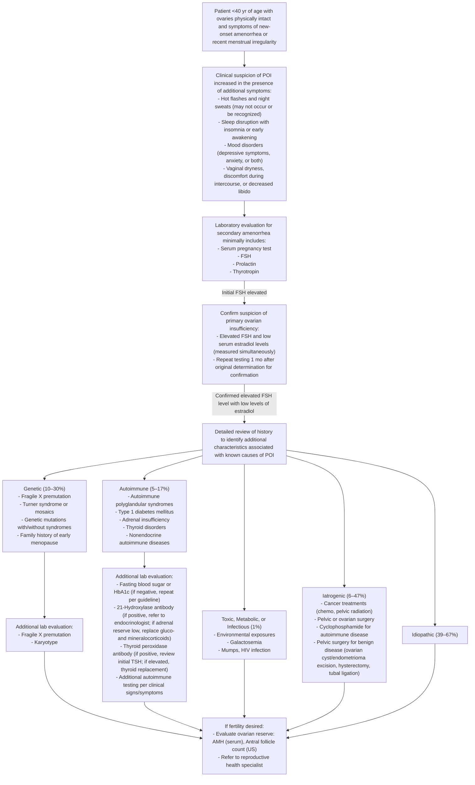

# NEJM Clinical Practice: Primary Ovarian Insufficiency

> **Layer 1 Source Reference:** [`NEJMcp2116488_261026_192416.pdf`](../../sources/magid-course/NEJMcp2116488_261026_192416.pdf)
> **Collection:** Magid Course — Clinical Guidelines & Literature | **Organization/Authors:** `Cynthia A. Stuenkel, M.D., and Anne Gompel, M.D., Ph.D. (N Engl J Med)` | **Date:** `January 12, 2023`

> [!NOTE]
> **Citation & Provenance:** *The New England Journal of Medicine*, Clinical Practice (Caren G. Solomon, M.D., M.P.H., Editor, and Winfred W. Williams, M.D., Editor). *N Engl J Med* 2023;388:154–63. DOI: `10.1056/NEJMcp2116488`. Affiliations: Department of Medicine, University of California, San Diego, School of Medicine, La Jolla (C.A.S.); Unité de Gynécologie Médicale, Port Royal-Cochin, Université de Paris Cité, Paris (A.G.).

---

## Clinical Vignette

`[Source: p. 1 (p. 154)]`

**A 23-year-old woman presents with a 6-month history of amenorrhea, with new shifts in mood and increased irritability. Her sleep has been disrupted by frequent awakenings associated with feeling hot and sweating. She questions whether her symptoms could be a result of stress related to a new job. She had menarche at 12 years of age; until 1 year ago, she had had menstrual cycles every 30 days. She has never been pregnant and has been using a copper intrauterine device (IUD) for the past 3 years. Her body-mass index (the weight in kilograms divided by the square of the height in meters) is 24.6. The physical examination is normal; there is no acne, hirsutism, or galactorrhea. A test for serum human chorionic gonadotropin is negative, and the levels of thyrotropin and prolactin are normal. The level of follicle-stimulating hormone (FSH) is in the postmenopausal range. How should this patient be further evaluated and treated?**

---

## Key Clinical Points

`[Source: p. 2 (p. 155)]`

> ### KEY CLINICAL POINTS — PRIMARY OVARIAN INSUFFICIENCY
> - Primary ovarian insufficiency should be considered in women younger than 40 years of age who present with new-onset irregular menses or amenorrhea and possibly vasomotor, depressive, or anxiety symptoms; prompt evaluation is indicated to avoid prolonged time to diagnosis and treatment.
> - Elevated follicle-stimulating hormone and low serum estradiol levels measured on two occasions 1 month apart are diagnostic.
> - The cause (genetic, autoimmune, metabolic, infectious, or iatrogenic) should be sought; in the majority of patients, the cause remains unidentified.
> - Management includes counseling the patient about the diagnosis, implications, and uncertainty regarding the clinical course of primary ovarian insufficiency; other concerns to address include fertility, the need for contraception, recommendations for hormone-replacement therapy (HRT), and depending on the cause of the disorder, surveillance for associated medical conditions.
> - Prompt initiation of HRT is recommended at higher doses than those used in older, naturally postmenopausal women and should be continued at least until the average age of natural menopause.
> - Research is needed to evaluate the effects of HRT on cardiovascular disease, osteoporosis, and neurodegenerative disorders in women with primary ovarian insufficiency.

---

## The Clinical Problem

`[Source: p. 1 (p. 154)]`

Primary ovarian insufficiency is a disorder in women younger than 40 years of age that is characterized by a decline in ovarian function, loss of oocytes and folliculogenesis, and elevated gonadotropin levels; it leads to compromised fertility and marked reduction of ovarian hormone production. This condition arises from a premature decrease in the number of ovarian follicles, acceleration of follicle destruction, or poor follicular response to gonadotropins.1 The reduction in systemic estrogen before the age of natural menopause is associated with the development of osteoporosis, cardiovascular disease, and possibly accelerated neurodegenerative aging.

The prevalence of primary ovarian insufficiency among women younger than 40 years of age is approximately 1% in the United States and 3.7% worldwide.2 The Study of Women's Health across the Nation reported significant differences in prevalence among ethnic groups: White, 1.0%; Black, 1.4%; Hispanic, 1.4%; Chinese, 0.5%; and Japanese, 0.1%.3 The nomenclature of the disorder has evolved, and "primary ovarian insufficiency" has replaced "premature ovarian failure."1,4-6 Some international groups prefer "premature ovarian insufficiency," which encompasses surgical menopause.7-9

The diagnosis is generally unexpected and is one that is difficult for clinicians to deliver and for patients to receive. A complete diagnostic evaluation is recommended, although many cases remain idiopathic in origin (Fig. 1). Causes include genetic, autoimmune, toxic, metabolic, infectious, and iatrogenic factors.11-14 Treatment involves attention to psychological counseling, symptom relief, reproductive options, and preventive strategies for bone and cardiovascular health.

---

## Strategies and Evidence

### Clinical Presentation

`[Source: p. 2 (p. 155)]`

Primary ovarian insufficiency manifests as primary or secondary amenorrhea. Amenorrhea for more than 3 months in a woman younger than 45 years of age with a history of regular cycles or for more than 6 months in a woman with a history of irregular menstrual cycles always merits evaluation.15 Women may also report new onset of menstrual irregularity or have decreased ovarian reserve detected during an infertility evaluation or preparation for elective egg harvesting. Menopausal symptoms (e.g., hot flashes, mood disorders, sleep disruption, symptoms of vaginal dryness, and impaired sexual function), if present, are often unrecognized, leading to delayed diagnosis and treatment (Fig. 1). In one survey, women reported having consulted three or more clinicians before receiving a diagnosis; for one in four women, more than 5 years transpired between the onset of symptoms and receipt of a diagnosis.16 The course of primary ovarian insufficiency can be unpredictable. Some women have temporary, spontaneous resumption of ovarian activity, but we lack reliable techniques to predict which patients will have this development.17,18 Clinical presentation can also vary according to the cause of the disorder.

### Diagnosis and Evaluation

`[Source: pp. 2, 4–6 (pp. 155, 157–159)]`

The initial diagnostic evaluation of secondary amenorrhea includes a careful history and physical examination focused on the timing of amenorrhea or menstrual irregularities (Fig. 1). A thorough family history should be obtained, including ages at menopause as well as any known cases of primary ovarian insufficiency and amenorrhea among family members. Cognitive impairment or autism in male family members should be noted, because these conditions arouse concern for premutation of the fragile X gene as a cause of amenorrhea.

Laboratory evaluation includes a serum pregnancy test and tests for levels of prolactin, thyrotropin, and FSH (Fig. 1). Elevated levels of FSH point to an ovarian source of amenorrhea and should be remeasured concurrently with serum estradiol 1 month after the first measurement.15 If the level of FSH remains high and the estradiol level is low, the diagnosis of primary ovarian insufficiency is confirmed, and further evaluation is indicated to identify the cause.

In the past, more than 70% of cases of primary ovarian insufficiency were considered to be of idiopathic origin4,7; however, more recent studies that used sequencing of the whole genome or whole exome have identified new gene mutations that are involved in normal gonadogenesis, oogenesis, folliculogenesis, mitochondrial and immune function, metabolism, apoptosis, DNA replication and repair (including in *BRCA1* and *BRCA2*), messenger RNA processing, cell-cycle progression, meiosis, and hormonal signaling, which suggests that in at least 30% of patients, and probably more, primary ovarian insufficiency can be attributed to a genetic cause12,15,19-23 (Table S1 in the Supplementary Appendix, available with the full text of this article at NEJM.org). Some research centers use a standard diagnostic panel to screen patients for commonly identified genetic variants,22 although in routine clinical practice, genetic testing is usually limited to karyotype and screening for premutation of the fragile X gene.

The Turner syndrome (loss of an X chromosome) and mosaicisms are well recognized causes of primary ovarian insufficiency,15,23-25 and thus a karyotype analysis should be ordered in all patients. With an incidence of 1 in 2000 to 2500 live births, the Turner syndrome is more commonly associated with primary amenorrhea. Mosaicisms or partial loss of an X chromosome, terminal deletions of the long arm of the X chromosome, or X autosomal translocations are associated with secondary amenorrhea in 10 to 20% of women with the Turner syndrome.25

Premutation of the gene encoding fragile X messenger ribonucleoprotein 1 (*FMR1*), which is associated with the fragile X syndrome,20 also contributes to primary ovarian insufficiency. Instability in the 5′ untranslated region of the gene results in the fragile X syndrome, which affects 1 in 4000 male and 1 in 8000 female persons; it is the most common hereditary cause of intellectual disability and autism.26 An allele with CGG repeats in the premutation range (55–200) occurs in 1 in 150 to 1 in 250 women26,27 and increases a carrier's risk of having a child with the fragile X syndrome owing to expansion of the allele to more than 200 repeats during meiosis (Fig. 2). Primary ovarian insufficiency develops in 20% of premutation carriers.26 As such, an *FMR1* genetic carrier analysis is also recommended routinely in the diagnostic evaluation of women with primary ovarian insufficiency.24 In a population-based study in Atlanta, the youngest age of onset and highest likelihood of primary ovarian insufficiency was observed in women with 85 to 89 repeats (42.5%), followed by those with 80 to 84 repeats and then by those with 90 to 94 repeats.27 Women with fewer than 65 or more than 120 repeats did not have a significantly increased risk.27 Clinicians should be aware of associated disorders in women with fragile X premutation, including tremor–ataxia syndrome,30 neurodevelopment disorders,30 and cardiovascular disorders (e.g., autonomic dysfunction, hypertension, and cardiac arrhythmia)31 (Fig. 2).

In routine practice, supplemental genetic screening beyond determination of karyotype and fragile X premutation status depends on the presence of clinical features of a specific syndrome and is not routinely recommended. A family history of early menopause or primary ovarian insufficiency, however, would merit additional genetic screening. If a first-degree relative has primary ovarian insufficiency, the likelihood of a genetic disorder is increased by a factor of 6 to 12.17 If testing is positive, family counseling regarding fertility preservation in female family members is indicated.

Autoimmune disorders (Fig. 1) have historically been considered to account for up to 30% of cases of primary ovarian insufficiency, but recent data suggest that number is closer to 4 to 5%.11,13,14,32 In the context of autoimmunity, fluctuations in ovarian activity that are more frequent than anticipated are associated with relatively high ovarian reserve and relatively low FSH level, at least at the onset of primary ovarian insufficiency.9,14,32 Autoimmune polyendocrine syndromes include primary ovarian insufficiency in constellation with other endocrinopathies. With a prevalence of 1 in 1000, autoimmune polyendocrine syndrome type 2 includes autoimmune thyroid disease (in 10% of women with primary ovarian insufficiency), Addison's disease (10% of cases are associated with primary ovarian insufficiency), and type 1 diabetes. Autoimmune primary ovarian insufficiency can occur in isolation or in association with nonendocrine systemic autoimmune disorders.9,32,33 Testing for thyroid peroxidase antibodies and thyrotropin, adrenal 21-hydroxylase antibodies, and fasting blood glucose or glycosylated hemoglobin levels is recommended (Fig. 1); ovarian antibody testing is not indicated owing to low sensitivity and specificity.1,7,9,15 Clinicians require a high index of suspicion and low threshold to test for other possible autoimmune disorders, since virtually all these disorders (most commonly hypothyroidism) have been described in association with primary ovarian insufficiency.

Cyclophosphamide therapy for autoimmune disorders can have toxic effects in ovarian follicles and contributes to primary ovarian insufficiency. Radiotherapy, chemotherapy, and pelvic surgery can also be gonadotoxic; effects depend on the patient's age and ovarian reserve at the time of treatment and the type, dose, and duration of therapy.34 Pelvic surgeries for benign conditions, especially multiple excisions of ovarian cysts (including endometriomas), are associated with reduced age of menopause (Fig. 1).35,36 Additional causes include toxic exposure to environmental chemicals (e.g., phthalates, bisphenols, and dioxins); galactosemia, a rare metabolic disorder usually diagnosed in infancy; and infection with mumps or human immunodeficiency virus37 (Fig. 1).

The results of bilateral salpingo-oophorectomy in women younger than 40 years of age differ physiologically from primary ovarian insufficiency. The transition occurs abruptly, results in complete loss of ovarian hormones, and causes permanent loss of fertility. In observational studies, oophorectomy before 46 years of age has been associated with increased long-term risks of osteoporosis, diabetes, cardiovascular disease, and neurodegenerative decline.38

---

### Figure 1: Diagnostic Approach in a Patient with Possible Primary Ovarian Insufficiency

`[Source: pp. 3–4 (pp. 156–157)]`

**Figure 1 Caption Notes (`[Source: p. 4 (p. 157)]`):**
- Hot flashes and night sweats may be mistaken for another condition (e.g., panic attacks) and not recognized by patients or unsuspecting clinicians as vasomotor symptoms associated with declining estrogen levels. Furthermore, vasomotor symptoms usually occur only after exposure to endogenous estrogen levels after attainment of puberty or use of hormone-replacement therapy. Therefore, in the context of primary amenorrhea without pubertal development, the patient may not have hot flashes.
- With regard to laboratory evaluation in a patient who is still having menstrual cycles, determination of follicle-stimulating hormone (FSH) level on day 2, 3, or 4 of the cycle is recommended.10
- Known causes of primary ovarian insufficiency are genetic (in 10 to 30% of women11-13); autoimmune (in 5 to 17%11,13,14); toxic, metabolic, or infectious (in 1%13); iatrogenic (in 6 to 47%11,13,14); and idiopathic (in 39 to 67%11,13,14).
- Nonendocrine autoimmune diseases include celiac disease, vitiligo, alopecia, pernicious anemia, systemic lupus erythematosus, rheumatoid arthritis, hemolytic anemia, Crohn's disease, Sjögren's syndrome, myasthenia gravis, primary biliary cirrhosis, and chronic active hepatitis.

---

### Figure 2: Fragile X Premutation Carrier Identification and Implications in Women with Primary Ovarian Insufficiency

`[Source: p. 5 (p. 158)]`

**Fragile X premutation status determined in women with POI on the basis of the number of CGG repeats in the 5′ untranslated region of *FMR1*, Xq27:**

| CGG Repeat Category | Repeat Count | Clinical & Reproductive Implications |
|---|---|---|
| **Normal** | ~5 to 44 | No increased risk of having a child with fragile X syndrome |
| **Intermediate (gray zone)** | 45 to 54 | Not at substantial risk for passing on fragile X syndrome; number of repeats may increase in the next generation |
| **Fragile X Premutation Carrier** | 55 to 200 | No symptoms of fragile X syndrome; risk for associated disorders (below); expansion to full fragile X syndrome mutation (>200 repeats) in child is directly correlated with number of CGG repeats; number of AGG interrupters may reduce risk of transmission to the next generation |

**Clinical considerations when managing POI in a Fragile X premutation carrier (55–200 repeats):**
1. **Possible Considerations for Fertility:**
   - Discuss patient desires regarding fertility evaluation.
   - Determine whether the patient is a candidate for oocyte retrieval or cryopreservation.
   - As appropriate, review possible options for prenatal diagnostic evaluation or blastocyst preimplantation evaluation, if available.
   - If donor eggs required, discuss options with fertility specialist.
2. **Family Screening:**
   - Referral for genetic counseling and genetic testing of family members, as appropriate.
   - If family members tested and positive, refer for fertility preservation, if desired, including oocyte harvest and storage, and evaluate for associated syndromes.
3. **Consider Disorders Associated with Fragile X Premutation:**
   - **Tremor–ataxia syndrome (FXTAS):** Affects 8–16% of women over 40 yr of age; tremor, ataxia, short-term memory loss, dementia, parkinsonism; specific neuroimaging findings.
   - **Neuropsychiatric disorders (FXAND):** Affects 50% of women; anxiety and depression disorders; attention and social deficits common; possible autism spectrum disorder.
   - **Possible cardiovascular disorders:** Autonomic dysfunction, hypertension, arrhythmias.
   - **Other possible disorders:** Sleep apnea, migraine headaches, thyroid disease, chronic pain.

**Figure 2 Caption Notes (`[Source: p. 5 (p. 158)]`):**
Fragile X premutation carrier screening is also recommended for patients with a family history of Fragile X Syndrome who are pregnant or considering pregnancy.24,26,27 Screening is optional for prepregnancy counseling, including carrier screening for other genetic conditions,24 and when a patient requests oocyte preservation to defer childbearing.28 The risk of expansion and transmission of fragile X syndrome to the next generation in patients with CGG repeats in the intermediate zone or a premutation carrier with a low number of CGG repeats depends on the number of AGG interruptions. Genetic and reproductive counseling necessitate determination of the number of AGG interruptions in addition to the number of CGG repeats.29

---

## Management

`[Source: p. 6 (p. 159)]`

Effective treatment of primary ovarian insufficiency includes psychological counseling, management of symptoms, hormone-replacement therapy (HRT), provision of contraception, fertility assistance, and, depending on the specific cause, family genetic counseling and management of associated conditions. Expressions of empathy and compassion when revealing the diagnosis of primary ovarian insufficiency are important, along with ensuring adequate time for answering questions and discussing options in an in-person, clinician-to-patient encounter. Psychological counseling should be initiated promptly, since unexpected infertility can precipitate symptoms of anxiety and depression;4 some carriers of the *FMR1* premutation may be especially vulnerable.30 The estrogen-deficiency state, with associated depressive symptoms, anxiety, and mood swings, may exacerbate patient distress.9

### Hormone-Replacement Therapy (HRT)

`[Source: pp. 6, 8 (pp. 159, 161)]`

In the absence of contraindications, HRT is recommended for relief of symptoms as well as for bone health and possibly for cardiovascular benefits. Reflecting expert consensus and limited evidence from randomized, controlled trials, guiding principles include initiating HRT promptly after diagnosis, prescribing higher doses of estrogen (to emulate the levels of endogenous estrogen in younger, menstruating women) than those recommended in women who have natural menopause, and continuing HRT until the age of natural menopause, at which point the advisability of extending HRT should be reassessed. Guidelines and recommendations regarding HRT are shown in Table 1.

Most guidelines and expert groups9,15,43 recommend the initiation of therapy with transdermal estradiol — which is biochemically similar to endogenous estradiol and, as compared with oral estrogen therapies, avoids first-pass metabolism by the liver — at doses higher than those prescribed in postmenopausal women. Alternatively, oral estrogens or a vaginal ring that delivers systemic doses of estrogen can be used. Depending on patient preference, endometrial protection can be provided in several ways. If the patient wants to become pregnant, use of micronized progesterone, rather than a synthetic progestogen, is advised for 12 to 14 days per month. Because long-term studies of endometrial protection in younger women who are receiving elevated doses of estrogen have not been conducted, breakthrough bleeding should be evaluated, adherence to progestogen therapy should be emphasized, and endometrial monitoring should be considered. Absence of withdrawal bleeding at or near completion of cyclical progestogen therapy is an indication for a pregnancy test. If conception has occurred, HRT should be discontinued. For women without a uterus, established evidence does not justify concurrent use of progesterone.

Premature deprivation of endogenous estrogen is associated with increased risks of osteoporosis, cardiovascular disease, and cognitive dysfunction.38,44 In studies that involved young women with primary ovarian insufficiency, transdermal estradiol administered at delivered doses of 100 to 150 μg per day (with cyclical progesterone therapy) resulted in significant increases in bone density.45 In another study, bone density in the group that received treatment with estradiol was similar at 3 years to that of controls without primary ovarian insufficiency.46 A randomized trial showed greater improvement in bone density with oral estradiol at a daily dose of 2 mg (with levonorgestrel) than with a combined oral contraceptive but was limited by small size and differential withdrawal rate in the two groups.47 Evidence is needed from larger trials to confirm these findings and assess effects on fractures. Determination of bone mineral density at diagnosis is recommended.5

Premature menopause is recognized by the American Heart Association and the American College of Cardiology as a factor that enhances the risk of cardiovascular disease and as a unique sex-specific risk factor.48,49 In a pooled analysis of 15 observational studies, the risk of cardiovascular disease events was approximately 50% greater among women who had menopause before 40 years of age than among those who had menopause at 50 or 51 years of age; the risk of cardiovascular disease events among women with premature menopause was lower when HRT was initiated within a year after menopause and maintained for more than 10 years.50 Randomized, controlled trials with clinical outcomes are lacking. Prospective observational studies of women after bilateral oophorectomy suggest other potential benefits of hormone replacement. Women who underwent bilateral salpingo-oophorectomy at 45 years of age or younger and who were treated with estrogen until at least 45 years of age had a decrease in osteoporosis risk.38 In a post hoc subgroup analysis of the Women's Health Initiative randomized, controlled trial, among women assigned to receive estrogen therapy who had undergone bilateral salpingo-oophorectomy before 45 years of age there was a reduction in all-cause mortality over long-term follow-up.51 Guidelines for the prevention of bone and cardiovascular disease recommend healthy lifestyle measures: weight regulation, exercise, restorative sleep, smoking cessation, moderation of alcohol use, adequate calcium and vitamin D intake, and management of blood pressure and lipid and glucose levels.48,49,52

---

### Table 1: Representative Guideline Recommendations for HRT in Women with Primary Ovarian Insufficiency*

`[Source: p. 7 (p. 160)]`

| Organization (Year) | Region | HRT Recommended | Preferred HRT Formulation & Dose | Preferred Method of Contraception | Duration of Therapy |
|---|---|---|---|---|---|
| **ENDO (2015)**5 | United States | Yes | Prescribe higher doses than usual postmenopausal starting doses (e.g., transdermal estradiol delivered at a daily dose of 100 μg). Reassess and taper dose with age and according to side-effect profile | Not addressed | Continue until the time of anticipated natural menopause, when the advisability of continuing can be reassessed |
| **ACOG (2017, reaffirmed 2021)**39† | United States | Yes | **Estrogen:** 17-β-E2, administered orally, 1 to 2 mg daily; transdermal estradiol delivered at a dose of 100 μg per day; conjugated equine estrogens, administered orally, 0.625 to 1.25 mg daily. **Progestogen:** medroxyprogesterone acetate, administered orally, 2.5 to 5 mg daily, or 10 mg daily for 12 days per month; micronized progesterone, administered orally, 100 mg daily, or 200 mg daily for 12 days per month. Combined oral contraceptives, dose not specified | Combined oral contraceptives, ERT with LNG-IUD, barrier methods | Continue until the average age of natural menopause. Decision to continue should be individualized |
| **NAMS (2022)**6 | United States | Yes | Appropriate doses of HT; higher doses may provide better bone protection than combined oral contraceptives, but uncertain | Combined oral contraceptives may be an alternative form of HT with contraceptive benefits in healthy younger women | HT recommended at least until the average age of menopause |
| **EMAS (2015)**40 | International | Yes | Not specified | Not specified | Continue until the average age of natural menopause |
| **NICE (2015, updated 2019)**8 | International | Yes | Choice of HRT | Combined oral contraceptives are an option | Continue treatment until at least the age of natural menopause |
| **IMS (2016)**41 | International | Yes | **Estrogen:** 17-β-E2, administered orally, 2 mg daily; conjugated equine estrogens, administered orally, 1.25 mg daily; estradiol, administered transdermally, 75 to 100 μg daily; or ethinyl estradiol, administered orally, 10 μg per day. **Progestogen:** medroxyprogesterone acetate, administered orally, 2.5 to 5 mg daily, or 10 mg daily for 12 days per month; micronized progesterone, administered orally, 100 mg daily, or 200 mg daily for 12 days per month. Combined oral contraceptives, dose not specified | Combined oral contraceptives continuously or ERT with LNG-IUD | Advised at least until the average age of menopause |
| **ESHRE (2016)**7† | International | Yes | **Estrogen:** 17-β-E2 preferred to conjugated equine estrogens or ethinyl estradiol. **Progestogen:** micronized progesterone, administered orally, 100 to 200 mg daily for 12 to 14 days per month; or dydrogesterone, administered orally, 5 to 10 mg daily for 12 to 14 days per month‡ | Not addressed | Initiate early and continue at least until the average age of natural menopause |

**Table 1 Footnotes:**
- **`*`** Guidelines regarding the use of hormone-replacement therapy (HRT) apply in the absence of contraindications, which include undiagnosed abnormal genital bleeding, breast cancer or a history of breast cancer, estrogen-dependent neoplasia, active deep-vein thrombosis, pulmonary embolism, or a history of these conditions; active arterial thromboembolic disease (e.g., stroke and myocardial infarction) or a history of these conditions; known anaphylactic reaction, angioedema, or hypersensitivity to estrogen preparations; hepatic impairment or disease; protein C, protein S, or antithrombin deficiency; or other known thrombophilic disorders, such as factor V Leiden, factor II mutation, antiphospholipid syndrome, and circulating anticoagulant. Warnings and precautions regarding the use of estrogen include increased risk of gallbladder disease; estrogen use should be discontinued if severe hypercalcemia, loss of vision, severe hypertriglyceridemia, or cholestatic jaundice occurs. Thyroid function should be monitored in women receiving thyroid-replacement therapy.42 *Abbreviations:* ACOG, American College of Obstetricians and Gynecologists; EMAS, European Menopause and Andropause Society; ENDO, the Endocrine Society; ERT, estrogen-replacement therapy; ESHRE, European Society of Human Reproduction and Embryology; HT, hormone therapy (estrogen or estrogen–progestogen combined therapy); IMS, International Menopause Society; LNG-IUD, levonorgestrel intrauterine device; NAMS, North American Menopause Society; NICE, National Institute for Health and Care Excellence.
- **`†`** This guideline is exclusively specific to primary ovarian insufficiency. Other guidelines include some recommendations for the diagnosis of primary ovarian insufficiency and use of HRT in women with primary ovarian insufficiency.
- **`‡`** Dydrogesterone (Duphaston and others) is not available in the United States.

---

### Contraception

`[Source: p. 8 (p. 161)]`

HRT does not provide contraception, and women with primary ovarian insufficiency should be educated that intermittent ovulation has been reported to occur in 50 to 75% of women with the disorder, with return of menses in 25 to 50% and pregnancy in 5 to 10%.17,18 Given that unexpected ovulation and fertility may occur before resumption of menses, ongoing contraception is recommended if pregnancy is not desired. Contraceptive options include the use of a levonorgestrel IUD concurrently with systemic estrogen, which effectively provides both contraception and endometrial protection; a barrier method; or, in the absence of contraindications, combined oral contraceptives in lieu of HRT.

### Loss of Fertility

`[Source: p. 8 (p. 161)]`

For many women, premature loss of fertility is the most devastating aspect of primary ovarian insufficiency. In women for whom conception is a priority, measures of ovarian reserve — antimüllerian hormone and antral follicle count — to assess the potential for fertility should be obtained at the time of diagnosis and referral made to a fertility specialist.10 Given the low likelihood of fertility, opportunities for family building focus on adoption or use of donor eggs or embryos. Retrospective studies suggest that in vitro fertilization with frozen-embryo transfer or oocyte or ovarian-tissue cryopreservation merit consideration in women who have a sufficient number of follicles.53-55 Only a minority of women qualify — those with autoimmune diseases or those in whom the diagnosis is established early. Family screening in the context of identification of an index case is important. In patients with the Turner syndrome, cardiac evaluation is recommended, since aortic abnormalities may contraindicate pregnancy.56

---

## Areas of Uncertainty

`[Source: pp. 8–9 (pp. 161–162)]`

New tools for genetic analysis have enabled identification of an increasing number of candidate genes associated with primary ovarian insufficiency. Wide clinical usefulness of these technologies and the effect on family counseling have not yet been established. A controversial yet provocative hypothesis postulates that sequelae associated with primary ovarian insufficiency and early menopause are manifestations of premature systemic aging rather than simply hormone-deficiency syndromes. In the absence of evidence from randomized, controlled trials, long-term prospective observational studies and consolidation of existing registries charting the choice of HRT and event outcomes would facilitate clinical recommendations. Reproductive technologies under investigation include transplantation of mesenchymal stem cells and in vitro activation of dormant primordial follicles. Currently, successes measured in live births have been confined to case reports and small patient series.55 Randomized, controlled trials are necessary to confirm the effectiveness of these technologies.

---

## Guidelines from Professional Societies

`[Source: p. 9 (p. 162)]`

Few clinical practice guidelines focus exclusively on primary ovarian insufficiency (Table 1). Those that do provide detailed recommendations for assessment and management,1,7,39 and others imbed recommendations within hormone-therapy position statements6 and broader guidelines for managing menopause.5 In women without contraindications, HRT is routinely recommended up to the anticipated age of natural menopause for treatment of symptoms and enhancement of quality of life and as a preventive strategy for bone preservation and possible cardiovascular and neurocognitive benefits.

---

## Conclusions and Recommendations

`[Source: p. 9 (p. 162)]`

The 23-year-old woman described in the vignette presented with amenorrhea and has a high FSH level consistent with primary ovarian insufficiency. After the presence of high FSH and low estradiol levels are confirmed, prompt evaluation to establish the cause is a priority. The karyotype and fragile X premutation status should be determined. Autoimmune disorders should be ruled out. Minimal evaluation includes thyroid peroxidase antibodies, 21-hydroxylase antibodies, and determination of glucose control; additional testing might be justified depending on the clinical presentation. Referral for ongoing psychological and initial fertility counseling is recommended. If the patient is found to be a fragile X premutation carrier, family genetic counseling should be advised for consideration of testing and possible fertility preservation. We would prescribe transdermal estrogen-replacement therapy at dose levels higher than usual postmenopausal doses, with endometrial protection. If contraception is needed, the levonorgestrel IUD concurrently provides both contraception and endometrial protection. Alternatively, combination oral contraceptives could be considered. For patients in whom testing reveals low ovarian reserve, we would advise that pregnancy is unlikely and that options for parenthood include adoption or use of donor eggs or embryos. Bone mineral density should be measured, with general recommendations for maintenance of bone health. Cardiovascular risks should be evaluated and managed, and the patient should be encouraged to observe healthy lifestyle measures.

---

## References

`[Source: pp. 9–10 (pp. 162–163)]`

1. Committee opinion no. 605: primary ovarian insufficiency in adolescents and young women. *Obstet Gynecol* 2014;124:193-7.
2. Golezar S, Ramezani Tehrani F, Khazaei S, Ebadi A, Keshavarz Z. The global prevalence of primary ovarian insufficiency and early menopause: a meta-analysis. *Climacteric* 2019;22:403-11.
3. Luborsky JL, Meyer P, Sowers MF, Gold EB, Santoro N. Premature menopause in a multi-ethnic population study of the menopause transition. *Hum Reprod* 2003;18:199-206.
4. Nelson LM. Clinical practice: primary ovarian insufficiency. *N Engl J Med* 2009;360:606-14.
5. Stuenkel CA, Davis SR, Gompel A, et al. Treatment of symptoms of the menopause: an Endocrine Society clinical practice guideline. *J Clin Endocrinol Metab* 2015;100:3975-4011.
6. The 2022 Hormone Therapy Position Statement of The North American Menopause Society Advisory Panel. The 2022 hormone therapy position statement of the North American Menopause Society. *Menopause* 2022;29:767-94.
7. European Society for Human Reproduction and Embryology (ESHRE) Guideline Group on POI, Webber L, Davies M, et al. ESHRE guideline: management of women with premature ovarian insufficiency. *Hum Reprod* 2016;31:926-37.
8. National Institute for Health and Care Excellence. Menopause: diagnosis and management. December 5, 2019 (https://www.nice.org.uk/guidance/ng23).
9. Lambrinoudaki I, Paschou SA, Lumsden MA, et al. Premature ovarian insufficiency: a toolkit for the primary care physician. *Climacteric* 2021;24:425-37.
10. Practice Committee of the American Society for Reproductive Medicine. Testing and interpreting measures of ovarian reserve: a committee opinion. *Fertil Steril* 2020;114:1151-7.
11. Jiao X, Meng T, Zhai Y, et al. Ovarian reserve markers in premature ovarian insufficiency: within different clinical stages and different etiologies. *Front Endocrinol (Lausanne)* 2021;12:601752.
12. Heddar A, Ogur C, Da Costa S, et al. Genetic landscape of a large cohort of primary ovarian insufficiency: new genes and pathways and implications for personalized medicine. *EBioMedicine* 2022;84:104246.
13. Ishizuka B. Current understanding of the etiology, symptomatology, and treatment options in premature ovarian insufficiency (POI). *Front Endocrinol (Lausanne)* 2021;12:626924.
14. Vogt EC, Real FG, Husebye ES, et al. Premature menopause and autoimmune primary ovarian insufficiency in two international multi-center cohorts. *Endocr Connect* 2022;11(5):e220024.
15. Stuenkel CA, Gompel A, Davis SR, Pinkerton JV, Lumsden MA, Santen RJ. Approach to the patient with new-onset secondary amenorrhea: is this primary ovarian insufficiency? *J Clin Endocrinol Metab* 2022;107:825-35.
16. Alzubaidi NH, Chapin HL, Vanderhoof VH, Calis KA, Nelson LM. Meeting the needs of young women with secondary amenorrhea and spontaneous premature ovarian failure. *Obstet Gynecol* 2002;99:720-5.
17. Kalantaridou SN, Davis SR, Nelson LM. Premature ovarian failure. *Endocrinol Metab Clin North Am* 1998;27:989-1006.
18. Bidet M, Bachelot A, Bissauge E, et al. Resumption of ovarian function and pregnancies in 358 patients with premature ovarian failure. *J Clin Endocrinol Metab* 2011;96:3864-72.
19. França MM, Mendonca BB. Genetics of ovarian insufficiency and defects of folliculogenesis. *Best Pract Res Clin Endocrinol Metab* 2022;36:101594.
20. Jiao X, Ke H, Qin Y, Chen Z-J. Molecular genetics of premature ovarian insufficiency. *Trends Endocrinol Metab* 2018;29:795-807.
21. Gorsi B, Hernandez E, Moore MB, et al. Causal and candidate gene variants in a large cohort of women with primary ovarian insufficiency. *J Clin Endocrinol Metab* 2022;107:685-714.
22. Eskenazi S, Bachelot A, Hugon-Rodin J, et al. Next generation sequencing should be proposed to every woman with "idiopathic" primary ovarian insufficiency. *J Endocr Soc* 2021;5(7):bvab032.
23. Di-Battista A, Moysés-Oliveira M, Melaragno MI. Genetics of premature ovarian insufficiency and the association with X-autosome translocations. *Reproduction* 2020;160(4):R55-R64.
24. Committee opinion no. 691: carrier screening for genetic conditions. *Obstet Gynecol* 2017;129(3):e41-e55.
25. Fiot E, Alauze B, Donadille B, et al. Turner syndrome: French National Diagnosis and Care Protocol (NDCP). *Orphanet J Rare Dis* 2022;17:Suppl 1:261.
26. Mila M, Alvarez-Mora MI, Madrigal I, Rodriguez-Revenga L. Fragile X syndrome: an overview and update of the FMR1 gene. *Clin Genet* 2018;93:197-205.
27. Allen EG, Charen K, Hipp HS, et al. Refining the risk for fragile X–associated primary ovarian insufficiency (FXPOI) by FMR1 CGG repeat size. *Genet Med* 2021;23:1648-55.
28. ACOG: committee opinion no. 584: oocyte cryopreservation. *Obstet Gynecol* 2014;123:221-2.
29. Loesch DZ, Duffy DL, Martin NG, Tassone F, Atkinson A, Storey E. 'Essential tremor' phenotype in FMR1 premutation/gray zone sibling series: exploring possible genetic modifiers. *Twin Res Hum Genet* 2021;24:95-102.
30. Tassanakijpanich N, Hagerman RJ, Worachotekamjorn J. Fragile X premutation and associated health conditions: a review. *Clin Genet* 2021;99:751-60.
31. Tassanakijpanich N, Cohen J, Cohen R, Srivatsa UN, Hagerman RJ. Cardiovascular problems in the fragile X premutation. *Front Genet* 2020;11:586910.
32. Christin-Maitre S, Givony M, Albarel F, et al. Position statement on the diagnosis and management of premature/primary ovarian insufficiency (except Turner syndrome). *Ann Endocrinol (Paris)* 2021;82:555-71.
33. McGlacken-Byrne SM, Conway GS. Premature ovarian insufficiency. *Best Pract Res Clin Obstet Gynaecol* 2022;81:98-110.
34. Su HI, Kwan B, Whitcomb BW, et al. Modeling variation in the reproductive lifespan of female adolescent and young adult cancer survivors using AMH. *J Clin Endocrinol Metab* 2020;105:2740-51.
35. Fenton A, Panay N. Does routine gynecological surgery contribute to an early menopause? *Climacteric* 2012;15:1-2.
36. Langton CR, Whitcomb BW, Purdue-Smithe AC, et al. Association of oral contraceptives and tubal ligation with risk of early natural menopause. *Hum Reprod* 2021;36:1989-98.
37. Laws MJ, Neff AM, Brehm E, Warner GR, Flaws JA. Endocrine disrupting chemicals and reproductive disorders in women, men, and animal models. *Adv Pharmacol* 2021;92:151-90.
38. Rocca WA, Gazzuola-Rocca L, Smith CY, et al. Accelerated accumulation of multimorbidity after bilateral oophorectomy: a population-based cohort study. *Mayo Clin Proc* 2016;91:1577-89.
39. Committee opinion no. 698: hormone therapy in primary ovarian insufficiency. *Obstet Gynecol* 2017;129(5):e134-e141.
40. Neves-E-Castro M, Birkhauser M, Samsioe G, et al. EMAS position statement: the ten point guide to the integral management of menopausal health. *Maturitas* 2015;81:88-92.
41. Baber RJ, Panay N, Fenton A; IMS Writing Group. 2016 IMS recommendations on women's midlife health and menopause hormone therapy. *Climacteric* 2016;19:109-50.
42. Novartis. Vivelle-Dot (estradiol transdermal system): highlights of prescribing information. 2021 (https://www.novartis.com/us-en/sites/novartis_us/files/Vivelle_DOT.pdf).
43. Klein KO, Rosenfield RL, Santen RJ, et al. Estrogen replacement in Turner syndrome: literature review and practical considerations. *J Clin Endocrinol Metab* 2018;103:1790-803.
44. Gong J, Harris K, Peters SAE, Woodward M. Reproductive factors and the risk of incident dementia: a cohort study of UK Biobank participants. *PLoS Med* 2022;19(4):e1003955.
45. Crofton PM, Evans N, Bath LE, et al. Physiological versus standard sex steroid replacement in young women with premature ovarian failure: effects on bone mass acquisition and turnover. *Clin Endocrinol (Oxf)* 2010;73:707-14.
46. Popat VB, Calis KA, Kalantaridou SN, et al. Bone mineral density in young women with primary ovarian insufficiency: results of a three-year randomized controlled trial of physiological transdermal estradiol and testosterone replacement. *J Clin Endocrinol Metab* 2014;99:3418-26.
47. Cartwright B, Robinson J, Seed PT, Fogelman I, Rymer J. Hormone replacement therapy versus the combined oral contraceptive pill in premature ovarian failure: a randomized controlled trial of the effects on bone mineral density. *J Clin Endocrinol Metab* 2016;101:3497-505.
48. El Khoudary SR, Aggarwal B, Beckie TM, et al. Menopause transition and cardiovascular disease risk: implications for timing of early prevention: a scientific statement from the American Heart Association. *Circulation* 2020;142(25):e506-e532.
49. Cho L, Davis M, Elgendy I, et al. Summary of updated recommendations for primary prevention of cardiovascular disease in women: JACC state-of-the-art review. *J Am Coll Cardiol* 2020;75:2602-18.
50. Zhu D, Chung H-F, Dobson AJ, et al. Age at natural menopause and risk of incident cardiovascular disease: a pooled analysis of individual patient data. *Lancet Public Health* 2019;4(11):e553-e564.
51. Manson JE, Aragaki AK, Bassuk SS, et al. Menopausal estrogen-alone therapy and health outcomes in women with and without bilateral oophorectomy: a randomized trial. *Ann Intern Med* 2019;171:406-14.
52. Lobo RA, Gompel A. Management of menopause: a view towards prevention. *Lancet Diabetes Endocrinol* 2022;10:457-70.
53. Zhu X, Ye J, Fu Y. Premature ovarian insufficiency patients with viable embryos derived from autologous oocytes through repeated oocyte retrievals could obtain reasonable cumulative pregnancy outcomes following frozen-embryo transfer. *Ann Transl Med* 2021;9:539.
54. De Vos M, Grynberg M, Ho TM, Yuan Y, Albertini DF, Gilchrist RB. Perspectives on the development and future of oocyte IVM in clinical practice. *J Assist Reprod Genet* 2021;38:1265-80.
55. Rosario R, Anderson RA. Novel approaches to fertility restoration in women with premature ovarian insufficiency. *Climacteric* 2021;24:491-7.
56. Schleedoorn MJ, Mulder BH, Braat DDM, et al. International consensus: ovarian tissue cryopreservation in young Turner syndrome patients: outcomes of an ethical Delphi study including 55 experts from 16 different countries. *Hum Reprod* 2020;35:1061-72.
