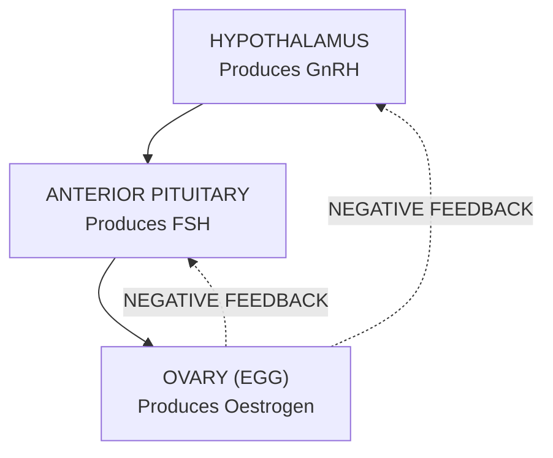
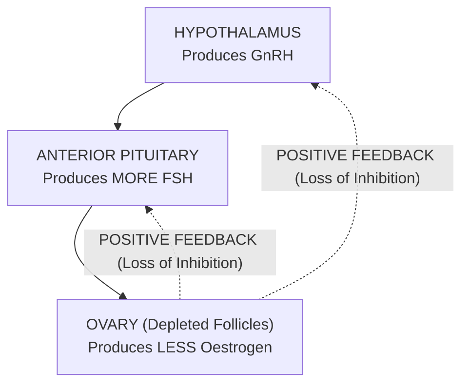

# Approaching and diagnosing menopause

> **Layer 1 Source Reference:** [`1 Approaching and diagnosing menopause.docx`](../../sources/red-whale/1%20Approaching%20and%20diagnosing%20menopause.docx)
> **Collection:** Red Whale Menopause Guidelines | **Original Format:** `DOCX` | **Review Date:** `November 2024`

*This article was reviewed in November 2024.*

Menopause is not just a hormonally-driven experience. It can also be impacted by emotional, psychological, social, sexual and cultural factors.

Menopause:

- Marks the end of reproductive life, which may be a positive for some women (no more periods or contraception!), but not for others (loss of fertility and ‘youth’).
- May coincide with the challenges of growing children, ageing parents, relationship strains, work stress and managing domestic chores, as well as all the other things that modern life throws at a middle-aged woman.
- Can be associated with debilitating and life-altering symptoms for some, or be a complete non-event for others (*around 60% of women experience mild or no symptoms*).
- Consultations can be tricky because it is sometimes hard to know whether a woman’s presenting problem is due to her menopause, is a consequence of other issues or is a culmination of everything!
- May be hard to recognise in some groups of women, e.g. those from ethnic minorities or those who lack awareness of menopause and its symptoms. They may present atypically, and supporting and managing these patients may be more challenging ([Br J Gen Pract 2023;73:e511](https://bjgp.org/content/73/732/e511)).

The approach to menopause care needs to be holistic and based on biopsychosocial assessment, and this is why primary care is the perfect place to manage the menopause!

This article summarises how we approach and diagnose menopause, and how we can counsel women about this life transition using empathy and empowerment. See *HRT: a guide to starting, troubleshooting and stopping* and the *HRT: GEMS* for details on initiating hormone replacement therapy.

## Menopause: health implications

As life expectancy increases (now 82y on average for women), and with the average age of menopause 51y, at least 30% of the lives of our female patients will be spent postmenopausally. This has medical implications because the hypo-oestrogenic state is associated with:

- Symptoms that may need managing.
- Increased risk of osteoporosis, cardiovascular disease and stroke.

Ageing in itself leads to physical issues and increased risk of disease so a menopause consultation provides a really good opportunity to address any medical risk factors, and encourage optimisation of lifestyle in order to maximise long-term health and happiness.

## Physiology of menopause

### In a premenopausal woman

The menstrual cycle begins when the hypothalamus produces gonadotrophin-releasing hormone (GnRH), which stimulates the production of follicle-stimulating hormone (FSH) from the pituitary gland. FSH stimulates follicular development in the ovary, and promotes ovarian oestrogen production. Raised oestrogen levels suppress FSH production and trigger the mid-cycle LH surge, which leads to ovulation. At the end of the luteal phase, if conception has not occurred, falling levels of oestrogen (and progesterone) lead to menstruation, and this stimulates the hypothalamus to start the process again.

> **Diagram Transcription — Premenopausal Hypothalamic–Pituitary–Ovarian (HPO) Axis (`image3.jpg`):**
> - **Hypothalamus** → produces **GnRH** → stimulates the **Anterior Pituitary** *(shown adjacent to the Posterior Pituitary)*.
> - **Anterior Pituitary** → produces **FSH** → stimulates the ovarian follicle (**Egg**).
> - **Egg / Ovary** → **produces oestrogen**.
> - **Negative Feedback:** Oestrogen exerts **negative feedback** (dashed pathways) on both the **Anterior Pituitary** and the **Hypothalamus**, regulating GnRH and FSH secretion.

### In a menopausal woman

The ageing ovary has declining numbers of oocytes and becomes less responsive to gonadotrophins; as a result, oestrogen production declines. Persistently low oestrogen levels stimulate the hypothalamic–pituitary axis to produce more FSH in an attempt to make residual oocytes ovulate. Ovarian dysfunction is a gradual process, marked by erratic hormonal changes and sporadic ovulation, during which FSH levels can fluctuate on a daily basis. By menopause, which is complete ovarian failure, a woman will have consistently raised FSH levels.

> **Diagram Transcription — Menopausal Hypothalamic–Pituitary–Ovarian (HPO) Axis (`image2.jpg`):**
> - **Hypothalamus** → produces **GnRH** → stimulates the **Anterior Pituitary** *(shown adjacent to the Posterior Pituitary)*.
> - **Anterior Pituitary** → **produces MORE FSH** → acts on the follicle-depleted **Ovary**.
> - **Ovary** → **produces LESS oestrogen**.
> - **Positive Feedback *(loss of oestrogenic negative feedback)*:** Reduced oestrogen results in compensatory stimulation (labelled **Positive Feedback** in diagram, dotted pathways) to the **Anterior Pituitary** and **Hypothalamus**, driving elevated FSH levels.

([BMS Management of the menopause handbook, 6th ed](https://thebms.org.uk/publications/handbook/).)

## Definitions

| Term | Definition |
| :--- | :--- |
| **Perimenopause** | This is the start of deteriorating ovarian function, and usually begins around the age of 45y. Perimenopausal women may experience: Menopausal symptoms due to lowering oestrogen levels. Erratic bleeding patterns and menstrual cycles due to fluctuating hormonal levels.Vasomotor symptoms are believed to represent a complex interplay between central and peripheral physiological mechanisms. It is thought that perimenopausal women may experience a narrowing of the thermoregulatory-neutral zone (the body’s thermostat). As a result, small changes in body temperature trigger the perception of intense heat and activate heat dissipation processes, e.g. peripheral vasodilation and sweating ([Climacteric,2018;21(2):96](https://doi.org/10.1080/13697137.2018.1430131)). |
| **Menopause** | This is the loss of ovarian follicular function. It marks the end of reproductive life and cessation of menstruation. Menopause is a retrospective diagnosis, defined as: 1y of amenorrhoea >50y OR 2y of amenorrhoea >40y (amenorrhoea/perimenopausal symptoms <40y need investigating to rule out premature ovarian insufficiency). |
| **Early menopause** | Menopause occurring between age 40y and 45y. |
| **Premature ovarian insufficiency** | Previously referred to as premature menopause/ovarian failure. Menopause under the age of 40y. Associated with increased risk of osteoporosis and cardiovascular disease. HRT is recommended for these women. |

([BMS Management of the menopause handbook, 6th ed](https://thebms.org.uk/publications/handbook/).)

## Symptoms of menopause

May be attributable to oestrogen deficiency in combination with age and other factors. Symptoms typically begin in the perimenopause and last around 2–7y, although can continue for up to 15y.

A woman may describe some or all of the following:

| Physical | Psychological | Gynaecological |
| :--- | :--- | :--- |
| Hot flushes and night sweats (affect around 75% of women). Joint and muscle pains. Palpitations. Skin/hair changes. Weight gain. | Sleep disturbance. Tiredness and lack of energy. Mood changes and irritability. Anxiety. Cognitive disturbance (‘brain fog’). | Menstrual irregularities. Vaginal dryness and dyspareunia. Loss of libido/sexual dysfunction. Urinary problems/incontinence. Uterovaginal prolapse. |

([Post Reproductive Health, 2020; 26(4):181](https://doi.org/10.1177/2053369120957514))

## Diagnosis

A clinical history of typical menopausal symptoms in a woman aged 45y or over is diagnostic, and no other investigation is required.

*BUT:*

- Investigate any change in bleeding pattern suggestive of endometrial pathology (as per NICE guidelines on heavy menstrual bleeding, [NICE 2018, updated 2021, NG88](https://www.nice.org.uk/guidance/ng88)).
- Consider the differential diagnoses below if the history is ATYPICAL for ovarian failure, or is suggestive of:
  - Anxiety or panic disorder.
  - Alcohol-induced symptoms.
  - Endocrine problems (thyroid disorders, diabetes, phaeochromocytoma).
  - Obesity and metabolic syndrome.
  - Tumours (rare).
  - TB.
  - Drugs (e.g. steroids, nitrates, diltiazem, levodopa, GnRH agonists, anti-oestrogens).

([Post Reproductive Health, 2017;23(4):177](https://doi.org/10.1177/2053369117715371))

## When should I do an FSH level?

Elevated FSH levels may indicate a degree of ovarian failure, but they can fluctuate in the perimenopause and so are unhelpful in diagnosing menopause in women >45y.

FSH measurement can be helpful to:

- Diagnose premature ovarian failure or early menopause:
  - Two measurements taken 4–8w apart >30IU/L are diagnostic.
- Decide whether an amenorrhoeic woman >50y on hormonal contraception may stop contraception or not:
  - Levels >30IU/L are suggestive of menopause, but the FSRH recommends continuing contraception for a further year.

### Can FSH be accurately measured in women on hormonal contraception?

- We can measure FSH in women on progestogen-only contraception because it doesn’t affect FSH…
- ALTHOUGH Depot Provera may give a falsely low reading so arrange blood test just before giving next injection.
- Oestrogen-containing preparations (e.g. HRT, CHC) do suppress FSH so stop for at least 6w prior to taking blood.

[(FSRH Contraception for women aged >40, 2017; updated 2019)](https://www.cosrh.org/Common/Uploaded%20files/documents/fsrh-guideline-contraception-for-women-aged-over-40-years.pdf)

## Menopause: too much medicalisation?

An Analysis article in the BMJ counters some of the controversial messaging regarding menopause that has been disseminated by the media in recent years. It makes the following points:

### Menopause is a natural process

- Negative reporting that emphasises physical decline and mental instability could result in women feeling anxious and dreading the onset of menopause.
- This focus on debilitating symptoms and long-term sequelae risks defining it as a ‘disease state’ that requires treatment – not a physiological entity that may not.
- Widespread endorsement of HRT as the only effective treatment, and as a preventer of long-term chronic disease, influences susceptible women. It also massively benefits the hormone-manufacturing industry.

### There is no universal menopause experience

- Whether a woman is symptomatic or not depends on biological factors (such as BMI, hormonal state, smoking, and alcohol consumption), as well as cultural ones – including socioeconomic status, education level, ethnicity and wider societal attitudes towards women.
- A global survey found that 16–40% of women experience moderate/severe vasomotor symptoms – *meaning that at least 60% of women do not!*

The article suggests that “normalising female ageing and celebrating the strengths, beauty and achievements of older women” can help change the narrative surrounding menopause and challenge gender-based stigma ([BMJ 2022;377:e069369](https://doi.org/10.1136/bmj-2021-069369)).

## An empowerment model for menopause management

As parts of a series on menopause in 2024, the Lancet included an article endorsing an empowerment model for menopause management. This model is based on the premise that there is a need to demedicalise menopause and to frame it as a natural phase of life. This use of empowerment is potentially an effective tool to enable self-management of health over the menopause transition.

Key components of this model are summarised in the table below, and may be useful for our consultations:

| Clinical Area / Principle | Recommendations & Actions |
| :--- | :--- |
| **Listen to concerns and be empathic** | Provide a space to enable a woman to feel validated, voice her concerns and have her questions answered. Challenge stigma and negative messaging by giving reassurance and supporting a positive, patient-centred action plan. Rather than a period of decay and decline, menopause may be considered as a period of life when a woman has experience and wisdom, and it could represent a time for positive life changes and personal fulfilment (*if possible, practical and desired*). Remind her about the benefits of menopause: freedom from menstrual symptoms and need for contraception. Not all women need or want treatment for their menopause, but we should give them unbiased information with which to make that decision. Provide written, digital or other resources to back up advice, and provide further information/support (e.g. menopause cafés or hubs, Menopause Matters or the Women’s Health Concern website – see useful resources at end of article). |
| **Give evidence-based and balanced information** | Vasomotor symptoms are usually time limited (on average, they last 4–7y), tend to be most severe around the last menstrual period and gradually reduce thereafter. Stress and anxiety can make hot flushes worse. Vaginal dryness and painful sex can occur in the menopause transition, and can be alleviated with vaginal moisturisers, lubricants or topical oestrogen. Other symptoms – including psychological and physical – may have a hormonal component, BUT may also be multifactorial or due to other causes. |
| **Support shared decision-making regarding treatments** | Advise patient that HRT is an effective treatment for vasomotor symptoms and other associated menopausal symptoms. Discuss risks and benefits of HRT in the patient’s individual context. Give information about alternatives to HRT if requested. Advise that CBT can help reduce menopausal symptoms and improve quality of life. Discuss behavioural strategies to reduce the impact of hot flushes and the anxiety which can surround them (e.g. avoidance of triggers, use of fans, weight loss). Encourage routines and practices that may reduce stress and improve mood, e.g. mindfulness and exercise. Give information about sleep hygiene and consider CBT-i if insomnia is a significant problem. Manage any low mood or depressive symptoms using counselling and medication if required. |
| **Give positive lifestyle and health improvement advice** | Reduce alcohol consumption if relevant. Encourage smoking cessation if a smoker. If BMI raised: explore weight reduction strategies. Discuss management of symptoms in the workplace (e.g. requesting flexible hours, supportive communication, ‘breathable’ uniforms, ambient room temperatures – for more information, see [Menopause at Work - menopause information pack for organizations](https://www.menopauseatwork.org/)). Encourage connection with friends and family for discussion and support. Remind about the importance of attending for health screening when called (e.g. breast cancer and cervical screening). |

([Lancet 2024; 403: 947–57](https://doi.org/10.1016/s0140-6736(23)02799-x))

## Referral

Most women with menopausal symptoms can be managed in primary care. However, there may be situations where more specialist advice is required.

NICE recommends referring to a healthcare professional with expertise in menopause:

- If treatments do not improve symptoms or there are ongoing troublesome side-effects.
- Women with menopausal symptoms and contraindications to HRT, for example:
  - Those with a history of breast cancer or who are at high risk of developing breast cancer.
  - Those with a history of cardiovascular disease.
  - Those at high risk of VTE.
- If there is uncertainty about the most suitable treatment option for their menopausal symptoms.
- Women with premature ovarian insufficiency (premature menopause).

A healthcare professional with expertise in menopause may be a local GP or gynaecologist with an interest in menopause ([NICE 2015 (updated 2024), NG23](https://www.nice.org.uk/guidance/ng23)).

## Key Clinical Summary

> **Approaching and diagnosing menopause**
> The main symptoms of menopause are hot flushes, night sweats, menstrual irregularities and urogenital atrophy. These symptoms are common and can have a significant impact on a woman’s life.
> Long-term risks of menopause are osteoporosis, cardiovascular disease and stroke.
> For women >45y, the diagnosis of menopause is clinical.
> FSH testing should be reserved for diagnosing premature ovarian failure or early menopause, and in deciding whether to stop contraception in women >50y.
> Most menopausal women can be managed in primary care using a biopsychosocial, holistic and empowering approach.

> **Useful resources for patients:**
> *Websites (all resources are hyperlinked for ease of use in Red Whale Knowledge*)
> [Menopause Matters](https://www.menopausematters.co.uk/)
> [Women’s Health Concern](https://www.womens-health-concern.org/)
> [Menopause Café](https://www.menopausecafe.net/) (gather to eat cake, drink and discuss menopause)
> [Henpicked](https://henpicked.net/)
