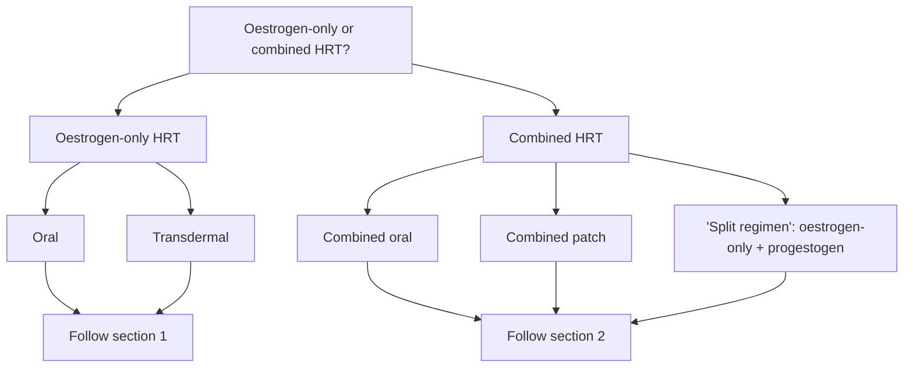

# HRT: availability, switching and off-licence prescribing

> **Layer 1 Source Reference:** [`HRT_ availability, switching and off-licence prescribing 6.docx`](../../sources/red-whale/HRT_%20availability%2C%20switching%20and%20off-licence%20prescribing%206.docx)
> **Collection:** Red Whale Menopause Guidelines | **Original Format:** `DOCX` | **Review Date:** `June 2025`

*HRT prescribing can sometimes feel like a complete minefield – possibly now more than ever! This may be due to a number of factors, including:*

### HRT availability

Or unavailability! This has been a recurrent issue for a number of years now, and shows no sign of abating: the affected preparations seem to vary, and include both oestrogen-only and combined HRT, and oral and transdermal preparations. More recently, progestogens have been a problem.

### New and discontinued products

As demand increases, especially for bioidentical HRT, more products have (and will) become available (e.g. Bijuve). Meanwhile, some older or less popular products have disappeared from the market (e.g. Climanor – the only preparation of medroxyprogesterone acetate (MPA) actually licensed for HRT!).

### Off-licence prescribing

We may be asked by patients or menopause specialists to prescribe off-licence HRT formulations (such as testosterone) or above-licensed-dose regimens.

There are situations when this seems reasonable, and may be endorsed by the British Menopause Society (BMS) and other expert bodies. In other situations, it may not.

*This article aims to provide some clarity on these issues and to help defuse the minefield! It was updated in June 2025.*

## Managing availability issues

### How do I know what is and isn’t available?

The British Menopause Society website is a good source of information on the availability of different products ([BMS – update on HRT supply)](https://thebms.org.uk/news/british-menopause-society-update-on-hrt-supply/), as is [MIMs – drug shortages live tracker](https://www.mims.co.uk/drug-shortages-live-tracker/article/1581516). Your local community pharmacist may be helpful too.

### It’s not in stock, what do I do?

If a product is not available, next steps depend on *what* that product is.

*Don’t forget that women can access an HRT prescription prepayment certificate from some pharmacies or online from the [NHSBSA – HRT prescription prepayment certificate](https://www.nhsbsa.nhs.uk/help-nhs-prescription-costs/nhs-hormone-replacement-therapy-prescription-prepayment-certificate-hrt-ppc). This enables them to get a year’s worth of HRT at a lower cost.*

Please follow the link for a PDF version of the GEMS for download/printing: [HRT availability: GEMS](https://www.redwhale.co.uk/media/fc3423bb-24ca-42d9-bb11-ba794c6259d1/HRT%20availability%20GEMS.pdf?version=3)

#### Embedded Red Whale GEMS: Troubleshooting HRT Availability & HRT Formulations (Pages 1–4)

> **Source Attribution (GEMS Header):** *The BMS Tools for Clinicians: Progestogens and endometrial protection, HRT preparations and equivalent alternatives; BMS guideline on management of unscheduled bleeding on HRT 2024; BNF 2025; MIMS 2025 (Red Whale GEMS — Guidelines & Evidence Made Simple, October 2026).*

##### Page 1 — 1. Troubleshooting HRT Availability (`image6.png`)

> **To use this GEMS:**
> - Identify what type of HRT a woman is taking and what component is unavailable.
> - Identify the dose equivalent of the unavailable component (section 1 for oestrogen-only HRT, section 2 for combined HRT).
> - Find a suitable available matching formulation that is acceptable to the woman (section 3).

**Decision Pathway — What type of HRT is being used?**

> **Patient Counselling Note:** Women may experience some irregular bleeding following a switch to an alternative preparation. This should settle within 3–6 months. Seek medical advice if it doesn’t.

###### Section 1: Oestrogen-Only HRT

- **Oral oestrogen-only HRT options:**
  - Make direct switch to another oral preparation of the equivalent dose (see HRT formulation tables).
  - *Consider* switch to a transdermal preparation of an equivalent dose.
- **Transdermal oestrogen-only HRT options:**
  - Swap to any transdermal oestrogen preparation of an equivalent dose.
  - Patches may be cut to give a required dose (off licence).
  - *If switching from transdermal to oral, do a full reassessment of suitability, i.e. avoid in higher-risk women (e.g. if >60y, overweight or migraine) due to increased VTE and CVA risk with oral preparations.*

**Dosing and dose equivalence — Oestradiol (BMS guidance on management of unscheduled bleeding on HRT 2024)**
*(Doses in italics are off licence. There is no published evidence for the efficacy or safety of off-licence oestradiol.)*

| Dosage | Oral oestradiol | Oestradiol patch | Oestradiol gel: Oestrogel | Oestradiol gel: Sandrena | Oestradiol spray |
| :--- | :--- | :--- | :--- | :--- | :--- |
| **Ultra-low** | 0.5mg | 12.5mcg | 1/2 pump | 0.25mg | 1 spray |
| **Low** | 1mg | 25mcg | 1 pump | 0.5mg | 2 sprays |
| **Standard** | 2mg | 50mcg | 2 pumps | 1mg | 3 sprays |
| **Moderate** | *3mg* | 75mcg | 3 pumps | 1.5–*2.0mg* | *4–5 sprays* |
| **High** | *4mg* | 100mcg | 4 pumps | *3mg* | *6 sprays* |

> *IMPORTANT! GMC guidance recommends that where a licensed preparation is available, it should be used in preference to an off-licence drug. If adjusting HRT for availability, we should take this into account.*

---

##### Page 2 — 2. Troubleshooting HRT Availability: Section 2: Combined HRT (`image5.png`)

- **Combined oral HRT options:**
  - Switch to alternative oral preparation: match the progestogen if possible (*there are a few containing norethisterone*), but otherwise choose alternative with a different progestogen.
  - Consider switching to a transdermal patch (e.g. Evorel Sequi has the same progestogen as Elleste Duet).
  - Or offer a split regimen (e.g. Oestrogel + Provera contains the same hormones as Indivina).
- **Combined patch HRT options:**
  - There are 2 combined patches, both of which have the same dose of oestrogen, so switching is possible:
    - Evorel (contains norethisterone) – applied twice weekly.
    - Femseven (contains levonorgestrel) – applied weekly.
  - Or consider switching to oral equivalent of patch – this will need reassessment of risk factors.
    - Use with caution in women at higher risk of thromboembolism (e.g. if >60y, overweight or with migraine) due to increased VTE and CVA risk with oral preparations.
  - Tibolone is a low-risk oral alternative to continuous combined HRT.
  - Offer split regimen (see below).
- **‘Split regimen’ oestrogen-only HRT + progestogen options:**
  - **Oestrogen component unavailable:**
    - See oestrogen-only alternatives (on page 1).
  - **Progestogen component unavailable:**
    - Micronised progesterone often first line as considered safest option. If not available:
      - Alternatives are medroxyprogesterone acetate (MPA) or norethisterone (note: norethisterone is associated with VTE risk so avoid in higher-risk women) or
      - Offer IUS or
      - Offer combined product: patch or oral, *if appropriate* (e.g. Bijuve is a continuous combined oral HRT with micronised progesterone).

**Dosing and dose equivalence — Progestogens (BMS guidance on management of unscheduled bleeding on HRT 2024)**
*(Doses in italics are off licence. There is no published evidence for the efficacy or safety of off-licence progestogen.)*

| Progestogen | Sequential dose | Continuous dose |
| :--- | :--- | :--- |
| **Micronised progesterone (Utrogestan or Gepretix)** | 200mg daily on days 1–14 of month. *300mg daily with high-dose oestrogen off licence.* *(Note: oral preparation can be used vaginally off licence if poorly tolerated orally.)* | 100mg daily from day 1–26 of cycle, or continuously. *200mg daily with high-dose oestrogen off licence.* *(Note: oral preparation can be used vaginally off licence if poorly tolerated orally.)* |
| **Medroxyprogesterone acetate** | 10mg daily on days 1–14 of month. *20mg daily with high-dose oestrogen off licence.* | 2.5mg daily with low-dose oestrogen. 5.0mg daily with standard/moderate-dose oestrogen. *10mg daily with high-dose oestrogen off licence.* |
| **Norethisterone** | 5mg daily on days 1–14 of month. | 5mg daily. *1mg is adequate for endometrial protection, but no formulation is available so the BMS suggests we can use 3x 350mcg Noriday POPs daily off licence.* |
| **Intrauterine system (52mg IUS)** | **Any 52mg intrauterine system up to 5y (Mirena, Benilexa, Levosert)**, although only Mirena is licensed and for 4y. | **Any 52mg intrauterine system up to 5y (Mirena, Benilexa, Levosert)**, although only Mirena is licensed and for 4y. |

> *(Note: Evidence shows that women using sequential regimens with less than 10d of progestogen a month are at increased risk of endometrial hyperplasia. The BMS therefore recommends that a progestogen is given on 12–14d per month. **For practicality, we suggest that the patient takes their progestogen from day 1 to 14 of the calendar month.**)*

---

##### Page 3 — 3. HRT: Formulations — Oestrogen-Only Formulations and Progestogens (`image3.png`)

*(From BNF 2025 and The BMS Tools for Clinicians: Progestogens and endometrial protection, HRT preparations and equivalent alternatives; BMS - management of unscheduled bleeding on hormone replacement therapy)*

> **Approximate prices per month:** `£` = usually <£5 | `££` = usually £5–10 | `£££` = usually >£10

**Oestrogen-only (only if no uterus/Mirena in place)**

| Route | Oestrogen | Name | Cost (per month) |
| :--- | :--- | :--- | :--- |
| **Oral** | Conjugated equine oestrogen 300mcg/625mcg/1.25mg | Generic preparations | £ |
| **Oral** | Oestradiol 1–2mg | Elleste Solo | £ |
| **Oral** | Oestradiol 1–2mg | Progynova | £ |
| **Oral** | Oestradiol 1–2mg | Zumenon | £ |
| **Patch** | Oestradiol 25/50/75/100mcg per 24h | Estraderm MX | ££ |
| **Patch** | Oestradiol 25/50/75/100mcg per 24h | Evorel | £ |
| **Patch** | Oestradiol 25/37.5/50/75/100mcg per 24h | Estradot | ££ |
| **Patch** | Oestradiol 50/75/100mcg per 24h | Femseven | ££ |
| **Gel** | Oestradiol gel (0.06%) 1–4 pumps (1.25–3.0mg)/24h | Oestrogel 80g pump | £–££ |
| **Gel** | Oestradiol gel (0.05%) 1–6 pumps (0.5–3mg)/24h | Evorel gel 50g pump | £–££ |
| **Gel** | Oestradiol gel (0.1%) 0.5–1.5mg/24h | Sandrena 0.5/1.0mg sachets | ££ |
| **Spray** | Oestradiol 1.53mg/metred dose 1–3 sprays/24h | Lenzetto 8.1ml (56 actuations) | £–££ |

**Progestogen/progesterone-only (to be used with oestrogen-only HRT if has uterus)**

| Category | Route | Progestogen | Sequential Dose (take daily for 12–14d of a cycle) | Continuous Dose (take everyday) | Name | Cost |
| :--- | :--- | :--- | :--- | :--- | :--- | :--- |
| **Licensed products** | Oral | Dydrogesterone | • 10mg, but may be increased to 20mg if required | • Not licensed for continuous use | Nalvee | £ |
| **Licensed products** | Intra-uterine | Levonorgestrel 52mcg | 20mcg/24h | 20mcg/24h | Mirena (licensed) Levosert or Benilexa (off licence) | £ |
| **Licensed products** | Oral/vaginal *(vaginal use is off licence)* | Micronised progesterone | • 200mg with low/moderate-dose oestrogen • 300mg with high-dose oestrogen (off licence) *(Note: licensed dose is 10–12d/cycle, but BMS recommends 12–14d)* | • 100mg daily with low/moderate-dose oestrogen • 200mg daily with high-dose oestrogen (off licence) *(Note: licensed dose is from d1–26 of a cycle, but BMS recommends everyday)* | Utrogestan (`££`) Gepretix (`£`) Generic preparation (`£`) | £–££ |
| **Off-licence products (endorsed by the BMS)** | Oral | Medroxyprogesterone acetate | • 10mg with low/moderate-dose oestrogen • 20mg with high-dose oestrogen (off licence) | • 2.5mg with low-dose oestrogen • 5mg with moderate-dose oestrogen • 10mg with high-dose oestrogen (off licence) | Generic preparation | £–££ |
| **Off-licence products (endorsed by the BMS)** | Oral | Norethisterone | • 5mg irrespective of oestrogen dose | • 1mg with low-dose oestrogen (not available so the POP Noriday (350mcg) may be used at a dose of 3 tablets a day) • 5mg for moderate to high-dose oestrogen | Generic preparation | ££ |

---

##### Page 4 — 4. HRT: Formulations (Continued) — Combined HRT Regimens (`image4.png`)

*(From MIMS 2025 and The BMS Tools for Clinicians: Progestogens and endometrial protection, HRT preparations and equivalent alternatives)*

> **Prescribing Principles:**
> - **Oral:** usually cheapest.
> - **Transdermal:** lower VTE/CVA risk so use preferentially if >60y, overweight or migraines.
> - **Dosing:** start with low-dose preparation (and match progestogen dose if using separate formulation – see *HRT regimens and progestogen doses* for details).
> - **If urogenital symptoms predominate:** consider using vaginal oestrogens instead.
> - **Approximate prices per month:** `£` = usually <£5 | `££` = usually £5–10 | `£££` = usually >£10

**Sequential combined**

| Route | Oestrogen | Progestogen | Name | Cost (per month) |
| :--- | :--- | :--- | :--- | :--- |
| **Oral** | Oestradiol 1–2mg | Dydrogesterone 10mg (14 tabs) | Femoston | ££ |
| **Oral** | Oestradiol valerate 2mg | Norethisterone 1mg (12 tabs) | Novofem | £ |
| **Oral** | Oestradiol 1mg / Oestradiol 1–2mg | Norethisterone 1mg (12 tabs) | Elleste Duet | £ |
| **Oral** | Oestradiol 1mg (10 tabs), 2mg (12 tabs) | Norethisterone 1mg (10 tabs) | Trisequens (phasic preparation) | £ |
| **Patch** | Oestradiol 50mcg/24h | Norethisterone 170mcg per 24h (2 patches/w for 14d) | Evorel Sequi | £££ |

**Continuous combined**

| Route | Oestrogen | Progestogen | Name | Cost (per month) |
| :--- | :--- | :--- | :--- | :--- |
| **Oral** | Conjugated equine oestrogen 300mcg | Medroxyprogesterone acetate 1.5mg | Available generically | £ |
| **Oral** | Oestradiol 1mg | Drospirenone | Angeliq | £££ |
| **Oral** | Oestradiol 0.5–1mg | Dydrogesterone 2.5–5.0mg | Femoston Conti | ££ |
| **Oral** | Oestradiol 1–2mg | Medroxyprogesterone acetate 2.5–5.0mg | Indivina | ££ |
| **Oral** | Oestradiol 1mg | Norethisterone 0.5mg | Kliovance | £ |
| **Oral** | Oestradiol 2mg | Norethisterone 1mg | Elleste Duet Conti | ££ |
| **Oral** | Oestradiol 2mg | Norethisterone 1mg | Kliofem | £ |
| **Oral** | Oestradiol 1mg | Progesterone 100mg | Bijuve | ££ |
| **Patch** | Oestradiol 30–40mcg/24h | Norethisterone 95–130mcg/24h (2 patches/w) | Estradot Conti | £££ |
| **Patch** | Oestradiol 50mcg/24h | Norethisterone 170mcg per 24h (2 patches/w) | Evorel Conti | £££ |
| **Patch** | Oestradiol 50mcg/24h | Levonorgestrel 7mcg per 24h (1 patch/w) | Femseven Conti | £££ |

**Other HRT preparations**

| Route | Content | Dose | Name | Cost (per month) |
| :--- | :--- | :--- | :--- | :--- |
| **Oral** | Tibolone (gonadomimetic) | 2.5mg | Livial | ££ |
| **Oral** | Tibolone (gonadomimetic) | 2.5mg | Generic tibolone | £ |

(The BMS Tools for Clinicians: [Progestogens and endometrial protection](https://thebms.org.uk/wp-content/uploads/2026/02/14-NEW-BMS-TfC-Progestogens-and-endometrial-protection-FEB2026-B.pdf); [HRT preparations and equivalent alternatives](https://thebms.org.uk/wp-content/uploads/2024/02/15-BMS-TfC-HRT-preparations-and-equivalent-alternatives-JAN2024-B.pdf), [BMS guideline on management of unscheduled bleeding on HRT 2024](https://thebms.org.uk/wp-content/uploads/2024/12/01-BMS-GUIDELINE-Management-of-unscheduled-bleeding-HRT-NOVEMBER2024-A.pdf), [BNF 2025](https://bnf.nice.org.uk/), [MIMS 2025](https://www.mims.co.uk/))

## Off-licence prescribing: guidance from professional bodies

What do we do when our patient has seen a private specialist who asks primary care to continue prescribing a high-dose regimen? When is off-licence OK?

### The GMC position

- The GMC provides guidance on off-licence prescribing. It requires clinicians to consider the risks and benefits of that treatment in the context of available evidence.
- It states that we should fully inform the patient and make a shared decision, and take responsibility for clinical outcomes.

([GMC – prescribing unlicensed medicines](https://www.gmc-uk.org/ethical-guidance/ethical-guidance-for-doctors/good-practice-in-prescribing-and-managing-medicines-and-devices/prescribing-unlicensed-medicines))

*Essentially, we need to only sign prescriptions which ensure we still sleep at night!*

### The British Menopause Society position

- The BMS advises that we use the lowest effective dose to control symptoms, and that, generally, regimens should not exceed maximum licensed doses.
- There is usually no safety data to guide the medical risks associated with above-licence regimens.
- In the exceptional circumstances when above-licence doses are felt to be indicated for symptom control, progestogen doses should be increased in tandem with oestrogen.

([Joint BMS FSRH RCGP RCOG SfE and RCN Women’s Health Forum safety alert](https://thebms.org.uk/2023/04/joint-bms-fsrh-rcgp-rcog-sfe-and-rcn-womens-health-forum-safety-alert/))

### The Red Whale position!

- We should ascertain whether the absence of response to a licensed regimen is because the symptoms may be multifactorial, and are therefore unlikely to get better with HRT or with HRT alone – for example brain fog, tiredness, insomnia, mood changes, anxiety or joint pains.
- Management of menopause should be a holistic process: we should remember that lifestyle optimisation and other non-hormonal strategies are also important in achieving symptom control and improving long-term health.
- As a rule of thumb, if an off-licence dose is endorsed by a recognised authoritative national body such as the BMS or FSRH, and we feel comfortable doing so, we can prescribe. Otherwise, consider referring back to the specialist.

## Off-licence prescribing of oestrogen

### When might an off-licence dose of oestradiol be reasonable?

There are no guidelines that recommend above-licence doses of oestradiol, and HRT dosing should be guided by response to treatment ([BMS statement - HRT prescribing](https://thebms.org.uk/2022/12/bms-statement-hrt-prescribing/)). Situations when off-licence HRT doses may be appropriate include:

#### Women with premature menopause due to surgery or premature ovarian insufficiency

These women may have gone from a state of relatively high physiological oestrogen levels to abrupt oestrogen deficiency. For low-risk symptomatic women, menopause specialists may consider prescribing higher-than-licensed doses of HRT, at least initially, with a view to coming down over time ([Best Pract Res Endocrinol Metab 2021;35(6):101561](https://doi.org/10.1016/j.beem.2021.101561)).

The European guidance on premature ovarian insufficiency states that AT LEAST 2mg oral oestradiol or 100mcg transdermal oestradiol per day is required to reliably prevent bone loss. There is no clear evidence to guide doses for symptom relief in this group, although expert opinion is that a transdermal dose of 100mcg/d is usually sufficient ([ESHRE - guideline on premature ovarian insufficiency](https://www.eshre.eu/Guidelines-and-Legal/Guidelines/Premature-ovarian-insufficiency)). The British Menopause Society suggests 75mcg/d transdermally or 2mg oral oestradiol ([British Menopause Society - premature ovarian insufficiency](https://thebms.org.uk/publications/consensus-statements/premature-ovarian-insufficiency/)).

#### Women on drugs that may interact with oestradiol

There is limited evidence in this area, but some drugs, such as a number of antiepileptics, are potent hepatic enzyme inducers and, extrapolating from data on combined hormonal contraception, use of concurrent enzyme inducers could increase the metabolism of oestradiol. In this scenario, an increased dose of HRT may be required for a therapeutic effect ([Menopause, 2023;30(8):873](https://journals.lww.com/menopausejournal/abstract/2023/08000/pharmacological_interactions_and_menopausal.13.aspx)).

#### ‘Poor responders’ or ‘poor absorbers’

These may be women who genuinely seem to have persistent vasomotor symptoms and so may benefit from higher doses of HRT for symptom relief. This could be idiosyncratic to them, or they may be poor absorbers of transdermal oestrogen. Again, there is limited evidence looking at this, and no guidelines to support off-licence prescribing. This decision would therefore need to be made by a specialist, with clear counselling and documentation. See article on *Measuring oestradiol levels for HRT dosing* for more information.

## Off-licence progestogen prescribing

In its 2024 guideline on the management of unscheduled bleeding on HRT, the British Menopause Society includes some recommendations on optimising HRT prescribing to reduce the risk of bleeding problems on HRT and the risk of endometrial cancer. This includes the use of off-licence progestogens. The article on *HRT regimens and progestogen doses* includes information on this. Below, we look at the role of progestogen-only pills as off-licence endometrial protection for HRT.

### Noriday

Apart from the IUS, progestogen-only contraception is not licensed for HRT. In the table above, the BMS suggests using above-licence doses of Noriday (the norethisterone progestogen-only pill (POP)).

### Desogestrel

Although there is data that shows 150mcg desogestrel to be effective endometrial protection (*and it is used in combined hormonal contraception at this dose*), there is a lack of evidence that 75mcg desogestrel is adequate for HRT, and there are no licensed HRT formulations containing desogestrel.

The BMS states that:

- If a patient is using desogestrel 75mcg for contraception, she should be given an additional progestogen (e.g. Utrogestan) for endometrial protection if taking HRT.

### But desogestrel may be used in certain circumstances…

In its guidance on managing unscheduled bleeding on HRT, the BMS advises that desogestrel may be used in the following circumstances off-licence:

- As an option for managing unscheduled bleeding on HRT, at a dose of 75mcg alongside combined HRT.
- If a woman experiences intolerance to all other progestogens, at a dose of 150mcg daily with oestrogen-only HRT.

([BMS – progestogens and endometrial protection](https://thebms.org.uk/wp-content/uploads/2021/10/14-BMS-TfC-Progestogens-and-endometrial-protection-01H.pdf))

### Drospirenone

Interestingly, in its Tools for Clinicians guide on HRT preparations and equivalent alternatives, the BMS endorses the use of drospirenone 4mg (currently licensed for contraception as the progestogen-only pill Slynd) as an off-licence progestogen option for women experiencing progestogenic side-effects with HRT. Remember, this formulation has a 4-day hormone-free interval so we should tell the patient to omit the hormone-free pills.

Drospirenone was the progestogen contained in the HRT formulation Angeliq, at a dose of 2mg. Angeliq is no longer available in the UK, *but Slynd is a fairly new, and more expensive, POP so we will probably be reserving this option for the rare occasions when no other preparations are appropriate.*

([BMS – HRT preparations and equivalent alternatives](https://thebms.org.uk/wp-content/uploads/2024/02/15-BMS-TfC-HRT-preparations-and-equivalent-alternatives-JAN2024-B.pdf))

## Key Clinical Summary

> **HRT: availability, switching and off-licence prescribing**
> - In 2023, the HRT prescription prepayment certificate (PPC) was introduced– a new scheme which enables women to access a year’s worth of HRT for only £19.30.
> - If a patient’s HRT is not available, we should switch them to a similar alternative of equivalent dose. We should warn the patient that there may be some erratic bleeding initially after changing product, but this should settle down.
> - Apart from the IUS, progestogen-only contraception is not licensed for endometrial protection.
> - If an off-licence dose is endorsed by the BMS, and we feel confident and comfortable doing so, then we can prescribe. Otherwise, we may wish to refer the patient back to a specialist.

## Related content

[Articles](https://www.redwhale.co.uk/content/hrt-regimens-and-progestogen-doses)

**[HRT regimens and progestogen doses](https://www.redwhale.co.uk/content/hrt-regimens-and-progestogen-doses)**

[Articles](https://www.redwhale.co.uk/content/measuring-oestradiol-levels-for-hrt-dosing)

**[Measuring oestradiol levels for HRT dosing](https://www.redwhale.co.uk/content/measuring-oestradiol-levels-for-hrt-dosing)**
