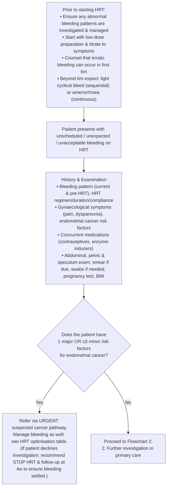
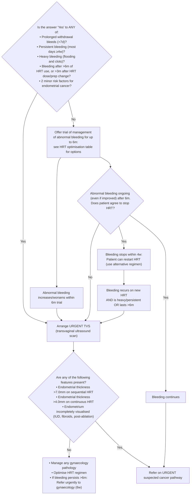

# Approaching and managing problematic bleeding on HRT

> **Layer 1 Source Reference:** [`Approaching and managing problematic bleeding on HRT 11.docx`](../../sources/red-whale/Approaching%20and%20managing%20problematic%20bleeding%20on%20HRT%2011.docx)
> **Collection:** Red Whale Menopause Guidelines | **Original Format:** `DOCX` | **Review Date:** `May 2026`

*This article was updated in May 2026.*

In 2024, the British Menopause Society, in partnership with the RCOG, the British Gynaecological Cancer Society and other associated bodies, published a guideline on the management of unscheduled bleeding on HRT. This was subsequently endorsed in NICE suspected cancer referral and recognition guidance ([NICE 2015, updated 2026, NG12](https://www.nice.org.uk/guidance/ng12)).

The guideline focused on:

- Prevention: optimising HRT prescribing to prevent problematic bleeding occurring.
- Assessment: guiding investigation and referral of bleeding issues based on endometrial cancer risk stratification.
- Management: giving evidence-based strategies to manage persistent bleeding.

This article summarises the assessment and management part of the BMS guideline, focusing on the information relevant to primary care. There is a separate article on *HRT regimens and progestogen doses* which looks at optimal HRT prescribing.

For more detail or specific information, we suggest looking at the original guidance ([BMS – management of unscheduled bleeding on hormone replacement therapy](https://thebms.org.uk/publications/bms-joint-guidelines/management-of-unscheduled-bleeding-on-hormone-replacement-therapy-hrt/)). Other sources used are referenced.

## Why is unscheduled bleeding on HRT important?

### Bleeding is a common side-effect of HRT

- The rise in HRT use in recent years means that more women are experiencing relief from distressing and disturbing menopausal symptoms.
- However, unscheduled uterine bleeding is a common side-effect of HRT use, so this increase has also led to increased numbers of menopausal women experiencing troublesome bleeding.
- This, in turn, has led to an increase in gynaecological referrals for abnormal bleeding.
- Urgent referrals through the suspected cancer pathways increased by 43% between 2021 and 2024, but this rise was not accompanied by increased endometrial cancer diagnoses.

### The assessment, investigation and management of unscheduled bleeding can be tricky

- The mechanisms that lead to unscheduled bleeding on HRT are poorly understood.
- Perimenopausal and menopausal women are prone to bleeding issues due to their endogenous hormonal fluctuations, which may cause, or exacerbate, bleeding.
- Older women are more likely to have gynaecological pathology, including endometrial cancer, which may also present as abnormal bleeding.

### We don’t want to miss endometrial cancer

- Endometrial cancer is the 4th commonest cancer in women.
- Incidence increases with age.
- However, the age-related risk in newly-menopausal women is low (0.7% in those age 50–54y and 1.2% in those age 55–59y).
- Sequential HRT regimens may be associated with increased risk of endometrial cancer when used beyond 5y, whereas continuous combined regimens are associated with a reduced risk of endometrial cancer compared with baseline.

([BMS – management of unscheduled bleeding on hormone replacement therapy](https://thebms.org.uk/publications/bms-joint-guidelines/management-of-unscheduled-bleeding-on-hormone-replacement-therapy-hrt/))

## Normal bleeding patterns around perimenopause

There is no normal! Perimenopausal bleeding patterns may become progressively lighter or heavier, infrequent or more frequent, according to fluctuating hormonal levels.

We should arrange further investigation along the appropriate pathway if a woman reports:

- Persistent intermenstrual bleeding (usually >3m).
- Persistent irregular bleeding.
- Infrequent heavy bleeding in the presence of obesity or a history of PCOS.
- Postcoital bleeding.
- Postmenopausal bleeding (occurring >1y after last period).
- Heavy bleeding associated with other symptoms such as pain or pressure.

([NG12, 2015 (updated 2023](https://www.nice.org.uk/guidance/ng12)); [NG88, 2018 (updated 2021)](https://www.nice.org.uk/guidance/ng88); [Obstetrics and Gynaecology International, 2014: Article ID:192087](https://doi.org/10.1155/2014/192087)).

## Causes of abnormal bleeding on HRT

The oestrogen component of HRT causes endometrial proliferation, and the progestogen suppresses growth and induces endometrial atrophy (and therefore stops bleeding). Erratic bleeding is common in the first 6 months of HRT use or within 3 months of a change in dose, affecting around 40% of users.

Mechanisms that lead to abnormal bleeding on HRT are poorly understood, and may relate to:

- Hormonal stimulation of existing pathology (e.g. endometrial polyps, hyperplasia, cancer, ovarian cysts).
- Poor compliance with treatment.
- Malabsorption of treatment.
- Drug interactions (e.g. with enzyme-inducers).
- Combined effect of HRT and endogenous oestrogen production stimulating the endometrium (e.g. in obese women).
- Vascular and endothelial factors in the endometrium.

([The Obstetrician & Gynaecologist, 2019;21(2):95](https://obgyn.onlinelibrary.wiley.com/toc/17444667/2019/21/2))

## Assessment and investigation of unscheduled bleeding on HRT

### Prevention of problematic bleeding

Prior to starting HRT, we should ensure that:

- Any pre-existing bleeding issues are investigated and fully managed.
- We choose the correct type of HRT (sequential or continuous regimen).
- An adequate progestogen regimen is given to match the dose of oestrogen.

*(See article on HRT regimens and endometrial cancer risk for guidance on progestogen regimens.)*

### Risk stratification for endometrial cancer

The flowcharts below summarise the BMS guidance on the investigation of unscheduled bleeding on HRT. There is limited data looking at the rates of endometrial cancer in women who experience unscheduled bleeding on HRT; the BMS has therefore adopted a pragmatic approach based on risk stratification for endometrial cancer (*although this is also based on limited evidence).*

The BMS divides endometrial risk factors into major and minor, to guide appropriate investigation of abnormal bleeding in different HRT users:

| Major risk factors | Minor risk factors |
| :--- | :--- |
| • BMI ≥40. • Genetic risk (e.g. Lynch syndrome). • Unopposed oestrogen use for >6m. • Prolonged use of sequential regimen (>5y when started in a woman ≥45y). • Inadequate progestogen use in a sequential regimen for ≥12m: ◦ Tricycling HRT and giving quarterly progestogen. ◦ Using <10d of medroxyprogesterone acetate (MPA) or norethisterone per month. ◦ Using <12d of micronised progesterone per month. | • BMI 30–39. • Anovulatory cycles (e.g. PCOS). • Diabetes mellitus. • Unopposed oestrogen use for 3–6m. • Inadequate progestogen dose for oestrogen dose (including expired IUS) for >12m. • Inadequate progestogen dose in a sequential regimen for 6–12m: ◦ Tricycling HRT and giving quarterly progestogen. ◦ Using <10d of medroxyprogesterone acetate (MPA) or norethisterone per month. ◦ Using <12d of micronised progesterone per month. |

*See article on HRT regimens and progestogen doses for guidance on progestogen regimens.*

#### Flowchart 1: Initial Steps and Assessment (`image4.png`)

**Detailed Breakdown of Flowchart 1 (`1. Initial steps and assessment`):**

- **Prior to starting HRT:**
  - Ensure any abnormal bleeding patterns are investigated and managed.
  - Start with a low-dose preparation and titrate according to symptoms.
  - Counsel patients that some erratic bleeding can occur in the first 6m of treatment.
  - Beyond 6m, a woman should expect the following bleeding patterns:
    - **Sequential combined regimen:** a light cyclical bleed at end of progestogen phase.
    - **Continuous combined regimen:** amenorrhoea.
- **Presentation:** Patient presents with unscheduled/unexpected/unacceptable bleeding on HRT.
- **History:**
  - Ask about current bleeding pattern and pattern prior to starting HRT.
  - What HRT regimen has she been on and for how long? Is there good compliance?
  - Are there any other gynaecological symptoms (e.g. pain, dyspareunia)?
  - Are there any endometrial cancer risk factors?
  - Other medications (e.g. contraceptives, enzyme-inducers)?
- **Examination:**
  - Do abdominal, pelvic and speculum examination.
  - Take smear if due, and swabs if necessary. Consider pregnancy test.
  - Check BMI.
- **Decision — Does the patient have 1 major or ≥3 minor risk factors for endometrial cancer?**
  - **Major risk factors:**
    - BMI ≥40.
    - Genetic risk (e.g. Lynch syndrome).
    - Unopposed oestrogen use for >6m.
    - Prolonged use of sequential regimen (>5y when started in a woman ≥45y).
    - Inadequate progestogen use in a sequential regimen for ≥12m:
      - Tricycling HRT and giving quarterly progestogen.
      - Using <10d of MPA/norethisterone per month.
      - Using <12d of micronised progesterone per month.
  - **Minor risk factors:**
    - BMI 30–39.
    - Anovulatory cycles (e.g. PCOS).
    - Diabetes mellitus.
    - Unopposed oestrogen use for 3–6m.
    - Inadequate progestogen dose for oestrogen dose (including expired IUS) for >12m.
    - Inadequate progestogen dose in a sequential regimen for 6–12m:
      - Tricycling HRT and giving quarterly progestogen.
      - Using <10d of MPA/norethisterone per month.
      - Using <12d of micronised progesterone per month.
  - **If YES:** **Refer via urgent suspected cancer pathway.** Manage bleeding as well: *see HRT optimisation table*. *If patient declines investigation, recommend to STOP HRT and follow-up at 4w to ensure bleeding settled.*
  - **If NO:** **See flowchart 2.**

---

#### Flowchart 2: Further Investigation in Primary Care (`image2.png`)

**Detailed Breakdown of Flowchart 2 (`2. Further investigation in primary care`):**

- **Step 1 — Is the answer ‘yes’ to ANY of the following?**
  - Does she have prolonged withdrawal bleeds (i.e. lasting >7d)?
  - Does she have persistent bleeding (i.e. occurring most days for ≥4w)?
  - Does she have heavy bleeding (i.e. flooding and clots)?
  - Has bleeding occurred after >6m of HRT use, or >3m following a change in HRT dose or preparation?
  - Does she have 2 minor risk factors for endometrial cancer?
- **If YES:** **Arrange URGENT TVS (transvaginal ultrasound scan).**
- **If NO:** **Offer trial of management of abnormal bleeding for up to 6m: see HRT optimisation table for options.**
  - If **abnormal bleeding increases/worsens within the 6m trial period** → **Arrange URGENT TVS** (transvaginal ultrasound scan).
  - If **abnormal bleeding ongoing (even if improved) after 6m** → **Does the patient agree to stop HRT?**
    - **No** → **Arrange URGENT TVS** (transvaginal ultrasound scan).
    - **Yes** →
      - **Bleeding stops within 4w:** Patient can restart HRT (*use alternative regimen*). If **bleeding recurs on new HRT and is heavy/persistent or lasts >6m** → **Arrange URGENT TVS**.
      - **Bleeding continues:** **Refer on URGENT suspected cancer pathway.** *(See pathway notes below.)*
- **Step 2 — Urgent TVS Assessment: Are any of the following features present?**
  - Endometrial thickness of **>7.0mm** on sequential HRT.
  - Endometrial thickness of **>4.0mm** on continuous HRT.
  - Endometrium **incompletely visualised** (e.g. due to presence of IUD, fibroids, post-ablation).
  - **If NO:**
    - Manage any gynaecology pathology.
    - Optimise HRT regimen.
    - If bleeding persists >6m: **Refer urgently to gynaecology (6w).**
  - **If YES:**
    - **Refer on URGENT suspected cancer pathway.**
    - *If patient declines investigation, recommend to STOP HRT. Follow-up at 4w to ensure bleeding settled.*
    - If endometrium incompletely visualised on scan but area measured is within normal limits: **Refer urgently to gynaecology (6w).**

## Management of bleeding issues on HRT: HRT optimisation

*(Note: MPA = medroxyprogesterone acetate)*

| Clinical Area / Principle | Recommendations & Actions |
| :--- | :--- |
| **General advice and options** | • Address modifiable risk factors (e.g. weight loss) that may reduce bleeding *(and also risk of endometrial cancer).* • Offer an IUS as progestogen component (if appropriate or desirable), particularly if at increased risk of endometrial cancer. • Reduce oestrogen dose of HRT. • If on synthetic progestogen (norethisterone or MPA): change to a regimen with an alternative progestogen (see article on *HRT regimens and progestogen doses*). • If on transdermal preparation: where appropriate and safe, offer a switch to an oral preparation because they are associated with less bleeding risk. • Consider offering additional oral progestogen (100mg micronised progesterone, 10mg MPA, 5mg norethisterone) alongside combined preparation for a 3m trial (including women with an IUS). • Suggest using micronised progesterone vaginally rather than orally (on an off-licence basis). • If examination suggests vulvovaginal atrophy may be the cause of bleeding, offer vaginal oestrogen. |
| **Compliance issues** | • Ensure patient is using product correctly and consistently. • Ensure adequate progestogen is being taken for dose of oestrogen. • Move to a regimen that is easier for the woman to remember *(depending on the individual, this might mean a transdermal patch which requires once or twice-weekly application, or a daily regimen).* • If on ‘split regimen’ (non-combined preparations), patient could either: ◦ Switch to combined preparation (e.g. combined patch or pill), which may be more practical. ◦ Take oral progestogen at the same time as applying oestrogen gel/spray to reduce bleeding. |
| **Sequential combined HRT users** | • If <50y and no contraindications, consider switching to CHC *(CHC is not licensed ≥50y).* • If on micronised progesterone: ◦ Increase progesterone to 300mg a day sequentially or increase number of days taking progesterone (e.g. to 14d of a 28d cycle), OR ◦ Change to a synthetic progestogen (e.g. norethisterone or MPA), OR ◦ Offer desogestrel in addition to micronised progesterone at a dose of 75mcg, or instead of progesterone at a dose of 150mcg *(on an off-licence basis).* • Women >45y taking a sequential combined regimen should swap to a continuous combined regimen: ◦ No later than 5y after the start of sequential HRT use **OR** ◦ By the age of 54y (whichever comes first). |
| **Continuous combined HRT users** | • If on micronised progesterone: ◦ Recommend a daily regimen of 100mg rather than the licensed dose of 25d per cycle; off licence. ◦ Consider changing to a synthetic progestogen (norethisterone or MPA), OR ◦ Consider increasing progesterone to 200mg a day; off licence. • If recently postmenopausal, switch to sequential regimen for 6m. |

> *Note: any off-licence prescribing should be fully discussed and documented. Consider review at 3m and reducing doses back to licensed regimens, if tolerated. If off-licence regimens are continued long term, counsel patients about any additional possible risks (e.g. breast cancer or VTE).*

([BMS - management of unscheduled bleeding on hormone replacement therapy](https://thebms.org.uk/publications/bms-guidelines/management-of-unscheduled-bleeding-on-hormone-replacement-therapy-hrt/))

## Bleeding with an IUS in-situ

Mirena is the only intrauterine system currently licensed for endometrial protection with HRT, and this is for 4y. However, evidence shows that all brands of 52mg IUS provide endometrial protection for up to 5y. The BMS recommends that ([BMS - management of unscheduled bleeding on hormone replacement therapy](https://thebms.org.uk/publications/bms-guidelines/management-of-unscheduled-bleeding-on-hormone-replacement-therapy-hrt/)):

- Any brand of 52mg IUS may be used for endometrial protection for up to 5y.
- If new-onset bleeding occurs with an IUS after 4y of use, change IUS for new device AFTER pathology has been excluded (which, in practice, means an examination and TVS – or referral for further investigation if other symptoms or risk factors are present).

### Malpositioned IUS

- A malpositioned IUS is one that is located >2cm from the uterine fundus, or is partially/fully displaced into the cervical canal.
- If a woman experiences bleeding on HRT and has an ultrasound scan which shows the IUS to be malpositioned, the BMS suggests that the IUS should be replaced.
- Although there is no data showing that a non-fundally-placed IUS is less effective, it may provide more irregular endometrial suppression and could be more likely to cause breakthrough bleeding.

## What do I do about a thickened endometrium reported in an asymptomatic woman on HRT?

*You review an ultrasound report for your patient, Mariam, which states that the endometrium is 8mm thick and recommends clinical assessment. A glance at her notes tells you the scan was not requested due to any bleeding issues. What should you do next?*

The BMS guidelines recommend the following action ([BMS - management of unscheduled bleeding on hormone replacement therapy](https://thebms.org.uk/publications/bms-guidelines/management-of-unscheduled-bleeding-on-hormone-replacement-therapy-hrt/)):

| Endometrial cancer risk factors | Endometrial thickness | Action |
| :--- | :--- | :--- |
| None. | <10mm. | May be offered an increase in progestogen as part of the HRT regimen *(the BMS does not suggest rescanning asymptomatic women routinely after HRT adjustment).* |
| None. | ≥10mm. | Urgent gynaecology referral (6w). |
| 1 major or 2 minor risk factors *(see table above).* | >4mm on continuous HRT. | Refer via urgent suspect cancer pathway **and** Increase progestogen in HRT regimen. |
| 1 major or 2 minor risk factors *(see table above).* | >7mm on sequential HRT. | Refer via urgent suspect cancer pathway **and** Increase progestogen in HRT regimen. |
| 1 major or 2 minor risk factors *(see table above).* | ≥10mm on any regimen. | Refer via urgent suspect cancer pathway. |

## Key Clinical Summary

> **Approaching and managing problematic bleeding on HRT**
> - Unscheduled bleeding on HRT is common, especially in the first 6m of use.
> - We should manage any pre-existing bleeding problems prior to starting HRT, and ensure that the regimen is appropriate for the stage of menopause, and that adequate progestogen is given.
> - Initial assessment of bleeding involves history, examination and assessment of endometrial risk factors.
> - Further investigation and referral pathway will depend on endometrial cancer risk, nature of bleeding and duration of HRT use.
> - First-line investigation is transvaginal ultrasound scan to look for pathology and at endometrial thickness.
> - Endometrial thickness on sequential HRT should be ≤7mm, and on continuous combined HRT should be ≤4mm.
> - Most unscheduled bleeding caused by HRT can be managed by altering the dose, type or regimen of hormones.

## Related content

[Articles](https://www.redwhale.co.uk/content/hrt-regimens-and-progestogen-doses)

**[HRT regimens and progestogen doses](https://www.redwhale.co.uk/content/hrt-regimens-and-progestogen-doses)**
