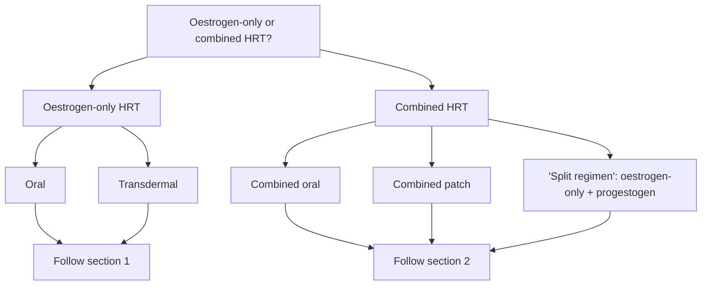

# Red Whale GEMS: Troubleshooting HRT Availability and Formulations

> **Layer 1 Source Reference:** [`GEM.pdf בעיות.pdf`](../../sources/red-whale/GEM.pdf%20%D7%91%D7%A2%D7%99%D7%95%D7%AA.pdf)
> **Collection:** Red Whale Menopause Guidelines | **Original Format:** `PDF` | **Review Date:** `February 2026`
> **Subtitle / Guideline Sources:** *The BMS Tools for Clinicians: Progestogens and endometrial protection, HRT preparations and equivalent alternatives; BMS guideline on management of unscheduled bleeding on HRT 2024; BNF 2025; MIMS 2025 (Red Whale GEMS — Guidelines & Evidence Made Simple).*

## 1. Troubleshooting HRT Availability

> **To use this GEMS:**
> - Identify what type of HRT a woman is taking and what component is unavailable.
> - Identify the dose equivalent of the unavailable component (section 1 for oestrogen-only HRT, section 2 for combined HRT).
> - Find a suitable available matching formulation that is acceptable to the woman (section 3).

### What Type of HRT Is Being Used?

> **Patient Counselling Note:** **Women may experience some irregular bleeding following a switch to an alternative preparation. This should settle within 3–6 months. Seek medical advice if it doesn’t.**

### Section 1: Oestrogen-Only HRT

- **Oral oestrogen-only HRT options:**
  - Make direct switch to another oral preparation of the equivalent dose (see HRT formulation tables).
  - *Consider* switch to a transdermal preparation of an equivalent dose.
- **Transdermal oestrogen-only HRT options:**
  - Swap to any transdermal oestrogen preparation of an equivalent dose.
  - Patches may be cut to give a required dose (off licence).
  - *If switching from transdermal to oral, do a full reassessment of suitability, i.e. avoid in higher-risk women (e.g. if >60y, overweight or migraine) due to increased VTE and CVA risk with oral preparations.*

### Oestradiol Dosing and Dose Equivalence

**Dosing and dose equivalence (BMS guidance on management of unscheduled bleeding on HRT 2024)**
*(Doses in italics are off licence. There is no published evidence for the efficacy or safety of off-licence oestradiol.)*

| Dosage | Oral oestradiol | Oestradiol patch | Oestradiol gel — Oestrogel | Oestradiol gel — Sandrena | Oestradiol spray |
| :--- | :--- | :--- | :--- | :--- | :--- |
| **Ultra-low** | 0.5mg | 12.5mcg | 1/2 pump | 0.25mg | 1 spray |
| **Low** | 1mg | 25mcg | 1 pump | 0.5mg | 2 sprays |
| **Standard** | 2mg | 50mcg | 2 pumps | 1mg | 3 sprays |
| **Moderate** | *3mg* | 75mcg | 3 pumps | 1.5–*2.0mg* | *4–5 sprays* |
| **High** | *4mg* | 100mcg | 4 pumps | *3mg* | *6 sprays* |

> *IMPORTANT! GMC guidance recommends that where a licensed preparation is available, it should be used in preference to an off-licence drug. If adjusting HRT for availability, we should take this into account.*

---

## 2. Troubleshooting HRT Availability — Section 2: Combined HRT

### Combined Oral HRT Options

- Switch to alternative oral preparation: match the progestogen if possible (*there are a few containing norethisterone*), but otherwise choose alternative with a different progestogen.
- Consider switching to a transdermal patch (e.g. Evorel Sequi has the same progestogen as Elleste Duet).
- Or offer a split regimen (e.g. Oestrogel + Provera contains the same hormones as Indivina).

### Combined Patch HRT Options

- There are 2 combined patches, both of which have the same dose of oestrogen, so switching is possible:
  - Evorel (contains norethisterone) – applied twice weekly.
  - Femseven (contains levonorgestrel) – applied weekly.
- Or consider switching to oral equivalent of patch – this will need reassessment of risk factors.
  - Use with caution in women at higher risk of thromboembolism (e.g. if >60y, overweight or with migraine) due to increased VTE and CVA risk with oral preparations.
- Tibolone is a low-risk oral alternative to continuous combined HRT.
- Offer split regimen (see below).

### ‘Split Regimen’ Oestrogen-Only HRT + Progestogen Options

- **Oestrogen component unavailable:**
  - See oestrogen-only alternatives (on page 1).
- **Progestogen component unavailable:**
  - Micronised progesterone often first line as considered safest option. If not available:
    - Alternatives are medroxyprogesterone acetate (MPA) or norethisterone (note: norethisterone is associated with VTE risk so avoid in higher-risk women) or
    - Offer IUS or
    - Offer combined product: patch or oral, *if appropriate* (e.g. Bijuve is a continuous combined oral HRT with micronised progesterone).

### Progestogen Dosing and Dose Equivalence

**Dosing and dose equivalence (BMS guidance on management of unscheduled bleeding on HRT 2024)**
*(Doses in italics are off licence. There is no published evidence for the efficacy or safety of off-licence progestogen.)*

| Progestogen | Sequential dose | Continuous dose |
| :--- | :--- | :--- |
| **Micronised progesterone (Utrogestan or Gepretix)** | 200mg daily on days 1–14 of month. *300mg daily with high-dose oestrogen off licence.* *(Note: oral preparation can be used vaginally off licence if poorly tolerated orally.)* | 100mg daily from day 1–26 of cycle, or continuously. *200mg daily with high-dose oestrogen off licence.* *(Note: oral preparation can be used vaginally off licence if poorly tolerated orally.)* |
| **Medroxyprogesterone acetate** | 10mg daily on days 1–14 of month. *20mg daily with high-dose oestrogen off licence.* | 2.5mg daily with low-dose oestrogen. 5.0mg daily with standard/moderate-dose oestrogen. *10mg daily with high-dose oestrogen off licence.* |
| **Norethisterone** | 5mg daily on days 1–14 of month. | 5mg daily. *1mg is adequate for endometrial protection, but no formulation is available so the BMS suggests we can use 3x 350mcg Noriday POPs daily off licence.* |
| **52mg Intrauterine System (IUS)** | **Any 52mg intrauterine system up to 5y (Mirena, Benilexa, Levosert)**, although only Mirena is licensed and for 4y. | **Any 52mg intrauterine system up to 5y (Mirena, Benilexa, Levosert)**, although only Mirena is licensed and for 4y. |

> *(Note: Evidence shows that women using sequential regimens with less than 10d of progestogen a month are at increased risk of endometrial hyperplasia. The BMS therefore recommends that a progestogen is given on 12–14d per month. **For practicality, we suggest that the patient takes their progestogen from day 1 to 14 of the calendar month.**)*

---

## 3. HRT: Formulations — Oestrogen-Only Formulations and Progestogens

*(From BNF 2025; The BMS Tools for Clinicians: Progestogens and endometrial protection, HRT preparations and equivalent alternatives; BMS - management of unscheduled bleeding on hormone replacement therapy — September 2025)*

> **Approximate prices per month:**
> - `£` = usually <£5
> - `££` = usually £5–10
> - `£££` = usually >£10

### Oestrogen-Only (Only If No Uterus / Mirena in Place)

| Route | Oestrogen | Name | Cost (per month) |
| :--- | :--- | :--- | :--- |
| **Oral** | Conjugated equine oestrogen 300mcg/625mcg/1.25mg | Generic preparations | £ |
| **Oral** | Oestradiol 1–2mg | Elleste Solo | £ |
| **Oral** | Oestradiol 1–2mg | Progynova | £ |
| **Oral** | Oestradiol 1–2mg | Zumenon | £ |
| **Patch** | Oestradiol 25/50/75/100mcg per 24h | Estraderm MX | ££ |
| **Patch** | Oestradiol 25/50/75/100mcg per 24h | Evorel | £ |
| **Patch** | Oestradiol 25/37.5/50/75/100mcg per 24h | Estradot | ££ |
| **Patch** | Oestradiol 50/75/100mcg per 24h | Femseven | ££ |
| **Patch** | Oestradiol 50/100mcg per 24h | Progynova TS | ££ |
| **Gel** | Oestradiol gel (0.06%) 1–4 pumps (1.25–3.0mg)/24h | Oestrogel 80g pump | £–££ |
| **Gel** | Oestradiol gel (0.1%) 0.5–1.5mg/24h | Sandrena 0.5/1.0mg sachets | ££ |
| **Spray** | Oestradiol 1.53mg/metred dose 1–3 sprays/24h | Lenzetto 8.1ml (56 actuations) | £–££ |

### Progestogen / Progesterone-Only (To Be Used With Oestrogen-Only HRT If Has Uterus)

| Licensing Status | Route | Progestogen | Dose — Sequential (take daily for 12–14d of a cycle) | Dose — Continuous (take everyday) | Name | Cost |
| :--- | :--- | :--- | :--- | :--- | :--- | :--- |
| **Licensed products** | Oral | Dydrogesterone | • 10mg, but may be increased to 20mg if required | • Not licensed for continuous use | Nalvee | £ |
| **Licensed products** | Intra-uterine | Levonorgestrel 52mcg | 20mcg/24h | 20mcg/24h | Mirena (licensed) Levosert or Benilexa (off licence) | £ |
| **Licensed products** | Oral/vaginal *(vaginal use is off licence)* | Micronised progesterone | • 200mg with low/moderate-dose oestrogen • 300mg with high-dose oestrogen (off licence) *(Note: licensed dose is 10–12d/cycle, but BMS recommends 12–14d)* | • 100mg daily with low/moderate-dose oestrogen • 200mg daily with high-dose oestrogen (off licence) *(Note: licensed dose is from d1–26 of a cycle, but BMS recommends everyday)* | Utrogestan (`££`) Gepretix (`£`) Generic preparation (`£`) | £–££ |
| **Off-licence products (endorsed by the BMS)** | Oral | Medroxyprogesterone acetate | • 10mg with low/moderate-dose oestrogen • 20mg with high-dose oestrogen (off licence) | • 2.5mg with low-dose oestrogen • 5mg with moderate-dose oestrogen • 10mg with high-dose oestrogen (off licence) | Generic preparation | £–££ |
| **Off-licence products (endorsed by the BMS)** | Oral | Norethisterone | • 5mg irrespective of oestrogen dose | • 1mg with low-dose oestrogen (not available so the POP Noriday (350mcg) may be used at a dose of 3 tablets a day) • 5mg for moderate to high-dose oestrogen | Generic preparation | ££ |

---

## 4. HRT: Formulations (Continued) — Combined HRT Regimens

*(From MIMS 2025 and The BMS Tools for Clinicians: Progestogens and endometrial protection, HRT preparations and equivalent alternatives — February 2026)*

> **Key Prescribing Principles:**
> - **Oral:** usually cheapest.
> - **Transdermal:** lower VTE/CVA risk so use preferentially if >60y, overweight or migraines.
> - **Dosing:** start with low-dose preparation (and match progestogen dose if using separate formulation – see *HRT regimens and progestogen doses* for details).
> - **If urogenital symptoms predominate:** consider using vaginal oestrogens instead.
> - **Approximate prices per month:** `£` = usually <£5 | `££` = usually £5–10 | `£££` = usually >£10

### Sequential Combined

| Route | Oestrogen | Progestogen | Name | Cost (per month) |
| :--- | :--- | :--- | :--- | :--- |
| **Oral** | Oestradiol 1–2mg | Dydrogesterone 10mg (14 tabs) | Femoston | ££ |
| **Oral** | Oestradiol valerate 2mg | Norethisterone 1mg (12 tabs) | Novofem | £ |
| **Oral** | Oestradiol 1mg / Oestradiol 1–2mg | Norethisterone 1mg (12 tabs) | Elleste Duet | £ |
| **Oral** | Oestradiol 1mg (10 tabs), 2mg (12 tabs) | Norethisterone 1mg (10 tabs) | Trisequens (phasic preparation) | £ |
| **Patch** | Oestradiol 50mcg/24h | Norethisterone 170mcg per 24h (2 patches/w for 14d) | Evorel Sequi | £££ |

### Continuous Combined

| Route | Oestrogen | Progestogen | Name | Cost (per month) |
| :--- | :--- | :--- | :--- | :--- |
| **Oral** | Conjugated equine oestrogen 300mcg | Medroxyprogesterone acetate 1.5mg | Available generically | £ |
| **Oral** | Oestradiol 0.5–1mg | Dydrogesterone 2.5–5.0mg | Femoston Conti | ££ |
| **Oral** | Oestradiol 1–2mg | Medroxyprogesterone acetate 2.5–5.0mg | Indivina | ££ |
| **Oral** | Oestradiol 1mg | Norethisterone 0.5mg | Kliovance | £ |
| **Oral** | Oestradiol 2mg | Norethisterone 1mg | Elleste Duet Conti | ££ |
| **Oral** | Oestradiol 2mg | Norethisterone 1mg | Kliofem | £ |
| **Oral** | Oestradiol 1mg | Progesterone 100mg | Bijuve | ££ |
| **Patch** | Oestradiol 30–40mcg/24h | Norethisterone 95–130mcg/24h (2 patches/w) | Estradot Conti | £££ |
| **Patch** | Oestradiol 50mcg/24h | Norethisterone 170mcg per 24h (2 patches/w) | Evorel Conti | £££ |
| **Patch** | Oestradiol 50mcg/24h | Levonorgestrel 7mcg per 24h (1 patch/w) | Femseven Conti | £££ |

### Other HRT Preparations

| Route | Content | Dose | Name | Cost (per month) |
| :--- | :--- | :--- | :--- | :--- |
| **Oral** | Tibolone (gonadomimetic) | 2.5mg | Livial | ££ |
| **Oral** | Tibolone (gonadomimetic) | 2.5mg | Generic tibolone | £ |

> *Disclaimer: We make every effort to ensure the information in these pages is accurate and correct at the date of publication, but it is of necessity of a brief and general nature. The information presented herein should not replace your own good clinical judgement, or be regarded as a substitute for taking professional advice in appropriate circumstances. In particular, we suggest you carefully consider the specific facts, circumstances and medical history of any patient, and recommendations of the relevant regulatory authorities. We also suggest that you check drug doses, potential side-effects and interactions with the British National Formulary. Save insofar as any such liability cannot be excluded at law, we do not accept any liability for loss of any type caused by reliance on the information in these pages. February 2026. For full references see the relevant Red Whale articles.*
