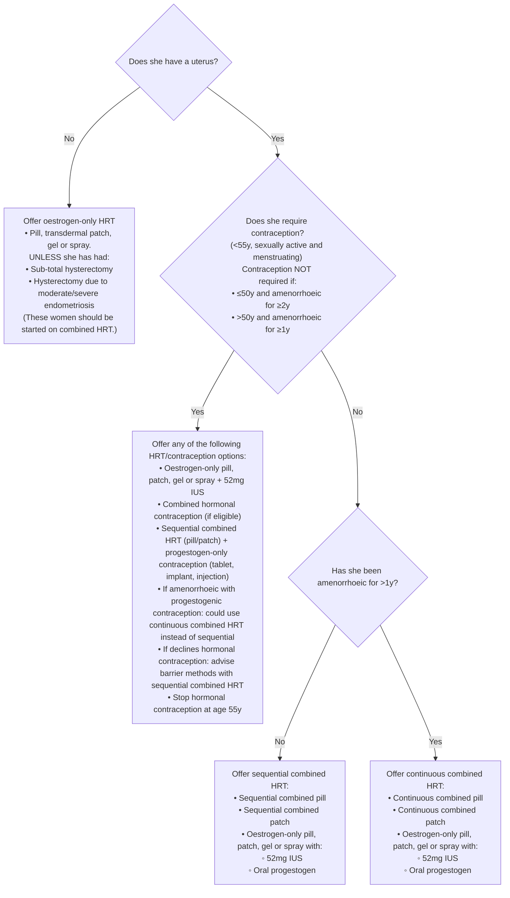

# Red Whale GEMS: Menopause and HRT — Overview, Which HRT, and Formulations

> **Layer 1 Source Reference:** [`GEMS טייפול.pdf`](../../sources/red-whale/GEMS%20%D7%98%D7%99%D7%99%D7%A4%D7%95%D7%9C.pdf)
> **Collection:** Red Whale Menopause Guidelines | **Original Format:** `PDF` | **Review Date:** `February 2026`
> **Subtitle / Guideline Sources:** *NICE Menopause NG23 (2024), Joint position statement on menopause management BMS/RCOG (Post Reproductive Health, 2022;0(0)1), British Menopause Society guidelines (2020), BNF 2025, and MIMS 2025 (Red Whale GEMS — Guidelines & Evidence Made Simple).*

## 1. Menopause and HRT: Overview, Diagnosis, Treatments and Counselling

### Symptoms (Due to Falling Oestrogen Levels)

- Hot flushes, night sweats.
- Menstrual irregularities.
- Sleep disturbance.
- Vaginal dryness.
- Urinary problems.
- Joint and muscle pains.
- Sexual difficulties (e.g. low libido).
- Mood changes.
- Cognitive disturbance.

### Diagnosis and Investigations

**Diagnosis is made from a clinical history of typical symptoms in a woman ≥45y, but remember:**

- Investigate abnormal bleeding first.
- Consider differentials if symptoms atypical (e.g. alcohol, drugs, thyroid, anxiety, tumours).

**Arrange FSH if:**

- **<45y:** 2 results >30 IU/L 4–8w apart is suggestive of early menopause, or premature if <40y.
- **>50y and amenorrhoeic and wants to stop hormonal contraception:** if 1 result >30 IU/L, she can stop contraception in 12m (the FSRH consensus is that she is likely to no longer be fertile by then).

### Treatment Options

| Lifestyle | Hormone replacement therapy (HRT) | Alternatives to HRT |
| :--- | :--- | :--- |
| • Regular exercise. • Healthy diet and BMI. • Stop smoking. • Reduce alcohol. • Avoid symptom triggers e.g. spicy food. • Reduce stress. • Relaxation exercises. • Sleep hygiene. | **First line for:** • Vasomotor symptoms. • Depressive symptoms with other menopausal symptoms. **Beneficial for:** • Sexual function. • Urogenital symptoms (vaginal oestrogen is first line). • Bone mineral density. | • **CBT (+/- HRT):** ◦ For vasomotor symptoms, low mood, insomnia and anxiety. • **Isoflavones (soy), black cohosh:** ◦ For flushes. Preparations vary in content/safety. • **SSRIs/SNRIs:** ◦ Counsel regarding side-effects. • **Neurokinin receptor antagonists.** |

### Contraindications to HRT (Refer to Menopause Specialist)

- History of breast cancer or oestrogen-dependent tumour.
- Untreated endometrial hyperplasia.
- Undiagnosed vaginal bleeding.
- Uncontrolled hypertension.
- Arterial thromboembolic disease.
- Current or past VTE (unless anticoagulated).
- Thrombophilic disorder or strong FH of VTE.
- Liver disease (with abnormal LFTs).

### Counselling for HRT *(Note Contraindications Above)*

| Condition | Risk |
| :--- | :--- |
| **Breast cancer** | • Small increased risk: risk greater with combined HRT than oestrogen-only HRT. • Individual risk depends on modifiable and non-modifiable risk factors. ◦ **Lifestyle factors (obesity, excess alcohol) likely to have greater impact on risk than HRT.** • HRT is *unlikely* to increase risk of breast cancer in women <50y. ◦ Risk of exposure from HRT should be counted from age 50y only. • Micronised progesterone and dydrogesterone may be safest progestogens. |
| **VTE** | • HRT increases VTE risk. Individual risk depends on other risk factors. ◦ VTE risk generally low in early post-menopause years. • Oral preparations carry higher risk. Transdermal oestrogen appears safer as it avoids first-pass liver metabolism and doesn’t activate clotting factors (not confirmed by RCTs). • Micronised progesterone appears to be the safest progestogen, but more data is needed. |
| **Cardiovascular disease (CVD)** | • CVD is the commonest cause of death in postmenopausal women. • HRT does not increase the risk of cardiovascular disease in women <65y. • HRT may be cardioprotective in younger postmenopausal women (<10y from LMP), but evidence not strong enough to recommend as primary prevention of CVD. |
| **Stroke (CVA)** | • Oral HRT increases the risk of stroke. • Transdermal preparations appear safer (observational evidence). • Risk of CVA depends on other cardiovascular risk factors but generally low in this age group. |
| **Ovarian cancer** | • Slight increased risk (based on epidemiological studies, causation cannot be inferred). |

> **In summary:** HRT use may be associated with small risks, but these are balanced by benefits of treatment in a symptomatic menopausal woman, and, overall, use of HRT is unlikely to affect life expectancy.

---

## 2. Menopause and HRT: Which HRT?

### Types of HRT

| Oestrogen-only HRT | Sequential combined HRT | Continuous combined HRT |
| :--- | :--- | :--- |
| Oestrogen is the symptom-relieving component of HRT *BUT*  *Unopposed oestrogen causes endometrial proliferation: women with a uterus MUST have progestogen to stop this.* | *Perimenopausal women* (Endogenous hormone production will lead to irregular bleeding on a continuous regimen) Daily oestrogen with *sequential* progestogen (usually in last 12–14d of pack/month) to trigger a bleed. | *Postmenopausal women* (>12m since LMP).  Contains *daily* oestrogen and progestogen. |

> **Switching Rule:** **Swap from sequential to continuous combined within 5y of starting HRT or by age 54y.**

### Clinical Decision Algorithm: Which HRT?

**Step-by-Step Pathway (`Which HRT?`):**

1. **Does she have a uterus?**
   - **No** → **Offer oestrogen-only HRT:**
     - Pill, transdermal patch, gel or spray.
     - **UNLESS** she has had:
       - Sub-total hysterectomy.
       - A hysterectomy due to moderate/severe endometriosis.
       - These women should be started on combined HRT.
   - **Yes** → Proceed to Step 2.
2. **Does she require contraception?** *(<55y, sexually active and menstruating)*
   - *Contraception NOT required if:*
     - ≤50y and has been amenorrhoeic for ≥2y.
     - >50y and has been amenorrhoeic for ≥1y.
   - **Yes** → **Offer any of the following HRT/contraception options:**
     - Oestrogen-only pill, patch, gel or spray + 52mg IUS.
     - Combined hormonal contraception (if eligible).
     - Sequential combined HRT (pill or patch) + progestogen-only contraception (tablet, implant, injection).
     - If amenorrhoeic with progestogenic contraception: could use continuous combined HRT instead of sequential.
     - If declines hormonal contraception: advise barrier methods with sequential combined HRT.
     - **Stop hormonal contraception at age 55y.**
   - **No** → Proceed to Step 3.
3. **Has she been amenorrhoeic for >1y?**
   - **No** → **Offer sequential combined HRT:**
     - Sequential combined pill.
     - Sequential combined patch.
     - Oestrogen-only pill, patch, gel or spray with:
       - *52mg IUS.*
       - *Oral progestogen.*
   - **Yes** → **Offer continuous combined HRT:**
     - Continuous combined pill.
     - Continuous combined patch.
     - Oestrogen-only pill, patch, gel or spray with:
       - *52mg IUS.*
       - *Oral progestogen.*

### Review and Stopping HRT

**Review *(3m after starting and then annually)*:**

- Discuss symptom control, side-effects and ongoing indication.
- Check BP, BMI and screening up to date.
- Reinforce lifestyle optimisation.

**Stop HRT when…**

- Risks outweigh benefits:
  - No arbitrary limits should be placed on age or duration of use.
- Patient happy to stop.

### Troubleshooting

- **Persistent symptoms:**
  - Increase to maximum licensed dose.
  - Consider switch to alternative preparation.
- **Unscheduled bleeding:** common in first 3–6m, but may indicate pathology:
  - Examine and investigate as per BMS guidelines (see article on *Approaching and managing problematic bleeding on HRT*).
  - Once pathology excluded, manage bleeding by reducing oestrogen, changing progestogen type or increasing progestogen dose.
- **Progestogenic side-effects:**
  - Switch to alternative progestogen or consider IUS.

---

## 3. HRT: Formulations — Oestrogen-Only Formulations and Progestogens

*(From BNF 2025 and The BMS Tools for Clinicians: Progestogens and endometrial protection, HRT preparations and equivalent alternatives; BMS - management of unscheduled bleeding on hormone replacement therapy — September 2025)*

> **Approximate prices per month:**
> - `£` = usually <£5
> - `££` = usually £5–10
> - `£££` = usually >£10

### Oestrogen-Only (Only If No Uterus / Mirena in Place)

| Route | Oestrogen | Name | Cost (per month) |
| :--- | :--- | :--- | :--- |
| **Oral** | Conjugated equine oestrogen 300mcg/625mcg/1.25mg | Generic preparations | £ |
| **Oral** | Oestradiol 1–2mg | Elleste Solo | £ |
| **Oral** | Oestradiol 1–2mg | Progynova | £ |
| **Oral** | Oestradiol 1–2mg | Zumenon | £ |
| **Patch** | Oestradiol 25/50/75/100mcg per 24h | Estraderm MX | ££ |
| **Patch** | Oestradiol 25/50/75/100mcg per 24h | Evorel | £ |
| **Patch** | Oestradiol 25/37.5/50/75/100mcg per 24h | Estradot | ££ |
| **Patch** | Oestradiol 50/75/100mcg per 24h | Femseven | ££ |
| **Patch** | Oestradiol 50/100mcg per 24h | Progynova TS | ££ |
| **Gel** | Oestradiol gel (0.06%) 1–4 pumps (1.25–3.0mg)/24h | Oestrogel 80g pump | £–££ |
| **Gel** | Oestradiol gel (0.1%) 0.5–1.5mg/24h | Sandrena 0.5/1.0mg sachets | ££ |
| **Spray** | Oestradiol 1.53mg/metred dose 1–3 sprays/24h | Lenzetto 8.1ml (56 actuations) | £–££ |

### Progestogen / Progesterone-Only (To Be Used With Oestrogen-Only HRT If Has Uterus)

| Licensing Status | Route | Progestogen | Dose — Sequential (take daily for 12–14d of a cycle) | Dose — Continuous (take everyday) | Name | Cost |
| :--- | :--- | :--- | :--- | :--- | :--- | :--- |
| **Licensed products** | Oral | Dydrogesterone | • 10mg, but may be increased to 20mg if required | • Not licensed for continuous use | Nalvee | £ |
| **Licensed products** | Intra-uterine | Levonorgestrel 52mcg | 20mcg/24h | 20mcg/24h | Mirena (licensed) Levosert or Benilexa (off licence) | £ |
| **Licensed products** | Oral/vaginal *(vaginal use is off licence)* | Micronised progesterone | • 200mg with low/moderate-dose oestrogen • 300mg with high-dose oestrogen (off licence) *(Note: licensed dose is 10–12d/cycle, but BMS recommends 12–14d)* | • 100mg daily with low/moderate-dose oestrogen • 200mg daily with high-dose oestrogen (off licence) *(Note: licensed dose is from d1–26 of a cycle, but BMS recommends everyday)* | Utrogestan (`££`) Gepretix (`£`) Generic preparation (`£`) | £–££ |
| **Off-licence products (endorsed by the BMS)** | Oral | Medroxyprogesterone acetate | • 10mg with low/moderate-dose oestrogen • 20mg with high-dose oestrogen (off licence) | • 2.5mg with low-dose oestrogen • 5mg with moderate-dose oestrogen • 10mg with high-dose oestrogen (off licence) | Generic preparation | £–££ |
| **Off-licence products (endorsed by the BMS)** | Oral | Norethisterone | • 5mg irrespective of oestrogen dose | • 1mg with low-dose oestrogen (not available so the POP Noriday (350mcg) may be used at a dose of 3 tablets a day) • 5mg for moderate to high-dose oestrogen | Generic preparation | ££ |

---

## 4. HRT: Formulations (Continued) — Combined HRT Regimens

*(From MIMS 2025 and The BMS Tools for Clinicians: Progestogens and endometrial protection, HRT preparations and equivalent alternatives — February 2026)*

> **Key Prescribing Principles:**
> - **Oral:** usually cheapest.
> - **Transdermal:** lower VTE/CVA risk so use preferentially if >60y, overweight or migraines.
> - **Dosing:** start with low-dose preparation (and match progestogen dose if using separate formulation – see *HRT regimens and progestogen doses* for details).
> - **If urogenital symptoms predominate:** consider using vaginal oestrogens instead.
> - **Approximate prices per month:** `£` = usually <£5 | `££` = usually £5–10 | `£££` = usually >£10

### Sequential Combined

| Route | Oestrogen | Progestogen | Name | Cost (per month) |
| :--- | :--- | :--- | :--- | :--- |
| **Oral** | Oestradiol 1–2mg | Dydrogesterone 10mg (14 tabs) | Femoston | ££ |
| **Oral** | Oestradiol valerate 2mg | Norethisterone 1mg (12 tabs) | Novofem | £ |
| **Oral** | Oestradiol 1mg / Oestradiol 1–2mg | Norethisterone 1mg (12 tabs) | Elleste Duet | £ |
| **Oral** | Oestradiol 1mg (10 tabs), 2mg (12 tabs) | Norethisterone 1mg (10 tabs) | Trisequens (phasic preparation) | £ |
| **Patch** | Oestradiol 50mcg/24h | Norethisterone 170mcg per 24h (2 patches/w for 14d) | Evorel Sequi | £££ |

### Continuous Combined

| Route | Oestrogen | Progestogen | Name | Cost (per month) |
| :--- | :--- | :--- | :--- | :--- |
| **Oral** | Conjugated equine oestrogen 300mcg | Medroxyprogesterone acetate 1.5mg | Available generically | £ |
| **Oral** | Oestradiol 0.5–1mg | Dydrogesterone 2.5–5.0mg | Femoston Conti | ££ |
| **Oral** | Oestradiol 1–2mg | Medroxyprogesterone acetate 2.5–5.0mg | Indivina | ££ |
| **Oral** | Oestradiol 1mg | Norethisterone 0.5mg | Kliovance | £ |
| **Oral** | Oestradiol 2mg | Norethisterone 1mg | Elleste Duet Conti | ££ |
| **Oral** | Oestradiol 2mg | Norethisterone 1mg | Kliofem | £ |
| **Oral** | Oestradiol 1mg | Progesterone 100mg | Bijuve | ££ |
| **Patch** | Oestradiol 30–40mcg/24h | Norethisterone 95–130mcg/24h (2 patches/w) | Estradot Conti | £££ |
| **Patch** | Oestradiol 50mcg/24h | Norethisterone 170mcg per 24h (2 patches/w) | Evorel Conti | £££ |
| **Patch** | Oestradiol 50mcg/24h | Levonorgestrel 7mcg per 24h (1 patch/w) | Femseven Conti | £££ |

### Other HRT Preparations

| Route | Content | Dose | Name | Cost (per month) |
| :--- | :--- | :--- | :--- | :--- |
| **Oral** | Tibolone (gonadomimetic) | 2.5mg | Livial | ££ |
| **Oral** | Tibolone (gonadomimetic) | 2.5mg | Generic tibolone | £ |

> *Disclaimer: We make every effort to ensure the information in these pages is accurate and correct at the date of publication, but it is of necessity of a brief and general nature. The information presented herein should not replace your own good clinical judgement, or be regarded as a substitute for taking professional advice in appropriate circumstances. In particular, we suggest you carefully consider the specific facts, circumstances and medical history of any patient, and recommendations of the relevant regulatory authorities. We also suggest that you check drug doses, potential side-effects and interactions with the British National Formulary. Save insofar as any such liability cannot be excluded at law, we do not accept any liability for loss of any type caused by reliance on the information in these pages. February 2026. For full references see the relevant Red Whale articles.*
