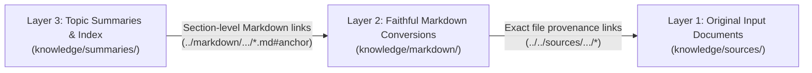

# Menopause Clinical Knowledge Base — Master Topic Index (`Layer 3`)

Welcome to **Layer 3 (`knowledge/summaries/`)** of the clinical knowledge base for the **Menopause Care Clinical Decision Support Web App**.

## Three-Layer Traceability Architecture

Every clinical rule, dosing threshold, and algorithm decision in this project follows a strict **three-layer provenance chain** where **each layer points explicitly to its reference in the previous layer**:

1. **`knowledge/sources/` (Layer 1 — Original Input Files):** All **40** canonical source documents (`DOCX`, `PDF`, `PPTX`, `JPEG`, `HTML`) organized into `red-whale/` (19) and `magid-course/` (21).
2. **`knowledge/markdown/` (Layer 2 — Markdown Conversions):** **40** 1-to-1 high-fidelity Markdown conversions (preserving original language, GFM tables, speaker/slide content, embedded flowcharts, and OCR of scanned pages), each linking at the top to its exact Layer 1 source file.
3. **`knowledge/summaries/` (Layer 3 — Topic Summaries & Master Index):** **10** domain-specific clinical & design synthesis guides plus this `INDEX.md`, with every clinical claim linking directly to the exact Layer 2 Markdown document and section heading.

---

## 1. Specific Clinical & Design Topic Summaries (`knowledge/summaries/`)

| # | Topic Summary File | Clinical Scope & Key Guidelines Covered | App Workflow Stage |
| :--- | :--- | :--- | :--- |
| **01** | [`01-diagnosis-staging-and-straw10.md`](01-diagnosis-staging-and-straw10.md) | HPO axis, LOOP cycles, `STRAW+10` (`-3b` to `+2`) + 2025 IMS `-3a` symptom update, clinical diagnosis `≥45y` vs. `FSH` rules (`40–44y`, `<40y` POI, `≥50y` on POP/IUS), IMS 19-item symptom clusters & thyroid/anemia differentials | **Stage 1** |
| **02** | [`02-initial-assessment-screening-and-completeness-gate.md`](02-initial-assessment-screening-and-completeness-gate.md) | First-visit anamnesis, **IMS 19-item longitudinal symptom & importance questionnaire (`0–4`)**, female reproductive CV enhancers, **IMA Israeli Preventive Medicine & Health Basket (`סל הבריאות`)** screening, contraindications & **Completeness Gate** | **Stage 1** |
| **03** | [`03-systemic-mht-regimens-routes-and-dosing.md`](03-systemic-mht-regimens-routes-and-dosing.md) | `ET` vs. `sHRT` vs. `ccHRT` (incl. post-hysterectomy endometriosis & switching `sHRT → ccHRT`), transdermal vs. oral PK & selection rules, `rBHRT` vs. `CEE` vs. `cBHRT` vs. `Tibolone` vs. `Duavive`, and **BMS/IMS Estradiol Dose-Equivalence Tiers** | **Stage 2 & Mod H** |
| **04** | [`04-progestogen-selection-and-endometrial-protection.md`](04-progestogen-selection-and-endometrial-protection.md) | Steroid receptor pharmacology (`PR`/`AR`/`MR`/`GR`/`GABA-A`), safety comparison (`Utrogestan`, `Duphaston`, `Mirena` 5-yr rule, `NETA`, `Drospirenone`, `MPA`, `Duavive`), **proportional progestogen dosing by E2 tier**, POP pitfalls & vaginal MP caveats | **Stage 2 & Mod H** |
| **05** | [`05-cardiovascular-vte-and-metabolic-risk.md`](05-cardiovascular-vte-and-metabolic-risk.md) | Vascular timing hypothesis (`<60y` / `<10y` post-FMP), **Nov 2025 FDA boxed-warning removal**, **MDCalc #10491 `AHA PREVENT™`** & Traffic-Light `ASCVD` risk tiers (`<5%` / `5–10%` / `≥10%`), `VTE`/thrombophilia rules, and **BMS 2024 Post-MI HRT** guidance | **Stage 1, 2 & Mod H** |
| **06** | [`06-cancer-risks-osteoporosis-and-brca-carriers.md`](06-cancer-risks-osteoporosis-and-brca-carriers.md) | Breast cancer risk (`WHI 20y`, `Lancet 2019`, `Vinogradova 2020`: ET vs. E+P, MP/dydrogesterone vs. synthetic progestins & `Mirena`), endometrial/ovarian/cervical/CRC risks, **Osteoporosis (`FRAX`/`DXA`)**, and **`BRCA1/2` post-RRBSO MHT** | **Stage 1, 2 & Mod H** |
| **07** | [`07-poi-early-menopause-and-contraception.md`](07-poi-early-menopause-and-contraception.md) | **2024 ASRM/ESHRE/IMS POI Guideline** (`3.5–3.7%` prevalence, single `FSH >25 IU/L`, karyotype + `FMR1` + `21-OHAb` + `DXA`, high-dose physiological E2 until `51–52y`, spontaneous ovulation) & **Perimenopausal Contraception** (`Mirena` 55y vs. 5y MHT rule, `CHC` to 50y, `POP` `FSH >30` rule) | **Stage 1, 2 & 3** |
| **08** | [`08-gsm-sexual-health-and-non-hormonal-therapies.md`](08-gsm-sexual-health-and-non-hormonal-therapies.md) | Local `GSM` (`Vagifem`, `Ovestin`, `Intrarosa`, `Ospemifene`, breast cancer `tamoxifen` vs. `AI` rules), **transdermal testosterone for `HSDD`**, and **Non-Hormonal VMS/Sleep/Mood Care** (`Fezolinetant` & `Elinzanetant` NK antagonists + LFT rules, `SSRI`/`SNRI` `CYP2D6` rule, `Gabapentin`, `CBT`) | **Stage 2 & 3** |
| **09** | [`09-unscheduled-bleeding-side-effects-interactions-and-stopping.md`](09-unscheduled-bleeding-side-effects-interactions-and-stopping.md) | **BMS 2024 / Dr. Freiberg Unscheduled Bleeding Algorithm** (`6m`/`3m` windows, Major vs. Minor risk factors, `TVS` `≤4mm` ccHRT / `≤7mm` sHRT / `≤10mm` asymptomatic), side-effect troubleshooting, **BMS 2025 `GLP-1`/`Lamotrigine`/`Levothyroxine` interactions**, and tapering/stopping | **Stage 3 & Mod H** |
| **10** | [`10-israeli-formulary-clinical-cases-and-design-alignment.md`](10-israeli-formulary-clinical-cases-and-design-alignment.md) | Unified **Israeli Menopause Formulary** (`Estrofem`, `Evorel`, `Estrogel`, `Utrogestan`, `Duphaston`, `Femoston`, `Activelle`, `Eviana`, `Angeliq`, `Evorel Conti`, `Mirena`, `Duavive`, `Livial`, `Veoza`), lessons from **9 Magid clinical cases**, and **11 actionable clinical-engine design upgrades** | **All Stages & Architecture** |

---

## 2. Quick Clinical Workflow Lookup Map

* **Stage 1 — Initial Visit, Staging, Risk Calculators & Completeness Gate:**
  * Primary Layer 2 clinical checklists, questionnaires & calculators: [`menopause-intake-anamnesis-checklist.md`](../markdown/magid-course/menopause-intake-anamnesis-checklist.md) · [`israeli-menopause-society-symptoms-quiz.md`](../markdown/magid-course/israeli-menopause-society-symptoms-quiz.md) · [`menopause-staging-and-diagnosis-shaklai.md`](../markdown/magid-course/menopause-staging-and-diagnosis-shaklai.md) · [`ima-preventive-medicine-guidelines-2022.md`](../markdown/magid-course/ima-preventive-medicine-guidelines-2022.md) · [`mdcalc-10491-aha-prevent-calculator.md`](../markdown/magid-course/mdcalc-10491-aha-prevent-calculator.md)
  * Clinical syntheses: [Topic 01 (Diagnosis & STRAW+10)](01-diagnosis-staging-and-straw10.md) · [Topic 02 (Anamnesis, Israeli Screening & Gate)](02-initial-assessment-screening-and-completeness-gate.md) · [Topic 05 (CV/VTE Risk)](05-cardiovascular-vte-and-metabolic-risk.md) · [Topic 07 (POI & Contraception)](07-poi-early-menopause-and-contraception.md)
* **Stage 2 — Regimen Formulation, Route, Progestogen, GSM & Non-Hormonal Options:**
  * Primary Layer 2 clinical algorithms: [`menopause-mht-treatment-renana-teomim.md`](../markdown/magid-course/menopause-mht-treatment-renana-teomim.md) · [`progestogen-selection-in-mht-srebnik.md`](../markdown/magid-course/progestogen-selection-in-mht-srebnik.md) · [`05-hrt-regimens-and-progestogen-doses.md`](../markdown/red-whale/05-hrt-regimens-and-progestogen-doses.md) · [`acog-cpg-13-vasomotor-sleep-mood-2026.md`](../markdown/magid-course/acog-cpg-13-vasomotor-sleep-mood-2026.md)
  * Clinical syntheses: [Topic 03 (Regimens, Routes & E2 Dosing)](03-systemic-mht-regimens-routes-and-dosing.md) · [Topic 04 (Progestogens & Dose Matching)](04-progestogen-selection-and-endometrial-protection.md) · [Topic 06 (Cancers, Bone & BRCA)](06-cancer-risks-osteoporosis-and-brca-carriers.md) · [Topic 08 (GSM, Testosterone & Non-Hormonal)](08-gsm-sexual-health-and-non-hormonal-therapies.md) · [Topic 10 (Israeli Formulary)](10-israeli-formulary-clinical-cases-and-design-alignment.md)
* **Stage 3 — Longitudinal Follow-Up, Unscheduled Bleeding, Side Effects & Cessation:**
  * Primary Layer 2 clinical algorithms & tracking scales: [`israeli-menopause-society-symptoms-quiz.md`](../markdown/magid-course/israeli-menopause-society-symptoms-quiz.md) · [`bleeding-and-side-effects-under-mht-freiberg.md`](../markdown/magid-course/bleeding-and-side-effects-under-mht-freiberg.md) · [`11-problematic-bleeding-on-hrt.md`](../markdown/red-whale/11-problematic-bleeding-on-hrt.md) · [`14-drug-interactions-with-hrt.md`](../markdown/red-whale/14-drug-interactions-with-hrt.md) · [`04-hrt-starting-troubleshooting-stopping.md`](../markdown/red-whale/04-hrt-starting-troubleshooting-stopping.md)
  * Clinical syntheses: [Topic 09 (Bleeding, Side Effects, GLP-1 Interactions & Stopping)](09-unscheduled-bleeding-side-effects-interactions-and-stopping.md) · [Topic 10 (Clinical Cases & Engine Upgrades)](10-israeli-formulary-clinical-cases-and-design-alignment.md)
* **Module H — Physician Quick-Reference Card:**
  * Rapid visual tables in Layer 2: [`gems-menopause-and-hrt-treatment.md`](../markdown/red-whale/gems-menopause-and-hrt-treatment.md) · [`gems-hrt-troubleshooting-and-availability.md`](../markdown/red-whale/gems-hrt-troubleshooting-and-availability.md) · [`menopause-mht-treatment-renana-teomim.md` §Slide 20](../markdown/magid-course/menopause-mht-treatment-renana-teomim.md#slide-20-acog-systemic-mht-options--israeli-equivalents--טבלת-acog-והתאמה-לתכשירים-בישראל) · [`progestogen-selection-in-mht-srebnik.md` §Slide 39](../markdown/magid-course/progestogen-selection-in-mht-srebnik.md#slide-39-practical-clinical-comparison-of-progestogens-in-israel--טבלת-השוואה-קלינית-מסכמת)

---

## 3. Complete Registry of All 40 Layer 2 Documents (Each Linking to Layer 1)

### A. Red Whale Clinical Guidelines & Hebrew Summaries (`knowledge/markdown/red-whale/`) — 19 Documents

| # | Layer 2 Markdown Reference | Author / Source & Date | Lang | Primary Layer 3 Topics |
| :--- | :--- | :--- | :--- | :--- |
| 1 | [`red-whale/01-approaching-and-diagnosing-menopause.md`](../markdown/red-whale/01-approaching-and-diagnosing-menopause.md) | Red Whale #1 (Nov 2024) | `en` | [01](01-diagnosis-staging-and-straw10.md), [07](07-poi-early-menopause-and-contraception.md) |
| 2 | [`red-whale/02-nice-guideline-menopause-2024.md`](../markdown/red-whale/02-nice-guideline-menopause-2024.md) | Red Whale #2 — NICE NG23 (Dec 2024) | `en` | [01](01-diagnosis-staging-and-straw10.md), [05](05-cardiovascular-vte-and-metabolic-risk.md), [06](06-cancer-risks-osteoporosis-and-brca-carriers.md), [08](08-gsm-sexual-health-and-non-hormonal-therapies.md) |
| 3 | [`red-whale/03-different-types-of-hrt.md`](../markdown/red-whale/03-different-types-of-hrt.md) | Red Whale #3 (Nov 2024) | `en` | [03](03-systemic-mht-regimens-routes-and-dosing.md), [04](04-progestogen-selection-and-endometrial-protection.md) |
| 4 | [`red-whale/04-hrt-starting-troubleshooting-stopping.md`](../markdown/red-whale/04-hrt-starting-troubleshooting-stopping.md) | Red Whale #4 (Dec 2024) | `en` | [02](02-initial-assessment-screening-and-completeness-gate.md), [03](03-systemic-mht-regimens-routes-and-dosing.md), [09](09-unscheduled-bleeding-side-effects-interactions-and-stopping.md) |
| 5 | [`red-whale/05-hrt-regimens-and-progestogen-doses.md`](../markdown/red-whale/05-hrt-regimens-and-progestogen-doses.md) | Red Whale #5 (June 2025) | `en` | [03](03-systemic-mht-regimens-routes-and-dosing.md), [04](04-progestogen-selection-and-endometrial-protection.md) |
| 6 | [`red-whale/06-hrt-availability-switching-off-licence.md`](../markdown/red-whale/06-hrt-availability-switching-off-licence.md) | Red Whale #6 + Embedded GEMS (June 2025 / Oct 2026) | `en` | [01](01-diagnosis-staging-and-straw10.md), [03](03-systemic-mht-regimens-routes-and-dosing.md), [04](04-progestogen-selection-and-endometrial-protection.md), [07](07-poi-early-menopause-and-contraception.md) |
| 7 | [`red-whale/07-hrt-and-breast-cancer-risk.md`](../markdown/red-whale/07-hrt-and-breast-cancer-risk.md) | Red Whale #7 (June 2025) | `en` | [04](04-progestogen-selection-and-endometrial-protection.md), [06](06-cancer-risks-osteoporosis-and-brca-carriers.md) |
| 8 | [`red-whale/08-hrt-and-risk-of-vte.md`](../markdown/red-whale/08-hrt-and-risk-of-vte.md) | Red Whale #8 (July 2025) | `en` | [03](03-systemic-mht-regimens-routes-and-dosing.md), [04](04-progestogen-selection-and-endometrial-protection.md), [05](05-cardiovascular-vte-and-metabolic-risk.md) |
| 9 | [`red-whale/10-hrt-and-osteoporosis.md`](../markdown/red-whale/10-hrt-and-osteoporosis.md) | Red Whale #10 (Aug 2026) | `en` | [02](02-initial-assessment-screening-and-completeness-gate.md), [06](06-cancer-risks-osteoporosis-and-brca-carriers.md), [07](07-poi-early-menopause-and-contraception.md) |
| 10 | [`red-whale/11-problematic-bleeding-on-hrt.md`](../markdown/red-whale/11-problematic-bleeding-on-hrt.md) | Red Whale #11 + BMS Flowcharts (May 2026) | `en` | [09](09-unscheduled-bleeding-side-effects-interactions-and-stopping.md), [10](10-israeli-formulary-clinical-cases-and-design-alignment.md) |
| 11 | [`red-whale/12-hrt-gynaecological-and-other-cancers.md`](../markdown/red-whale/12-hrt-gynaecological-and-other-cancers.md) | Red Whale #12 (June 2025) | `en` | [06](06-cancer-risks-osteoporosis-and-brca-carriers.md) |
| 12 | [`red-whale/13-hrt-primary-prevention-chronic-disease.md`](../markdown/red-whale/13-hrt-primary-prevention-chronic-disease.md) | Red Whale #13 | `en` | [03](03-systemic-mht-regimens-routes-and-dosing.md), [06](06-cancer-risks-osteoporosis-and-brca-carriers.md) |
| 13 | [`red-whale/14-drug-interactions-with-hrt.md`](../markdown/red-whale/14-drug-interactions-with-hrt.md) | Red Whale #14 — GLP-1 & AEDs (Aug 2025) | `en` | [02](02-initial-assessment-screening-and-completeness-gate.md), [03](03-systemic-mht-regimens-routes-and-dosing.md), [09](09-unscheduled-bleeding-side-effects-interactions-and-stopping.md) |
| 14 | [`red-whale/gems-hrt-troubleshooting-and-availability.md`](../markdown/red-whale/gems-hrt-troubleshooting-and-availability.md) | Red Whale GEMS Visual Guide (Feb 2026) | `en` | [03](03-systemic-mht-regimens-routes-and-dosing.md), [04](04-progestogen-selection-and-endometrial-protection.md) |
| 15 | [`red-whale/gems-menopause-and-hrt-treatment.md`](../markdown/red-whale/gems-menopause-and-hrt-treatment.md) | Red Whale GEMS Overview & Decision Tree (Feb 2026) | `en` | [02](02-initial-assessment-screening-and-completeness-gate.md), [03](03-systemic-mht-regimens-routes-and-dosing.md) |
| 16 | [`red-whale/hebrew-summary-diagnosis-red-whale.md`](../markdown/red-whale/hebrew-summary-diagnosis-red-whale.md) | Red Whale Ch. 1 Hebrew Summary | `he` | [01](01-diagnosis-staging-and-straw10.md) |
| 17 | [`red-whale/hebrew-summary-menopause-treatment.md`](../markdown/red-whale/hebrew-summary-menopause-treatment.md) | Red Whale Ch. 3–4 Hebrew Summary | `he` | [03](03-systemic-mht-regimens-routes-and-dosing.md), [09](09-unscheduled-bleeding-side-effects-interactions-and-stopping.md), [10](10-israeli-formulary-clinical-cases-and-design-alignment.md) |
| 18 | [`red-whale/hebrew-summary-hrt-and-progesterone.md`](../markdown/red-whale/hebrew-summary-hrt-and-progesterone.md) | Red Whale Ch. 5 Hebrew Summary | `he` | [03](03-systemic-mht-regimens-routes-and-dosing.md), [04](04-progestogen-selection-and-endometrial-protection.md), [09](09-unscheduled-bleeding-side-effects-interactions-and-stopping.md) |
| 19 | [`red-whale/hebrew-summary-perimenopause-contraception.md`](../markdown/red-whale/hebrew-summary-perimenopause-contraception.md) | Perimenopausal Contraception Hebrew Summary | `he` | [01](01-diagnosis-staging-and-straw10.md), [07](07-poi-early-menopause-and-contraception.md) |

### B. Magid Practical Menopause Course & Major Clinical Guidelines (`knowledge/markdown/magid-course/`) — 21 Documents

| # | Layer 2 Markdown Reference | Author / Guideline Body & Date | Lang | Primary Layer 3 Topics |
| :--- | :--- | :--- | :--- | :--- |
| 20 | [`magid-course/menopause-staging-and-diagnosis-shaklai.md`](../markdown/magid-course/menopause-staging-and-diagnosis-shaklai.md) | Dr. Sigal Shaklai — Staging & STRAW+10 (2026) | `he+en` | [01](01-diagnosis-staging-and-straw10.md), [10](10-israeli-formulary-clinical-cases-and-design-alignment.md) |
| 21 | [`magid-course/menopause-intake-anamnesis-checklist.md`](../markdown/magid-course/menopause-intake-anamnesis-checklist.md) | Magid Course Intake Anamnesis Checklist | `he` | [01](01-diagnosis-staging-and-straw10.md), [02](02-initial-assessment-screening-and-completeness-gate.md) |
| 22 | [`magid-course/israeli-menopause-society-symptoms-quiz.md`](../markdown/magid-course/israeli-menopause-society-symptoms-quiz.md) | Israeli Menopause Society (IMS) 19-Item Longitudinal Symptom Quiz (`MRS` / Modified Greene; originally downloaded from [menopause.org.il](https://www.menopause.org.il/news-updates/%d7%a9%d7%90%d7%9c%d7%95%d7%9f-%d7%a1%d7%99%d7%9e%d7%a4%d7%98%d7%95%d7%9e%d7%99%d7%9d/)) | `he` | [01](01-diagnosis-staging-and-straw10.md), [02](02-initial-assessment-screening-and-completeness-gate.md), [10](10-israeli-formulary-clinical-cases-and-design-alignment.md) |
| 23 | [`magid-course/menopause-mht-treatment-renana-teomim.md`](../markdown/magid-course/menopause-mht-treatment-renana-teomim.md) | Dr. Renana Teomim — MHT Treatment & Israeli Drugs (2026) | `he+en` | [02](02-initial-assessment-screening-and-completeness-gate.md), [03](03-systemic-mht-regimens-routes-and-dosing.md), [04](04-progestogen-selection-and-endometrial-protection.md), [09](09-unscheduled-bleeding-side-effects-interactions-and-stopping.md), [10](10-israeli-formulary-clinical-cases-and-design-alignment.md) |
| 24 | [`magid-course/progestogen-selection-in-mht-srebnik.md`](../markdown/magid-course/progestogen-selection-in-mht-srebnik.md) | Dr. Naama Srebnik — Progestogen Selection in MHT (2026) | `he+en` | [04](04-progestogen-selection-and-endometrial-protection.md), [05](05-cardiovascular-vte-and-metabolic-risk.md), [06](06-cancer-risks-osteoporosis-and-brca-carriers.md) |
| 25 | [`magid-course/mht-in-brca-carriers-srebnik.md`](../markdown/magid-course/mht-in-brca-carriers-srebnik.md) | Dr. Naama Srebnik — MHT in BRCA Carriers (2026) | `he+en` | [01](01-diagnosis-staging-and-straw10.md), [03](03-systemic-mht-regimens-routes-and-dosing.md), [06](06-cancer-risks-osteoporosis-and-brca-carriers.md), [08](08-gsm-sexual-health-and-non-hormonal-therapies.md), [10](10-israeli-formulary-clinical-cases-and-design-alignment.md) |
| 26 | [`magid-course/bleeding-and-side-effects-under-mht-freiberg.md`](../markdown/magid-course/bleeding-and-side-effects-under-mht-freiberg.md) | Dr. Merav Freiberg — Bleeding & Side Effects Under MHT (Sept 2026) | `he+en` | [09](09-unscheduled-bleeding-side-effects-interactions-and-stopping.md), [10](10-israeli-formulary-clinical-cases-and-design-alignment.md) |
| 27 | [`magid-course/practical-menopause-course-session5-cases.md`](../markdown/magid-course/practical-menopause-course-session5-cases.md) | Magid Course Session 5 — 9 Clinical Cases (Nov 2026) | `he` | [01](01-diagnosis-staging-and-straw10.md), [02](02-initial-assessment-screening-and-completeness-gate.md), [04](04-progestogen-selection-and-endometrial-protection.md), [07](07-poi-early-menopause-and-contraception.md), [10](10-israeli-formulary-clinical-cases-and-design-alignment.md) |
| 28 | [`magid-course/acog-cpg-13-vasomotor-sleep-mood-2026.md`](../markdown/magid-course/acog-cpg-13-vasomotor-sleep-mood-2026.md) | ACOG Clinical Practice Guideline No. 13 (Nov 2026) | `en` | [01](01-diagnosis-staging-and-straw10.md), [02](02-initial-assessment-screening-and-completeness-gate.md), [03](03-systemic-mht-regimens-routes-and-dosing.md), [05](05-cardiovascular-vte-and-metabolic-risk.md), [08](08-gsm-sexual-health-and-non-hormonal-therapies.md), [09](09-unscheduled-bleeding-side-effects-interactions-and-stopping.md) |
| 29 | [`magid-course/bms-consensus-non-hormonal-treatments-2026.md`](../markdown/magid-course/bms-consensus-non-hormonal-treatments-2026.md) | BMS Consensus: Non-Hormonal Treatments (July 2026) | `en` | [08](08-gsm-sexual-health-and-non-hormonal-therapies.md), [10](10-israeli-formulary-clinical-cases-and-design-alignment.md) |
| 30 | [`magid-course/bms-hrt-after-myocardial-infarction-2024.md`](../markdown/magid-course/bms-hrt-after-myocardial-infarction-2024.md) | BMS Tool for Clinicians: HRT After MI (March 2024) | `en` | [02](02-initial-assessment-screening-and-completeness-gate.md), [03](03-systemic-mht-regimens-routes-and-dosing.md), [05](05-cardiovascular-vte-and-metabolic-risk.md) |
| 31 | [`magid-course/asrm-eshre-ims-poi-guideline-2024.md`](../markdown/magid-course/asrm-eshre-ims-poi-guideline-2024.md) | ASRM / ESHRE / CREWHIRL / IMS POI Guideline (Dec 2024) | `en` | [01](01-diagnosis-staging-and-straw10.md), [03](03-systemic-mht-regimens-routes-and-dosing.md), [07](07-poi-early-menopause-and-contraception.md), [08](08-gsm-sexual-health-and-non-hormonal-therapies.md) |
| 32 | [`magid-course/nejm-clinical-practice-poi-stuenkel-2023.md`](../markdown/magid-course/nejm-clinical-practice-poi-stuenkel-2023.md) | Stuenkel & Gompel — NEJM Primary Ovarian Insufficiency (2023) | `en` | [01](01-diagnosis-staging-and-straw10.md), [07](07-poi-early-menopause-and-contraception.md) |
| 33 | [`magid-course/ima-preventive-medicine-guidelines-2022.md`](../markdown/magid-course/ima-preventive-medicine-guidelines-2022.md) | IMA Israeli Preventive Medicine Task Force Guidelines (Oct 2022) | `he` | [01](01-diagnosis-staging-and-straw10.md), [02](02-initial-assessment-screening-and-completeness-gate.md), [05](05-cardiovascular-vte-and-metabolic-risk.md), [06](06-cancer-risks-osteoporosis-and-brca-carriers.md), [10](10-israeli-formulary-clinical-cases-and-design-alignment.md) |
| 34 | [`magid-course/mdcalc-10491-aha-prevent-calculator.md`](../markdown/magid-course/mdcalc-10491-aha-prevent-calculator.md) | MDCalc #10491: AHA PREVENT™ 10/30-Yr CVD Calculator (2024–2026) | `en` | [02](02-initial-assessment-screening-and-completeness-gate.md), [05](05-cardiovascular-vte-and-metabolic-risk.md), [10](10-israeli-formulary-clinical-cases-and-design-alignment.md) |
| 35 | [`magid-course/slide-cv-risk-stratification-cho-2023.md`](../markdown/magid-course/slide-cv-risk-stratification-cho-2023.md) | Slide: CV Risk Traffic Light — Cho et al., *Circulation* 2023 | `he+en` | [05](05-cardiovascular-vte-and-metabolic-risk.md) |
| 36 | [`magid-course/slide-cv-risk-evaluation-okelly-2022.md`](../markdown/magid-course/slide-cv-risk-evaluation-okelly-2022.md) | Slide: 4-Step CV Evaluation — O'Kelly et al., *Circ Res* 2022 | `he+en` | [02](02-initial-assessment-screening-and-completeness-gate.md), [03](03-systemic-mht-regimens-routes-and-dosing.md), [05](05-cardiovascular-vte-and-metabolic-risk.md) |
| 37 | [`magid-course/slide-cv-risk-calculators-aha-prevent-2026.md`](../markdown/magid-course/slide-cv-risk-calculators-aha-prevent-2026.md) | Slide: AHA PREVENT Equation — Karam et al., *Obstet Gynecol* 2026 | `he+en` | [05](05-cardiovascular-vte-and-metabolic-risk.md), [10](10-israeli-formulary-clinical-cases-and-design-alignment.md) |
| 38 | [`magid-course/slide-progestogen-endometrial-protection-doses-davis-2023.md`](../markdown/magid-course/slide-progestogen-endometrial-protection-doses-davis-2023.md) | Slide: Progestogen Endometrial Dosing — Davis et al., *Climacteric* 2023 | `en` | [04](04-progestogen-selection-and-endometrial-protection.md), [10](10-israeli-formulary-clinical-cases-and-design-alignment.md) |
| 39 | [`magid-course/slide-mht-estrogen-dosing-equivalence-davis-2023.md`](../markdown/magid-course/slide-mht-estrogen-dosing-equivalence-davis-2023.md) | Slide: Estrogen Dosing Equivalence — Davis et al., *Climacteric* 2023 | `en` | [03](03-systemic-mht-regimens-routes-and-dosing.md) |
| 40 | [`magid-course/slide-systemic-mht-options-israeli-annotations-2026.md`](../markdown/magid-course/slide-systemic-mht-options-israeli-annotations-2026.md) | Slide: ACOG Systemic MHT Options + Israeli Formulary Annotations (2026) | `en` | [10](10-israeli-formulary-clinical-cases-and-design-alignment.md) |
